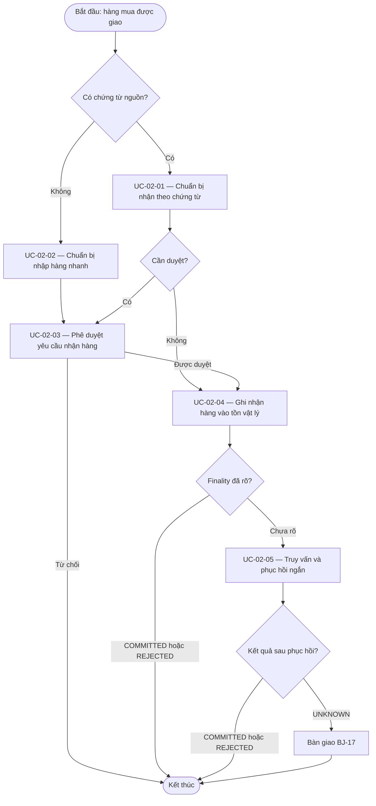

# BJ-02 — Nhận hàng mua

## 1. Tổng quan nghiệp vụ & Bối cảnh

Ghi đúng hàng mua thực tế đã đến và thuộc quyền sở hữu của đơn vị, theo **một nhà cung cấp cho mỗi receipt**, hỗ trợ nhiều sản phẩm, nhiều đơn vị giao dịch và nhiều lô khi áp dụng. Nhập hàng nhanh chỉ bỏ bước chọn chứng từ mua; không bỏ master-data, tracking, approval, ownership hoặc idempotency guard.

Một chứng từ/source line có thể được nhận qua **nhiều receipt**. Nhận thiếu là kết quả hợp lệ; phần chưa nhận tiếp tục thuộc nguồn mua và có thể được nhận ở lần sau. Theme 7 dùng `remaining_receivable_qty` authoritative do nguồn cung cấp, không tự suy phần còn nhận từ số đặt ban đầu trừ lịch sử receipt cục bộ.

**Bắt đầu khi:** Hàng mua thực tế được giao đến.

**Kết thúc khi:** Kết quả ghi nhận tồn vật lý đã rõ; hoặc hồ sơ dừng/chờ mà không tạo tác động bán phần.

**Không bao gồm:** Giá trị nhập chính thức, công nợ nhà cung cấp, payment hoặc quyền lợi thương mại; liên kết Quick Receipt với PO phát sinh sau (đối soát thuộc Theme 10).

## 2. Tác nhân và trách nhiệm

| Tác nhân | Trách nhiệm | Phạm vi thẩm quyền |
|---|---|---|
| Thủ kho | Ghi nhận hàng thực nhận theo chứng từ và chênh lệch giao nhận theo đúng nguồn/version. | Không sửa chứng từ nguồn; khi lượng accepted physical vượt tolerance/ngưỡng của source theo ApprovalPolicy thì bàn giao người duyệt, người lập không tự duyệt. |
| Thủ kho hoặc người có quyền lập hồ sơ nhận hàng nhanh | Lập Quick Receipt với Supplier/Product/UOM và bằng chứng giao nhận hợp lệ. | Không tạo PO giả; Quick Receipt luôn đi đúng approval policy trước khi ghi tồn. |
| Người có quyền và cấp phê duyệt phù hợp, khác người lập | Duyệt hoặc từ chối yêu cầu nhận hàng trên snapshot/bằng chứng hiện hành. | Không sửa payload của người lập; từ chối phải có lý do. |
| Hệ thống; Thủ kho/adapter khi truy vấn kết quả | Hệ thống tự thực thi receipt khi operation đã `READY`; Thủ kho/adapter chỉ truy vấn/phục hồi ngắn khi finality chưa rõ. | Không có CTA người dùng để commit lại receipt; retry/query phải giữ cùng operation/idempotency identity và không tạo movement thứ hai. |

## 3. Sơ đồ hành trình nghiệp vụ

**Điều kiện `Cần duyệt?` của nhánh nhận theo chứng từ:** trong phạm vi đã chốt hiện tại, hồ sơ chuyển phê duyệt khi **cumulative accepted physical quantity** (`Đạt + Cách ly + Hỏng`, quy đổi về base UOM) vượt tolerance/ngưỡng của `remaining_receivable_qty` theo ApprovalPolicy. Ngoài điều kiện này, chưa có Decision nào định nghĩa thêm trigger approval cho Document Receipt. Căn cứ: `T7-DR-022`, `T7-DR-116`, `T7-DR-078`, `T7-DR-080`.

## 4. Bản đồ Use Case

| UC — Tên | Mục tiêu | Tác nhân | Đầu vào / Bắt đầu khi | Kết quả | Tiếp tục |
|---|---|---|---|---|---|
| [UC-02-01](../use-cases/UC-02-01-chuan-bi-nhan-theo-chung-tu.md) — Chuẩn bị nhận theo chứng từ | Ghi đúng lượng thực nhận so với dòng chứng từ và version nguồn. | Thủ kho | Chứng từ nguồn hợp lệ được chọn | `READY` nếu không vượt ngưỡng; `PENDING_APPROVAL` nếu accepted physical vượt tolerance/ngưỡng theo policy. | UC-02-03 nếu cần duyệt; UC-02-04 nếu `READY` |
| [UC-02-02](../use-cases/UC-02-02-chuan-bi-nhap-hang-nhanh.md) — Chuẩn bị nhập hàng nhanh | Lập hồ sơ nhận cho hàng đã đến khi chưa có chứng từ mua phù hợp. | Thủ kho hoặc người có quyền lập hồ sơ nhận hàng nhanh | Hàng đã đến, chưa có chứng từ mua phù hợp và chính sách cho phép lập hồ sơ nhanh | Hồ sơ nhận nhanh được lưu với định danh nguồn/bằng chứng tối thiểu và version bị khóa khi gửi; Operation chuyển sang `PENDING_APPROVAL`; chưa tạo movement hoặc tăng tồn vật lý. | UC-02-03 |
| [UC-02-03](../use-cases/UC-02-03-phe-duyet-yeu-cau-nhan-hang.md) — Phê duyệt yêu cầu nhận hàng | Ra quyết định độc lập với người lập, trên snapshot đã khóa. | Người có quyền và cấp phê duyệt phù hợp, khác người lập | Hồ sơ nhập hàng nhanh đã gửi hoặc hồ sơ nhận theo chứng từ vượt tolerance/ngưỡng cần duyệt | Chấp thuận: operation được phép chuyển sang `READY`, nhưng chưa tạo movement; Từ chối: bắt buộc có lý do, kết thúc yêu cầu mà không thay đổi tồn. | UC-02-04 |
| [UC-02-04](../use-cases/UC-02-04-ghi-nhan-hang-vao-ton-vat-ly.md) — Ghi nhận hàng vào tồn vật lý | Hệ thống commit nguyên tử operation đã `READY`. | Hệ thống | Operation đã `READY` và các guard còn hợp lệ | `COMMITTED`, `REJECTED` hoặc `UNKNOWN`; nếu commit thì movement/balance/lot, `VALUATION_PENDING` và outbox được ghi đúng một lần. | UC-02-05 chỉ khi finality chưa rõ |
| [UC-02-05](../use-cases/UC-02-05-truy-van-va-phuc-hoi-ngan-ket-qua-nhan-hang.md) — Truy vấn và phục hồi ngắn kết quả nhận hàng | Xác định finality của đúng operation đã gửi mà không thực hiện lại nhận hàng | Thủ kho; adapter nhận hàng | Đã có operation identity nhưng response/finality chưa rõ | COMMITTED/REJECTED được xác định hoặc UNKNOWN được bàn giao BJ17 | Kết thúc BJ02 hoặc BJ17 |

## 5. Bàn giao và ranh giới liên quan

| Nơi nhận / Nơi cung cấp | Dữ kiện hoặc trách nhiệm bàn giao | Điều kiện bàn giao / tiếp tục |
|---|---|---|
| Theme 10 / nguồn mua → BJ02 | Chứng từ mua, Supplier, `source_line_id/version`, `remaining_receivable_qty`, transaction UOM và conversion snapshot nếu nhận theo chứng từ | Nguồn đủ hợp lệ để nhận; Quick không phụ thuộc Theme 10 |
| BJ02 → Theme 10 / reporting | Fact `EVT-IO-01` về receipt đã commit, gồm source-line lineage, lượng thực nhận theo UOM, kho và ngày nhận | **Chỉ khi `COMMITTED`**; đây là integration fact đã xảy ra, không phải command yêu cầu Theme 10 cập nhật PO |
| BJ03 | Receipt item/quantity đã commit, UOM/LOT/state và source lineage; lượng tương ứng ở `VALUATION_PENDING` | **Chỉ khi `effect_status=COMMITTED` / `GoodsReceipt=COMPLETED`**; `REJECTED` và `UNKNOWN` không được kích hoạt BJ03 |
| BJ17 | Cùng operation identity, fingerprint và evidence/finality refs của receipt chưa xác định | Sau cửa sổ phục hồi ngắn của UC-02-05 vẫn là `UNKNOWN`; không tạo receipt mới |

## 6. Liên kết thiết kế

[UIF-02 — Nhận hàng mua](../../../03.design/flows/UIF-02-BJ-02.md) sở hữu routing giữa các màn hình, điểm vào/kết thúc và state hiển thị; chi tiết màn hình nằm tại `03.design/screens/`.

## 7. Nghiệm thu hành trình (Journey Acceptance)

| ID | Điều kiện ở cấp hành trình | Kết quả cần bảo đảm | UC / BC liên quan |
|---|---|---|---|
| JA-01 | Journey bắt đầu từ đúng trigger và actor có quyền | Kết quả chỉ được ghi trong phạm vi authority của Theme 7; source ngoài Theme không bị sửa ngầm | UC-02-01 / BC liên quan |
| JA-02 | Một nhánh bị từ chối, blocked hoặc chưa xác định | Không được báo thành công hoặc tạo tác động bán phần; hướng xử lý/owner tiếp theo phải rõ | UC-02-01…UC-02-05 |
| JA-03 | Journey hoàn tất thành công với `COMMITTED` | Receipt/movement có provenance, phần nhận được đưa `VALUATION_PENDING`, fact `EVT-IO-01` được ghi cùng outbox và BJ03 chỉ nhận đúng quantity đã commit | UC-02-04 / BC-IO-02 / EVT-IO-01 |
| JA-04 | Nhận thiếu hoặc nhận nhiều lần cho cùng source line | Receipt hiện tại được commit độc lập; phần chưa nhận không bị coi là đã hoàn tất và lần sau dùng `remaining_receivable_qty` authoritative mới nhất của source | UC-02-01 / UC-02-04 / T7-DR-022/117 |
| JA-05 | Sau phục hồi ngắn vẫn `UNKNOWN` | Không kích hoạt BJ03, không phát sinh receipt mới; bàn giao BJ17 với cùng identity/evidence | UC-02-05 / BJ-17 |

## 8. Truy vết

| Nguồn | Vai trò đối với hành trình |
|---|---|
| [KB-KGV-007 — Nhận hàng mua và xử lý chênh lệch giao nhận](../../../01.knowledge/know-how/KB-KGV-007-nhan-hang-mua-va-xu-ly-chenh-lech-giao-nhan.md); [KB-KGV-008 — Hàng đã nhận nhưng chưa chốt giá và điều kiện đưa vào bán](../../../01.knowledge/know-how/KB-KGV-008-hang-da-nhan-nhung-chua-chot-gia.md); [KB-KGV-024 — Chọn quản lý thông thường hay quản lý theo lô](../../../01.knowledge/know-how/KB-KGV-024-chinh-sach-quan-ly-hang-thong-thuong-theo-lo-hoac-theo-serial.md); [KB-KGV-025 — Danh tính và vòng đời của một lô hàng](../../../01.knowledge/know-how/KB-KGV-025-danh-tinh-va-vong-doi-cua-mot-lo-hang.md); [KB-KGV-031 — Phê duyệt Inventory Operation theo mức rủi ro](../../../01.knowledge/know-how/KB-KGV-031-phe-duyet-inventory-operation-theo-muc-rui-ro.md) | **Bài tri thức cốt lõi** giúp hiểu nền nghiệp vụ của Journey; rule triển khai vẫn theo Decision/BJ/UC/BC canonical |
| [Decision Register](../../../01.knowledge/decisions/decision-register.md) — G03, G10, G11; trọng tâm `T7-DR-022`, `T7-DR-105`, `T7-DR-116`, `T7-DR-117`, `T7-DR-078`, `T7-DR-080` | Nguồn quyết định cho nhận từng phần/nhận vượt, authority phần còn nhận, approval và finality/recovery |
| `DOM-IO` | Domain authority và invariants dùng cho Journey |
| [Use Case Map](../use-cases/00-use-case-map.md) | Danh mục UC canonical của Theme 7 |
