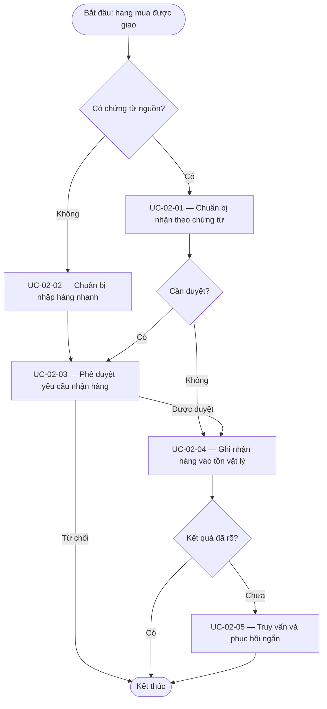

# BJ-02 — Nhận hàng mua

## 1. Tổng quan nghiệp vụ & Bối cảnh

Ghi đúng hàng mua thực tế đã đến và thuộc quyền sở hữu của đơn vị, theo **một nhà cung cấp cho mỗi receipt**, hỗ trợ nhiều sản phẩm, nhiều đơn vị giao dịch và nhiều lô khi áp dụng. Nhập hàng nhanh chỉ bỏ bước chọn chứng từ mua; không bỏ master-data, tracking, approval, ownership hoặc idempotency guard.

**Bắt đầu khi:** Hàng mua thực tế được giao đến.

**Kết thúc khi:** Kết quả ghi nhận tồn vật lý đã rõ; hoặc hồ sơ dừng/chờ mà không tạo tác động bán phần.

**Không bao gồm:** Giá trị nhập chính thức, công nợ nhà cung cấp, payment hoặc quyền lợi thương mại.

## 2. Tác nhân và trách nhiệm

| Tác nhân | Trách nhiệm | Phạm vi thẩm quyền |
|---|---|---|
| Thủ kho; người duyệt khi có ngoại lệ | Ghi nhận hàng thực nhận theo chứng từ và xử lý ngoại lệ giao nhận theo đúng nguồn/version. | Thủ kho không sửa chứng từ nguồn; ngoại lệ cần duyệt phải theo policy và người lập không tự duyệt. |
| Thủ kho hoặc người có quyền lập hồ sơ nhận hàng nhanh | Lập Quick Receipt với Supplier/Product/UOM và bằng chứng giao nhận hợp lệ. | Không tạo PO giả; Quick Receipt luôn đi đúng approval policy trước khi ghi tồn. |
| Người có quyền và cấp phê duyệt phù hợp, khác người lập | Duyệt hoặc từ chối yêu cầu nhận hàng trên snapshot/bằng chứng hiện hành. | Không sửa payload của người lập; từ chối phải có lý do. |
| Thủ kho; adapter nhận hàng | Thực thi/tra cứu kết quả ghi nhận hàng vật lý và phục hồi ngắn khi finality chưa rõ. | Retry phải giữ cùng operation/idempotency identity; không tạo movement thứ hai. |

## 3. Sơ đồ hành trình nghiệp vụ

## 4. Bản đồ Use Case

| UC — Tên | Mục tiêu | Tác nhân | Đầu vào / Bắt đầu khi | Kết quả | Tiếp tục |
|---|---|---|---|---|---|
| [UC-02-01](../use-cases/UC-02-01-chuan-bi-nhan-theo-chung-tu.md) — Chuẩn bị nhận theo chứng từ | Hồ sơ thực nhận sẵn sàng hoặc cần duyệt; Receipt draft gắn source/version. | Thủ kho; người duyệt khi có ngoại lệ | Chứng từ nguồn hợp lệ được chọn | Hồ sơ thực nhận sẵn sàng hoặc cần duyệt; Receipt draft gắn source/version. | UC-02-02 |
| [UC-02-02](../use-cases/UC-02-02-chuan-bi-nhap-hang-nhanh.md) — Chuẩn bị nhập hàng nhanh | Hồ sơ nhận nhanh được lưu với định danh nguồn/bằng chứng tối thiểu và version bị khóa khi gửi; Operation chuyển sang `PENDING_APPROVAL`; chưa tạo movement hoặc tăng tồn vật lý. | Thủ kho hoặc người có quyền lập hồ sơ nhận hàng nhanh | Hàng đã đến, chưa có chứng từ mua phù hợp và chính sách cho phép lập hồ sơ nhanh | Hồ sơ nhận nhanh được lưu với định danh nguồn/bằng chứng tối thiểu và version bị khóa khi gửi; Operation chuyển sang `PENDING_APPROVAL`; chưa tạo movement hoặc tăng tồn vật lý. | UC-02-03 |
| [UC-02-03](../use-cases/UC-02-03-phe-duyet-yeu-cau-nhan-hang.md) — Phê duyệt yêu cầu nhận hàng | Chấp thuận: operation được phép chuyển sang `READY`, nhưng chưa tạo movement; Từ chối: bắt buộc có lý do, kết thúc yêu cầu mà không thay đổi tồn. | Người có quyền và cấp phê duyệt phù hợp, khác người lập | Hồ sơ nhập hàng nhanh đã gửi hoặc hồ sơ nhận theo chứng từ có ngoại lệ cần duyệt | Chấp thuận: operation được phép chuyển sang `READY`, nhưng chưa tạo movement; Từ chối: bắt buộc có lý do, kết thúc yêu cầu mà không thay đổi tồn. | UC-02-04 |
| [UC-02-04](../use-cases/UC-02-04-ghi-nhan-hang-vao-ton-vat-ly.md) — Ghi nhận hàng vào tồn vật lý | COMMITTED, REJECTED hoặc UNKNOWN; Movement/balance/lot và result. | Thủ kho; người duyệt khi có ngoại lệ | Hồ sơ hợp lệ và đủ thẩm quyền | COMMITTED, REJECTED hoặc UNKNOWN; Movement/balance/lot và result. | UC-02-05 |
| [UC-02-05](../use-cases/UC-02-05-truy-van-va-phuc-hoi-ngan-ket-qua-nhan-hang.md) — Truy vấn và phục hồi ngắn kết quả nhận hàng | Xác định finality của đúng operation đã gửi mà không thực hiện lại nhận hàng | Thủ kho; adapter nhận hàng | Đã có operation identity nhưng response/finality chưa rõ | COMMITTED/REJECTED được xác định hoặc UNKNOWN được bàn giao BJ17 | Kết thúc BJ02 hoặc BJ17 |

## 5. Bàn giao và ranh giới liên quan

| Nơi nhận / Nơi cung cấp | Dữ kiện hoặc trách nhiệm bàn giao | Điều kiện bàn giao / tiếp tục |
|---|---|---|
| Theme 10 / nguồn mua | Chứng từ mua, supplier/source line/version nếu nhận theo chứng từ | Nguồn đủ hợp lệ để nhận; Quick không phụ thuộc Theme 10 |
| BJ03 | Receipt item, quantity thực nhận, UOM/LOT/state và source lineage | Sau khi nhận vật lý hoàn tất |

## 6. Luồng giao diện cấp hành trình

| Chặng / UC | Chuyển màn hình | Hành động nghiệp vụ |
|---|---|---|
| UC-02-01 — Chuẩn bị nhận theo chứng từ | `SCR-006`, `SCR-007`, `SCR-009`, `SCR-084`, `SCR-010` | Chuẩn bị hồ sơ nhận hàng theo chứng từ nguồn, ghi đúng hàng thực nhận và các chênh lệch trước khi gửi duyệt/thực thi. |
| UC-02-02 — Chuẩn bị nhập hàng nhanh | `SCR-006`, `SCR-008`, `SCR-009`, `SCR-084`, `SCR-010` | Lập hồ sơ nhập hàng nhanh khi hàng đã đến nhưng chưa có chứng từ mua phù hợp, không tạo PO giả và luôn đi qua phê duyệt. |
| UC-02-03 — Phê duyệt yêu cầu nhận hàng | `SCR-010`, `SCR-011` | Ra quyết định phê duyệt độc lập cho Quick receipt và các receipt theo chứng từ có ngoại lệ cần duyệt. |
| UC-02-04 — Ghi nhận hàng vào tồn vật lý | `SCR-012` | Ghi hàng thực nhận vào tồn vật lý bằng một commit nguyên tử cho operation đã đủ điều kiện. |
| UC-02-05 — Truy vấn và phục hồi ngắn kết quả nhận hàng | `SCR-012`, `SCR-013` | Xác định **kết quả cuối của đúng operation nhận hàng đã gửi trước đó** khi client mất response hoặc chưa biết operation đã commit hay chưa, mà không thực hiện lại nghiệp vụ nhận hàng. |

## 7. Nghiệm thu hành trình (Journey Acceptance)

| ID | Điều kiện ở cấp hành trình | Kết quả cần bảo đảm | UC / BC liên quan |
|---|---|---|---|
| JA-01 | Journey bắt đầu từ đúng trigger và actor có quyền | Kết quả chỉ được ghi trong phạm vi authority của Theme 7; source ngoài Theme không bị sửa ngầm | UC-02-01 / BC liên quan |
| JA-02 | Một nhánh bị từ chối, blocked hoặc chưa xác định | Không được báo thành công hoặc tạo tác động bán phần; hướng xử lý/owner tiếp theo phải rõ | UC-02-01…UC-02-05 |
| JA-03 | Journey hoàn tất thành công | Kết quả cuối có provenance, thời điểm/phạm vi và đủ dữ kiện cho consumer tiếp theo | UC-02-05 / Domain ledger |

## 8. Truy vết

| Nguồn | Vai trò đối với hành trình |
|---|---|
| [Decision Register](../../../01.knowledge/decisions/decision-register.md) — G03 | Nguồn quyết định nghiệp vụ và trạng thái hiệu lực |
| `DOM-IO` | Domain authority và invariants dùng cho Journey |
| [Use Case Map](../use-cases/00-use-case-map.md) | Danh mục UC canonical của Theme 7 |
