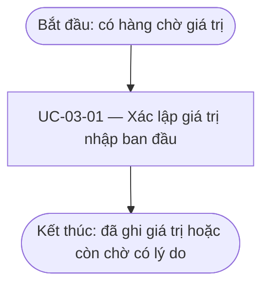

# BJ-03 — Xác lập giá trị ban đầu của hàng nhận

## 1. Tổng quan nghiệp vụ & Bối cảnh

Giúp kế toán xác lập giá trị ban đầu cho lượng hàng thực tế đã nhận bằng căn cứ giá hợp lệ đang có tại thời điểm xử lý. Nhận theo chứng từ có thể dùng nguồn thương mại từ Theme 10; nhập hàng nhanh phải hoàn tất được bằng căn cứ giá trực tiếp trong Theme 7. Hành trình không tạo giá vốn chính thức.

**Bắt đầu khi:** Có lượng hàng đã nhận thuộc quyền sở hữu tenant còn `VALUATION_PENDING`.

**Kết thúc khi:** Phạm vi có đủ căn cứ đã được ghi giá trị ban đầu; hoặc hồ sơ vẫn chờ/được bàn giao xử lý nguồn mà không tạo value movement sai.

**Không bao gồm:** Sửa PO/hóa đơn; business fact đến sau initial valuation; correction do nhập sai; tính/công bố Official Cost.

## 2. Tác nhân và trách nhiệm

| Tác nhân | Trách nhiệm | Phạm vi thẩm quyền |
|---|---|---|
| Kế toán kho hoặc người có quyền tài chính | Rà soát căn cứ và xác lập giá trị nhập ban đầu cho lượng hàng thực nhận. | Không sửa PO/hóa đơn Theme 10; không công bố Official Cost tại BJ03. |

## 3. Sơ đồ hành trình nghiệp vụ

## 4. Bản đồ Use Case

| UC — Tên | Mục tiêu | Tác nhân | Đầu vào / Bắt đầu khi | Kết quả | Tiếp tục |
|---|---|---|---|---|---|
| [UC-03-01](../use-cases/UC-03-01-xac-lap-gia-tri-nhap-ban-dau.md) — Xác lập giá trị nhập ban đầu | Xác lập giá trị ban đầu cho lượng hàng thực nhận từ căn cứ giá hợp lệ hiện có | Kế toán kho hoặc người có quyền tài chính tương đương | Có lượng hàng đã hoàn tất nhận vật lý, thuộc quyền sở hữu tenant, chưa từng được xác lập giá trị ban đầu và còn `VALUATION_PENDING`. | Giá trị ban đầu được ghi cho đúng phạm vi; phần đủ căn cứ chuyển `VALUATION_CONFIRMED`, phần chưa đủ căn cứ tiếp tục chờ | Kết thúc BJ03; nguồn phát sinh sau đó đi BJ13; sản phẩm + kỳ được đánh dấu cần BJ14 cập nhật giá vốn |

## 5. Bàn giao và ranh giới liên quan

| Nơi nhận / Nơi cung cấp | Dữ kiện hoặc trách nhiệm bàn giao | Điều kiện bàn giao / tiếp tục |
|---|---|---|
| BJ02 | Receipt/quantity đã nhận và còn VALUATION_PENDING | Receipt đã hoàn tất |
| Theme 10 | Căn cứ thương mại của nhánh nhận theo chứng từ: giá mua, chiết khấu, hóa đơn và các thành phần đã được xác lập | Chỉ dùng nguồn/phiên bản đang có hiệu lực; mâu thuẫn thương mại quay về Theme 10 xử lý |
| BJ13 | Thành phần giá trị mới hoặc thay đổi hợp lệ xuất hiện sau khi BJ03 đã hoàn tất | Ghi điều chỉnh mới; không sửa lại giá trị ban đầu đã xác nhận |
| BJ14 | Sản phẩm + kỳ cần cập nhật giá vốn | Sau khi giá trị ban đầu được ghi thành công |

## 6. Liên kết thiết kế

- **UI Flow canonical:** [UIF-03 — Xác lập giá trị ban đầu của hàng nhận](../../../03.design/flows/UIF-03-BJ-03.md)
- BJ này chỉ sở hữu **business boundary, mục tiêu, UC/handoff và acceptance ở cấp hành trình**.
- Screen-to-screen routing, entry/terminal, actor handoff, state/recovery và transition nằm tại `UIF-03`; anatomy/action chi tiết nằm tại `03.design/screens/`.
- Không copy Screen Flow vào BJ để tránh trùng với UC/UIF và để redesign UI không làm thay đổi semantic của Journey.

## 7. Nghiệm thu hành trình (Journey Acceptance)

| ID | Điều kiện ở cấp hành trình | Kết quả cần bảo đảm | UC / BC liên quan |
|---|---|---|---|
| JA-01 | Receipt theo chứng từ có nguồn Theme 10 hiện hành | Theme 7 chỉ tiêu thụ commercial facts; không sửa PO/hóa đơn và chỉ ghi giá trị cho lượng thực nhận được nguồn bao phủ | UC-03-01 / BC-IV-01 |
| JA-02 | Quick receipt không có PO hoặc dữ liệu Theme 10 | Kế toán có thể lập căn cứ giá trực tiếp có nguồn/evidence để hoàn tất BJ03; không tạo PO/hóa đơn giả | UC-03-01 / BC-IV-01 |
| JA-03 | Căn cứ thiếu hoặc mâu thuẫn thuộc owner khác | Phần chưa đủ căn cứ tiếp tục `VALUATION_PENDING`; không commit giá tùy ý và owner tiếp theo phải rõ | UC-03-01 / BC-IV-01 |
| JA-04 | Xác nhận thành công | Value movement ban đầu có provenance, không tạo `OfficialCostVersion`; Product + posting period được đánh dấu cần BJ14 cập nhật | UC-03-01 / BC-IV-01 |

## 8. Truy vết

| Nguồn | Vai trò đối với hành trình |
|---|---|
| [Decision Register](../../../01.knowledge/decisions/decision-register.md) — G03 | Nguồn quyết định nghiệp vụ và trạng thái hiệu lực |
| `DOM-IV`, `DOM-IO` | Domain authority và invariants dùng cho Journey |
| [Use Case Map](../use-cases/00-use-case-map.md) | Danh mục UC canonical của Theme 7 |
