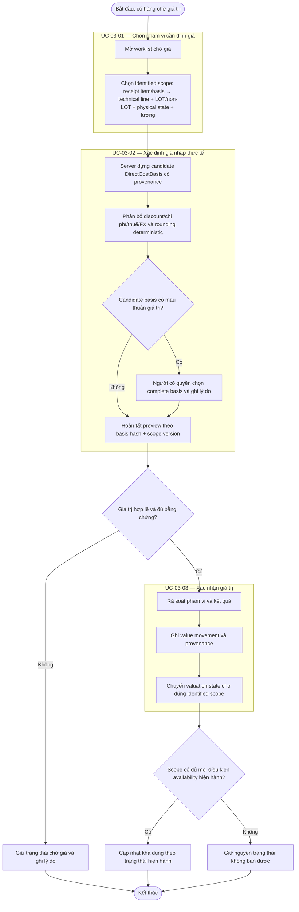
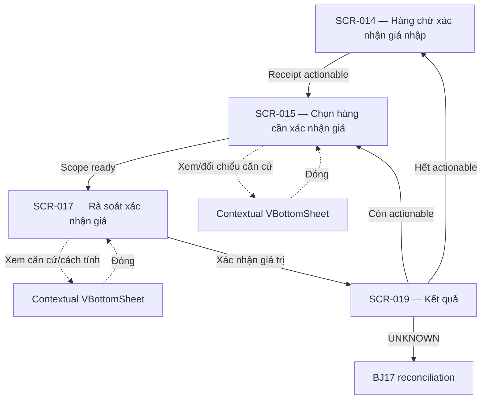

# BJ-03 — Xác nhận giá trị ban đầu của hàng nhận

## 1. Mục tiêu trải nghiệm

Xác lập **giá nhập thực tế và giá trị tồn kho ban đầu** cho hàng đã nhận quyền sở hữu. Việc xác nhận giá trị độc lập với việc hàng có đủ điều kiện bán hay không.

## 2. Phạm vi và ranh giới

### 2.1 Bắt đầu khi

| Thuộc tính | Nội dung |
|---|---|
| Bắt đầu | Có lượng hàng đã nhận chưa từng được xác nhận giá trị ban đầu và đang ở `VALUATION_PENDING` |
| Kết thúc | Dòng/lát số lượng đã được định giá; hoặc vẫn chờ giá với lý do rõ ràng |
| Tác động chính | Value movement và provenance của giá nhập |
| Không quyết định | Giá bán, promotion, công nợ, hay việc quarantine/damaged có trở thành sellable |

### 2.2 Kết thúc khi

| Thuộc tính | Nội dung |
|---|---|
| Bắt đầu | Có lượng hàng đã nhận chưa từng được xác nhận giá trị ban đầu và đang ở `VALUATION_PENDING` |
| Kết thúc | Dòng/lát số lượng đã được định giá; hoặc vẫn chờ giá với lý do rõ ràng |
| Tác động chính | Value movement và provenance của giá nhập |
| Không quyết định | Giá bán, promotion, công nợ, hay việc quarantine/damaged có trở thành sellable |

### 2.3 Không bao gồm

| Trong ranh giới | Ngoài ranh giới |
|---|---|
| Worklist chờ giá; chọn bằng chứng; tính giá nhập thực tế; phân bổ discount/chi phí; xác nhận từng dòng; xử lý xung đột nguồn | Phê duyệt invoice, thanh toán NCC, pricing, promotion |
| Gỡ trạng thái `VALUATION_PENDING` cho đúng identified scope đã xác nhận | Tự chuyển hàng quarantine/damaged/expired thành sellable; ghi chi phí mua đến sau khi initial valuation đã hoàn tất (thuộc BJ-13) |

## 3. Actor

- Kế toán kho hoặc người có quyền tài chính

## 4. Luồng chính

## 5. Use Case map

## 6. Luồng thay thế và ngoại lệ

### 4. Logic nghiệp vụ cần giữ

| Điểm kiểm soát | Quy tắc |
|---|---|
| Căn cứ giá | Hệ thống dựng candidate `DirectCostBasis`; không âm thầm chọn khi các complete basis khác nhau ở fact làm thay đổi giá trị. Người có quyền chọn một complete basis và ghi lý do. |
| Giá nhập thực tế | Bao gồm giá sau discount dòng, phân bổ discount cấp phiếu, chi phí mua phân bổ, thuế không được khấu trừ; loại VAT được khấu trừ |
| Hàng tặng | Phân bổ quyền lợi theo chính sách đã phê duyệt; không mặc định giá 0 nếu làm sai tổng giá trị |
| Ngoại tệ | Dùng tỷ giá được nguồn kế toán phê duyệt và lưu provenance |
| Làm tròn | Allocation/rounding deterministic theo policy/version và stable scope order. Partial dùng cumulative method nên tổng cuối không phụ thuộc cách chia lần xác nhận. |
| Xác nhận từng phần | Cho phép theo identified scope; basis identity, technical line, LOT/non-LOT, physical state và scope identity phải xác định. Phần còn lại tiếp tục `VALUATION_PENDING`; cumulative confirmed quantity/value và scope version được cập nhật. |
| Giá trị và sellability | Xác nhận giá trị chỉ đổi valuation axis; không thay đổi quarantine/damaged/expired. Khả dụng chỉ tăng theo authoritative availability evaluation sau commit, không suy đơn giản từ `SELLABLE` |
| Valuation basis | `valuation_basis_key` bám `receipt_item_ref`/commercial source line. Nhiều technical line của cùng item có thể dùng chung basis; hai source item độc lập cùng Product+UOM không tự động dùng chung. |
| UOM / normalization | UI thao tác theo transaction UOM; ReceiptValuation bảo toàn conversion snapshot và confirmed base quantity. Official Cost luôn VND/base UOM. |
| Freshness | Final confirm recheck selected `basis_hash + basis_version + scope_version`; không dùng receipt-wide source version để stale toàn receipt. |
| Initial Official Cost | Bootstrap compare-and-create nguyên tử theo tenant+product. Concurrent loser vẫn ghi valuation nhưng không overwrite Official Cost. |
| Ngày/kỳ | Direct receipt value dùng `receipt_business_date`; `recorded_at` là commit time; accounting period là kỳ chứa receipt business date. Component đến sau initial confirmation đi BJ13. |

### 5. Quan hệ và bàn giao

- Nhận đầu vào từ BJ-02.
- Cung cấp value facts cho BJ-14.
- Chỉ value component đã có căn cứ hợp lệ tại preview/commit của **initial valuation chưa hoàn tất** mới thuộc BJ-03. Component đến sau khi quantity đã initial-valued thuộc BJ-13/valuation adjustment; không route ngược về BJ-03 và không rewrite ReceiptValuation hoặc movement gốc.
- Việc chuyển trạng thái hàng thuộc BJ-09, không thuộc BJ này.

## 7. UI Flow và chuyển màn hình

> **Product correction:** `v1.5.0` · Preview `BC-IV-05/API-Q-11`; mutation duy nhất `ACT-03-CONFIRM-COST → BC-IV-01 → API-C-20`.

### Mental model

`Tìm việc → chọn exact identified scope theo valuation basis → rà soát → xác nhận → kết quả`. Căn cứ/cách tính và DirectCostBasis conflict là contextual detail của scope/review, không phải một bước navigation.

### Active flow

`SCR-016` giữ ID lịch sử/migration nhưng **không thuộc active Product flow từ v1.5.0**.

### Transition contract

| ID | Từ | Trigger | Đến | Loại |
|---|---|---|---|---|
| UIF-03-T01 | Begin | Có quyền | SCR-014 | NAVIGATION |
| UIF-03-T02 | SCR-014 | Chọn actionable receipt | SCR-015 | NAVIGATION |
| UIF-03-T03 | SCR-015 | Scope ready | SCR-017 | QUERY/NAVIGATION |
| UIF-03-T04 | SCR-015/017 | Xem hoặc resolve căn cứ | contextual VBottomSheet, same screen on close | QUERY/OVERLAY |
| UIF-03-T05 | SCR-017 | Confirm sau recheck | SCR-019 | MUTATION |
| UIF-03-T06 | SCR-019 | Còn actionable | SCR-015 | NAVIGATION |
| UIF-03-T07 | SCR-019 | Hết actionable/chỉ waiting | SCR-014 | TERMINAL/NAVIGATION |
| UIF-03-T08 | SCR-019 | UNKNOWN | BJ17 | HANDOFF |

### Invariants

- Exact scope giữ transaction Product+UOM, `receipt_item_ref/valuation_basis_key`, technical line, LOT/non-LOT, physical state và quantity.
- Một valuation basis có thể cover nhiều technical scopes; hai independent source items cùng Product+UOM không auto merge.
- Partial là progressive disclosure và dùng deterministic cumulative allocation/rounding.
- DirectCostBasis conflict không preselect; reason bắt buộc.
- Preview không mutation/query UNKNOWN; final command server recheck selected `basis_hash/version + scope_version`.
- Official Cost consequence normalize về base UOM; bootstrap compare-and-create nguyên tử.
- Availability effect server-authoritative; valuation state và physical state độc lập.
- Direct value movement dùng receipt business date; component đến sau initial confirmation route BJ13.
- Result consumed không Back vào SCR-017.

## 8. Handoff / phụ thuộc ngoài Journey

## 9. Outcome cuối

| Thuộc tính | Nội dung |
|---|---|
| Bắt đầu | Có lượng hàng đã nhận chưa từng được xác nhận giá trị ban đầu và đang ở `VALUATION_PENDING` |
| Kết thúc | Dòng/lát số lượng đã được định giá; hoặc vẫn chờ giá với lý do rõ ràng |
| Tác động chính | Value movement và provenance của giá nhập |
| Không quyết định | Giá bán, promotion, công nợ, hay việc quarantine/damaged có trở thành sellable |

## 10. Truy vết

### Nguồn v3.10.1 — BJ-03 — Xác nhận giá trị ban đầu của hàng nhận

> **Trạng thái:** Release đã đóng băng `4.1.0` — đã remap ID và boundary  
> **Chuyển đổi chính thức:** Theme 7 `4.0.0/BJ-03` → `4.1.0/BJ-03`  
> **Finality contract:** `COMPLETED`, `REJECTED/CANCELLED`, `SUSPENDED/BLOCKED`, `UNKNOWN/ESCALATED`
> **Phạm vi:** Phase 1 — xác nhận giá trị theo dòng hoặc lát số lượng được định danh  
> **Chủ sở hữu nghiệp vụ:** Inventory Valuation
> **Quyết định nghiệp vụ:** `T7-BASELINE-FREEZE-v4.0.0` + `T7-DR-021`, `T7-DR-025`, `T7-DR-026`, `T7-DR-150…156`
### Nguồn v3.10.1 — 3. Trường hợp sử dụng

| UC | Tên | Bắt đầu | Kết thúc | Kết quả |
|---|---|---|---|---|
| [UC-03-01](../use-cases/UC-03-01-chon-pham-vi-can-dinh-gia.md) | Chọn phạm vi cần định giá | Worklist có hàng chờ giá | Receipt line/lát số lượng được khóa chọn | Valuation scope |
| [UC-03-02](../use-cases/UC-03-02-xac-dinh-gia-nhap-thuc-te.md) | Xác định giá nhập thực tế | Có scope và bằng chứng | Có phép tính hợp lệ hoặc danh sách thiếu/xung đột | Cost calculation draft có provenance |
| [UC-03-03](../use-cases/UC-03-03-xac-nhan-gia-tri.md) | Xác nhận giá trị | Phép tính hợp lệ được rà soát | Value movement được commit và scope hết chờ giá | Confirmed receipt valuation |
### Nguồn v3.10.1 — 6. Nguồn tri thức liên quan

- [Hàng đã nhận nhưng chưa chốt giá](../../../01.knowledge/know-how/KB-KGV-008-hang-da-nhan-nhung-chua-chot-gia.md)
- [Đơn giá tồn kho chính thức và tổng giá trị ghi sổ](../../../01.knowledge/know-how/KB-KGV-015-don-gia-ton-kho-chinh-thuc-va-tong-gia-tri-ghi-so.md)
- [Các thành phần hình thành giá nhập thực tế](../../../01.knowledge/know-how/KB-KGV-019-cac-thanh-phan-hinh-thanh-gia-nhap-thuc-te.md)
