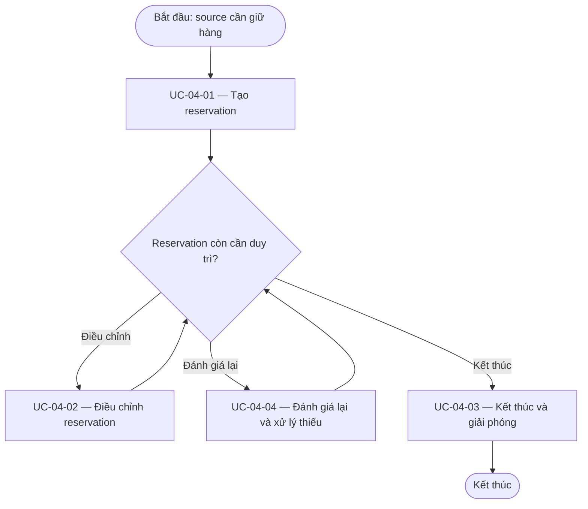

# BJ-04 — Quản lý vòng đời giữ hàng

## 1. Tổng quan nghiệp vụ & Bối cảnh

Bảo đảm capacity tồn kho cho source order có chính sách giữ hàng mà chưa làm thay đổi tồn vật lý. Theme 7 sở hữu reservation capacity commitment; source sở hữu commercial order intent; BJ-05 sở hữu LOT allocation/pick/handover sau khi fulfillment được hình thành.

**Bắt đầu khi:** Có yêu cầu nghiệp vụ hợp lệ trong phạm vi Theme 7.

**Kết thúc khi:** Kết quả hành trình được xác định hoặc dừng có kiểm soát.

**Không bao gồm:** Không sở hữu quyết định thuộc Theme/Domain khác.

## 2. Tác nhân và trách nhiệm

| Tác nhân | Trách nhiệm | Phạm vi thẩm quyền |
|---|---|---|
| Source system / system process | Khởi tạo, điều chỉnh, giải phóng hoặc đánh giá lại reservation theo source version và policy. | Source sở hữu requested quantity/lifecycle; Theme 7 sở hữu current hold/capacity effect; không sửa PickAllocation BJ05. |

## 3. Sơ đồ hành trình nghiệp vụ

## 4. Bản đồ Use Case

| UC — Tên | Mục tiêu | Tác nhân | Đầu vào / Bắt đầu khi | Kết quả | Tiếp tục |
|---|---|---|---|---|---|
| [UC-04-01](../use-cases/UC-04-01-tao-reservation.md) — Tạo reservation | Tạo current hold theo source/policy và trả shortage nếu thiếu | Source system / system process | Source line/version có explicit reservation policy | Reservation/Group version đầu tiên + current hold/shortage | Theo lifecycle source |
| [UC-04-02](../use-cases/UC-04-02-dieu-chinh-reservation.md) — Điều chỉnh reservation | Đưa current hold theo requested quantity/source version mới | Source system / system process | Source requested quantity/version tăng hoặc giảm | Reservation version mới; consumed history giữ nguyên | Theo lifecycle source / BJ05 review nếu allocation bị ảnh hưởng |
| [UC-04-03](../use-cases/UC-04-03-ket-thuc-va-giai-phong.md) — Kết thúc và giải phóng | Giải phóng current hold khi source kết thúc/release | Source system / system process | Source cancel/complete/release hoặc source-owned expiry | Current hold = 0; consumed history giữ nguyên | Kết thúc reservation lifecycle |
| [UC-04-04](../use-cases/UC-04-04-danh-gia-lai-va-xu-ly-thieu.md) — Đánh giá lại và xử lý thiếu | Giảm current hold khi capacity/eligibility giảm và trả shortage | Source system / system process | Eligibility giảm hoặc source explicit re-evaluate | Current holds phù hợp capacity + shortage + allocation review signal nếu cần | Theo lifecycle source / BJ05 review |

## 5. Bàn giao và ranh giới liên quan

| Nơi nhận / Nơi cung cấp | Dữ kiện hoặc trách nhiệm bàn giao | Điều kiện bàn giao / tiếp tục |
|---|---|---|
| Theme 5 / source order | Nhu cầu giữ/giải phóng capacity | Source intent hợp lệ |
| BJ05 | Reservation hiện hành để allocation/pick | Khi fulfillment bắt đầu |

## 6. Luồng giao diện cấp hành trình

| Chặng / UC | Chuyển màn hình | Hành động nghiệp vụ |
|---|---|---|
| UC-04-01 — Tạo reservation | `SCR-021` | Tạo current hold cho đúng source line/combo theo capacity/policy, trả shortage nếu thiếu và tạo Reservation/ReservationGroup version đầu tiên. |
| UC-04-02 — Điều chỉnh reservation | `SCR-021` | Đưa current hold về mức phù hợp với source version mới mà không sửa consumed history và không tự thay PickAllocation của BJ05. |
| UC-04-03 — Kết thúc và giải phóng | `SCR-021` | Đưa current hold của scope kết thúc về 0 với lý do rõ, giữ nguyên consumed history và giải phóng capacity cho nhu cầu khác. |
| UC-04-04 — Đánh giá lại và xử lý thiếu | `SCR-021` | Giảm current hold về capacity hợp lệ theo priority, trả shortage và báo BJ05 review allocation nếu cần; không tự top-up khi capacity tăng lại. |

## 7. Nghiệm thu hành trình (Journey Acceptance)

| ID | Điều kiện ở cấp hành trình | Kết quả cần bảo đảm | UC / BC liên quan |
|---|---|---|---|
| JA-01 | Journey bắt đầu từ đúng trigger và actor có quyền | Kết quả chỉ được ghi trong phạm vi authority của Theme 7; source ngoài Theme không bị sửa ngầm | UC-04-01 / BC liên quan |
| JA-02 | Một nhánh bị từ chối, blocked hoặc chưa xác định | Không được báo thành công hoặc tạo tác động bán phần; hướng xử lý/owner tiếp theo phải rõ | UC-04-01…UC-04-04 |
| JA-03 | Journey hoàn tất thành công | Kết quả cuối có provenance, thời điểm/phạm vi và đủ dữ kiện cho consumer tiếp theo | UC-04-04 / Domain ledger |

## 8. Truy vết

| Nguồn | Vai trò đối với hành trình |
|---|---|
| [Decision Register](../../../01.knowledge/decisions/decision-register.md) — Decision Register theo UC/BC | Nguồn quyết định nghiệp vụ và trạng thái hiệu lực |
| `DOM-IO` | Domain authority và invariants dùng cho Journey |
| [Use Case Map](../use-cases/00-use-case-map.md) | Danh mục UC canonical của Theme 7 |
