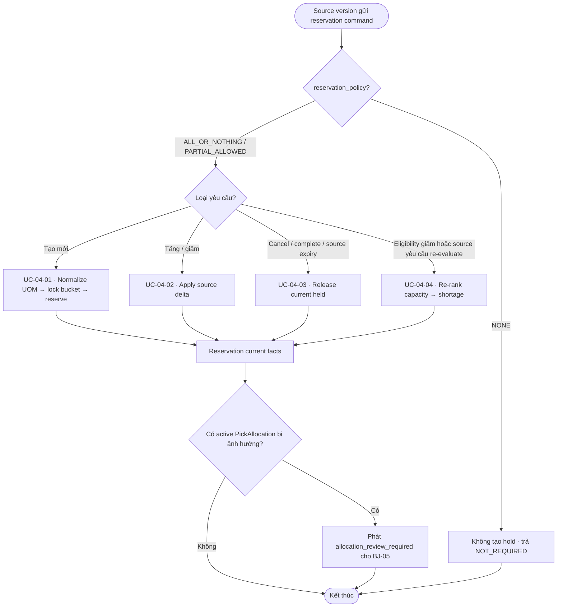
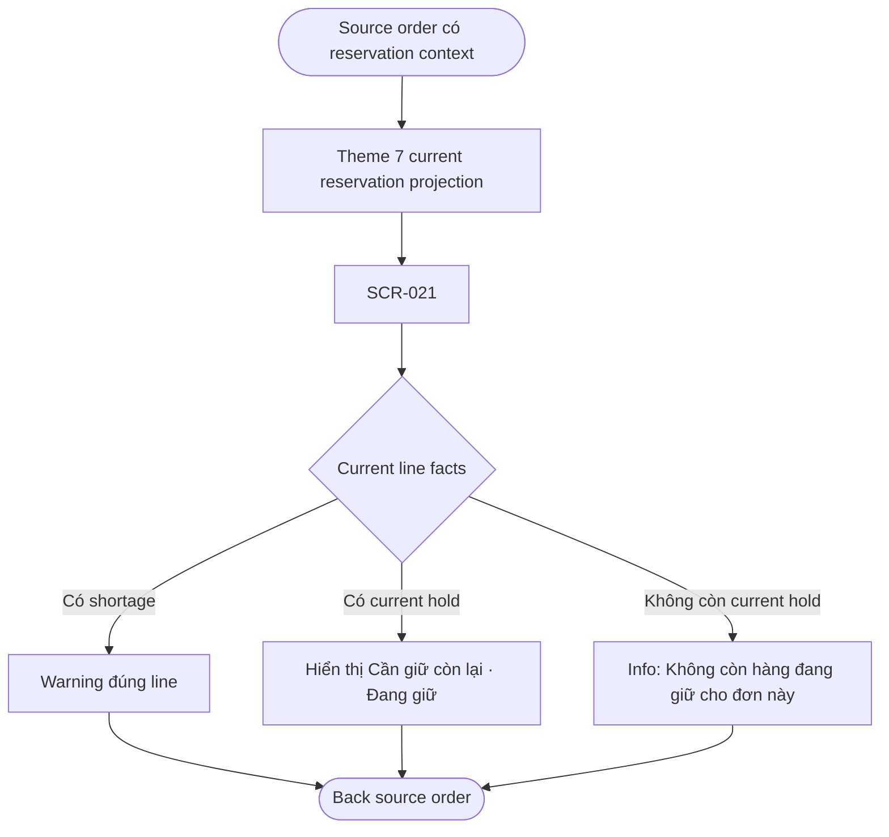

# BJ-04 — Quản lý vòng đời giữ hàng

## 1. Mục tiêu trải nghiệm

Bảo đảm capacity tồn kho cho source order có chính sách giữ hàng mà chưa làm thay đổi tồn vật lý. Theme 7 sở hữu reservation capacity commitment; source sở hữu commercial order intent; BJ-05 sở hữu LOT allocation/pick/handover sau khi fulfillment được hình thành.

## 2. Phạm vi và ranh giới

### 2.1 Bắt đầu khi

### 2.2 Kết thúc khi

### 2.3 Không bao gồm

## 3. Actor

- Source system / system process

## 4. Luồng chính

## 5. Use Case map

## 6. Luồng thay thế và ngoại lệ

### 4. Quantity model authoritative

Mỗi Reservation bảo toàn source quantity và base normalization:

- `requested_quantity` + transaction UOM snapshot/precision/conversion version;
- `requested_base_quantity` — source demand normalized;
- `reserved_base_quantity` — **lượng hiện đang được giữ, chưa consume/release**;
- `consumed_base_quantity` — lượng đã handover/issue commit cộng dồn;
- `remaining_required_base = max(0, requested_base_quantity - consumed_base_quantity)`;
- `shortage_base = max(0, remaining_required_base - reserved_base_quantity)`.

`ReservationBucket.reserved_base_quantity = Σ current Reservation.reserved_base_quantity`; consumed quantity không nằm trong bucket.

### 5. Priority và re-evaluation

Khi capacity đủ điều kiện giảm, phân capacity deterministic theo:

1. `reservation_priority` do source cung cấp;
2. `source_confirmed_at` cũ hơn trước;
3. stable `source_line_id` để phá hòa.

Hệ thống **không auto top-up** khi hàng lại đủ. Top-up chỉ xảy ra khi source gửi amend/re-evaluate mới có version/idempotency identity.

## 7. UI Flow và chuyển màn hình

> **Product/UI baseline:** `v3.9.6`  
> **Business authority:** BJ-04 + UC-04 + T7-DR-144…149.  
> **UI authority:** Live VET45 Figma Design System.  
> **HTML:** implementation + verification only.

### 1. Phạm vi UI

| Thuộc tính | Giá trị |
|---|---|
| Entry | Order/source detail có Advanced Stock reservation context |
| Active surface | `SCR-021 — Giữ hàng theo đơn` |
| Mutation UI | Không |
| Source/system operations | create / amend / release / re-evaluate current reservation capacity |
| Exit | Back về đúng source order |

Basic Stock và `reservation_policy=NONE` không mở một reservation Product surface của Theme 7.

### 2. Canonical flow

### 3. UX decisions v3.9.6

1. Một active read-only screen; retired `SCR-020/022/023/024` không quay lại active flow.
2. Reservation policy/capability do source/system quyết định; Inventory user không có fake reserve/release task.
3. Projection theo từng source line, không global FULL/PARTIAL/RELEASED/STALE.
4. Copy current facts: **Cần giữ còn lại** / **Đang giữ**; lịch sử quantity cũ thuộc audit/history.
5. Shortage chỉ gắn row bị thiếu; không cộng khác UOM thành tổng giả.
6. `STALE` không phải product-facing state. Refresh/reconcile trước khi hiển thị authoritative current facts.
7. Không show helper “Giữ hàng làm giảm khả dụng...” mặc định; đây là domain semantic không giúp user ra quyết định trên surface.
8. Combo vẫn hiển thị source combo line; component reservations không dump lên Product UI.
9. Function catalog chỉ thể hiện capability contextual/disabled; không cho mở như module Inventory độc lập.

### 4. Active state matrix

| State | UI | Mutation |
|---|---|---|
| `READY` | Context + current line facts; banner derive theo data | Không |
| `LOADING` | `VSkeleton` | Không |
| `PERMISSION_DENIED` | `VEmptyState` | Không |

### 5. Retired surfaces

`SCR-020`, `SCR-022`, `SCR-023`, `SCR-024` là historical contracts only; không xuất hiện trong active UIF-04 navigation/deep-link destination.

## 8. Handoff / phụ thuộc ngoài Journey

## 9. Outcome cuối

## 10. Truy vết

### Nguồn v3.10.1 — BJ-04 — Quản lý vòng đời giữ hàng

> **Deep-review amendment v3.9.6:** Reservation là capability do source/system điều khiển, chỉ áp dụng cho **Advanced Stock / Theme 7**. Source gửi explicit `reservation_policy`; Theme 7 giữ current capacity ở Product + Warehouse, bảo toàn transaction-UOM snapshot, current held/consumed semantics, deterministic priority, combo atomicity và ranh giới ownership với BJ-05. Xem `T7-DR-144…149`.
>
> **Control/UI amendment v1.3.4:** Trong Phase 1, create/amend/release/re-evaluate reservation là **source/system-driven**. Inventory user không có bước xác nhận giữ/nhả/phân bổ lại mặc định; UI chỉ phản ánh projection authoritative và shortage cần source xử lý. Xem `T7-DR-106`.

> **Trạng thái:** Cumulative deep-review baseline `v3.9.6`  
> **Finality contract:** `COMPLETED`, `REJECTED/CANCELLED`, `SUSPENDED/BLOCKED`, `UNKNOWN/ESCALATED`  
> **Phạm vi:** Phase 1 — một kho mặc định; giữ ở Product + Warehouse, chưa chọn LOT  
> **Chủ sở hữu nghiệp vụ:** Inventory Operations
### Nguồn v3.10.1 — 3. Trường hợp sử dụng

| UC | Tên | Trigger | Kết quả authoritative |
|---|---|---|---|
| [UC-04-01](../use-cases/UC-04-01-tao-reservation.md) | Tạo reservation | Source line/version có policy giữ | Current hold đầu tiên hoặc no-effect rejection |
| [UC-04-02](../use-cases/UC-04-02-dieu-chinh-reservation.md) | Điều chỉnh reservation | Source requested quantity/version đổi | Current hold/shortage mới |
| [UC-04-03](../use-cases/UC-04-03-ket-thuc-va-giai-phong.md) | Kết thúc và giải phóng | Cancel/complete/release/source expiry | Current hold = 0 cho phần kết thúc |
| [UC-04-04](../use-cases/UC-04-04-danh-gia-lai-va-xu-ly-thieu.md) | Đánh giá lại và xử lý thiếu | Eligibility giảm hoặc explicit re-evaluate | Current hold được xác lập lại, shortage phát về source |
### Nguồn v3.10.1 — 6. Combo reservation

Một combo source line được biểu diễn bằng `ReservationGroup` + N child Reservation component. Commit theo số nguyên combo và nguyên tử trên toàn component. Nếu `PARTIAL_ALLOWED`, quantity combo giữ được là `min(floor(component_capacity / qty_per_combo))`; không giữ mảnh component tạo combo không hoàn chỉnh.

UI/source-facing projection vẫn ưu tiên combo source line; component reservation là contract/audit/internal inventory detail.
### Nguồn v3.10.1 — 7. Ranh giới với BJ-05

- Trước active PickAllocation: BJ-04 được create/increase/decrease/release/re-evaluate current hold.
- Sau active PickAllocation: BJ-04 **không mutate allocation**. Reservation change hợp lệ phát `allocation_review_required`; BJ-05 revalidate và nếu cần supersede allocation set/version.
- Pick/handover không rewrite source requested history. Handover consume current hold đúng committed quantity.
### Nguồn v3.10.1 — 8. UI / projection

`SCR-021` chỉ mở từ source order có reservation context. Projection theo **từng source line**, không có global business state `FULL/PARTIAL/RELEASED/STALE`.

Mỗi line derive:
- `remaining_required`;
- `currently_reserved`;
- `shortage`;
- lifecycle fact (`ACTIVE`, `PARTIALLY_CONSUMED`, `CONSUMED`, `RELEASED`, `EXPIRED`).

Nếu toàn bộ current hold = 0, UI có thể báo ngắn **“Không còn hàng đang giữ cho đơn này.”**; lịch sử quantity cũ thuộc audit/history, không dump vào current projection.
### Nguồn v3.10.1 — 9. Nguồn tri thức liên quan

- [Giữ hàng và xử lý đơn không đủ tồn khả dụng](../../../01.knowledge/know-how/KB-KGV-009-giu-hang-va-xu-ly-don-khong-du-ton-kha-dung.md)
- [Chọn hàng để xuất và thời điểm hoàn tất xuất bán](../../../01.knowledge/know-how/KB-KGV-010-chon-hang-de-xuat-va-thoi-diem-hoan-tat-xuat-ban.md)
- [Combo bán hàng và tồn kho theo thành phần](../../../01.knowledge/know-how/KB-KGV-035-combo-ban-hang-va-ton-kho-theo-thanh-phan.md)
