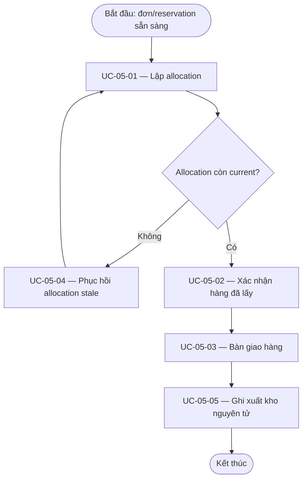

# BJ-05 — Lấy hàng và bàn giao đơn

## 1. Tổng quan nghiệp vụ & Bối cảnh

Giúp nhân viên chọn đúng sản phẩm/lô, theo dõi allocation có phiên bản và chỉ giảm tồn vật lý khi hàng thực sự được bàn giao cho khách hoặc đơn vị vận chuyển.

**Bắt đầu khi:** Có đơn/reservation sẵn sàng để lấy hàng.

**Kết thúc khi:** Hàng được bàn giao toàn phần/một phần; hoặc shortage được trả về nguồn mà không xuất sai.

**Không bao gồm:** Commercial delivery promise, vận chuyển hoặc thu tiền.

## 2. Tác nhân và trách nhiệm

| Tác nhân | Trách nhiệm | Phạm vi thẩm quyền |
|---|---|---|
| Hệ thống Inventory theo source/reservation; nhân viên/thủ kho là consumer của kết quả allocation | Dựng allocation version từ reservation/source và availability hiện hành để hướng dẫn lấy hàng. | Allocation không làm giảm tồn vật lý; LOT/pick chỉ có hiệu lực trong version hiện hành. |
| Nhân viên xử lý đơn hoặc thủ kho | Xác nhận hàng đã lấy, xử lý allocation stale và bàn giao đúng lượng thực tế. | Không xuất vượt lượng hợp lệ; đổi lô phải có dấu vết và tuân thủ policy. |
| Người dùng có thẩm quyền hoặc hệ thống nguồn | Ghi xuất kho nguyên tử khi có handover/source assertion hợp lệ. | Quantity/value/balance/reservation phải commit cùng finality contract. |

## 3. Sơ đồ hành trình nghiệp vụ

## 4. Bản đồ Use Case

| UC — Tên | Mục tiêu | Tác nhân | Đầu vào / Bắt đầu khi | Kết quả | Tiếp tục |
|---|---|---|---|---|---|
| [UC-05-01](../use-cases/UC-05-01-lap-allocation.md) — Lập allocation | Một allocation version active được tạo; Stable allocation set. | Hệ thống Inventory theo source/reservation; nhân viên/thủ kho là consumer của kết quả allocation | Đơn/reservation sẵn sàng | Một allocation version active được tạo; Stable allocation set. | UC-05-02 |
| [UC-05-02](../use-cases/UC-05-02-xac-nhan-hang-da-lay.md) — Xác nhận hàng đã lấy | Dòng pick được xác nhận hoặc stale được phát hiện; Pick evidence. | Nhân viên xử lý đơn hoặc thủ kho | Có allocation active | Dòng pick được xác nhận hoặc stale được phát hiện; Pick evidence. | UC-05-03 |
| [UC-05-03](../use-cases/UC-05-03-ban-giao-hang.md) — Bàn giao hàng | Xuất toàn phần/một phần hoặc bị từ chối; Handover issue result. | Nhân viên xử lý đơn hoặc thủ kho | Hàng đã pick và allocation hợp lệ | Xuất toàn phần/một phần hoặc bị từ chối; Handover issue result. | UC-05-04 |
| [UC-05-04](../use-cases/UC-05-04-phuc-hoi-allocation-stale.md) — Phục hồi allocation stale | Allocation mới hoặc shortage; Recovery result. | Nhân viên xử lý đơn hoặc thủ kho | Allocation/order/lot không còn hợp lệ | Allocation mới hoặc shortage; Recovery result. | UC-05-05 |
| [UC-05-05](../use-cases/UC-05-05-ghi-xuat-kho-nguyen-tu.md) — Ghi xuất kho nguyên tử | Movement, balance, reservation nếu có và cost snapshot cùng commit; Inventory issue result dùng chung. | Người dùng có thẩm quyền hoặc hệ thống nguồn | Có lô/nguồn xuất hợp lệ và allocation khi hành trình yêu cầu | Movement, balance, reservation nếu có và cost snapshot cùng commit; Inventory issue result dùng chung. | Kết thúc / theo nhánh trên sơ đồ |

## 5. Bàn giao và ranh giới liên quan

| Nơi nhận / Nơi cung cấp | Dữ kiện hoặc trách nhiệm bàn giao | Điều kiện bàn giao / tiếp tục |
|---|---|---|
| Theme 5 / source order | Reservation và fulfillment intent | Nguồn còn hiệu lực |
| BJ14 / valuation | Issue/value facts và COGS snapshot | Sau handover/issue commit |

## 6. Liên kết thiết kế

- **UI Flow canonical:** [UIF-05 — Lấy hàng và bàn giao đơn](../../../03.design/flows/UIF-05-BJ-05.md)
- BJ này chỉ sở hữu **business boundary, mục tiêu, UC/handoff và acceptance ở cấp hành trình**.
- Screen-to-screen routing, entry/terminal, actor handoff, state/recovery và transition nằm tại `UIF-05`; anatomy/action chi tiết nằm tại `03.design/screens/`.
- Không copy Screen Flow vào BJ để tránh trùng với UC/UIF và để redesign UI không làm thay đổi semantic của Journey.

## 7. Nghiệm thu hành trình (Journey Acceptance)

| ID | Điều kiện ở cấp hành trình | Kết quả cần bảo đảm | UC / BC liên quan |
|---|---|---|---|
| JA-01 | Journey bắt đầu từ đúng trigger và actor có quyền | Kết quả chỉ được ghi trong phạm vi authority của Theme 7; source ngoài Theme không bị sửa ngầm | UC-05-01 / BC liên quan |
| JA-02 | Một nhánh bị từ chối, blocked hoặc chưa xác định | Không được báo thành công hoặc tạo tác động bán phần; hướng xử lý/owner tiếp theo phải rõ | UC-05-01…UC-05-05 |
| JA-03 | Journey hoàn tất thành công | Kết quả cuối có provenance, thời điểm/phạm vi và đủ dữ kiện cho consumer tiếp theo | UC-05-05 / Domain ledger |

## 8. Truy vết

| Nguồn | Vai trò đối với hành trình |
|---|---|
| [Decision Register](../../../01.knowledge/decisions/decision-register.md) — Decision Register theo UC/BC | Nguồn quyết định nghiệp vụ và trạng thái hiệu lực |
| `DOM-IO` | Domain authority và invariants dùng cho Journey |
| [Use Case Map](../use-cases/00-use-case-map.md) | Danh mục UC canonical của Theme 7 |
