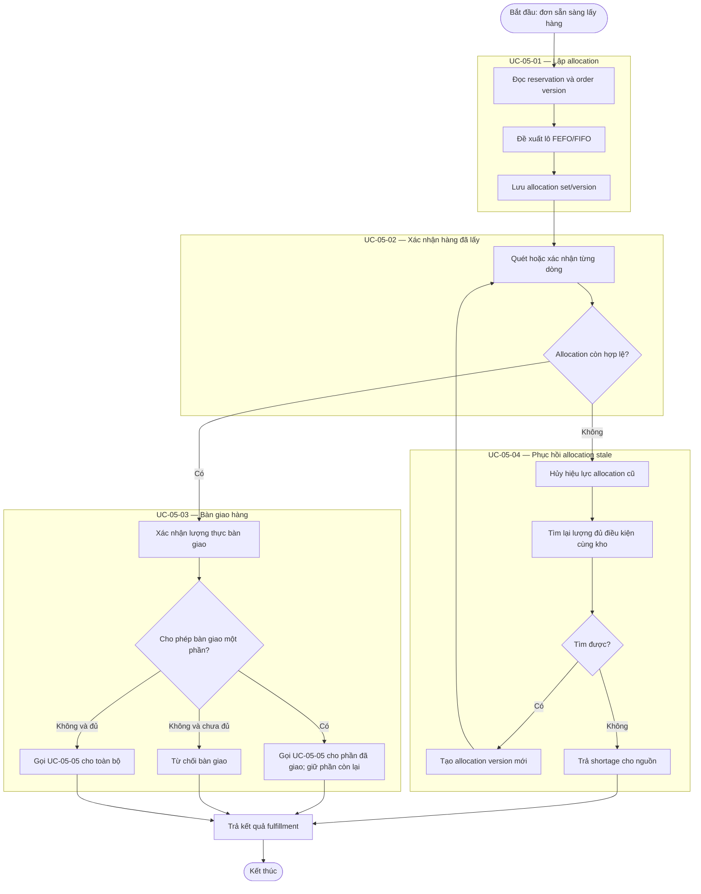
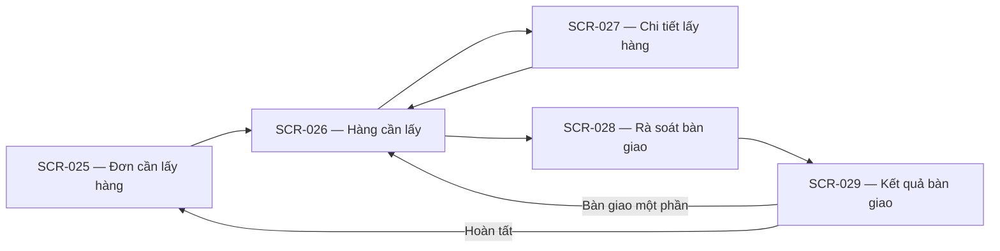

# BJ-05 — Lấy hàng và bàn giao đơn

## 1. Mục tiêu trải nghiệm

Giúp nhân viên chọn đúng sản phẩm/lô, theo dõi allocation có phiên bản và chỉ giảm tồn vật lý khi hàng thực sự được bàn giao cho khách hoặc đơn vị vận chuyển.

## 2. Phạm vi và ranh giới

### 2.1 Bắt đầu khi

| Thuộc tính | Nội dung |
|---|---|
| Bắt đầu | Có đơn/reservation sẵn sàng để lấy hàng |
| Kết thúc | Hàng được bàn giao toàn phần/một phần; hoặc shortage được trả về nguồn mà không xuất sai |
| Tác động chính | PickAllocation, reservation consumption, issue movement và COGS snapshot |
| Không quyết định | Commercial delivery promise, vận chuyển hoặc thu tiền |

### 2.2 Kết thúc khi

| Thuộc tính | Nội dung |
|---|---|
| Bắt đầu | Có đơn/reservation sẵn sàng để lấy hàng |
| Kết thúc | Hàng được bàn giao toàn phần/một phần; hoặc shortage được trả về nguồn mà không xuất sai |
| Tác động chính | PickAllocation, reservation consumption, issue movement và COGS snapshot |
| Không quyết định | Commercial delivery promise, vận chuyển hoặc thu tiền |

### 2.3 Không bao gồm

| Trong ranh giới | Ngoài ranh giới |
|---|---|
| Allocation version; FEFO/FIFO; pick; partial handover; stale recovery; shortage | Chọn kho khác; tối ưu tuyến giao; payment; hủy thương mại |
| Xử lý allocation sau pick | Reservation trước pick thuộc BJ-04 |

## 3. Actor

- Hệ thống Inventory theo source/reservation; nhân viên/thủ kho là consumer của kết quả allocation
- Nhân viên xử lý đơn hoặc thủ kho
- Người dùng có thẩm quyền hoặc hệ thống nguồn

## 4. Luồng chính

## 5. Use Case map

## 6. Luồng thay thế và ngoại lệ

### 4. Logic nghiệp vụ cần giữ

| Điểm kiểm soát | Quy tắc |
|---|---|
| Allocation version | Chỉ một version active; handover phải mang đúng active version |
| Pick | Pick không giảm physical quantity |
| Partial handover | Consume đúng lượng đã giao; reservation còn lại giảm tương ứng và vẫn active nếu source cho phép |
| Không cho partial | Chưa đủ lượng thì toàn bộ handover bị từ chối, không commit bán phần |
| Stale recovery | Reallocate trong cùng kho; không tìm kho khác và không âm thầm đổi order |
| Lô thay thế | Phải còn eligible; override FEFO/FIFO cần quyền và lý do |
| Handover lặp | Cùng source handover/version không được ghi issue lần hai |

### 5. Quan hệ và bàn giao

- Nhận reservation từ BJ-04.
- Nếu không thể reallocate, trả shortage cho Sales để quyết định giảm/hủy/chờ.
- Cung cấp issue movement và cost snapshot cho BJ-14 và BJ-15.
- Hủy thương mại sau bàn giao phải đi qua BJ-06 khi hàng thực quay về; chỉ sai sót operation mới dùng BJ-11. Không tự cộng tồn trở lại.

## 7. UI Flow và chuyển màn hình

> **Business baseline v1.3.7 + UX locks v1.4.x.** Product documents/BJ/UC/contracts quyết định nghiệp vụ và hành vi. Live Figma Design System là UI authority; HTML chỉ là renderer/workbench.

### Active flow

`SCR-025 Đơn cần lấy hàng → SCR-026 Hàng cần lấy ⇄ SCR-027 Chi tiết lấy hàng → SCR-028 Rà soát bàn giao → SCR-029 Kết quả bàn giao`.

### Entry & continuity v1.4.3

- `MODULE_ENTRY`: `SCR-025 — Đơn cần lấy hàng`; queue chỉ chứa order/fulfillment tasks còn mở.
- `CONTEXTUAL_DEEP_LINK`: task/notification của một đơn cụ thể có thể mở `SCR-026`; màn phải giữ order/customer/warehouse context và cho biết đây là việc lấy hàng từ đơn bán.
- `Đang chờ` là source/order-owned. Warehouse không mutation; khi source được cập nhật, cùng task được refresh/re-entry thay vì tạo task mới.
- Full result quay về `SCR-025`; partial result quay lại đúng order task `SCR-026`.

### UX/business locks v1.3.7

1. `SCR-025` luôn mặc định **Tất cả**; chip order là `Tất cả / Cần lấy / Đang chờ`. Hai chip sau chỉ lọc cùng một danh sách, không phải tab.
2. Dữ liệu pick phải scope theo **đúng Order/Fulfillment**. Không tồn tại pick lines dùng chung giữa các đơn.
3. Queue chỉ hiển thị task chưa đóng. `Cần lấy` là warehouse-actionable; `Đang chờ` là source/order đang xử lý shortage hoặc blocker ngoài quyền Kho.
4. Một Product+UOM có `1..N` LOT allocations. Hệ thống đề xuất FEFO/FIFO; alternative LOT phải hiển thị tối thiểu LOT code, HSD và lượng có thể lấy để user phân biệt.
5. Override LOT không được tự chọn alternative. Nếu allocation cũ đã pick > 0, đổi LOT phải reset phần pick đó về 0 và tạo physical-correction instruction: trả lô cũ → lấy lại lô mới.
6. Stale recovery dùng cùng physical-correction model. Affected pick bị invalid; `Rà soát bàn giao` bị khóa cho tới khi physical correction hoàn tất.
7. `SCR-026` không lặp progress bằng nhiều badge/text cùng nghĩa. Normal state yên tĩnh; chỉ bất thường mới dùng banner.
8. `SCR-028` chỉ render allocations có `picked > 0`. Allocation chưa lấy không tạo quantity control bàn giao.
9. Nếu source cho partial, actual handover quantity nhập theo allocation, không vượt picked quantity. Màn phải hiển thị tổng bàn giao lần này và lượng còn lại sau lần này.
10. Nếu source không cho partial và chưa đủ, hard block; không commit bán phần.
11. Trước commit server recheck source/version/scope/Product/UOM/LOT/quantity. Nếu stale/source changed, block commit và quay user về bản pick đã cập nhật.
12. Normal handover không approval. User xác nhận physical handover theo `T7-DR-110`; evidence theo `T7-DR-111`.
13. Result surface có finality rõ: không Back về pre-commit screen. `COMPLETED`, `PARTIAL_COMPLETED`, `REJECTED_EXECUTION`, `PERMISSION_DENIED`, `UNKNOWN` phải render khác nhau.
14. Partial result có CTA `Tiếp tục phần còn lại`; full result có CTA `Về danh sách đơn cần lấy`; UNKNOWN không blind retry.
15. Commit trong prototype phải mutate fixture/domain state tương ứng: consume actual handover quantity, cập nhật remaining/task lifecycle và remove completed task khỏi active queue.

### Screen states

- `SCR-025`: `READY`, `LOADING`, `EMPTY`, `FILTER_EMPTY`, `PERMISSION_DENIED`.
- `SCR-026`: `READY`, `STALE_RECOVERED`, `SHORTAGE`, `LOADING`, `PERMISSION_DENIED`.
- `SCR-027`: `READY`, `STALE_RECOVERED`, `PERMISSION_DENIED`.
- `SCR-028`: `READY`, `PARTIAL_ALLOWED`, `PARTIAL_BLOCKED`, `SOURCE_CHANGED`, `PERMISSION_DENIED`.
- `SCR-029`: `COMPLETED`, `PARTIAL_COMPLETED`, `UNKNOWN`, `REJECTED_EXECUTION`, `PERMISSION_DENIED`.

### v2.7.0 — Figma DS structural migration

- `SCR-025` dùng `VSearchBar` + `VChip` + independent `DS v2 / List Row`; waiting/source-owned row là `Type=Status`, không button/chevron.
- `SCR-026` dùng `DS v2 / Info Row` cho order/customer/warehouse context và `DS v2 / List Row` cho Product+UOM; numeric progress là primary fact, không lặp progress badge.
- `SCR-027` dùng `VTextField` cho picked quantity; contextual `DS v2 / Link` cho đổi LOT; override dùng canonical `DS v2 / Form Sheet` composition với `List Row/Selection`, `VRadio`, `VTextarea`, `VButton`. Alternative LOT không preselect.
- `SCR-028` dùng `Info Row` + `Key-value Row`; actual handover vẫn authoritative theo từng Product/UOM/LOT, không aggregate số lượng khác UOM. Normal physical-handover rule là quiet helper, không banner.
- `SCR-029` dùng result composition + `Info Row` và read-only `List Row`; không giả `VEmptyState` cho success result, không Back về commit, UNKNOWN không blind retry.
- Không thêm feature component mới. Reuse theo thứ tự Component → Pattern → Template → composition từ asset Figma DS hiện có.

### v2.7.1 — DS primitive correction (business-neutral)

- Historical v2.7.1 expression aligned row heights but still changed Type by availability; this specific affordance rule is superseded by v2.7.3, which keeps same-record collections on Navigation and uses `State=Disabled` for temporary unavailability.
- Multi-row context facts use the established VET45 information-surface composition around `Info Row 525:351`; the row itself remains transparent `338×44`.
- Handover summary reuses canonical `Key-value Row 525:358`; shared toasts re-sync to `VToast 526:4305`.
- No BJ05 domain rule, commit boundary, allocation ownership or recovery behavior changes in this release.

### v2.7.3 — Collection/state and detail-density correction

- Same record collection ⇒ same List Row family/Type/Density. In `SCR-025`, both actionable and waiting Orders are `Navigation / Default`; waiting uses `State=Disabled` and keeps the same chevron/anatomy while remaining non-interactive.
- `SCR-026` applies the same rule to Product+UOM task rows. Temporary unavailability is a component State, not a reason to switch to Status anatomy.
- `SCR-027` Product+UOM identity is a `Status / Compact` context row (`370×52`); a fixed 112px Summary Card is not used for sparse identity.
- Review of prior migrated BJ01/BJ02/BJ04/BJ05/BJ08 is a release gate: 402×874 geometry, root/internal overflow, visible clipping, component anatomy/state consistency and sticky-footer reachability must pass before packaging.

### v2.7.5 — UI correction

LOT replacement uses the canonical `VBottomSheet` shell (`4695:6353`) without a close Icon Button; the previous Form Sheet mapping is superseded. `SCR-028` is reorganized to make Product/UOM → LOT/allocation → actual handover quantity explicit while preserving the existing commit boundary and partial-handover business rules.

### v3.9.3 — BJ05 semantic hardening

- Runtime UI remains `SCR-025 → 026 → 027 → 028 → 029`; no architecture redesign.
- Queue recognizes distinct non-actionable `Đang xác minh bàn giao` after UNKNOWN, separate from source-owned `Đang chờ`.
- Pick/Handover presentation reads `allocated / picked / consumed / remaining` with the meanings locked in `T7-DR-122…130`.
- Expiry display reuses original DAY/MONTH/YEAR precision from shared LOT contract.

## 8. Handoff / phụ thuộc ngoài Journey

## 9. Outcome cuối

| Thuộc tính | Nội dung |
|---|---|
| Bắt đầu | Có đơn/reservation sẵn sàng để lấy hàng |
| Kết thúc | Hàng được bàn giao toàn phần/một phần; hoặc shortage được trả về nguồn mà không xuất sai |
| Tác động chính | PickAllocation, reservation consumption, issue movement và COGS snapshot |
| Không quyết định | Commercial delivery promise, vận chuyển hoặc thu tiền |

## 10. Truy vết

### Nguồn v3.10.1 — BJ-05 — Lấy hàng và bàn giao đơn

> **Control/UI amendment v1.3.4:** Pick/handover bình thường **không approval mặc định**. Hệ thống đề xuất LOT theo FEFO/FIFO; đổi LOT cần permission override + lý do + audit và LOT thay thế phải eligible trong cùng kho. Pick chưa giảm physical; actual handover mới là mốc giảm physical. Xem `T7-DR-107`.

> **Trạng thái:** Release đã đóng băng `4.1.0` — đã remap ID và boundary  
> **Chuyển đổi chính thức:** Theme 7 `4.0.0/BJ-06` → `4.1.0/BJ-05`  
> **Finality contract:** `COMPLETED`, `REJECTED/CANCELLED`, `SUSPENDED/BLOCKED`, `UNKNOWN/ESCALATED`
> **Phạm vi:** Phase 1 — fulfillment trong một kho mặc định  
> **Chủ sở hữu nghiệp vụ:** Inventory Operations  
> **Source intent owner:** Sales/Fulfillment
> **Quyết định nghiệp vụ:** `T7-BASELINE-FREEZE-v4.0.0` + `T7-DR-030`, `T7-DR-031`, `T7-DR-032`, `T7-DR-070`, `T7-DR-071`
### Nguồn v3.10.1 — 3. Trường hợp sử dụng

| UC | Tên | Bắt đầu | Kết thúc | Kết quả |
|---|---|---|---|---|
| [UC-05-01](../use-cases/UC-05-01-lap-allocation.md) | Lập allocation | Đơn/reservation sẵn sàng | Một allocation version active được tạo | Stable allocation set |
| [UC-05-02](../use-cases/UC-05-02-xac-nhan-hang-da-lay.md) | Xác nhận hàng đã lấy | Có allocation active | Dòng pick được xác nhận hoặc stale được phát hiện | Pick evidence |
| [UC-05-03](../use-cases/UC-05-03-ban-giao-hang.md) | Bàn giao hàng | Hàng đã pick và allocation hợp lệ | Xuất toàn phần/một phần hoặc bị từ chối | Handover issue result |
| [UC-05-04](../use-cases/UC-05-04-phuc-hoi-allocation-stale.md) | Phục hồi allocation stale | Allocation/order/lot không còn hợp lệ | Allocation mới hoặc shortage | Recovery result |
| [UC-05-05](../use-cases/UC-05-05-ghi-xuat-kho-nguyen-tu.md) | Ghi xuất kho nguyên tử | Có handover assertion và allocation hợp lệ | Consume allocation/reservation và ghi movement/cost snapshot | Inventory issue result dùng chung |
### Nguồn v3.10.1 — 6. Nguồn tri thức liên quan

- [Giữ hàng và xử lý đơn không đủ tồn khả dụng](../../../01.knowledge/know-how/KB-KGV-009-giu-hang-va-xu-ly-don-khong-du-ton-kha-dung.md)
- [Chọn hàng để xuất và thời điểm hoàn tất xuất bán](../../../01.knowledge/know-how/KB-KGV-010-chon-hang-de-xuat-va-thoi-diem-hoan-tat-xuat-ban.md)
- [Danh tính và vòng đời của một lô hàng](../../../01.knowledge/know-how/KB-KGV-025-danh-tinh-va-vong-doi-cua-mot-lo-hang.md)

### v3.9.3 — Deep-review semantic locks

- Phân biệt ba lớp fact: **allocation plan** (`allocated`), **pick evidence** (`picked`) và **handover/issue consumption** (`consumed`). Partial handover không rewrite lịch sử allocation/pick.
- Source `requested_quantity` bất biến theo source version; `remaining_to_handover` derive từ requested − cumulative committed handover.
- Nếu đổi/stale LOT khi còn picked chưa consume, phải xác nhận physical correction (trả LOT cũ + lấy lại LOT mới) trước khi handover.
- `lot_pickable_quantity` là server-calculated candidate tại as-of/version, không phải reservation theo LOT.
- UOM/precision: UI theo source UOM; guard/ledger theo base UOM với conversion snapshot/version.
- Partial policy thuộc fulfillment source/version.
- Mỗi handover commit tạo immutable `HandoverEvidence`; result hiển thị `confirmed_at` cho user, metadata kỹ thuật giữ trong contract/audit.
- `UNKNOWN` → `Đang xác minh bàn giao`, non-actionable, giữ cùng operation identity và handoff BJ17; không blind retry.
