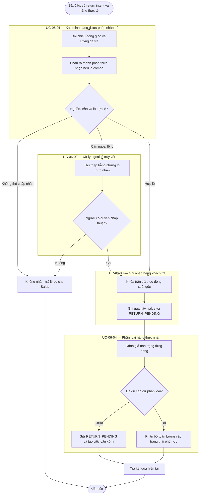

# BJ-06 — Tiếp nhận và phân loại hàng khách trả

## 1. Mục tiêu trải nghiệm

Ghi đúng **hàng thực tế quay về từ khách**, liên kết được với lần giao gốc, không nhận vượt trần và không đưa hàng trở lại bán trước khi phân loại. Việc nhận vật lý và việc phân loại là hai mốc khác nhau trong cùng hành trình.

## 2. Phạm vi và ranh giới

### 2.1 Bắt đầu khi

| Thuộc tính | Nội dung |
|---|---|
| Bắt đầu | Có return intent hợp lệ và hàng thực tế được khách giao lại |
| Kết thúc | Hàng thực nhận đã được ghi vào `RETURN_PENDING` và được phân loại; hoặc vẫn chờ phân loại/ngoại lệ với tác động đã được nói rõ; hoặc không nhận hàng |
| Tác động chính | Quantity/value movement khi nhận; state movement khi phân loại; cập nhật cumulative returned quantity |
| Không quyết định | Khách có được đổi/trả về mặt thương mại, số tiền hoàn, phương thức hoàn tiền hoặc cách xử lý combo ở cấp đơn bán |

### 2.2 Kết thúc khi

| Thuộc tính | Nội dung |
|---|---|
| Bắt đầu | Có return intent hợp lệ và hàng thực tế được khách giao lại |
| Kết thúc | Hàng thực nhận đã được ghi vào `RETURN_PENDING` và được phân loại; hoặc vẫn chờ phân loại/ngoại lệ với tác động đã được nói rõ; hoặc không nhận hàng |
| Tác động chính | Quantity/value movement khi nhận; state movement khi phân loại; cập nhật cumulative returned quantity |
| Không quyết định | Khách có được đổi/trả về mặt thương mại, số tiền hoàn, phương thức hoàn tiền hoặc cách xử lý combo ở cấp đơn bán |

### 2.3 Không bao gồm

| Trong ranh giới | Ngoài ranh giới |
|---|---|
| Đối chiếu dòng giao gốc; kiểm trần trả; nhận từng sản phẩm/thành phần combo thực tế; đối chiếu lô; ghi `RETURN_PENDING`; phân loại sellable/quarantine/damaged/expired | Phê duyệt chính sách đổi trả; refund; đổi sản phẩm; sửa đơn bán; tạo tồn combo |
| Ghi giá trị hàng trả theo căn cứ kỳ xuất gốc và giữ provenance | Chạy lại hoặc sửa COGS của dòng xuất gốc |

**Phụ thuộc bên ngoài:** Theme 5 sở hữu commercial return intent và quyết định combo/partial return. Theme 7 chỉ thực hiện inventory effect trên đúng hàng thực nhận.

## 3. Actor

- Thủ kho; bộ phận trả hàng cung cấp ý định thương mại

## 4. Luồng chính

## 5. Use Case map

## 6. Luồng thay thế và ngoại lệ

### 4. Logic nghiệp vụ cần giữ

| Điểm kiểm soát | Quy tắc |
|---|---|
| Trần trả | `authorized_return_quantity` của ReturnExchangeLine hiện hành là upper bound của request; actual received có thể ít hơn. Server đồng thời recheck cumulative cap dòng giao gốc và source version/precision nguyên tử. |
| Combo | Chỉ thành phần thực nhận tăng tồn; không tạo tồn combo; các dòng trong cùng yêu cầu nhận trả commit hoặc rollback cùng nhau |
| Lô | Với Product theo LOT, return line giữ Product+UOM+source LOT allocation. Actual LOT phải resolve tới LOT hiện hữu hoặc hoàn thiện thuộc tính bắt buộc cho LOT mới. Sai LOT tạo approval case riêng theo line, bind immutable subject/evidence hash; data-integrity conflict không approval override. |
| Mốc ghi giá trị | Ghi value movement cùng lúc nhận vật lý vào `RETURN_PENDING`; phân loại không ghi giá trị lần hai |
| Căn cứ giá | Dùng giá đã đối soát của sản phẩm và kỳ xuất gốc; nếu kỳ gốc chưa đối soát thì dùng snapshot tại lần xuất và giữ liên kết để điều chỉnh theo policy |
| Phân loại | Theme 5 `ReturnCondition` chỉ là tình trạng khai báo. Theme 7 user phân loại `Bán được/Cách ly/Hỏng` cho line chưa hết hạn; `Hết hạn` do hệ thống derive từ expiry + tenant business date và khóa toàn pending quantity của line. |
| Hàng hết hạn | `EXPIRED` là system-derived, không có input quantity của user; line đã hết hạn không thể phân bổ một phần sang sellable/quarantine/damaged. |

### 5. Quan hệ và bàn giao

- Nhận commercial return intent, ReturnExchangeLine/source version, `authorized_return_quantity`, transaction UOM precision và declared `ReturnCondition` từ Theme 5; Theme 7 không sở hữu hoặc tự sửa các quyết định thương mại đó.
- Phần sellable sau phân loại bàn giao cho BJ-01; phần quarantine/damaged/expired bàn giao cho BJ-09 và có thể tiếp tục sang BJ-10.
- Nếu phát hiện sai operation sau khi hoàn tất, dùng BJ-11; không sửa return receipt hoặc movement gốc.
- Giá trị hàng trả được đưa vào BJ-14 để đối soát theo kỳ nguồn.

## 7. UI Flow và chuyển màn hình

### Baseline v2.8.2

UIF-06 is structurally migrated to the live Figma Design System. Business authority remains the BJ/UC/decision and screen contracts; Figma decides component anatomy, variants, tokens, typography, spacing and interaction conventions.

#### Canonical maker route

`SCR-030 Hàng khách trả → SCR-031 Hàng khách trả → SCR-032 Chi tiết hàng trả → SCR-031`.

After receipt commit: `SCR-035 Đã nhận hàng khách trả → SCR-033 Phân loại hàng trả → SCR-035 Kết quả phân loại hàng trả`.

A request already in `Cần phân loại` re-enters directly at `SCR-033`; **Back returns to `SCR-030`**, never to an approver screen. From `SCR-032`, Back returns to the owning `SCR-031`; from `SCR-031`, Back returns to `SCR-030`.

#### Independent approver route

Wrong-LOT approval is a separate actor-handoff context at `SCR-034 Ngoại lệ lô cần duyệt`. It is not a previous/next step in the maker route and must never be reached through generic Back navigation from `SCR-033` or other maker screens.

#### Locked behavior

- Queue defaults to `Tất cả`; one collection uses one List Row family/type/density. Waiting records retain the same collection anatomy; temporary unavailability is expressed by component state rather than ad-hoc affordance removal.
- Request/classification task screens use one compact request-context row instead of repeating three supporting facts before the actionable list. Detail facts remain available where they are needed for a decision.
- Verification is per Product + UOM + source LOT allocation. Each line binds the current Theme 5 ReturnExchangeLine `authorized_return_quantity`; actual physical quantity may be smaller. No quantity aggregation across UOM.
- Actual quantity starts unconfirmed. Source LOT is read-only evidence, not a pre-confirmed actual LOT.
- Wrong LOT requires Phase-1 reason (`RETURNED_DIFFERENT_LOT` or `OTHER` + description), label image and one `LINE_EXCEPTION` ApprovalCase per line, bound to immutable LOT/evidence subject hash. Source-integrity errors are blockers, not reasons.
- Approval does not commit inventory. Receipt is all-or-nothing for the request.
- Classification is per Product + UOM + LOT. For non-expired LOT: user inputs `Bán được + Cách ly + Hỏng = lượng đang chờ phân loại`. For expired LOT: system derives the whole pending line as `Hết hạn`; expired is never a user quantity input.
- `UNKNOWN` never means failure and never offers blind retry.

#### v3.9.4 semantic additions

- Theme 5 `ReturnCondition` is read-only declared context; Theme 7 physical classification remains authoritative for inventory state.
- Existing actual LOT resolves to authoritative lot identity/version. New LOT asks only required attributes after the code is known; data-integrity conflict cannot be approved away.
- Result uses source request/SalesOrder plus `recorded_at`/`classified_at`; `UNKNOWN` hands off to BJ17 / UIF-17 with the same operation identity; **không blind retry**.

## 8. Handoff / phụ thuộc ngoài Journey

## 9. Outcome cuối

| Thuộc tính | Nội dung |
|---|---|
| Bắt đầu | Có return intent hợp lệ và hàng thực tế được khách giao lại |
| Kết thúc | Hàng thực nhận đã được ghi vào `RETURN_PENDING` và được phân loại; hoặc vẫn chờ phân loại/ngoại lệ với tác động đã được nói rõ; hoặc không nhận hàng |
| Tác động chính | Quantity/value movement khi nhận; state movement khi phân loại; cập nhật cumulative returned quantity |
| Không quyết định | Khách có được đổi/trả về mặt thương mại, số tiền hoàn, phương thức hoàn tiền hoặc cách xử lý combo ở cấp đơn bán |

## 10. Truy vết

### Nguồn v3.10.1 — BJ-06 — Tiếp nhận và phân loại hàng khách trả

> **Control/UI amendment v1.3.4:** Return đúng dòng/LOT đi normal flow. LOT thực nhận khác LOT đã xuất thì **luôn maker–checker**: maker ghi evidence, approver khác maker và đúng scope/quyền; approval chỉ cho phép receipt tiếp tục, không tự ghi tồn. Classification bình thường không approval mặc định; cumulative-return cap và expired→sellable là hard guard không override. Xem `T7-DR-108`.

> **Trạng thái:** Release đã đóng băng `4.1.0` — đã remap ID và boundary  
> **Chuyển đổi chính thức:** Theme 7 `4.0.0/BJ-07` → `4.1.0/BJ-06`  
> **Finality contract:** `COMPLETED`, `REJECTED/CANCELLED`, `SUSPENDED/BLOCKED`, `UNKNOWN/ESCALATED`
> **Phạm vi:** Phase 1 — nhận hàng thực tế theo return intent hợp lệ, chưa quản lý serial  
> **Chủ sở hữu nghiệp vụ:** Inventory Operations  
> **Source intent owner:** Sales/Returns
> **Quyết định nghiệp vụ:** `T7-BASELINE-FREEZE-v4.0.0` + `T7-DR-040`, `T7-DR-041`, `T7-DR-043`, `T7-DR-044`, `T7-DR-045`, `T7-DR-048`, `T7-DR-112`, `T7-DR-113`, `T7-DR-131…137`
### Nguồn v3.10.1 — 3. Trường hợp sử dụng

| UC | Tên | Bắt đầu | Kết thúc | Kết quả |
|---|---|---|---|---|
| [UC-06-01](../use-cases/UC-06-01-xac-minh-hang-duoc-phep-nhan-tra.md) | Xác minh hàng được phép nhận trả | Có return intent và hàng vật lý | Hàng đủ điều kiện nhận, cần ngoại lệ hoặc bị từ chối | Return validation result |
| [UC-06-02](../use-cases/UC-06-02-xu-ly-ngoai-le-truy-vet.md) | Xử lý ngoại lệ truy vết | Lô thực nhận không khớp lô đã xuất | Ngoại lệ được chấp thuận hoặc từ chối có bằng chứng | Trace exception decision |
| [UC-06-03](../use-cases/UC-06-03-ghi-nhan-hang-khach-tra.md) | Ghi nhận hàng khách trả | Các dòng thực nhận đã hợp lệ | Toàn yêu cầu được commit vào `RETURN_PENDING` hoặc không có gì commit | Return receipt có quantity/value provenance |
| [UC-06-04](../use-cases/UC-06-04-phan-loai-hang-thuc-nhan.md) | Phân loại hàng thực nhận | Có lượng `RETURN_PENDING` | Toàn lượng được phân loại hoặc giữ pending với việc cần xử lý | Classification result |
### Nguồn v3.10.1 — 6. Nguồn tri thức liên quan

- [Hàng khách trả: từ tiếp nhận đến phân loại](../../../01.knowledge/know-how/KB-KGV-012-hang-khach-tra-tu-tiep-nhan-den-phan-loai.md)
- [Danh tính và vòng đời của một lô hàng](../../../01.knowledge/know-how/KB-KGV-025-danh-tinh-va-vong-doi-cua-mot-lo-hang.md)
- [Combo bán hàng và tồn kho theo thành phần](../../../01.knowledge/know-how/KB-KGV-035-combo-ban-hang-va-ton-kho-theo-thanh-phan.md)
- [Định giá hàng trả, tiêu hủy và chênh lệch thừa thiếu](../../../01.knowledge/know-how/KB-KGV-020-dinh-gia-hang-tra-tieu-huy-va-chenh-lech-thua-thieu.md)
