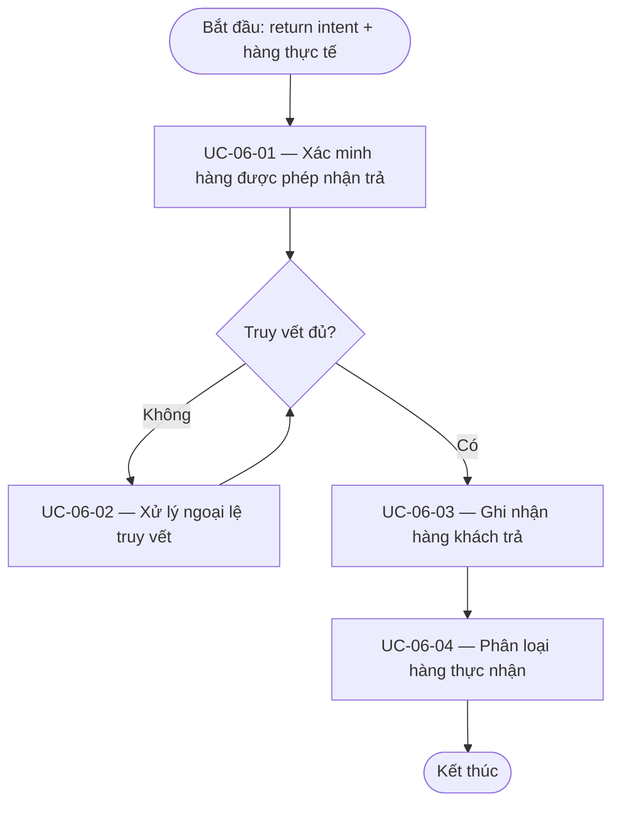

# BJ-06 — Tiếp nhận và phân loại hàng khách trả

## 1. Tổng quan nghiệp vụ & Bối cảnh

Ghi đúng **hàng thực tế quay về từ khách**, liên kết được với lần giao gốc, không nhận vượt trần và không đưa hàng trở lại bán trước khi phân loại. Việc nhận vật lý và việc phân loại là hai mốc khác nhau trong cùng hành trình.

**Bắt đầu khi:** Có return intent hợp lệ và hàng thực tế được khách giao lại.

**Kết thúc khi:** Hàng thực nhận đã được ghi vào `RETURN_PENDING` và được phân loại; hoặc vẫn chờ phân loại/ngoại lệ với tác động đã được nói rõ; hoặc không nhận hàng.

**Không bao gồm:** Khách có được đổi/trả về mặt thương mại, số tiền hoàn, phương thức hoàn tiền hoặc cách xử lý combo ở cấp đơn bán.

## 2. Tác nhân và trách nhiệm

| Tác nhân | Trách nhiệm | Phạm vi thẩm quyền |
|---|---|---|
| Thủ kho; bộ phận trả hàng cung cấp ý định thương mại | Xác minh hàng thực nhận, truy vết giao dịch gốc và phân loại hàng khách trả. | Theme 7 chỉ sở hữu receipt/physical state; quyết định hoàn tiền/thương mại thuộc Theme nguồn. |

## 3. Sơ đồ hành trình nghiệp vụ

## 4. Bản đồ Use Case

| UC — Tên | Mục tiêu | Tác nhân | Đầu vào / Bắt đầu khi | Kết quả | Tiếp tục |
|---|---|---|---|---|---|
| [UC-06-01](../use-cases/UC-06-01-xac-minh-hang-duoc-phep-nhan-tra.md) — Xác minh hàng được phép nhận trả | Hàng đủ điều kiện nhận, cần ngoại lệ hoặc bị từ chối; Return validation result. | Thủ kho; bộ phận trả hàng cung cấp ý định thương mại | Có return intent và hàng vật lý | Hàng đủ điều kiện nhận, cần ngoại lệ hoặc bị từ chối; Return validation result. | UC-06-02 |
| [UC-06-02](../use-cases/UC-06-02-xu-ly-ngoai-le-truy-vet.md) — Xử lý ngoại lệ truy vết | Ngoại lệ được chấp thuận hoặc từ chối có bằng chứng; Trace exception decision. | Thủ kho; bộ phận trả hàng cung cấp ý định thương mại | Lô thực nhận không khớp lô đã xuất | Ngoại lệ được chấp thuận hoặc từ chối có bằng chứng; Trace exception decision. | UC-06-03 |
| [UC-06-03](../use-cases/UC-06-03-ghi-nhan-hang-khach-tra.md) — Ghi nhận hàng khách trả | Toàn yêu cầu được commit vào `RETURN_PENDING` hoặc không có gì commit; Return receipt có quantity/value provenance. | Thủ kho; bộ phận trả hàng cung cấp ý định thương mại | Các dòng thực nhận đã hợp lệ | Toàn yêu cầu được commit vào `RETURN_PENDING` hoặc không có gì commit; Return receipt có quantity/value provenance. | UC-06-04 |
| [UC-06-04](../use-cases/UC-06-04-phan-loai-hang-thuc-nhan.md) — Phân loại hàng thực nhận | Toàn lượng được phân loại hoặc giữ pending với việc cần xử lý; Classification result. | Thủ kho; bộ phận trả hàng cung cấp ý định thương mại | Có lượng `RETURN_PENDING` | Toàn lượng được phân loại hoặc giữ pending với việc cần xử lý; Classification result. | Kết thúc / theo nhánh trên sơ đồ |

## 5. Bàn giao và ranh giới liên quan

| Nơi nhận / Nơi cung cấp | Dữ kiện hoặc trách nhiệm bàn giao | Điều kiện bàn giao / tiếp tục |
|---|---|---|
| Theme 5 / return source | Return intent và source sale lineage | Nguồn cho phép tiếp nhận |
| BJ09 | Hàng sau nhận cần phân loại trạng thái | Physical receipt đã ghi |

## 6. Luồng giao diện cấp hành trình

| Chặng / UC | Chuyển màn hình | Hành động nghiệp vụ |
|---|---|---|
| UC-06-01 — Xác minh hàng được phép nhận trả | `SCR-030`, `SCR-031` | Xác minh hàng khách mang trả có thuộc giao dịch gốc và còn nằm trong phạm vi được phép nhận trả trước khi ghi nhận vật lý. |
| UC-06-02 — Xử lý ngoại lệ truy vết | `SCR-031`, `SCR-032`, `SCR-034` | Xử lý trường hợp hàng trả không truy vết thẳng được về dòng xuất/lô gốc bằng bằng chứng và quyết định ngoại lệ có thẩm quyền. |
| UC-06-03 — Ghi nhận hàng khách trả | `SCR-031`, `SCR-032`, `SCR-035` | Ghi lượng hàng khách thực tế trả vào tồn vật lý ở `RETURN_PENDING` cùng giá trị theo căn cứ kỳ xuất gốc, trước khi phân loại sử dụng tiếp. |
| UC-06-04 — Phân loại hàng thực nhận | `SCR-033`, `SCR-035` | Phân loại hàng khách trả đã nằm trong `RETURN_PENDING` sang trạng thái vật lý phù hợp mà không ghi quantity/value lần hai. |

## 7. Nghiệm thu hành trình (Journey Acceptance)

| ID | Điều kiện ở cấp hành trình | Kết quả cần bảo đảm | UC / BC liên quan |
|---|---|---|---|
| JA-01 | Journey bắt đầu từ đúng trigger và actor có quyền | Kết quả chỉ được ghi trong phạm vi authority của Theme 7; source ngoài Theme không bị sửa ngầm | UC-06-01 / BC liên quan |
| JA-02 | Một nhánh bị từ chối, blocked hoặc chưa xác định | Không được báo thành công hoặc tạo tác động bán phần; hướng xử lý/owner tiếp theo phải rõ | UC-06-01…UC-06-04 |
| JA-03 | Journey hoàn tất thành công | Kết quả cuối có provenance, thời điểm/phạm vi và đủ dữ kiện cho consumer tiếp theo | UC-06-04 / Domain ledger |

## 8. Truy vết

| Nguồn | Vai trò đối với hành trình |
|---|---|
| [Decision Register](../../../01.knowledge/decisions/decision-register.md) — Decision Register theo UC/BC | Nguồn quyết định nghiệp vụ và trạng thái hiệu lực |
| `DOM-IO` | Domain authority và invariants dùng cho Journey |
| [Use Case Map](../use-cases/00-use-case-map.md) | Danh mục UC canonical của Theme 7 |
