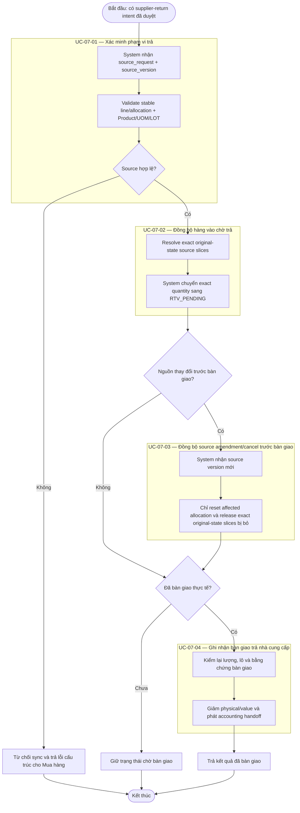
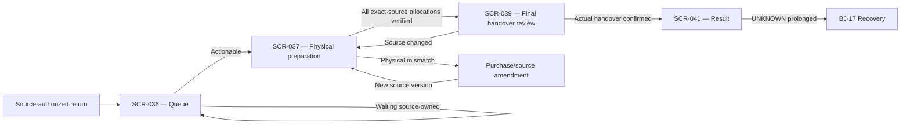

# BJ-07 — Thực hiện trả hàng cho nhà cung cấp

## 1. Mục tiêu trải nghiệm

Loại hàng đã được chấp thuận trả khỏi khả dụng và chỉ giảm **tồn vật lý, giá trị tồn kho** khi hàng thực sự được bàn giao cho nhà cung cấp hoặc đơn vị vận chuyển.

## 2. Phạm vi và ranh giới

### 2.1 Bắt đầu khi

| Thuộc tính | Nội dung |
|---|---|
| Bắt đầu | Capability Mua hàng gửi supplier-return intent đã đủ nguồn, phiên bản và thẩm quyền |
| Kết thúc | Yêu cầu đang chờ bàn giao, đã được điều chỉnh/hủy trước bàn giao, đã bàn giao thành công, hoặc bị từ chối mà không tạo tác động bán phần |
| Tác động chính | Hệ thống đồng bộ exact source allocations vào `RTV_PENDING` khi source authorization/version có hiệu lực; actual handover mới giảm physical/value và phát accounting handoff |
| Không quyết định | Nhà cung cấp có chấp thuận thương mại hay không, giảm công nợ bao nhiêu hoặc hạch toán chênh lệch thế nào |

### 2.2 Kết thúc khi

| Thuộc tính | Nội dung |
|---|---|
| Bắt đầu | Capability Mua hàng gửi supplier-return intent đã đủ nguồn, phiên bản và thẩm quyền |
| Kết thúc | Yêu cầu đang chờ bàn giao, đã được điều chỉnh/hủy trước bàn giao, đã bàn giao thành công, hoặc bị từ chối mà không tạo tác động bán phần |
| Tác động chính | Hệ thống đồng bộ exact source allocations vào `RTV_PENDING` khi source authorization/version có hiệu lực; actual handover mới giảm physical/value và phát accounting handoff |
| Không quyết định | Nhà cung cấp có chấp thuận thương mại hay không, giảm công nợ bao nhiêu hoặc hạch toán chênh lệch thế nào |

### 2.3 Không bao gồm

| Trong ranh giới | Ngoài ranh giới |
|---|---|
| System intake/source-version sync; resolve exact original-state source slices; physical verification; structured mismatch observation; system release/update pending trước bàn giao; ghi nhận actual handover | Tạo purchase-return commercial intent; thương lượng giá trả; debit note; giảm công nợ |
| Giảm tồn theo lô và giá trị theo official cost tại lúc bàn giao | Chuyển kho; mô phỏng trả NCC bằng adjustment |

**Phụ thuộc bên ngoài:** Capability Mua hàng sở hữu lý do thương mại, supplier approval và lượng được phép trả. Theme Kế toán sở hữu tác động công nợ và hạch toán chênh lệch.

## 3. Actor

- System process; Purchase/source là upstream authority
- System process; Purchase/source phát source version mới
- Thủ kho; bộ phận mua hàng cung cấp ý định trả

## 4. Luồng chính

## 5. Use Case map

## 6. Luồng thay thế và ngoại lệ

### 4. Logic nghiệp vụ cần giữ

| Điểm kiểm soát | Quy tắc |
|---|---|
| Giới hạn lượng | Lượng trả không vượt đồng thời lượng còn được source cho phép và lượng tenant thực có theo đúng sản phẩm/lô |
| Exact source scope | Kho bàn giao đúng Product + UOM + LOT allocation của source version hiện hành; không warehouse-side partial hoặc LOT substitution |
| Stable source identity | `source_request_id + source_version → source_line_id → source_allocation_id`; allocation ID ổn định qua version khi cùng business subject. |
| Original-state source slice | Mỗi allocation phải khóa `1..N` source slices gồm exact balance/stock state + LOT + quantity + balance version. Một composition hợp lệ thì system auto-resolve; nhiều composition hợp lệ mới hỏi Kho “Xác định nguồn tồn”. |
| Physical mismatch observation | `QUANTITY/LOT/ITEM_NOT_FOUND/OTHER` được lưu immutable với actual fact tương ứng; không tạo stock effect và không cho Kho sửa source. |
| Physical mismatch | Không tự sửa quantity/LOT tại kho; block handover và chờ source amendment/new version |
| Granular invalidation | Source change chỉ reset affected verification; unaffected evidence giữ nguyên; source remove/cancel system-release phần pending |
| Nguồn nhập | Giữ liên kết đến receipt/source nhập gốc khi nguồn cung cấp; không tự tạo quan hệ thương mại mới |
| Mốc loại khỏi khả dụng | Khi supplier return đã được chấp thuận và lượng chuyển `RTV_PENDING` |
| Mốc giảm vật lý | Chỉ khi có bằng chứng bàn giao thực tế; tạo hồ sơ chờ trả không giảm physical |
| Sửa trước bàn giao | Không sửa trực tiếp payload đã khóa; source version mới tạo thay đổi có truy vết và chỉ giải phóng phần chưa bàn giao |
| Giá trị | Giảm theo official cost có hiệu lực. Commercial supplier price/debit note/payable difference thuộc Purchase/Accounting; thiếu commercial price không được block physical handover. |
| Công nợ | Chỉ Theme Kế toán được giảm công nợ hoặc hạch toán chênh lệch |

### 5. Quan hệ và bàn giao

- Nhận commercial intent từ Purchase/Supplier Returns và trả kết quả bàn giao về capability đó.
- Có thể nhận hàng quarantine/damaged/expired từ BJ-09 nhưng phải chuyển qua `RTV_PENDING` bằng operation có nguồn.
- Nếu hàng thực tế bị tiêu hủy thay vì trả, dùng BJ-10; hai hành trình không thay thế lẫn nhau.
- Accounting handoff được chuyển sang Theme Kế toán; Theme 7 không suy ra khoản phải trả mới.

## 7. UI Flow và chuyển màn hình

> **Product/UI baseline v3.9.5.** Supplier return là source-authorized; **Figma Design System** là UI authority; HTML là implementation/verification workbench. Business authority vẫn là BJ/UC/Decision/behavioral/UI contracts.

### Active Product flow

`SCR-036 Hàng chờ trả NCC → SCR-037 Chuẩn bị/xác minh hàng vật lý → SCR-039 Rà soát bàn giao → SCR-041 Kết quả`.

`SCR-038` **không thuộc UIF-07**; screen này chỉ được bảo toàn cho UIF-09.

### Entry & source ownership v1.4.3

- `MODULE_ENTRY`: `SCR-036 — Hàng chờ trả nhà cung cấp`. Source ownership nằm trong contract/Inspect; Product UI chỉ hiển thị request/supplier/source cần cho thao tác, không thêm câu giải thích handoff thường trực.
- `CONTEXTUAL_DEEP_LINK`: một supplier-return task cụ thể có thể mở `SCR-037`; Product UI giữ request/supplier/source document nhưng không lặp prose giải thích actor handoff nếu không giúp quyết định hiện tại.
- Physical mismatch/source delta không tạo quyền sửa commercial source cho Kho. Task chuyển trạng thái chờ **Mua hàng cập nhật yêu cầu**; source version mới re-enter cùng `SCR-037`, chỉ affected verification bị invalid.
- Waiting/source-owned row ở `SCR-036` vẫn thuộc cùng collection của request; giữ `Navigation / Default` anatomy nhưng dùng `State=Disabled`, không click. Availability là state, không đổi component type.
- Result quay về supplier-return queue; prolonged UNKNOWN handoff BJ17, không blind retry.

### Locked business/UX invariants v1.3.9

1. Purchase/source quyết định commercial supplier return. Inventory không approval thương mại lần hai.
2. `RTV_PENDING` loại khỏi availability nhưng chưa giảm physical/value. Chỉ actual handover tại `SCR-039` mới commit physical/value.
3. Queue phân biệt **Cần chuẩn bị / Sẵn sàng / Đang chờ**. Waiting/source-owned task là read-only và không có affordance tiếp tục mutation.
4. Physical verification theo **Product + UOM → 1..N LOT allocations**. Cùng Product khác UOM là item riêng.
5. Source quantity/LOT là read-only business facts; kho không tự giảm quantity, không tự thay LOT và không có warehouse-side partial handover.
6. Nếu hàng vật lý không khớp source, commit bị khóa. Purchase/source phải amendment và phát source version mới trước khi kho tiếp tục.
7. Scan/typed LOT chỉ hỗ trợ xác minh. Blank được phép; LOT khác source là blocker và không silent-substitute.
8. Source update add/change/remove/cancel chỉ invalidate **affected verification**; evidence không bị ảnh hưởng được giữ. Lượng bị source remove/cancel được hệ thống release khỏi pending.
9. Source cancel trước handover đóng task; kho không có thao tác “khôi phục trạng thái”.
10. `SCR-039` là một explicit final review surface; không lặp thêm confirmation modal. Không aggregate quantity khác UOM thành một tổng.
11. Source/version phải recheck tại final commit. Nếu stale, quay về `SCR-037` với delta thay vì commit trên version cũ.
12. `SCR-041` là finality surface: `COMPLETED`, `REJECTED_EXECUTION`, `UNKNOWN`, `PERMISSION_DENIED`; không Back vào consumed commit screen. UNKNOWN dùng cùng operation identity, không blind retry; kéo dài thì BJ-17.

### Transition contract

| ID | Transition |
|---|---|
| UIF-07-T01 | Source-authorized request xuất hiện ở SCR-036 |
| UIF-07-T02 | Mở actionable request → SCR-037 |
| UIF-07-T03 | Source amendment/correction cập nhật cùng preparation context; affected evidence reset granular |
| UIF-07-T04 | Tất cả allocation đúng source được verify → SCR-039 |
| UIF-07-T05 | Source/version đổi hoặc mismatch tại final review → SCR-037 |
| UIF-07-T06 | Xác nhận actual handover → SCR-041 |
| UIF-07-T07 | Final result → về SCR-036 an toàn |
| UIF-07-T08 | UNKNOWN kéo dài → BJ-17 |

### Mandatory fixture matrix

Phải cover: multi-product, same Product different UOM, multi-LOT, source qty/LOT/add/remove delta, granular invalidation, scan đúng/sai LOT, physical mismatch, waiting read-only, source cancel, leave/resume, stale ở final review, COMPLETED/REJECTED/UNKNOWN/PERMISSION, search no-result và 402×874 overflow.

### v2.9.1 — Queue & information-hierarchy correction

- `SCR-036` là **một list request duy nhất** sau Search & Filter Header. Không chèn các heading trạng thái như “Cần chuẩn bị / Sẵn sàng bàn giao / Đang chờ cập nhật” vào giữa list. Mọi record dùng cùng `DS v2 / List Row`, `Type=Navigation`, `Density=Default`; trạng thái công việc nằm ở `VBadge`. Request chưa thể mở dùng `State=Disabled`, giữ cùng geometry/chevron nhưng không tương tác.
- `SCR-037` dùng hierarchy **request context → Product+UOM section → allocation LOT rows**. Product+UOM là structural `VSection` composition (`VText + VBadge`), không dùng List Row/card; LOT/non-LOT allocation là `Navigation / Default` List Row. Product và LOT không còn cùng visual weight.
- `SCR-039` chỉ giữ context cần quyết định (`Nhà cung cấp / Yêu cầu trả / Kho`), sau đó mỗi Product+UOM là section heading rõ ràng và các LOT/non-LOT là `Key-value Row`. Chỉ được cộng quantity trong chính một Product+UOM group; tuyệt đối không có grand total xuyên UOM.
- `SCR-041 COMPLETED` tái sử dụng đúng evidence hierarchy của final review: Product+UOM section → allocation key-value rows. Hero finality đứng riêng; evidence factual căn trái và scan được nhanh.
- Không tạo component Theme 7 mới. Product viewport giữ `402×874`; review bezel/scale ở ngoài Product UI.
- Correction này khóa thêm kinh nghiệm: **collection không bị chia bởi status heading; parent entity và child allocation phải khác visual hierarchy; final review/result ưu tiên fact scanning hơn decoration.**

### v2.9.2 — Canonical Product-group composition

- Supersedes the v2.9.1 visual implementation of Product+UOM as a raw section heading. Product+UOM identity/status is now a real `List Row / Status / Compact` inside a bordered group surface.
- `SCR-037`: Product summary row → exact LOT/non-LOT Navigation rows.
- `SCR-039` and `SCR-041`: Product summary row → exact allocation Key-value evidence.
- Quantity badge is scoped to the same Product+UOM only; mixed UOM is never aggregated.
- This correction changes visual composition only; source ownership, verification, invalidation and actual-handover commit rules are unchanged.

### v2.9.3 — Layout correction lock

- Figma Layout `Surface Grouping 4518:1545` is now an explicit BJ07 visual contract: dense homogeneous collections use one light grouped surface, not repeated/nested Product cards.
- Product+UOM remains canonical Status/Compact List Row; actionable allocation remains Navigation/Default; final review/result allocation becomes Key-value fact.
- Quantities are data values. VBadge is reserved for workflow/status semantics.
- No business transition, inventory effect, source ownership or finality rule changes in this release.

### v3.9.5 — Supplier-return semantic lock

- Before `SCR-036`, Purchase/source authorization is synchronized by **BC-IO-17**. `RTV_PENDING` is system-owned; no Warehouse CTA changes inventory state into pending.
- Source identity is stable: `source_request_id + source_version → source_line_id → source_allocation_id`. Source delta invalidates only affected allocation verification.
- Every supplier-return allocation owns exact original-state source slices. One valid stock-state composition is auto-resolved; only ambiguous composition progressively opens **Xác định nguồn tồn** in `SCR-037`.
- `Không khớp` opens a structured observation sheet (`QUANTITY`, `LOT`, `ITEM_NOT_FOUND`, `OTHER`). Submitting the observation has **no stock effect** and moves the task to `Chờ cập nhật yêu cầu`.
- `SCR-039` rechecks source + exact source slices and never requires supplier-approved commercial price. Official cost owns inventory value reduction.
- `SCR-041` shows server-authoritative handover time and uses immutable source-agnostic HandoverEvidence. UNKNOWN keeps the same handover identity and hands prolonged recovery to BJ17.
- Search copy is `Tìm mã yêu cầu, NCC hoặc chứng từ`. Source delta copy states the concrete business change; raw source version stays contract-only.

#### Additional mandatory fixtures

- One supplier-return allocation with multiple valid original stock-state compositions.
- Structured LOT mismatch observation that preserves actual LOT, becomes waiting/read-only, then resolves through a new source version while unaffected verification remains valid.
- Handover with no commercial supplier price still commits physical/value using official cost and creates generalized HandoverEvidence.

## 8. Handoff / phụ thuộc ngoài Journey

## 9. Outcome cuối

| Thuộc tính | Nội dung |
|---|---|
| Bắt đầu | Capability Mua hàng gửi supplier-return intent đã đủ nguồn, phiên bản và thẩm quyền |
| Kết thúc | Yêu cầu đang chờ bàn giao, đã được điều chỉnh/hủy trước bàn giao, đã bàn giao thành công, hoặc bị từ chối mà không tạo tác động bán phần |
| Tác động chính | Hệ thống đồng bộ exact source allocations vào `RTV_PENDING` khi source authorization/version có hiệu lực; actual handover mới giảm physical/value và phát accounting handoff |
| Không quyết định | Nhà cung cấp có chấp thuận thương mại hay không, giảm công nợ bao nhiêu hoặc hạch toán chênh lệch thế nào |

## 10. Truy vết

### Nguồn v3.10.1 — BJ-07 — Thực hiện trả hàng cho nhà cung cấp

> **Control/UI amendment v1.3.4:** Supplier-return commercial intent đã được Purchase/source authorize trước khi vào BJ-07. Theme 7 **không duyệt thương mại lần hai**; chỉ xác minh stock/LOT, quản lý `RTV_PENDING`, áp source-version change cho phần chưa bàn giao và xác nhận actual handover. Xem `T7-DR-109`.

> **Trạng thái:** Release đã đóng băng `4.1.0` — đã remap ID và boundary  
> **Chuyển đổi chính thức:** Theme 7 `4.0.0/BJ-08` → `4.1.0/BJ-07`  
> **Finality contract:** `COMPLETED`, `REJECTED/CANCELLED`, `SUSPENDED/BLOCKED`, `UNKNOWN/ESCALATED`
> **Phạm vi:** Phase 1 — trả từ một kho mặc định theo supplier-return intent được chấp thuận  
> **Chủ sở hữu nghiệp vụ:** Inventory Operations  
> **Source intent owner:** Theme 10 — Mua hàng / Supplier Returns
> **Quyết định nghiệp vụ:** `T7-BASELINE-FREEZE-v4.0.0` + `T7-DR-042`, `T7-DR-054`
### Nguồn v3.10.1 — 3. Trường hợp sử dụng

| UC | Tên | Bắt đầu | Kết thúc | Kết quả |
|---|---|---|---|---|
| [UC-07-01](../use-cases/UC-07-01-xac-minh-pham-vi-tra.md) | Xác minh phạm vi trả | Có supplier-return intent được duyệt | Hồ sơ hợp lệ hoặc bị từ chối | Validated return scope |
| [UC-07-02](../use-cases/UC-07-02-dua-hang-vao-cho-tra.md) | Đồng bộ hàng vào chờ trả | Có source allocation hợp lệ | Hệ thống resolve source slices và chuyển exact quantity sang `RTV_PENDING`, không có warehouse CTA | Pending supplier return |
| [UC-07-03](../use-cases/UC-07-03-dieu-chinh-hoac-huy-truoc-ban-giao.md) | Đồng bộ amendment/cancel trước bàn giao | Source phát version mới khi chưa bàn giao | Chỉ affected allocation reset; phần bỏ trả được system release về exact original stock state | Amended/cancelled pending return |
| [UC-07-04](../use-cases/UC-07-04-ghi-nhan-ban-giao-tra-nha-cung-cap.md) | Ghi nhận bàn giao trả nhà cung cấp | Có handover assertion và lượng pending hợp lệ | Tồn vật lý/giá trị giảm hoặc toàn operation bị từ chối | Supplier return issue result |
### Nguồn v3.10.1 — 6. Nguồn tri thức liên quan

- [Trả hàng cho nhà cung cấp](../../../01.knowledge/know-how/KB-KGV-013-tra-hang-cho-nha-cung-cap.md)
- [Chọn hàng để xuất và thời điểm hoàn tất xuất bán](../../../01.knowledge/know-how/KB-KGV-010-chon-hang-de-xuat-va-thoi-diem-hoan-tat-xuat-ban.md)
- [Đơn giá tồn kho chính thức và tổng giá trị ghi sổ](../../../01.knowledge/know-how/KB-KGV-015-don-gia-ton-kho-chinh-thuc-va-tong-gia-tri-ghi-so.md)
- [Tính nguyên tử khi ghi tồn kho và phát sự kiện](../../../01.knowledge/know-how/KB-KGV-029-tinh-nguyen-tu-khi-ghi-ton-kho-va-phat-su-kien.md)
