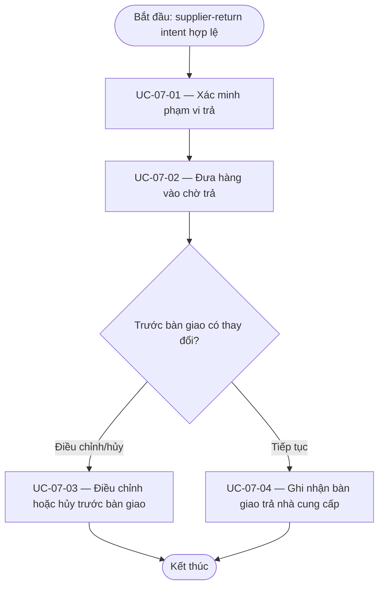

# BJ-07 — Thực hiện trả hàng cho nhà cung cấp

## 1. Tổng quan nghiệp vụ & Bối cảnh

Loại hàng đã được chấp thuận trả khỏi khả dụng và chỉ giảm **tồn vật lý, giá trị tồn kho** khi hàng thực sự được bàn giao cho nhà cung cấp hoặc đơn vị vận chuyển.

**Bắt đầu khi:** Capability Mua hàng gửi supplier-return intent đã đủ nguồn, phiên bản và thẩm quyền.

**Kết thúc khi:** Yêu cầu đang chờ bàn giao, đã được điều chỉnh/hủy trước bàn giao, đã bàn giao thành công, hoặc bị từ chối mà không tạo tác động bán phần.

**Không bao gồm:** Nhà cung cấp có chấp thuận thương mại hay không, giảm công nợ bao nhiêu hoặc hạch toán chênh lệch thế nào.

## 2. Tác nhân và trách nhiệm

| Tác nhân | Trách nhiệm | Phạm vi thẩm quyền |
|---|---|---|
| System process; Purchase/source là upstream authority | Đồng bộ intent trả NCC và phạm vi hàng chờ trả từ source đã được phê duyệt. | Không tự tạo/sửa authorization mua hàng trong Theme 7. |
| System process; Purchase/source phát source version mới | Đồng bộ amend/cancel của authorization trả NCC vào lượng `RTV_PENDING`. | Chỉ phản ánh source version hiện hành; không ghi xuất vật lý. |
| Thủ kho; bộ phận mua hàng cung cấp ý định trả | Bàn giao thực tế cho NCC và ghi giảm quantity/value khi source/pending scope còn hợp lệ. | Không giảm công nợ NCC; đó là owner ngoài Theme 7. |

## 3. Sơ đồ hành trình nghiệp vụ

## 4. Bản đồ Use Case

| UC — Tên | Mục tiêu | Tác nhân | Đầu vào / Bắt đầu khi | Kết quả | Tiếp tục |
|---|---|---|---|---|---|
| [UC-07-01](../use-cases/UC-07-01-xac-minh-pham-vi-tra.md) — Xác minh phạm vi trả | Hồ sơ hợp lệ hoặc bị từ chối; Validated return scope. | System process; Purchase/source là upstream authority | Có supplier-return intent được duyệt | Hồ sơ hợp lệ hoặc bị từ chối; Validated return scope. | UC-07-02 |
| [UC-07-02](../use-cases/UC-07-02-dua-hang-vao-cho-tra.md) — Đồng bộ hàng vào chờ trả | Lượng được chuyển sang `RTV_PENDING` và loại khỏi khả dụng; Pending supplier return. | System process; Purchase/source là upstream authority | Có scope hợp lệ | Lượng được chuyển sang `RTV_PENDING` và loại khỏi khả dụng; Pending supplier return. | UC-07-03 |
| [UC-07-03](../use-cases/UC-07-03-dieu-chinh-hoac-huy-truoc-ban-giao.md) — Điều chỉnh hoặc hủy trước bàn giao | Lượng pending được cập nhật, phần bỏ trả quay về trạng thái nguồn hợp lệ; Amended/cancelled pending return. | System process; Purchase/source phát source version mới | Source giảm lượng hoặc hủy khi chưa bàn giao | Lượng pending được cập nhật, phần bỏ trả quay về trạng thái nguồn hợp lệ; Amended/cancelled pending return. | UC-07-04 |
| [UC-07-04](../use-cases/UC-07-04-ghi-nhan-ban-giao-tra-nha-cung-cap.md) — Ghi nhận bàn giao trả nhà cung cấp | Tồn vật lý/giá trị giảm hoặc toàn operation bị từ chối; Supplier return issue result. | Thủ kho; bộ phận mua hàng cung cấp ý định trả | Có handover assertion và lượng pending hợp lệ | Tồn vật lý/giá trị giảm hoặc toàn operation bị từ chối; Supplier return issue result. | Kết thúc / theo nhánh trên sơ đồ |

## 5. Bàn giao và ranh giới liên quan

| Nơi nhận / Nơi cung cấp | Dữ kiện hoặc trách nhiệm bàn giao | Điều kiện bàn giao / tiếp tục |
|---|---|---|
| Theme 10 / Purchase | Supplier-return intent/version | Theme 10 sở hữu quyết định thương mại |
| Theme 6/9 | Accounting/payable handoff từ kết quả bàn giao | Sau physical/value issue thành công |

## 6. Liên kết thiết kế

- **UI Flow canonical:** [UIF-07 — Thực hiện trả hàng cho nhà cung cấp](../../../03.design/flows/UIF-07-BJ-07.md)
- BJ này chỉ sở hữu **business boundary, mục tiêu, UC/handoff và acceptance ở cấp hành trình**.
- Screen-to-screen routing, entry/terminal, actor handoff, state/recovery và transition nằm tại `UIF-07`; anatomy/action chi tiết nằm tại `03.design/screens/`.
- Không copy Screen Flow vào BJ để tránh trùng với UC/UIF và để redesign UI không làm thay đổi semantic của Journey.

## 7. Nghiệm thu hành trình (Journey Acceptance)

| ID | Điều kiện ở cấp hành trình | Kết quả cần bảo đảm | UC / BC liên quan |
|---|---|---|---|
| JA-01 | Journey bắt đầu từ đúng trigger và actor có quyền | Kết quả chỉ được ghi trong phạm vi authority của Theme 7; source ngoài Theme không bị sửa ngầm | UC-07-01 / BC liên quan |
| JA-02 | Một nhánh bị từ chối, blocked hoặc chưa xác định | Không được báo thành công hoặc tạo tác động bán phần; hướng xử lý/owner tiếp theo phải rõ | UC-07-01…UC-07-04 |
| JA-03 | Journey hoàn tất thành công | Kết quả cuối có provenance, thời điểm/phạm vi và đủ dữ kiện cho consumer tiếp theo | UC-07-04 / Domain ledger |

## 8. Truy vết

| Nguồn | Vai trò đối với hành trình |
|---|---|
| [Decision Register](../../../01.knowledge/decisions/decision-register.md) — Decision Register theo UC/BC | Nguồn quyết định nghiệp vụ và trạng thái hiệu lực |
| `DOM-IO` | Domain authority và invariants dùng cho Journey |
| [Use Case Map](../use-cases/00-use-case-map.md) | Danh mục UC canonical của Theme 7 |
