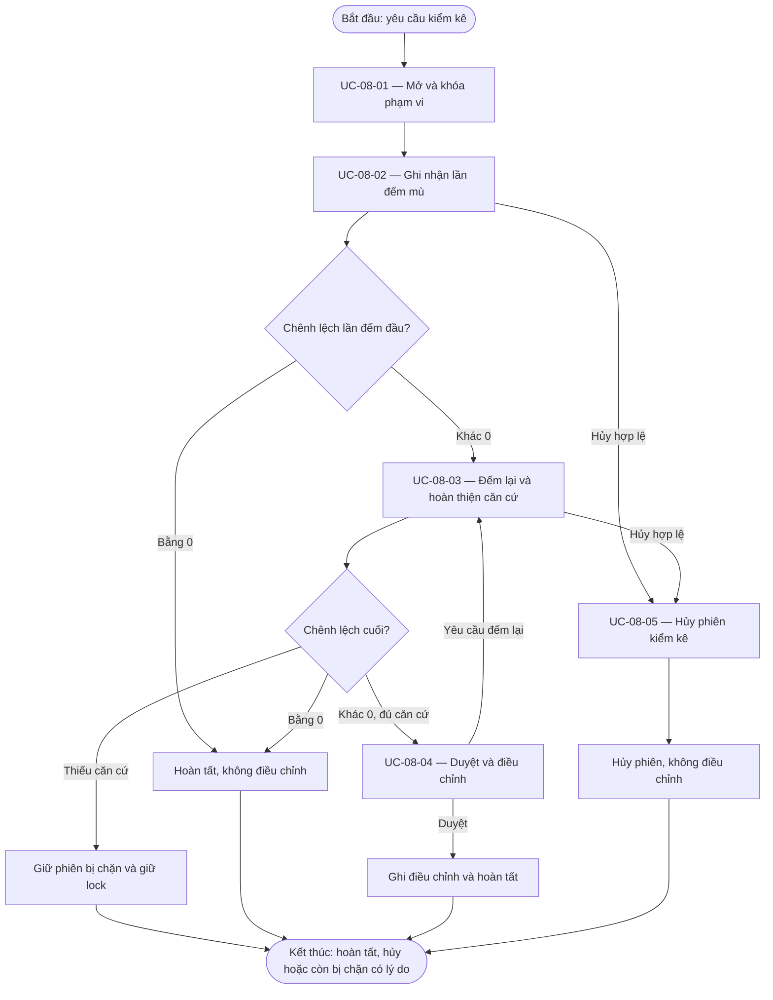

# BJ-08 — Kiểm kê và điều chỉnh chênh lệch

## 1. Tổng quan nghiệp vụ & Bối cảnh

So sánh hàng thực tế với **book snapshot tại đúng cut-off đã khóa**, dùng đếm mù và các vòng recount bất biến; chỉ tạo điều chỉnh số lượng/giá trị khi final variance còn khác 0 và được người duyệt độc lập phê duyệt trên đúng risk/value basis hiện hành.

**Bắt đầu khi:** Người có quyền yêu cầu kiểm kê một warehouse/phạm vi hợp lệ.

**Kết thúc khi:** Session `COMPLETED` và lock đã release; hoặc `CANCELLED`; hoặc vẫn `BLOCKED` chờ căn cứ mà chưa ghi adjustment. Mutation `UNKNOWN` được bàn giao BJ17.

**Không bao gồm:** Điều tra nguyên nhân nhân sự; sửa Product master; tự nhập giá cho hàng thừa; sửa operation nguồn khi scope đang khóa.

## 2. Tác nhân và trách nhiệm

| Tác nhân | Trách nhiệm | Phạm vi thẩm quyền |
|---|---|---|
| Người có quyền mở kiểm kê | Chọn phạm vi/lý do và khởi tạo phiên | Không được mở nếu scope conflict hoặc còn valuation chưa giải quyết |
| Người đếm được phân công | Ghi FIRST/RECOUNT theo đếm mù và bằng chứng vật lý | Không xem book/variance trước FIRST submit; không nhập giá trị hàng thừa |
| Người duyệt: `is_owner` hoặc vai trò `store_owner`, khác người lập (trừ ngoại lệ `is_owner` tự duyệt) | Duyệt exact final variance snapshot hoặc yêu cầu recount trên phiên kiểm kê. | **Người duyệt** là `is_owner` hoặc vai trò `store_owner`, khác người lập. **Ngoại lệ:** cửa hàng chỉ có một chủ, nên `is_owner` lập phiên kiểm kê (kể cả khi chủ tự đếm) thì vẫn gửi duyệt rồi tự duyệt ở màn duyệt (không có đường ghi nhận thẳng); lịch sử ghi người duyệt "Chủ cửa hàng". Không sửa số đếm. |
| Hệ thống | Khóa scope/cutoff, tính variance/risk, ghi adjustment và giải phóng lock | Không tự hợp thức hóa surplus thiếu value basis |

## 3. Sơ đồ hành trình nghiệp vụ

## 4. Bản đồ Use Case

| UC | Mục tiêu | Tác nhân | Bắt đầu khi | Kết quả |
|---|---|---|---|---|
| [UC-08-01](../use-cases/UC-08-01-mo-va-khoa-pham-vi.md) | Khóa exact scope + cut-off trước đếm | Người mở kiểm kê | Có yêu cầu kiểm kê hợp lệ | Session OPEN/LOCKED + CountScopeSnapshot + InventoryLock |
| [UC-08-02](../use-cases/UC-08-02-ghi-nhan-lan-dem-mu.md) | Ghi FIRST count không bị book quantity chi phối | Assigned counter | Session OPEN/LOCKED | Immutable FIRST submission; zero variance hoặc RECOUNT_REQUIRED |
| [UC-08-03](../use-cases/UC-08-03-dem-lai-va-hoan-thien-bang-chung.md) | Tạo recount bất biến và final count hiện hành | Assigned counter | Có variance/REQUEST_RECOUNT | Zero variance complete hoặc non-zero basis ready/blocked |
| [UC-08-04](../use-cases/UC-08-04-duyet-va-dieu-chinh.md) | Duyệt exact variance snapshot hoặc yêu cầu recount | Independent approver | Non-zero final variance + current basis/case | Adjustment + complete/unlock hoặc recount requirement |
| [UC-08-05](../use-cases/UC-08-05-huy-phien-kiem-ke.md) | Dừng session an toàn | Người có quyền hủy | Session chưa final và policy cho phép | CANCELLED, no adjustment, lock released |

## 5. Bàn giao và ranh giới liên quan

| Nơi cung cấp/nhận | Dữ kiện | Điều kiện |
|---|---|---|
| BJ01 / ledger | Book snapshot tại cutoff | Scope barrier đã khóa |
| BJ03 | Valuation readiness | Scope có mixed/VALUATION_PENDING thì BJ08 chưa mở session |
| BJ11/BJ16 | Correction/reconciliation nguồn | Chỉ sau khi count session kết thúc; không sửa nguồn trong lock |
| BJ14 | Value facts từ approved adjustment | Sau adjustment commit |
| BJ17 | Same command/session identity khi mutation `UNKNOWN` | Không blind retry |

## 6. Liên kết thiết kế

- **UI Flow canonical:** [UIF-08 — Kiểm kê và điều chỉnh chênh lệch](../../../03.design/flows/UIF-08-BJ-08.md)
- BJ này chỉ sở hữu **business boundary, mục tiêu, UC/handoff và acceptance ở cấp hành trình**.
- Screen-to-screen routing, entry/terminal, actor handoff, state/recovery và transition nằm tại `UIF-08`; anatomy/action chi tiết nằm tại `03.design/screens/`.
- Không copy Screen Flow vào BJ để tránh trùng với UC/UIF và để redesign UI không làm thay đổi semantic của Journey.

## 7. Nghiệm thu hành trình (Journey Acceptance)

| ID | Điều kiện | Kết quả cần bảo đảm | Trace |
|---|---|---|---|
| JA-01 | Mở phiên thành công | Scope membership, cutoff, book snapshot và lock cùng atomic boundary | UC-08-01 / BC-IC-01 |
| JA-02 | FIRST/recount | Evidence round cũ bất biến; người đếm không thấy book trước FIRST submit | UC-08-02/03 |
| JA-03 | Final variance = 0 | Complete + unlock, không ApprovalCase/adjustment | UC-08-02/03 |
| JA-04 | Final variance ≠ 0 | Chỉ current independent approval + current risk/value basis mới được commit | UC-08-04 |
| JA-05 | Hủy | Giữ evidence, không adjustment, release lock | UC-08-05 |
| JA-06 | UNKNOWN | Không ghi lần hai; handoff BJ17 cùng identity | UC-08-01/02/03/04/05 |

## 8. Truy vết

- **Bài tri thức cốt lõi:** [KB-KGV-011 — Kiểm kê hàng tồn kho từ khóa phạm vi đến điều chỉnh chênh lệch](../../../01.knowledge/know-how/KB-KGV-011-kiem-ke-hang-ton-kho-tu-khoa-pham-vi-den-dieu-chinh-chenh-lech.md); [KB-KGV-020 — Định giá hàng trả, tiêu hủy và chênh lệch thừa thiếu](../../../01.knowledge/know-how/KB-KGV-020-dinh-gia-hang-tra-tieu-huy-va-chenh-lech-thua-thieu.md); [KB-KGV-021 — Sửa sai tồn kho mà không sửa lịch sử](../../../01.knowledge/know-how/KB-KGV-021-sua-sai-ton-kho-khong-sua-lich-su.md); [KB-KGV-029 — Tính nguyên tử khi ghi tồn kho và phát sự kiện](../../../01.knowledge/know-how/KB-KGV-029-tinh-nguyen-tu-khi-ghi-ton-kho-va-phat-su-kien.md); [KB-KGV-032 — Movement ledger, số dư dẫn xuất và phục hồi sau sự cố](../../../01.knowledge/know-how/KB-KGV-032-movement-ledger-so-du-dan-xuat-va-phuc-hoi-sau-su-co.md)

- **Decision:** `T7-DR-035…039`, `T7-DR-171…177`.
- **Domain:** `DOM-IC`, `DOM-IO`, valuation reference `DOM-IV`.
- **BC:** `BC-IC-01/02/03/08`.
- **UI:** `SCR-042…047`.
