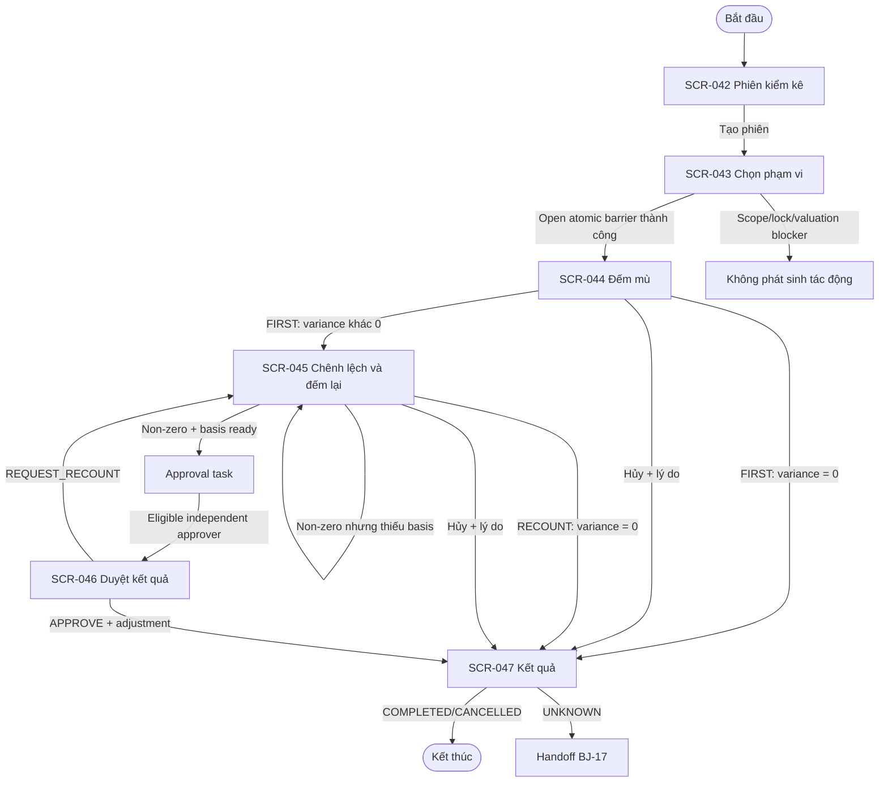
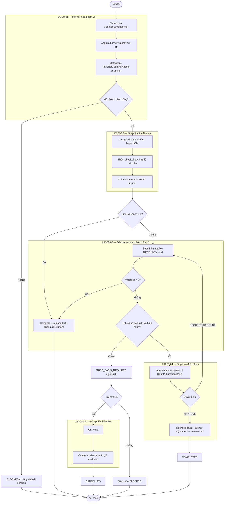

# BJ-08 — Kiểm kê và điều chỉnh chênh lệch

## 1. Mục tiêu trải nghiệm

## 2. Phạm vi và ranh giới

### 2.1 Bắt đầu khi

### 2.2 Kết thúc khi

### 2.3 Không bao gồm

## 3. Actor

Actor được giữ theo các Use Case thuộc Journey và flow nguồn v3.10.1.

## 4. Luồng chính

## 5. Use Case map

## 6. Luồng thay thế và ngoại lệ

Các nhánh thay thế/ngoại lệ được thể hiện trong sơ đồ hành trình và UC tương ứng.

## 7. UI Flow và chuyển màn hình

> **Patch:** `v3.10.0-bj08-deep-review` · **Nguồn nghiệp vụ:** BJ08 + `T7-DR-171…177` · **Bằng chứng:** `STATIC_RUNTIME_TARGET`  
> **Ranh giới:** UI chỉ orchestration. Mutation luôn đi Action → BC → API. Actor handoff giữa counter và approver không giả làm navigation cùng người dùng.

### 1. Phạm vi flow

| Thuộc tính | Giá trị |
|---|---|
| Owner | Inventory Control |
| Start | Người có quyền bắt đầu/tiếp tục stock count task |
| End | Session COMPLETED/CANCELLED hoặc handoff BJ17 khi UNKNOWN |
| Entry | `SCR-042`; assigned-counter deep link có thể vào `SCR-044`; approver task vào `SCR-046` |
| Terminal | `SCR-047` |
| Prototype | `RENDERED_v3.10.0` |

### 2. Sơ đồ

### 3. Transition Contract

| ID | Từ | Trigger/guard | Đến | Type | Action/trace |
|---|---|---|---|---|---|
| `UIF-08-T01` | Begin | module entry | `SCR-042` | NAVIGATION | UC08-01 |
| `UIF-08-T02` | `SCR-042` | tạo phiên | `SCR-043` | NAVIGATION | UC08-01 |
| `UIF-08-T03` | `SCR-043` | open atomic barrier success | `SCR-044` | MUTATION | `ACT-09-OPEN / BC-IC-01 / API-C-14` |
| `UIF-08-T04` | `SCR-043` | scope/lock/unresolved valuation rejected | Blocked | TERMINAL | UC08-01; effect NONE |
| `UIF-08-T05` | `SCR-044` | FIRST submit, variance ≠ 0 | `SCR-045` | MUTATION | `ACT-09-SUBMIT / BC-IC-02` |
| `UIF-08-T06` | `SCR-044` | FIRST submit, variance = 0 | `SCR-047` | MUTATION | same submit atomically completes/unlocks; no ApprovalCase |
| `UIF-08-T07` | `SCR-044` | authorized cancel + reason | `SCR-047` | MUTATION | `ACT-09-CANCEL / BC-IC-08` |
| `UIF-08-T08` | `SCR-045` | RECOUNT, variance = 0 | `SCR-047` | MUTATION | `ACT-09-SUBMIT`; complete/unlock no adjustment |
| `UIF-08-T09` | `SCR-045` | non-zero but value basis missing | `SCR-045` | SYSTEM | `PRICE_BASIS_REQUIRED`; lock retained |
| `UIF-08-T10` | `SCR-045` | non-zero + basis ready, immutable recount submitted | Approval task | MUTATION | `ACT-09-SUBMIT`; current ApprovalCase created |
| `UIF-08-T11` | Approval task | eligible independent approver opens task | `SCR-046` | HANDOFF | UC08-04; actor boundary |
| `UIF-08-T12` | `SCR-045` | authorized cancel + reason | `SCR-047` | MUTATION | `ACT-09-CANCEL / BC-IC-08` |
| `UIF-08-T13` | `SCR-046` | `REQUEST_RECOUNT` + reason | `SCR-045` | MUTATION | `ACT-09-APPROVE / BC-IC-03`; old case immutable |
| `UIF-08-T14` | `SCR-046` | APPROVE, basis still current | `SCR-047` | MUTATION | `ACT-09-APPROVE / BC-IC-03 / API-C-16` |
| `UIF-08-T15` | `SCR-047` | completed/cancelled authoritative result | End | TERMINAL | UC08-02/03/04/05 |
| `UIF-08-T16` | `SCR-047` | mutation finality UNKNOWN | BJ17 | HANDOFF | same command/session identity; no blind retry |

### 4. UC / Screen coverage

| UC | Screen |
|---|---|
| UC-08-01 | SCR-042, SCR-043 |
| UC-08-02 | SCR-044, SCR-047 khi zero variance |
| UC-08-03 | SCR-045, SCR-047 khi recount zero variance |
| UC-08-04 | SCR-046, SCR-047 |
| UC-08-05 | SCR-044, SCR-045, SCR-047 |

### 5. State/recovery locks

1. `SCR-044` blind count không chứa book/variance/proxy trong DOM/accessibility trước FIRST submit.
2. `SCR-045` hiển thị round number + discrepant lines + authoritative basis status; không cho counter nhập surplus price.
3. `SCR-046` chỉ có non-zero variance và current ApprovalCase; mọi evidence contributor bị loại khỏi eligible approvers.
4. `REQUEST_RECOUNT` giữ lock và tạo round/case successor; không overwrite evidence.
5. `SCR-047 COMPLETED` có hai biến thể authoritative: `ZERO_VARIANCE_NO_ADJUSTMENT` và `ADJUSTED`.
6. UNKNOWN chỉ verify/handoff BJ17 bằng cùng identity.
7. Cancel chỉ ở session context `SCR-044/SCR-045`, không ở browse `SCR-042` hay approval `SCR-046`.

### 6. Acceptance

- 5/5 UC, 6 canonical screens, 4 Action IDs đều trace được.
- Zero variance không đi qua approval.
- Scope/physical state/base UOM/immutable round semantics khớp Decisions 171–177.
- Flow status chỉ được nâng sau runtime + release gate v3.10.0.

## 8. Handoff / phụ thuộc ngoài Journey

## 9. Outcome cuối

## 10. Truy vết

### Nguồn v3.10.1 — BJ-08 — Kiểm kê và điều chỉnh chênh lệch

> **Trạng thái:** `DEEP_REVIEW_AMENDED_v3.10.0` — chờ release gate  
> **Finality contract:** `COMPLETED`, `CANCELLED`, `BLOCKED`, `UNKNOWN/ESCALATED`  
> **Phạm vi:** Phase 1 — kiểm kê toàn kho hoặc một phần tại một cut-off xác định  
> **Chủ sở hữu nghiệp vụ:** Inventory Control  
> **Quyết định nghiệp vụ:** `T7-BASELINE-FREEZE-v4.0.0` + `T7-DR-035…039`, `T7-DR-171…177`

### 1. Mục tiêu và ranh giới

So sánh hàng thực tế với **book snapshot tại đúng cut-off đã khóa**, dùng đếm mù và các vòng recount bất biến; chỉ tạo inventory/value adjustment khi final variance còn khác 0 và được người duyệt độc lập phê duyệt trên đúng risk/value basis hiện hành.

| Thuộc tính | Nội dung |
|---|---|
| Bắt đầu | Người có quyền yêu cầu kiểm kê một phạm vi hợp lệ |
| Kết thúc | Phiên `COMPLETED` và lock đã release; hoặc `CANCELLED`; hoặc còn `BLOCKED` chờ basis/evidence mà chưa adjustment |
| Tác động chính | Frozen scope + cut-off barrier + immutable count evidence + conditional adjustment |
| Không quyết định | Nguyên nhân nhân sự; sửa master Product; tự đặt giá cho hàng thừa; phân bổ valuation-state vật lý bằng suy đoán |

#### Boundary
- BJ08 sở hữu count session, count evidence, approval snapshot và adjustment chênh lệch đã duyệt.
- Product/LOT master vẫn theo owner hiện hành; BJ08 không tạo Product. LOT mới chỉ được capture theo tracking contract dùng chung.
- Nếu physical key còn `VALUATION_PENDING`/mixed valuation state, BJ08 **không mở session**; nghĩa vụ BJ03 phải hoàn tất trước.
- Nếu operation nguồn sai, correction/reconciliation đi BJ11/BJ16 sau khi count session kết thúc; không sửa nguồn giữa scope lock.

### 2. Sơ đồ hành trình

### 3. Trường hợp sử dụng

| UC | Tên | Actor authoritative | Commit point | Kết quả |
|---|---|---|---|---|
| [UC-08-01](../use-cases/UC-08-01-mo-va-khoa-pham-vi.md) | Mở và khóa phạm vi | Người có quyền mở kiểm kê | Atomic barrier + cutoff + session/lock/book snapshot | Locked count session |
| [UC-08-02](../use-cases/UC-08-02-ghi-nhan-lan-dem-mu.md) | Ghi nhận lần đếm mù | Assigned counter | Immutable FIRST submission | Recount required hoặc zero-variance completion |
| [UC-08-03](../use-cases/UC-08-03-dem-lai-va-hoan-thien-bang-chung.md) | Đếm lại và hoàn thiện căn cứ | Assigned counter | Immutable RECOUNT submission | Zero-variance completion, blocked, hoặc approval case |
| [UC-08-04](../use-cases/UC-08-04-duyet-va-dieu-chinh.md) | Duyệt và điều chỉnh | Eligible independent approver | Approval decision; APPROVE có adjustment transaction | Completed hoặc recount required |
| [UC-08-05](../use-cases/UC-08-05-huy-phien-kiem-ke.md) | Hủy phiên kiểm kê | Người có quyền hủy session | Cancel + release lock | Cancelled, evidence retained |

### 4. Invariant nghiệp vụ

| Invariant | Quy tắc |
|---|---|
| Atomic cut-off barrier | Barrier được acquire trước khi chốt cutoff/materialize book; mutation trong scope không commit sau cutoff tới khi lock release. |
| Frozen scope | `CountScopeSnapshot` là authority. Group được resolve thành exact Product membership tại open. |
| PhysicalCountKey | Warehouse + Product + physical stock state + LOT/non-LOT; count quantity dùng base UOM. |
| Valuation unresolved | Scope có `VALUATION_PENDING`/mixed valuation state trên physical key bị chặn ở open; không phân bổ thiếu hụt bằng suy đoán. |
| Blind count | Book/variance và proxy từ book không xuất hiện trước FIRST submit. |
| Immutable rounds | Mọi FIRST/RECOUNT là submission bất biến; request recount tạo round mới. |
| Unexpected stock | Product phải tồn tại; state + tracking identity phải hợp lệ; surplus không được counter nhập giá. |
| Surplus value | Chỉ authoritative surplus value basis mới cho phép adjustment thừa. |
| Maker-checker | Mọi actor góp evidence của count snapshot hiện hành bị loại khỏi approver eligible. |
| Risk snapshot | `Σ abs(line amount VND)`, bind exact cost/value basis; basis stale => approval stale. |
| Zero variance | Complete + no adjustment + unlock; không tạo approval giả. |
| Atomic adjustment | Non-zero approved variance: adjustment quantity/value + session completion + unlock commit toàn bộ hoặc không commit. |

### 5. Handoff và recovery

- `UNKNOWN` của mutation giữ cùng command/idempotency identity và handoff BJ17 nếu không thể chứng minh finality; không blind retry bằng identity mới.
- `REQUEST_RECOUNT` không release lock; case cũ bất biến và round/case mới giữ predecessor lineage.
- Mất lock/basis stale/permission change chặn commit; không dùng UI state cũ làm authority.
- Adjustment đã commit cung cấp valuation facts cho BJ14 theo các contract valuation hiện hành.

### 6. Nguồn tri thức và trace

- [Kiểm kê hàng tồn kho: từ khóa phạm vi đến điều chỉnh chênh lệch](../../../01.knowledge/know-how/KB-KGV-011-kiem-ke-hang-ton-kho-tu-khoa-pham-vi-den-dieu-chinh-chenh-lech.md)
- [Định giá hàng trả, tiêu hủy và chênh lệch thừa thiếu](../../../01.knowledge/know-how/KB-KGV-020-dinh-gia-hang-tra-tieu-huy-va-chenh-lech-thua-thieu.md)
- [Tính chính thức của tồn kho và nguyên tắc chống xuất âm](../../../01.knowledge/know-how/KB-KGV-006-tinh-chinh-thuc-cua-ton-kho-va-nguyen-tac-chong-xuat-am.md)
- [Tính nguyên tử khi ghi tồn kho và phát sự kiện](../../../01.knowledge/know-how/KB-KGV-029-tinh-nguyen-tu-khi-ghi-ton-kho-va-phat-su-kien.md)
- Decisions: `T7-DR-035…039`, `T7-DR-171…177`.
- UI: `UIF-08`, `SCR-042…047`.
- Behavioral: `BC-IC-01`, `BC-IC-02`, `BC-IC-03`, `BC-IC-08`.
