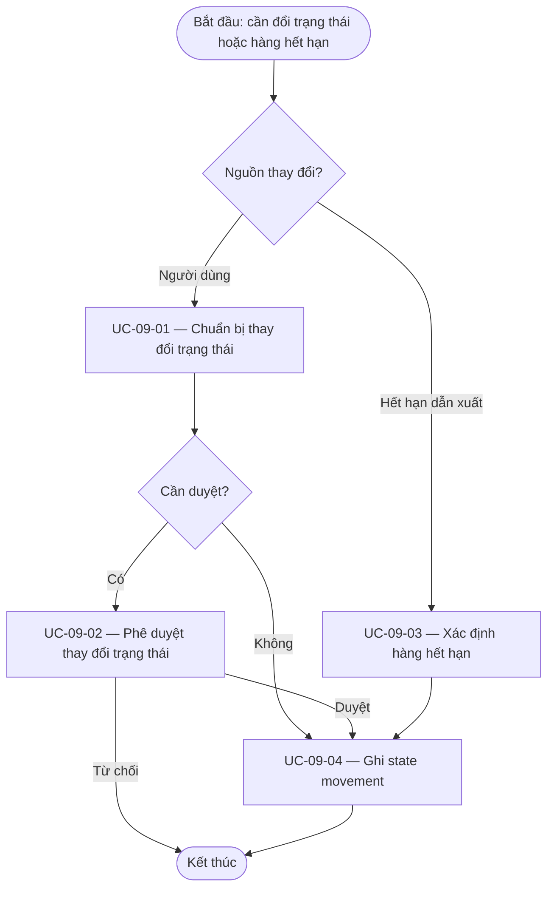

# BJ-09 — Quản lý trạng thái hàng

## 1. Tổng quan nghiệp vụ & Bối cảnh

Phản ánh đúng **tình trạng và khả năng bán của hàng vẫn còn hiện diện**, bao gồm `SELLABLE`, `QUARANTINE`, `DAMAGED`, `DEMO` và hiệu lực `EXPIRED` do hệ thống dẫn xuất; mọi thay đổi có lý do, quyền và dấu vết, không sửa trực tiếp số dư.

**Bắt đầu khi:** Người dùng có căn cứ đổi tình trạng hàng, hoặc ngày nghiệp vụ làm một lô hết hạn.

**Kết thúc khi:** State movement được ghi và khả dụng được đánh giá lại; hoặc yêu cầu bị từ chối/chờ duyệt mà không có tác động bán phần.

**Không bao gồm:** Không sở hữu quyết định thuộc Theme/Domain khác.

## 2. Tác nhân và trách nhiệm

| Tác nhân | Trách nhiệm | Phạm vi thẩm quyền |
|---|---|---|
| Thủ kho hoặc quản lý kho | Chuẩn bị, duyệt khi cần và thực thi thay đổi trạng thái vật lý của hàng. | Không dùng state change để thay thế quantity/value correction hoặc tiêu hủy. |

## 3. Sơ đồ hành trình nghiệp vụ

## 4. Bản đồ Use Case

| UC — Tên | Mục tiêu | Tác nhân | Đầu vào / Bắt đầu khi | Kết quả | Tiếp tục |
|---|---|---|---|---|---|
| [UC-09-01](../use-cases/UC-09-01-chuan-bi-thay-doi-trang-thai.md) — Chuẩn bị thay đổi trạng thái | Hồ sơ hợp lệ, cần duyệt hoặc bị từ chối; State-change request. | Thủ kho hoặc quản lý kho | Có căn cứ nghiệp vụ và lượng hàng xác định | Hồ sơ hợp lệ, cần duyệt hoặc bị từ chối; State-change request. | UC-09-02 |
| [UC-09-02](../use-cases/UC-09-02-phe-duyet-thay-doi-trang-thai.md) — Phê duyệt thay đổi trạng thái | Duyệt hoặc từ chối có lý do; Approval decision. | Thủ kho hoặc quản lý kho | Yêu cầu vượt ngưỡng/rủi ro | Duyệt hoặc từ chối có lý do; Approval decision. | UC-09-03 |
| [UC-09-03](../use-cases/UC-09-03-xac-dinh-hang-het-han.md) — Xác định hàng hết hạn | Không có tác động hoặc xác định lượng phải hết hạn; Expiry evaluation result. | Thủ kho hoặc quản lý kho | Ngày nghiệp vụ thay đổi hoặc dữ liệu lô được đánh giá | Không có tác động hoặc xác định lượng phải hết hạn; Expiry evaluation result. | UC-09-04 |
| [UC-09-04](../use-cases/UC-09-04-ghi-state-movement.md) — Ghi state movement | State movement/balance được commit hoặc không có gì commit; Authoritative inventory state result. | Thủ kho hoặc quản lý kho | Có thay đổi hợp lệ và đủ thẩm quyền | State movement/balance được commit hoặc không có gì commit; Authoritative inventory state result. | Kết thúc / theo nhánh trên sơ đồ |

## 5. Bàn giao và ranh giới liên quan

| Nơi nhận / Nơi cung cấp | Dữ kiện hoặc trách nhiệm bàn giao | Điều kiện bàn giao / tiếp tục |
|---|---|---|
| Theme 2 | Tracking/expiry policy | Dùng để derive trạng thái liên quan |
| BJ04/BJ05 | Availability/reservation impact | Sau state movement commit |

## 6. Liên kết thiết kế

- **UI Flow canonical:** [UIF-09 — Quản lý trạng thái hàng](../../../03.design/flows/UIF-09-BJ-09.md)
- BJ này chỉ sở hữu **business boundary, mục tiêu, UC/handoff và acceptance ở cấp hành trình**.
- Screen-to-screen routing, entry/terminal, actor handoff, state/recovery và transition nằm tại `UIF-09`; anatomy/action chi tiết nằm tại `03.design/screens/`.
- Không copy Screen Flow vào BJ để tránh trùng với UC/UIF và để redesign UI không làm thay đổi semantic của Journey.

## 7. Nghiệm thu hành trình (Journey Acceptance)

| ID | Điều kiện ở cấp hành trình | Kết quả cần bảo đảm | UC / BC liên quan |
|---|---|---|---|
| JA-01 | Journey bắt đầu từ đúng trigger và actor có quyền | Kết quả chỉ được ghi trong phạm vi authority của Theme 7; source ngoài Theme không bị sửa ngầm | UC-09-01 / BC liên quan |
| JA-02 | Một nhánh bị từ chối, blocked hoặc chưa xác định | Không được báo thành công hoặc tạo tác động bán phần; hướng xử lý/owner tiếp theo phải rõ | UC-09-01…UC-09-04 |
| JA-03 | Journey hoàn tất thành công | Kết quả cuối có provenance, thời điểm/phạm vi và đủ dữ kiện cho consumer tiếp theo | UC-09-04 / Domain ledger |

## 8. Truy vết

| Nguồn | Vai trò đối với hành trình |
|---|---|
| [Decision Register](../../../01.knowledge/decisions/decision-register.md) — Decision Register theo UC/BC | Nguồn quyết định nghiệp vụ và trạng thái hiệu lực |
| `DOM-IC`, `DOM-IO` | Domain authority và invariants dùng cho Journey |
| [Use Case Map](../use-cases/00-use-case-map.md) | Danh mục UC canonical của Theme 7 |
