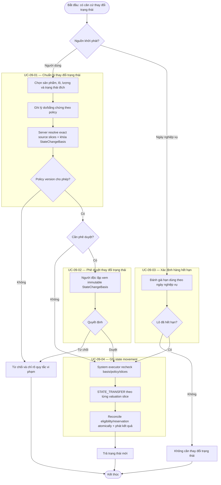
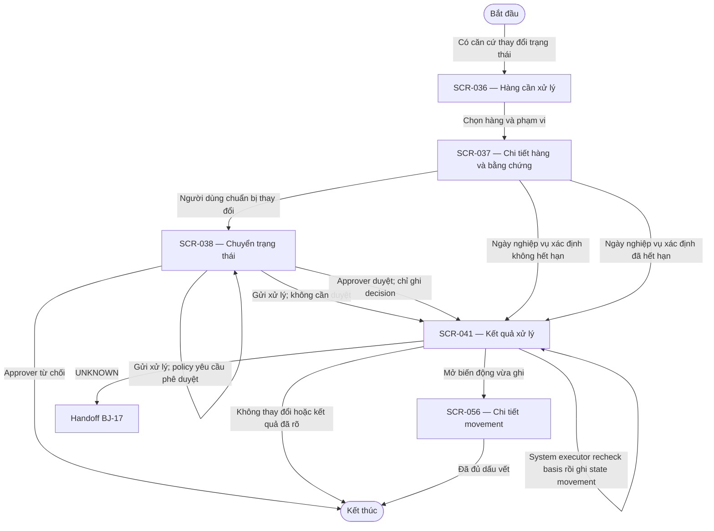

# BJ-09 — Quản lý trạng thái hàng

## 1. Mục tiêu trải nghiệm

Phản ánh đúng **tình trạng và khả năng bán của hàng vẫn còn hiện diện**, bao gồm `SELLABLE`, `QUARANTINE`, `DAMAGED`, `DEMO` và hiệu lực `EXPIRED` do hệ thống dẫn xuất; mọi thay đổi có lý do, quyền và dấu vết, không sửa trực tiếp số dư.

## 2. Phạm vi và ranh giới

### 2.1 Bắt đầu khi

| Thuộc tính | Nội dung |
|---|---|
| Bắt đầu | Người dùng có căn cứ đổi tình trạng hàng, hoặc ngày nghiệp vụ làm một lô hết hạn |
| Kết thúc | State movement được ghi và khả dụng được đánh giá lại; hoặc yêu cầu bị từ chối/chờ duyệt mà không có tác động bán phần |
| Tác động chính | Chuyển lượng giữa các trạng thái; cập nhật eligibility, availability và tác động reservation liên quan |
| Không làm thay đổi | Tổng tồn vật lý và tổng giá trị ghi sổ của sản phẩm |

### 2.2 Kết thúc khi

| Thuộc tính | Nội dung |
|---|---|
| Bắt đầu | Người dùng có căn cứ đổi tình trạng hàng, hoặc ngày nghiệp vụ làm một lô hết hạn |
| Kết thúc | State movement được ghi và khả dụng được đánh giá lại; hoặc yêu cầu bị từ chối/chờ duyệt mà không có tác động bán phần |
| Tác động chính | Chuyển lượng giữa các trạng thái; cập nhật eligibility, availability và tác động reservation liên quan |
| Không làm thay đổi | Tổng tồn vật lý và tổng giá trị ghi sổ của sản phẩm |

### 2.3 Không bao gồm

| Trong ranh giới | Ngoài ranh giới |
|---|---|
| Chuyển sellable/quarantine/damaged/demo theo ma trận; xác định expired; quyền/lý do/duyệt; đánh giá lại khả dụng | Tiêu hủy; trả NCC; nhận khách trả; xác nhận giá; sửa trạng thái trực tiếp |
| Materialize `EXPIRED` có chống trùng nếu hệ thống cần lưu trạng thái | Tạo lifecycle cảnh báo cận hạn hoặc sửa hạn dùng để né hết hạn |

**Ranh giới quan trọng:** `VALUATION_PENDING`, `RETURN_PENDING` và `RTV_PENDING` chỉ được tạo/giải phóng bởi BJ sở hữu tương ứng; chức năng đổi trạng thái chung không phải đường tắt để đi vào hoặc thoát các trạng thái này.

## 3. Actor

- Thủ kho hoặc quản lý kho

## 4. Luồng chính

## 5. Use Case map

## 6. Luồng thay thế và ngoại lệ

### 4. Logic nghiệp vụ cần giữ

| Điểm kiểm soát | Quy tắc |
|---|---|
| Taxonomy | Canonical user-selectable business states là `SELLABLE`, `QUARANTINE`, `DAMAGED`, `DEMO`; nhãn `DEMO` là **Dùng thử**. Không dùng `TRIAL`. `EXPIRED` là system-derived. |
| Ma trận chuyển trạng thái | Chỉ cho chuyển đổi trong immutable `StateTransitionPolicyVersion`; policy khóa permission, reason/evidence, approval route/level và eligibility effect. Submit bind exact `policy_version + policy_hash`. |
| Partial quantity | User nhập quantity nhưng không chọn `valuation_state`. Server resolve exact source balance slices `{balance_id, balance_version, valuation_state, quantity}`; ambiguous composition bị block, không silent split. |
| Tổng vật lý & giá trị | `STATE_TRANSFER` chỉ đổi physical state trên cùng valuation state; không tạo value movement, không đổi tổng physical quantity và authoritative book value. |
| Approval | Maker submit tạo immutable `StateChangeBasis`. Approver chỉ quyết định trên đúng `basis_hash`; approve không ghi stock. System executor recheck basis ngay trước commit. |
| Hết hạn | Derive trực tiếp từ `Lot.expiry_date` + tenant business date; loại khỏi eligibility ngay. Không có destination/CTA thủ công cho `EXPIRED`; materialization nếu có là system-owned/idempotent. |
| Cận hạn | Chỉ là chỉ báo/policy `WARN` hoặc `BLOCK_SALE`; không phải state movement và không tạo hồ sơ cảnh báo có lifecycle. |
| Demo | `DEMO` vẫn thuộc physical và book value nhưng không khả dụng; muốn bán lại phải qua transition policy hợp lệ. |
| Reservation | Khi eligible giảm, state balances + reservation capacity/reconciliation commit atomically. Không rewrite active PickAllocation; phát `allocation_review_required` khi allocation cần BJ-05 xem lại. |
| Trạng thái do BJ khác sở hữu | Không cho người dùng chọn trực tiếp `VALUATION_PENDING`, `RETURN_PENDING` hoặc `RTV_PENDING` ngoài hành trình nguồn. |
| Khóa/stale | State change bị chặn trong scope kiểm kê/xung đột. Basis/policy/balance version stale không execute; approval cũ không được áp vào basis mới. |

### 5. Quan hệ và bàn giao

- Nhận lượng cần phân loại từ BJ-06 và lượng cần quản lý tình trạng từ BJ-02.
- Khi lượng mất eligibility, bàn giao tín hiệu cho BJ-04; nếu đã có PickAllocation thì BJ-05 xử lý stale allocation.
- Hàng damaged/expired có thể được chọn cho BJ-10 hoặc BJ-07; đổi trạng thái không tự tiêu hủy hay trả NCC.
- Cấu hình cận hạn theo sản phẩm/tenant thuộc capability cấu hình chính sách tồn, không nằm trong BJ này.

## 7. UI Flow và chuyển màn hình

> **Patch:** `4.2.0-rc1.ui-flow.1` · **Freeze:** `T7-UIFLOW-PATCH-v4.2.0-rc1.1` · **Nguồn UI:** `T7-UIUX-FREEZE-v4.2.0-rc1` · **Bằng chứng:** `HARNESS_LOCAL_AND_CUMULATIVE_REVIEWED`.
> **Ranh giới:** Mũi tên chỉ mô tả điều hướng/orchestration UI. Mọi thay đổi dữ liệu vẫn do Action → BC → API hiện hữu sở hữu; flow không tạo đường thay đổi dữ liệu, trạng thái nghiệp vụ hoặc nguồn hiệu lực cuối cùng mới.

### 1. Phạm vi flow

| Thuộc tính | Giá trị |
|---|---|
| Nguồn nghiệp vụ | [BJ-09](BJ-09-quan-ly-trang-thai-hang.md) |
| Chủ sở hữu nghiệp vụ | Inventory Control; CAP-01 cung cấp policy |
| Bắt đầu | Người dùng có căn cứ đổi tình trạng hàng, hoặc ngày nghiệp vụ làm một lô hết hạn |
| Kết thúc | State movement được ghi và khả dụng được đánh giá lại; hoặc yêu cầu bị từ chối/chờ duyệt mà không có tác động bán phần |
| Entry Screen | [`SCR-036`](../../../03.design/screens/SCR-036.md) |
| Terminal Screen | [`SCR-041`](../../../03.design/screens/SCR-041.md), [`SCR-056`](../../../03.design/screens/SCR-056.md) |
| Prototype | `HTML_HARNESS_RENDERED` |

### 2. Sơ đồ UI flow

### 3. Transition Contract

`NAVIGATION` không tạo tác động nghiệp vụ; `QUERY` chỉ đọc/tạo bản xuất; `MUTATION` bắt buộc có Action ID; `SYSTEM` là định tuyến từ kết quả authoritative; `HANDOFF` chuyển quyền xử lý nhưng không tự xác lập finality.

| Transition | Từ | Trigger/điều kiện | Đến | Loại | Trace |
|---|---|---|---|---|---|
| `UIF-09-T01` | `Bắt đầu` | Có căn cứ thay đổi trạng thái | [`SCR-036`](../../../03.design/screens/SCR-036.md) | `NAVIGATION` | [`UC-09-01`](../use-cases/UC-09-01-chuan-bi-thay-doi-trang-thai.md); [`UC-09-03`](../use-cases/UC-09-03-xac-dinh-hang-het-han.md) |
| `UIF-09-T02` | [`SCR-036`](../../../03.design/screens/SCR-036.md) | Chọn hàng và phạm vi | [`SCR-037`](../../../03.design/screens/SCR-037.md) | `NAVIGATION` | [`UC-09-01`](../use-cases/UC-09-01-chuan-bi-thay-doi-trang-thai.md); [`UC-09-03`](../use-cases/UC-09-03-xac-dinh-hang-het-han.md) |
| `UIF-09-T03` | [`SCR-037`](../../../03.design/screens/SCR-037.md) | Người dùng chuẩn bị thay đổi | [`SCR-038`](../../../03.design/screens/SCR-038.md) | `NAVIGATION` | [`UC-09-01`](../use-cases/UC-09-01-chuan-bi-thay-doi-trang-thai.md) |
| `UIF-09-T04` | [`SCR-038`](../../../03.design/screens/SCR-038.md) | Gửi xử lý; policy yêu cầu phê duyệt | [`SCR-038`](../../../03.design/screens/SCR-038.md) | `MUTATION` | [`UC-09-01`](../use-cases/UC-09-01-chuan-bi-thay-doi-trang-thai.md); [`ACT-COMMON-SUBMIT`](../../../09.generated/registries/design/action-registry.json) |
| `UIF-09-T05` | [`SCR-038`](../../../03.design/screens/SCR-038.md) | Approver từ chối; không có state movement | `Kết thúc` | `MUTATION` | [`UC-09-02`](../use-cases/UC-09-02-phe-duyet-thay-doi-trang-thai.md); [`ACT-COMMON-DECIDE`](../../../09.generated/registries/design/action-registry.json) |
| `UIF-09-T06` | [`SCR-038`](../../../03.design/screens/SCR-038.md) | Gửi xử lý; policy không cần duyệt → basis READY, system execution bắt đầu | [`SCR-041`](../../../03.design/screens/SCR-041.md) | `MUTATION` → `SYSTEM` | [`UC-09-01`](../use-cases/UC-09-01-chuan-bi-thay-doi-trang-thai.md); [`ACT-COMMON-SUBMIT`](../../../09.generated/registries/design/action-registry.json); system trace [`ACT-08-STATE`](../../../09.generated/registries/design/action-registry.json) |
| `UIF-09-T13` | [`SCR-038`](../../../03.design/screens/SCR-038.md) | Approver duyệt exact `StateChangeBasis`; **chưa đổi stock** | [`SCR-041`](../../../03.design/screens/SCR-041.md) | `MUTATION` | [`UC-09-02`](../use-cases/UC-09-02-phe-duyet-thay-doi-trang-thai.md); [`ACT-COMMON-DECIDE`](../../../09.generated/registries/design/action-registry.json) |
| `UIF-09-T14` | [`SCR-041`](../../../03.design/screens/SCR-041.md) | System executor recheck basis/policy/source slices; ghi `STATE_TRANSFER` + reservation reconciliation | [`SCR-041`](../../../03.design/screens/SCR-041.md) | `SYSTEM` | [`UC-09-04`](../use-cases/UC-09-04-ghi-state-movement.md); [`ACT-08-STATE`](../../../09.generated/registries/design/action-registry.json) |
| `UIF-09-T07` | [`SCR-037`](../../../03.design/screens/SCR-037.md) | Ngày nghiệp vụ xác định không hết hạn | [`SCR-041`](../../../03.design/screens/SCR-041.md) | `SYSTEM` | [`UC-09-03`](../use-cases/UC-09-03-xac-dinh-hang-het-han.md) |
| `UIF-09-T08` | [`SCR-037`](../../../03.design/screens/SCR-037.md) | Ngày nghiệp vụ xác định đã hết hạn | [`SCR-041`](../../../03.design/screens/SCR-041.md) | `SYSTEM` | [`UC-09-03`](../use-cases/UC-09-03-xac-dinh-hang-het-han.md); [`UC-09-04`](../use-cases/UC-09-04-ghi-state-movement.md) |
| `UIF-09-T09` | [`SCR-041`](../../../03.design/screens/SCR-041.md) | Mở biến động vừa ghi | [`SCR-056`](../../../03.design/screens/SCR-056.md) | `NAVIGATION` | [`UC-09-04`](../use-cases/UC-09-04-ghi-state-movement.md) |
| `UIF-09-T10` | [`SCR-041`](../../../03.design/screens/SCR-041.md) | Không thay đổi hoặc kết quả đã rõ | `Kết thúc` | `TERMINAL` | [`UC-09-03`](../use-cases/UC-09-03-xac-dinh-hang-het-han.md); [`UC-09-04`](../use-cases/UC-09-04-ghi-state-movement.md) |
| `UIF-09-T11` | [`SCR-056`](../../../03.design/screens/SCR-056.md) | Đã đủ dấu vết | `Kết thúc` | `TERMINAL` | [`UC-09-04`](../use-cases/UC-09-04-ghi-state-movement.md) |
| `UIF-09-T12` | [`SCR-041`](../../../03.design/screens/SCR-041.md) | UNKNOWN | `Handoff BJ-17` | `HANDOFF` | [`UC-09-04`](../use-cases/UC-09-04-ghi-state-movement.md) |

> **Harness UX patch:** Maker submit, approval decision and state movement are distinct contracts. The same canonical SCR-038 may render PREPARE or APPROVAL mode, but a user never sees both actor tasks in one session.

### 4. Bao phủ UC và Screen

| UC | Tên | Screen trực tiếp | Trạng thái |
|---|---|---|---|
| [`UC-09-01`](../use-cases/UC-09-01-chuan-bi-thay-doi-trang-thai.md) | Chuẩn bị thay đổi trạng thái | [`SCR-036`](../../../03.design/screens/SCR-036.md), [`SCR-037`](../../../03.design/screens/SCR-037.md), [`SCR-038`](../../../03.design/screens/SCR-038.md) | `MAPPED` |
| [`UC-09-02`](../use-cases/UC-09-02-phe-duyet-thay-doi-trang-thai.md) | Phê duyệt thay đổi trạng thái | [`SCR-038`](../../../03.design/screens/SCR-038.md), [`SCR-041`](../../../03.design/screens/SCR-041.md) | `MAPPED` |
| [`UC-09-03`](../use-cases/UC-09-03-xac-dinh-hang-het-han.md) | Xác định hàng hết hạn | [`SCR-036`](../../../03.design/screens/SCR-036.md), [`SCR-037`](../../../03.design/screens/SCR-037.md), [`SCR-041`](../../../03.design/screens/SCR-041.md) | `MAPPED` |
| [`UC-09-04`](../use-cases/UC-09-04-ghi-state-movement.md) | Ghi state movement | [`SCR-038`](../../../03.design/screens/SCR-038.md), [`SCR-041`](../../../03.design/screens/SCR-041.md), [`SCR-056`](../../../03.design/screens/SCR-056.md) | `MAPPED` |

### 5. Quy tắc state và phục hồi

1. `PERMISSION_DENIED`: không đưa dữ liệu nhạy cảm vào DOM và không hiển thị CTA thay đổi dữ liệu.
2. `VALIDATION_ERROR`: giữ dữ liệu người dùng đã nhập; focus lỗi đầu tiên; không phát sinh tác động bán phần.
3. `CONFLICT` hoặc source version stale: tải phiên bản authoritative để đối chiếu; không ghi đè im lặng.
4. `REJECTED`: nêu guard/điều kiện không đạt và xác nhận tác động bằng 0.
5. `UNKNOWN`: giữ cùng operation identity; chỉ query/resume/verify hoặc handoff BJ-17; không blind retry bằng identity mới.
6. Back/cancel chỉ là điều hướng nếu không có Action ID. Khi có Action ID, tác động phải đúng BC/API đã liên kết.

### 6. Điều kiện nghiệm thu flow

- 4/4 UC của BJ-09 xuất hiện trong transition và bảng coverage.
- 5 Screen được dùng trực tiếp; không dùng alias nhóm màn hình cũ.
- 3 Action ID được tham chiếu: `ACT-COMMON-SUBMIT`, `ACT-COMMON-DECIDE`, `ACT-08-STATE`.
- Mọi transition mutation trỏ tới Action Registry; điều hướng không được suy diễn thành tác động backend.
- Flow đạt `STATIC_VALIDATED`; chưa chứng minh HTML, Flutter, backend, accessibility runtime hoặc E2E.

### v1.6.0 Product correction — authoritative for current renderer

- Module entry is `SCR-036` “Tình trạng hàng”; Product/Lot detail is `SCR-037`.
- `SCR-038` has mutually exclusive maker and approver modes. Maker submit ends maker task; approver enters from assigned task.
- Generic destinations are canonical business states only (`SELLABLE`, `QUARANTINE`, `DAMAGED`, `DEMO`; label `DEMO` = **Dùng thử**) as policy allows. `TRIAL`, `EXPIRED`, `VALUATION_PENDING`, `RETURN_PENDING`, `RTV_PENDING` are not selectable destinations.
- Expiry is derived by policy/business date and never presented as “Đánh dấu hết hạn”.
- State movement preserves total physical quantity and book value; it changes classification/availability only.
- `SCR-056` is true read-only history. UNKNOWN preserves same operation identity.

### v3.10.1 BJ09 semantic hardening

- Maker PREPARE: current state is server-authoritative/read-only; user enters destination, partial quantity and reason/evidence required by policy. Technical valuation slices are resolved by server and not shown as choices.
- Submit always creates/locks immutable `StateChangeBasis` before routing. A no-approval route may start system execution immediately, but there is no user-facing `ACT-08-STATE` CTA.
- Approver sees the exact frozen basis needed for decision. `APPROVE` records decision only. `REJECT` requires reason.
- `SCR-041/PROCESSING` is the boundary where system executor rechecks basis and runs BC-IO-10. Basis stale routes to conflict/recreate, never reuses old approval.
- `EXPIRED` transitions are SYSTEM-only from business-date evaluation.

## 8. Handoff / phụ thuộc ngoài Journey

## 9. Outcome cuối

| Thuộc tính | Nội dung |
|---|---|
| Bắt đầu | Người dùng có căn cứ đổi tình trạng hàng, hoặc ngày nghiệp vụ làm một lô hết hạn |
| Kết thúc | State movement được ghi và khả dụng được đánh giá lại; hoặc yêu cầu bị từ chối/chờ duyệt mà không có tác động bán phần |
| Tác động chính | Chuyển lượng giữa các trạng thái; cập nhật eligibility, availability và tác động reservation liên quan |
| Không làm thay đổi | Tổng tồn vật lý và tổng giá trị ghi sổ của sản phẩm |

## 10. Truy vết

### Nguồn v3.10.1 — BJ-09 — Quản lý trạng thái hàng

> **Trạng thái:** Release đã đóng băng `4.1.0` — đã remap ID và boundary  
> **Chuyển đổi chính thức:** Theme 7 `4.0.0/BJ-10` → `4.1.0/BJ-09`  
> **Finality contract:** `COMPLETED`, `REJECTED/CANCELLED`, `SUSPENDED/BLOCKED`, `UNKNOWN/ESCALATED`
> **Phạm vi:** Phase 1 — thay đổi trạng thái trong một kho mặc định, không giảm tổng tồn vật lý  
> **Chủ sở hữu nghiệp vụ:** Inventory Control; CAP-01 cung cấp policy
> **Quyết định nghiệp vụ:** `T7-BASELINE-FREEZE-v4.0.0` + `T7-DR-012`, `T7-DR-018`, `T7-DR-046`, `T7-DR-047`, `T7-DR-092`, `T7-DR-178…184`
### Nguồn v3.10.1 — 3. Trường hợp sử dụng

| UC | Tên | Bắt đầu | Kết thúc | Kết quả |
|---|---|---|---|---|
| [UC-09-01](../use-cases/UC-09-01-chuan-bi-thay-doi-trang-thai.md) | Chuẩn bị thay đổi trạng thái | Có căn cứ nghiệp vụ và lượng hàng xác định | Hồ sơ hợp lệ, cần duyệt hoặc bị từ chối | State-change request |
| [UC-09-02](../use-cases/UC-09-02-phe-duyet-thay-doi-trang-thai.md) | Phê duyệt thay đổi trạng thái | Yêu cầu vượt ngưỡng/rủi ro | Duyệt hoặc từ chối có lý do | Approval decision |
| [UC-09-03](../use-cases/UC-09-03-xac-dinh-hang-het-han.md) | Xác định hàng hết hạn | Ngày nghiệp vụ thay đổi hoặc dữ liệu lô được đánh giá | Không có tác động hoặc xác định lượng phải hết hạn | Expiry evaluation result |
| [UC-09-04](../use-cases/UC-09-04-ghi-state-movement.md) | Ghi state movement | Có thay đổi hợp lệ và đủ thẩm quyền | State movement/balance được commit hoặc không có gì commit | Authoritative inventory state result |
### Nguồn v3.10.1 — 6. Nguồn tri thức liên quan

- [Hàng cận hạn, hết hạn, hư hỏng và tiêu hủy](../../../01.knowledge/know-how/KB-KGV-014-hang-can-han-het-han-hu-hong-va-tieu-huy.md)
- [Tồn vật lý và tồn khả dụng](../../../01.knowledge/know-how/KB-KGV-005-ton-vat-ly-va-ton-kha-dung.md)
- [Danh tính và vòng đời của một lô hàng](../../../01.knowledge/know-how/KB-KGV-025-danh-tinh-va-vong-doi-cua-mot-lo-hang.md)
- [Hàng ký gửi, hàng demo và quyền sở hữu](../../../01.knowledge/know-how/KB-KGV-034-quyen-so-huu-hang-hoa-hang-ky-gui-va-hang-demo.md)
### Nguồn v3.10.1 — 7. Deep-review amendment v3.10.1

BJ-09 dùng `StateChangeBasis` như boundary giữa **user intent/approval** và **system execution**. UI không expose balance ID, valuation state, policy hash hoặc technical version như lựa chọn nghiệp vụ. Các fact đó vẫn bắt buộc ở contract/Inspect/audit để backend và QA chứng minh exact scope.

Acceptance bổ sung:
1. Không tồn tại active enum `TRIAL`; UI chỉ hiển thị **Dùng thử** cho `DEMO`.
2. Partial transition bảo toàn valuation state slice-by-slice; ambiguous source slice bị block.
3. Approve không làm thay đổi balance; chỉ system executor sau recheck mới commit movement.
4. State transfer không sinh value movement và không đổi tổng book value.
5. Expiry có hiệu lực theo business date dù chưa materialize; không có user CTA “đánh dấu hết hạn”.
6. Eligibility/reservation reconciliation nằm cùng transaction với state transfer; PickAllocation chỉ bị đánh dấu cần review, không rewrite im lặng.
