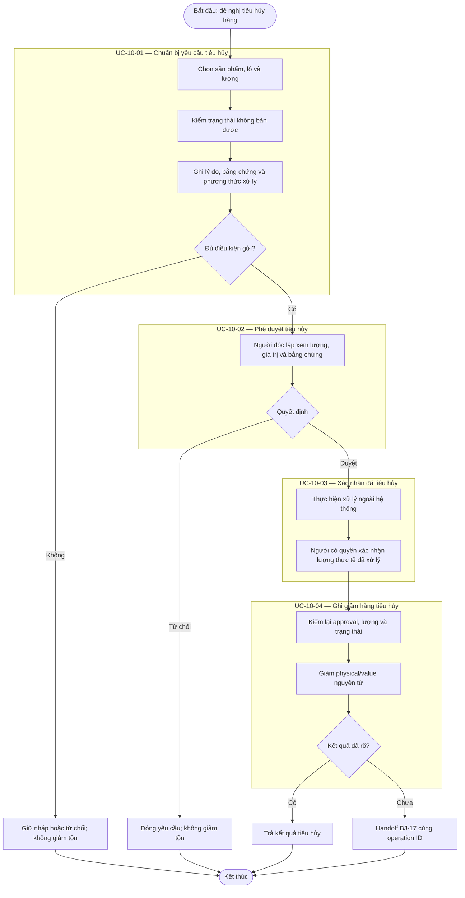
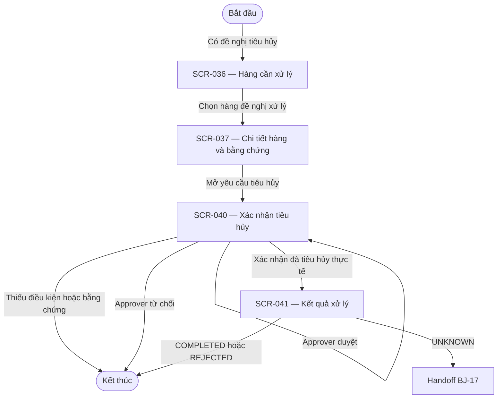

# BJ-10 — Tiêu hủy hàng

## 1. Mục tiêu trải nghiệm

Ghi nhận đúng việc **hàng đã thực sự bị tiêu hủy hoặc xử lý loại bỏ**, chỉ giảm tồn vật lý và giá trị sau khi có đủ lý do, bằng chứng, phê duyệt theo rủi ro và xác nhận hoàn tất.

## 2. Phạm vi và ranh giới

### 2.1 Bắt đầu khi

| Thuộc tính | Nội dung |
|---|---|
| Bắt đầu | Người có quyền chọn một lượng hàng không bán được để đề nghị tiêu hủy |
| Kết thúc | Hàng được tiêu hủy và giảm physical/value; hoặc yêu cầu chờ duyệt/chờ xử lý; hoặc bị từ chối mà không giảm tồn |
| Tác động chính | Disposal issue movement, value movement, balance và audit evidence |
| Không quyết định | Trách nhiệm bồi thường, xử lý môi trường/chuyên ngành hoặc hạch toán chi phí ngoài inventory value effect |

### 2.2 Kết thúc khi

| Thuộc tính | Nội dung |
|---|---|
| Bắt đầu | Người có quyền chọn một lượng hàng không bán được để đề nghị tiêu hủy |
| Kết thúc | Hàng được tiêu hủy và giảm physical/value; hoặc yêu cầu chờ duyệt/chờ xử lý; hoặc bị từ chối mà không giảm tồn |
| Tác động chính | Disposal issue movement, value movement, balance và audit evidence |
| Không quyết định | Trách nhiệm bồi thường, xử lý môi trường/chuyên ngành hoặc hạch toán chi phí ngoài inventory value effect |

### 2.3 Không bao gồm

| Trong ranh giới | Ngoài ranh giới |
|---|---|
| Chọn lượng/lô; kiểm trạng thái; lý do/bằng chứng; tính rủi ro; duyệt; xác nhận đã xử lý; ghi giảm | Đổi trạng thái để hợp thức hóa; tiêu hủy hàng vẫn sellable; trả NCC; điều chỉnh thiếu do kiểm kê |
| Ghi giảm giá trị theo official cost có hiệu lực | Xóa movement, sửa ledger hoặc dùng adjustment thay cho disposal |

## 3. Actor

- Thủ kho, người duyệt và người xác nhận xử lý

## 4. Luồng chính

## 5. Use Case map

## 6. Luồng thay thế và ngoại lệ

### 4. Logic nghiệp vụ cần giữ

| Điểm kiểm soát | Quy tắc |
|---|---|
| Trạng thái nguồn | Chỉ hàng không bán được và thuộc tenant mới được tiêu hủy; hàng sellable phải qua BJ-09 trước |
| Mốc giảm tồn | Phê duyệt chưa làm giảm physical; chỉ completion assertion hợp lệ mới cho phép ghi giảm |
| Maker–checker | Người lập không tự duyệt; cấp duyệt suy ra từ trị tuyệt đối lượng × căn cứ giá |
| Thiếu căn cứ giá | Không gửi duyệt khi thiếu cả official cost và giá nguồn; giữ nháp để bổ sung, không gán rủi ro không xác định |
| Giá trị | Giảm theo official cost có hiệu lực tại thời điểm hoàn tất; không suy ra giá riêng theo kho/lô |
| Số lượng thực xử lý | Nếu khác lượng được duyệt, chỉ cho phép trong phạm vi policy; vượt phạm vi phải quay lại lập/duyệt yêu cầu mới |
| Chống trùng | Cùng operation/completion assertion không được ghi giảm hai lần |
| UNKNOWN | Không tạo disposal mới; truy vấn ngắn bằng cùng operation identity, sau đó handoff BJ-17 nếu chưa xác lập finality |

### 5. Quan hệ và bàn giao

- Nhận hàng damaged/expired/quarantine phù hợp từ BJ-09 hoặc BJ-06.
- Nếu quyết định thực tế là trả nhà cung cấp, dùng BJ-07; không đổi type của disposal đang xử lý.
- Cung cấp quantity/value facts cho BJ-14 và Theme Kế toán nhưng không quyết định tài khoản chi phí.
- Sai sót sau khi hoàn tất phải đi qua BJ-11 và thỏa reversal guard; không sửa disposal gốc.

## 7. UI Flow và chuyển màn hình

> **Patch:** `4.2.0-rc1.ui-flow.1` · **Freeze:** `T7-UIFLOW-PATCH-v4.2.0-rc1.1` · **Nguồn UI:** `T7-UIUX-FREEZE-v4.2.0-rc1` · **Bằng chứng:** `HARNESS_LOCAL_AND_CUMULATIVE_REVIEWED`.
> **Ranh giới:** Mũi tên chỉ mô tả điều hướng/orchestration UI. Mọi thay đổi dữ liệu vẫn do Action → BC → API hiện hữu sở hữu; flow không tạo đường thay đổi dữ liệu, trạng thái nghiệp vụ hoặc nguồn hiệu lực cuối cùng mới.

### 1. Phạm vi flow

| Thuộc tính | Giá trị |
|---|---|
| Nguồn nghiệp vụ | [BJ-10](BJ-10-tieu-huy-hang.md) |
| Chủ sở hữu nghiệp vụ | Inventory Control |
| Bắt đầu | Người có quyền chọn một lượng hàng không bán được để đề nghị tiêu hủy |
| Kết thúc | Hàng được tiêu hủy và giảm physical/value; hoặc yêu cầu chờ duyệt/chờ xử lý; hoặc bị từ chối mà không giảm tồn |
| Entry Screen | [`SCR-036`](../../../03.design/screens/SCR-036.md) |
| Terminal Screen | [`SCR-041`](../../../03.design/screens/SCR-041.md) |
| Prototype | `HTML_HARNESS_RENDERED` |

### 2. Sơ đồ UI flow

### 3. Transition Contract

`NAVIGATION` không tạo tác động nghiệp vụ; `QUERY` chỉ đọc/tạo bản xuất; `MUTATION` bắt buộc có Action ID; `SYSTEM` là định tuyến từ kết quả authoritative; `HANDOFF` chuyển quyền xử lý nhưng không tự xác lập finality.

| Transition | Từ | Trigger/điều kiện | Đến | Loại | Trace |
|---|---|---|---|---|---|
| `UIF-10-T01` | `Bắt đầu` | Có đề nghị tiêu hủy | [`SCR-036`](../../../03.design/screens/SCR-036.md) | `NAVIGATION` | [`UC-10-01`](../use-cases/UC-10-01-chuan-bi-yeu-cau-tieu-huy.md) |
| `UIF-10-T02` | [`SCR-036`](../../../03.design/screens/SCR-036.md) | Chọn hàng đề nghị xử lý | [`SCR-037`](../../../03.design/screens/SCR-037.md) | `NAVIGATION` | [`UC-10-01`](../use-cases/UC-10-01-chuan-bi-yeu-cau-tieu-huy.md) |
| `UIF-10-T03` | [`SCR-037`](../../../03.design/screens/SCR-037.md) | Mở yêu cầu tiêu hủy | [`SCR-040`](../../../03.design/screens/SCR-040.md) | `NAVIGATION` | [`UC-10-01`](../use-cases/UC-10-01-chuan-bi-yeu-cau-tieu-huy.md) |
| `UIF-10-T04` | [`SCR-040`](../../../03.design/screens/SCR-040.md) | Thiếu điều kiện hoặc bằng chứng | `Dừng hoặc chờ; không phát sinh tác động` | `TERMINAL` | [`UC-10-01`](../use-cases/UC-10-01-chuan-bi-yeu-cau-tieu-huy.md) |
| `UIF-10-T05` | [`SCR-040`](../../../03.design/screens/SCR-040.md) | Gửi duyệt; chưa giảm tồn | [`SCR-040`](../../../03.design/screens/SCR-040.md) | `MUTATION` | [`UC-10-01`](../use-cases/UC-10-01-chuan-bi-yeu-cau-tieu-huy.md); [`ACT-COMMON-SUBMIT`](../../../09.generated/registries/design/action-registry.json) |
| `UIF-10-T06` | [`SCR-040`](../../../03.design/screens/SCR-040.md) | Approver từ chối; không giảm tồn | `Kết thúc` | `MUTATION` | [`UC-10-02`](../use-cases/UC-10-02-phe-duyet-tieu-huy.md); [`ACT-COMMON-DECIDE`](../../../09.generated/registries/design/action-registry.json) |
| `UIF-10-T07` | [`SCR-040`](../../../03.design/screens/SCR-040.md) | Approver duyệt; chưa giảm tồn | [`SCR-040`](../../../03.design/screens/SCR-040.md) | `MUTATION` | [`UC-10-02`](../use-cases/UC-10-02-phe-duyet-tieu-huy.md); [`ACT-COMMON-DECIDE`](../../../09.generated/registries/design/action-registry.json) |
| `UIF-10-T08` | [`SCR-040`](../../../03.design/screens/SCR-040.md) | Xác nhận đã tiêu hủy thực tế | [`SCR-041`](../../../03.design/screens/SCR-041.md) | `MUTATION` | [`UC-10-03`](../use-cases/UC-10-03-xac-nhan-da-tieu-huy.md); [`UC-10-04`](../use-cases/UC-10-04-ghi-giam-hang-tieu-huy.md); [`ACT-08-DISPOSE`](../../../09.generated/registries/design/action-registry.json) |
| `UIF-10-T09` | [`SCR-041`](../../../03.design/screens/SCR-041.md) | COMPLETED hoặc REJECTED | `Kết thúc` | `TERMINAL` | [`UC-10-04`](../use-cases/UC-10-04-ghi-giam-hang-tieu-huy.md) |
| `UIF-10-T10` | [`SCR-041`](../../../03.design/screens/SCR-041.md) | UNKNOWN | `Handoff BJ-17` | `HANDOFF` | [`UC-10-04`](../use-cases/UC-10-04-ghi-giam-hang-tieu-huy.md) |

> **Harness UX patch:** SCR-040 is one canonical surface with PREPARE, APPROVAL and COMPLETION modes. Approval never decrements stock; only actual completion can trigger disposal movement.

### 4. Bao phủ UC và Screen

| UC | Tên | Screen trực tiếp | Trạng thái |
|---|---|---|---|
| [`UC-10-01`](../use-cases/UC-10-01-chuan-bi-yeu-cau-tieu-huy.md) | Chuẩn bị yêu cầu tiêu hủy | [`SCR-036`](../../../03.design/screens/SCR-036.md), [`SCR-037`](../../../03.design/screens/SCR-037.md), [`SCR-040`](../../../03.design/screens/SCR-040.md) | `MAPPED` |
| [`UC-10-02`](../use-cases/UC-10-02-phe-duyet-tieu-huy.md) | Phê duyệt tiêu hủy | [`SCR-040`](../../../03.design/screens/SCR-040.md) | `MAPPED` |
| [`UC-10-03`](../use-cases/UC-10-03-xac-nhan-da-tieu-huy.md) | Xác nhận đã tiêu hủy | [`SCR-040`](../../../03.design/screens/SCR-040.md) | `MAPPED` |
| [`UC-10-04`](../use-cases/UC-10-04-ghi-giam-hang-tieu-huy.md) | Ghi giảm hàng tiêu hủy | [`SCR-041`](../../../03.design/screens/SCR-041.md) | `MAPPED` |

### 5. Quy tắc state và phục hồi

1. `PERMISSION_DENIED`: không đưa dữ liệu nhạy cảm vào DOM và không hiển thị CTA thay đổi dữ liệu.
2. `VALIDATION_ERROR`: giữ dữ liệu người dùng đã nhập; focus lỗi đầu tiên; không phát sinh tác động bán phần.
3. `CONFLICT` hoặc source version stale: tải phiên bản authoritative để đối chiếu; không ghi đè im lặng.
4. `REJECTED`: nêu guard/điều kiện không đạt và xác nhận tác động bằng 0.
5. `UNKNOWN`: giữ cùng operation identity; chỉ query/resume/verify hoặc handoff BJ-17; không blind retry bằng identity mới.
6. Back/cancel chỉ là điều hướng nếu không có Action ID. Khi có Action ID, tác động phải đúng BC/API đã liên kết.

### 6. Điều kiện nghiệm thu flow

- 4/4 UC của BJ-10 xuất hiện trong transition và bảng coverage.
- 4 Screen được dùng trực tiếp; không dùng alias nhóm màn hình cũ.
- 3 Action ID được tham chiếu: `ACT-COMMON-SUBMIT`, `ACT-COMMON-DECIDE`, `ACT-08-DISPOSE`.
- Mọi transition mutation trỏ tới Action Registry; điều hướng không được suy diễn thành tác động backend.
- Flow đạt `STATIC_VALIDATED`; chưa chứng minh HTML, Flutter, backend, accessibility runtime hoặc E2E.

### v1.6.0 Product correction — authoritative for current renderer

- Source list contains only non-sellable tenant-owned stock; sellable stock must first change condition through BJ09.
- `SCR-040` owns mutually exclusive PREPARE / APPROVAL / APPROVED_PENDING_DISPOSAL / COMPLETION modes for different task owners.
- Missing authoritative price basis blocks submit; UI does not provide an ad-hoc price field to bypass the blocker.
- Approval authorizes processing but does not decrement physical stock. Only the completion assertion “đã tiêu hủy thực tế” can invoke `ACT-08-DISPOSE` / `BC-IO-11`.
- Actual disposed quantity is authoritative; beyond-policy difference is blocked and requires a new request/approval.
- UNKNOWN verifies the same disposal operation; no second disposal is created.

## 8. Handoff / phụ thuộc ngoài Journey

## 9. Outcome cuối

| Thuộc tính | Nội dung |
|---|---|
| Bắt đầu | Người có quyền chọn một lượng hàng không bán được để đề nghị tiêu hủy |
| Kết thúc | Hàng được tiêu hủy và giảm physical/value; hoặc yêu cầu chờ duyệt/chờ xử lý; hoặc bị từ chối mà không giảm tồn |
| Tác động chính | Disposal issue movement, value movement, balance và audit evidence |
| Không quyết định | Trách nhiệm bồi thường, xử lý môi trường/chuyên ngành hoặc hạch toán chi phí ngoài inventory value effect |

## 10. Truy vết

### Nguồn v3.10.1 — BJ-10 — Tiêu hủy hàng

> **Trạng thái:** Release đã đóng băng `4.1.0` — đã remap ID và boundary  
> **Chuyển đổi chính thức:** Theme 7 `4.0.0/BJ-11` → `4.1.0/BJ-10`  
> **Finality contract:** `COMPLETED`, `REJECTED/CANCELLED`, `SUSPENDED/BLOCKED`, `UNKNOWN/ESCALATED`
> **Phạm vi:** Phase 1 — tiêu hủy lượng hàng thuộc tenant và đã ở trạng thái không bán được  
> **Chủ sở hữu nghiệp vụ:** Inventory Control
> **Quyết định nghiệp vụ:** `T7-BASELINE-FREEZE-v4.0.0` + `T7-DR-047`, `T7-DR-078`, `T7-DR-080`, `T7-DR-081`
### Nguồn v3.10.1 — 3. Trường hợp sử dụng

| UC | Tên | Bắt đầu | Kết thúc | Kết quả |
|---|---|---|---|---|
| [UC-10-01](../use-cases/UC-10-01-chuan-bi-yeu-cau-tieu-huy.md) | Chuẩn bị yêu cầu tiêu hủy | Có lượng hàng được đề nghị loại bỏ | Draft đủ điều kiện gửi hoặc bị chặn | Disposal request |
| [UC-10-02](../use-cases/UC-10-02-phe-duyet-tieu-huy.md) | Phê duyệt tiêu hủy | Yêu cầu có snapshot rủi ro và approver hợp lệ | Duyệt hoặc từ chối có lý do | Approval decision |
| [UC-10-03](../use-cases/UC-10-03-xac-nhan-da-tieu-huy.md) | Xác nhận đã tiêu hủy | Yêu cầu đã duyệt và việc xử lý thực tế diễn ra | Có completion assertion cho lượng thực xử lý | Disposal completion evidence |
| [UC-10-04](../use-cases/UC-10-04-ghi-giam-hang-tieu-huy.md) | Ghi giảm hàng tiêu hủy | Approval và completion assertion còn hợp lệ | Physical/value giảm nguyên tử hoặc result không rõ được chuyển đối soát | Disposal inventory result |
### Nguồn v3.10.1 — 6. Nguồn tri thức liên quan

- [Hàng cận hạn, hết hạn, hư hỏng và tiêu hủy](../../../01.knowledge/know-how/KB-KGV-014-hang-can-han-het-han-hu-hong-va-tieu-huy.md)
- [Định giá hàng trả, tiêu hủy và chênh lệch thừa thiếu](../../../01.knowledge/know-how/KB-KGV-020-dinh-gia-hang-tra-tieu-huy-va-chenh-lech-thua-thieu.md)
- [Phê duyệt inventory operation theo mức rủi ro](../../../01.knowledge/know-how/KB-KGV-031-phe-duyet-inventory-operation-theo-muc-rui-ro.md)
- [Tính nguyên tử khi ghi tồn kho và phát sự kiện](../../../01.knowledge/know-how/KB-KGV-029-tinh-nguyen-tu-khi-ghi-ton-kho-va-phat-su-kien.md)
