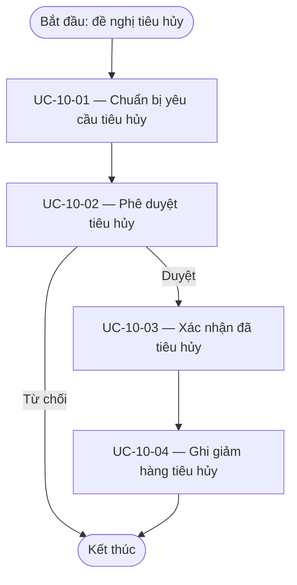

# BJ-10 — Tiêu hủy hàng

## 1. Tổng quan nghiệp vụ & Bối cảnh

Ghi nhận đúng việc **hàng đã thực sự bị tiêu hủy hoặc xử lý loại bỏ**, chỉ giảm tồn vật lý và giá trị sau khi có đủ lý do, bằng chứng, phê duyệt theo rủi ro và xác nhận hoàn tất.

**Bắt đầu khi:** Người có quyền chọn một lượng hàng không bán được để đề nghị tiêu hủy.

**Kết thúc khi:** Hàng được tiêu hủy và giảm physical/value; hoặc yêu cầu chờ duyệt/chờ xử lý; hoặc bị từ chối mà không giảm tồn.

**Không bao gồm:** Trách nhiệm bồi thường, xử lý môi trường/chuyên ngành hoặc hạch toán chi phí ngoài inventory value effect.

## 2. Tác nhân và trách nhiệm

| Tác nhân | Trách nhiệm | Phạm vi thẩm quyền |
|---|---|---|
| Thủ kho, người duyệt và người xác nhận xử lý | Chuẩn bị, duyệt, xác nhận xử lý thực tế và ghi giảm hàng tiêu hủy. | Người thực hiện/duyệt phải tuân segregation policy; không ghi giảm trước completion evidence. |

## 3. Sơ đồ hành trình nghiệp vụ

## 4. Bản đồ Use Case

| UC — Tên | Mục tiêu | Tác nhân | Đầu vào / Bắt đầu khi | Kết quả | Tiếp tục |
|---|---|---|---|---|---|
| [UC-10-01](../use-cases/UC-10-01-chuan-bi-yeu-cau-tieu-huy.md) — Chuẩn bị yêu cầu tiêu hủy | Draft đủ điều kiện gửi hoặc bị chặn; Disposal request. | Thủ kho, người duyệt và người xác nhận xử lý | Có lượng hàng được đề nghị loại bỏ | Draft đủ điều kiện gửi hoặc bị chặn; Disposal request. | UC-10-02 |
| [UC-10-02](../use-cases/UC-10-02-phe-duyet-tieu-huy.md) — Phê duyệt tiêu hủy | Duyệt hoặc từ chối có lý do; Approval decision. | Thủ kho, người duyệt và người xác nhận xử lý | Yêu cầu có snapshot rủi ro và approver hợp lệ | Duyệt hoặc từ chối có lý do; Approval decision. | UC-10-03 |
| [UC-10-03](../use-cases/UC-10-03-xac-nhan-da-tieu-huy.md) — Xác nhận đã tiêu hủy | Có completion assertion cho lượng thực xử lý; Disposal completion evidence. | Thủ kho, người duyệt và người xác nhận xử lý | Yêu cầu đã duyệt và việc xử lý thực tế diễn ra | Có completion assertion cho lượng thực xử lý; Disposal completion evidence. | UC-10-04 |
| [UC-10-04](../use-cases/UC-10-04-ghi-giam-hang-tieu-huy.md) — Ghi giảm hàng tiêu hủy | Physical/value giảm nguyên tử hoặc result không rõ được chuyển đối soát; Disposal inventory result. | Thủ kho, người duyệt và người xác nhận xử lý | Approval và completion assertion còn hợp lệ | Physical/value giảm nguyên tử hoặc result không rõ được chuyển đối soát; Disposal inventory result. | Kết thúc / theo nhánh trên sơ đồ |

## 5. Bàn giao và ranh giới liên quan

| Nơi nhận / Nơi cung cấp | Dữ kiện hoặc trách nhiệm bàn giao | Điều kiện bàn giao / tiếp tục |
|---|---|---|
| BJ09 | Hàng không bán được đủ điều kiện disposal | State/source hợp lệ |
| BJ14 | Value effect cần reconcile | Sau disposal commit |

## 6. Luồng giao diện cấp hành trình

| Chặng / UC | Chuyển màn hình | Hành động nghiệp vụ |
|---|---|---|
| UC-10-01 — Chuẩn bị yêu cầu tiêu hủy | `SCR-036`, `SCR-037`, `SCR-040` | Chuẩn bị yêu cầu tiêu hủy cho lượng hàng đủ điều kiện, với lý do, phương thức và bằng chứng dự kiến rõ ràng. |
| UC-10-02 — Phê duyệt tiêu hủy | `SCR-040` | Duyệt hoặc từ chối disposal request cần phê duyệt trên đúng snapshot và evidence hiện hành. |
| UC-10-03 — Xác nhận đã tiêu hủy | `SCR-040` | Xác nhận việc tiêu hủy/xử lý thực tế đã xảy ra và lưu bằng chứng hoàn tất trước khi ghi giảm tồn. |
| UC-10-04 — Ghi giảm hàng tiêu hủy | `SCR-041` | Ghi giảm quantity và value cho đúng lượng đã được xác nhận tiêu hủy, sau khi completion evidence hợp lệ. |

## 7. Nghiệm thu hành trình (Journey Acceptance)

| ID | Điều kiện ở cấp hành trình | Kết quả cần bảo đảm | UC / BC liên quan |
|---|---|---|---|
| JA-01 | Journey bắt đầu từ đúng trigger và actor có quyền | Kết quả chỉ được ghi trong phạm vi authority của Theme 7; source ngoài Theme không bị sửa ngầm | UC-10-01 / BC liên quan |
| JA-02 | Một nhánh bị từ chối, blocked hoặc chưa xác định | Không được báo thành công hoặc tạo tác động bán phần; hướng xử lý/owner tiếp theo phải rõ | UC-10-01…UC-10-04 |
| JA-03 | Journey hoàn tất thành công | Kết quả cuối có provenance, thời điểm/phạm vi và đủ dữ kiện cho consumer tiếp theo | UC-10-04 / Domain ledger |

## 8. Truy vết

| Nguồn | Vai trò đối với hành trình |
|---|---|
| [Decision Register](../../../01.knowledge/decisions/decision-register.md) — Decision Register theo UC/BC | Nguồn quyết định nghiệp vụ và trạng thái hiệu lực |
| `DOM-IC`, `DOM-IO` | Domain authority và invariants dùng cho Journey |
| [Use Case Map](../use-cases/00-use-case-map.md) | Danh mục UC canonical của Theme 7 |
