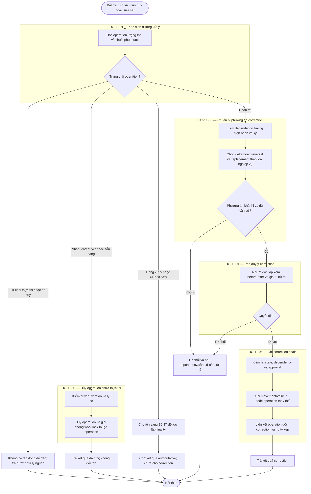
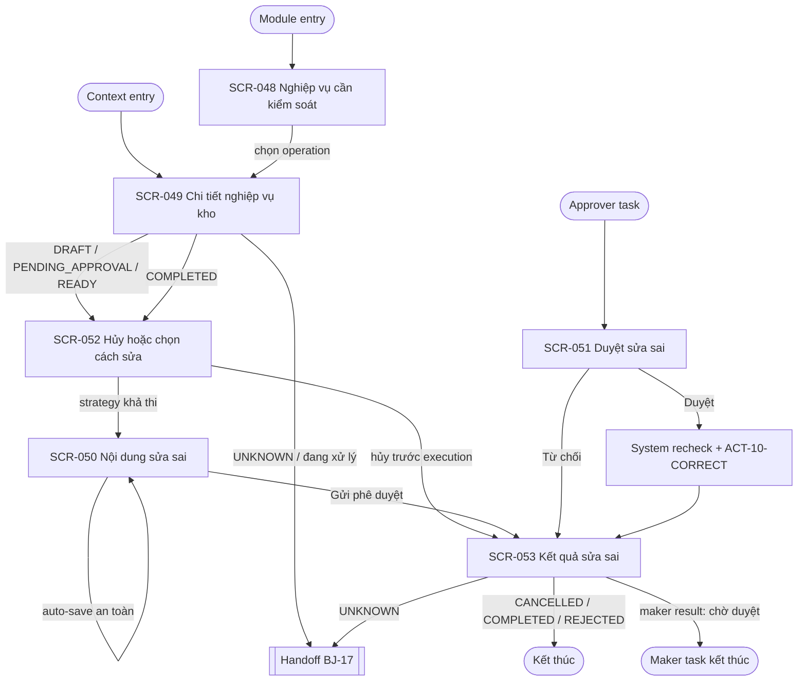

# BJ-11 — Hủy và sửa sai nghiệp vụ kho

## 1. Mục tiêu trải nghiệm

Cho phép dừng yêu cầu chưa thực thi hoặc sửa sai operation đã hoàn tất mà vẫn bảo toàn **operation gốc, movement ledger, kỳ kế toán và toàn bộ chuỗi truy vết**.

## 2. Phạm vi và ranh giới

### 2.1 Bắt đầu khi

| Thuộc tính | Nội dung |
|---|---|
| Bắt đầu | Nguồn yêu cầu hủy operation, hoặc người có quyền phát hiện operation kho đã hoàn tất sai |
| Kết thúc | Operation chưa thực thi được hủy không tác động tồn; correction/reversal được commit; hoặc yêu cầu bị chặn/chờ đối soát mà lịch sử gốc không thay đổi |
| Tác động chính | Cancellation audit hoặc operation bù/thay thế có quantity/value adjustment liên kết |
| Không cho phép | Sửa/xóa operation, movement, result hoặc chứng từ lịch sử đã hoàn tất |

### 2.2 Kết thúc khi

| Thuộc tính | Nội dung |
|---|---|
| Bắt đầu | Nguồn yêu cầu hủy operation, hoặc người có quyền phát hiện operation kho đã hoàn tất sai |
| Kết thúc | Operation chưa thực thi được hủy không tác động tồn; correction/reversal được commit; hoặc yêu cầu bị chặn/chờ đối soát mà lịch sử gốc không thay đổi |
| Tác động chính | Cancellation audit hoặc operation bù/thay thế có quantity/value adjustment liên kết |
| Không cho phép | Sửa/xóa operation, movement, result hoặc chứng từ lịch sử đã hoàn tất |

### 2.3 Không bao gồm

| Trong ranh giới | Ngoài ranh giới |
|---|---|
| Chọn đường cancel/reconcile/correct theo trạng thái; phân tích dependency; chọn delta hay reversal + replacement theo operation type; duyệt và thực thi | Hủy thương mại đơn bán/đơn mua; customer return thay cho correction; sửa kỳ đã khóa; sửa ledger trực tiếp |
| Lưu ngày nghiệp vụ gốc và ngày ghi nhận correction | Viết lại báo cáo kỳ cũ hoặc tái sử dụng operation ID gốc |

**Phụ thuộc bên ngoài:** Với operation phát sinh từ Sales, Purchase hoặc capability khác, capability nguồn tạo correction intent và source version. Theme 7 quyết định correction có khả thi trên tồn kho hiện hành hay không.

## 3. Actor

- Người vận hành kho và người duyệt sửa sai

## 4. Luồng chính

## 5. Use Case map

## 6. Luồng thay thế và ngoại lệ

### 4. Logic nghiệp vụ cần giữ

| Điểm kiểm soát | Quy tắc |
|---|---|
| Hủy trước thực thi | Chỉ `DRAFT`, `PENDING_APPROVAL` hoặc `READY` được hủy; cancellation không tạo movement/value |
| UNKNOWN | Không đảo hoặc thay thế khi chưa xác lập finality; truy vấn cùng operation ID rồi handoff BJ-17 nếu vẫn chưa rõ |
| Operation hoàn tất | Không sửa payload/result; tạo operation mới trong correction chain |
| Dependency | Chặn reversal nếu làm âm tồn hoặc dependency chưa được trung hòa; không giả lập trung hòa bằng sửa số dư |
| Delta hay full reversal | Dùng delta khi chỉ phần sai có thể sửa độc lập và giữ đúng nguồn; dùng reversal + replacement khi toàn operation mất hiệu lực hoặc payload đúng phải được xác lập lại nguyên khối |
| Hàng thực quay về | Sale Issue đã bàn giao chỉ tăng tồn qua BJ-06; cancellation/correction không thay thế việc nhận hàng thực tế |
| Kỳ khóa | Ghi ảnh hưởng ở kỳ mở hiện tại, giữ ngày nghiệp vụ gốc và liên kết kỳ gốc; không sửa kỳ đã khóa |
| Một reversal hiệu lực | Mỗi operation gốc chỉ có một reversal hiệu lực; sửa tiếp qua chain kế nhiệm, không tạo nhiều reversal song song |
| Maker–checker | Correction/reversal duyệt theo rủi ro; người tạo không tự duyệt |

#### Hướng correction theo nhóm operation

| Nhóm operation | Hướng xử lý chính |
|---|---|
| Receipt / Customer Return | Kiểm lượng còn truy được và dependency đã phát sinh; dùng delta hoặc reversal + replacement khi khả thi |
| Sale Issue / Supplier Return / Disposal | Không “hủy” bàn giao vật lý; cần evidence và operation bù phù hợp, customer return dùng đúng BJ-06 |
| Stocktake Adjustment | Tạo adjustment/correction mới có liên kết; không mở lại hoặc sửa số đếm đã duyệt |
| State Change | Tạo state movement ngược hoặc thay thế nếu transition hiện hành cho phép |
| Value-only Adjustment | Ghi value adjustment bù ở kỳ mở và giữ liên kết kỳ gốc |

### 5. Quan hệ và bàn giao

- Có thể nhận correction intent từ mọi BJ có mutation nhưng không thay thế workflow thương mại của BJ nguồn.
- Nếu correction liên quan hàng thực quay về, bàn giao BJ-06; nếu liên quan kiểm kê, chờ BJ-08 kết thúc scope lock.
- Quantity/value effects được chuyển cho BJ-14 và báo cáo theo cả ngày nghiệp vụ gốc lẫn ngày ghi nhận.
- Operation có finality chưa xác định được bàn giao BJ-17; ledger/projection mismatch được bàn giao BJ-16 để mở/điều phối Reconciliation Case. Không cho người dùng sửa kết quả bằng tay.

## 7. UI Flow và chuyển màn hình

> **v1.7.0 Product correction.** Nguồn nghiệp vụ: BJ-11/UC-11-01..05. Figma DS v2.0.2 là UI authority; HTML là renderer; Flutter DS chỉ là historical renderer provenance. Mũi tên `HANDOFF` không giả lập actor/session khác.

### 1. Design Readiness

| Câu hỏi | Quyết định |
|---|---|
| Primary task | Hủy yêu cầu chưa thực thi, hoặc sửa sai operation đã hoàn tất mà không sửa lịch sử gốc |
| Primary object | Inventory Operation + immutable correction chain |
| Known context | Operation, source, warehouse, state, dependency, kỳ, quantity/value impact |
| User decision | Lý do hủy; strategy correction khi server cho phép; số đúng + lý do; approval decision của actor độc lập |
| System decision | Route cancel / correction / BJ-17; feasibility/dependency; delta derived; auto-save draft; auto-execute correction sau approval |
| Commit point | `ACT-10-CANCEL` hoặc `ACT-10-CORRECT` sau approval hợp lệ |
| Recovery | UNKNOWN giữ same operation identity và handoff BJ-17; không blind retry |

### 2. Entry architecture

| Entry | Actor | Screen | Product behavior |
|---|---|---|---|
| Inventory → Kiểm soát → Sửa sai | Người phụ trách kho | `SCR-048` | Mở worklist nghiệp vụ cần kiểm soát |
| Chi tiết nghiệp vụ / deep link có context | Người phụ trách kho | `SCR-049` | Mở đúng operation, không bắt chọn lại context |
| Công việc phê duyệt được giao | Người phê duyệt độc lập | `SCR-051` | Direct entry; không đi qua phiên maker |

Entry/handoff explanation thuộc artifact này, **không render thành card/banner trong Product UI**.

### 3. UI flow

### 4. Transition contract

| ID | From | Trigger | To | Type | Trace |
|---|---|---|---|---|---|
| `UIF-11-T01` | Module entry | Mở Kiểm soát → Sửa sai | `SCR-048` | NAVIGATION | UC-11-01 |
| `UIF-11-T02` | Context entry | Có operation context hợp lệ | `SCR-049` | NAVIGATION | UC-11-01 |
| `UIF-11-T03` | Approver task | Công việc duyệt được giao | `SCR-051` | ACTOR_HANDOFF | UC-11-04 |
| `UIF-11-T04` | `SCR-048` | Chọn operation | `SCR-049` | NAVIGATION | UC-11-01 |
| `UIF-11-T05` | `SCR-049` | Operation chưa thực thi và được hủy | `SCR-052:CANCEL_UNEXECUTED` | NAVIGATION | UC-11-02 |
| `UIF-11-T06` | `SCR-052` | Xác nhận hủy + lý do hợp lệ | `SCR-053:CANCELLED` | MUTATION | `ACT-10-CANCEL` · BC-IO-12 · API-C-12 |
| `UIF-11-T07` | `SCR-049` | `UNKNOWN` / chưa xác lập finality | BJ-17 | HANDOFF | UC-11-01 |
| `UIF-11-T08` | `SCR-049` | Operation `COMPLETED` | `SCR-052:CORRECTION_ROUTE` | NAVIGATION | UC-11-03 |
| `UIF-11-T09` | `SCR-052` | Chọn strategy server cho phép | `SCR-050` | NAVIGATION | UC-11-03 |
| `UIF-11-T10` | `SCR-050` | Dữ liệu thay đổi an toàn | `SCR-050` | SYSTEM | `ACT-10-SAVE-DRAFT` · không render CTA |
| `UIF-11-T11` | `SCR-050` | Gửi phê duyệt | `SCR-053:PENDING_APPROVAL` | MUTATION | `ACT-10-SUBMIT` · BC-IC-07 · API-C-26 |
| `UIF-11-T12` | `SCR-051` | Từ chối + reason | `SCR-053:REJECTED` | MUTATION | `ACT-10-DECIDE` · BC-IC-06 · API-C-19 |
| `UIF-11-T13` | `SCR-051` | Duyệt | `SCR-053:PROCESSING` | MUTATION | `ACT-10-DECIDE` · BC-IC-06 · API-C-19 |
| `UIF-11-T14` | System | Approval hợp lệ + dependency/state vẫn hợp lệ | `SCR-053:COMPLETED/UNKNOWN/BLOCKED` | SYSTEM_MUTATION | `ACT-10-CORRECT` · BC-IO-13 · API-C-13 |
| `UIF-11-T15` | `SCR-053` | CANCELLED / COMPLETED / REJECTED | End | TERMINAL | UC-11-02/04/05 |
| `UIF-11-T16` | `SCR-053` | UNKNOWN | BJ-17 | HANDOFF | UC-11-05 |

### 5. Product invariants

1. Chỉ `DRAFT`, `PENDING_APPROVAL`, `READY` được hủy trước execution; cancellation không tạo movement/value.
2. `COMPLETED` là bất biến; sửa sai tạo operation mới trong correction chain.
3. Delta chỉ dùng khi phần sai sửa độc lập được; full reversal + replacement khi toàn payload phải xác lập lại.
4. Sale Issue đã bàn giao vật lý không “trả về kho” bằng correction; hàng thực quay về dùng BJ-06.
5. Kỳ đã khóa không bị viết lại; correction ghi ảnh hưởng ở kỳ mở và giữ ngày/kỳ gốc.
6. Maker không tự duyệt. Maker submit **không điều hướng sang approver UI**.
7. Sau duyệt, execution là system-owned; không có nút “Ghi correction” lần hai.
8. UNKNOWN ≠ failed; giữ same identity và handoff BJ-17.

## 8. Handoff / phụ thuộc ngoài Journey

## 9. Outcome cuối

| Thuộc tính | Nội dung |
|---|---|
| Bắt đầu | Nguồn yêu cầu hủy operation, hoặc người có quyền phát hiện operation kho đã hoàn tất sai |
| Kết thúc | Operation chưa thực thi được hủy không tác động tồn; correction/reversal được commit; hoặc yêu cầu bị chặn/chờ đối soát mà lịch sử gốc không thay đổi |
| Tác động chính | Cancellation audit hoặc operation bù/thay thế có quantity/value adjustment liên kết |
| Không cho phép | Sửa/xóa operation, movement, result hoặc chứng từ lịch sử đã hoàn tất |

## 10. Truy vết

### Nguồn v3.10.1 — BJ-11 — Hủy và sửa sai nghiệp vụ kho

> **Trạng thái:** Release đã đóng băng `4.1.0` — đã remap ID và boundary  
> **Chuyển đổi chính thức:** Theme 7 `4.0.0/BJ-12` → `4.1.0/BJ-11`  
> **Finality contract:** `COMPLETED`, `REJECTED/CANCELLED`, `SUSPENDED/BLOCKED`, `UNKNOWN/ESCALATED`
> **Phạm vi:** Phase 1 — hủy operation chưa thực thi hoặc tạo correction cho operation đã hoàn tất  
> **Chủ sở hữu nghiệp vụ:** Inventory Control; source capability sở hữu correction intent của nghiệp vụ liên miền
> **Quyết định nghiệp vụ:** `T7-BASELINE-FREEZE-v4.0.0` + `T7-DR-064`, `T7-DR-065`, `T7-DR-066`, `T7-DR-071`, `T7-DR-074`
### Nguồn v3.10.1 — 3. Trường hợp sử dụng

| UC | Tên | Bắt đầu | Kết thúc | Kết quả |
|---|---|---|---|---|
| [UC-11-01](../use-cases/UC-11-01-xac-dinh-duong-xu-ly.md) | Xác định đường xử lý | Có operation và yêu cầu hủy/sửa | Chọn cancel, reconcile, correction hoặc không có tác động để đảo | Treatment route |
| [UC-11-02](../use-cases/UC-11-02-huy-operation-chua-thuc-thi.md) | Hủy operation chưa thực thi | Operation ở trạng thái cho phép hủy | Operation `CANCELLED`, lock/work được giải phóng, không movement/value | Cancellation result |
| [UC-11-03](../use-cases/UC-11-03-chuan-bi-phuong-an-correction.md) | Chuẩn bị phương án correction | Operation đã hoàn tất và có correction intent | Phương án khả thi đủ căn cứ hoặc bị chặn | Correction proposal |
| [UC-11-04](../use-cases/UC-11-04-phe-duyet-correction.md) | Phê duyệt correction | Proposal có snapshot rủi ro | Duyệt hoặc từ chối có lý do | Approval decision |
| [UC-11-05](../use-cases/UC-11-05-ghi-correction-chain.md) | Ghi correction chain | Proposal được duyệt và vẫn khả thi | Operation bù/thay thế cùng liên kết được commit hoặc không có gì commit | Immutable correction chain |
### Nguồn v3.10.1 — 6. Nguồn tri thức liên quan

- [Sửa sai tồn kho mà không sửa lịch sử](../../../01.knowledge/know-how/KB-KGV-021-sua-sai-ton-kho-khong-sua-lich-su.md)
- [Vòng đời của một Inventory Operation](../../../01.knowledge/know-how/KB-KGV-027-vong-doi-cua-mot-inventory-operation.md)
- [Idempotency, phiên bản nguồn và xử lý kết quả chưa xác định](../../../01.knowledge/know-how/KB-KGV-028-idempotency-phien-ban-nguon-va-xu-ly-ket-qua-chua-xac-dinh.md)
- [Tính nguyên tử khi ghi tồn kho và phát sự kiện](../../../01.knowledge/know-how/KB-KGV-029-tinh-nguyen-tu-khi-ghi-ton-kho-va-phat-su-kien.md)
