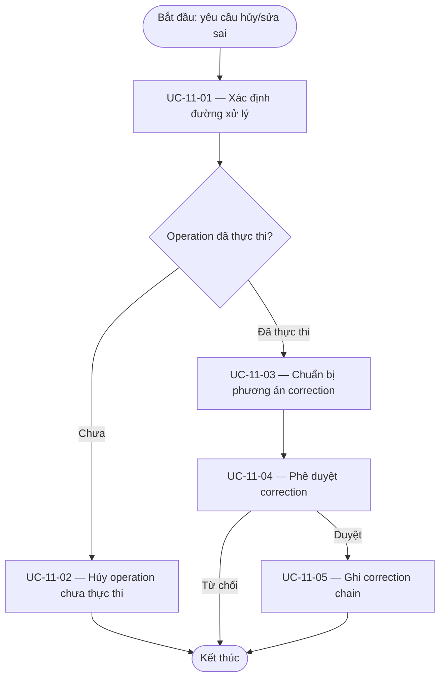

# BJ-11 — Hủy và sửa sai nghiệp vụ kho

## 1. Tổng quan nghiệp vụ & Bối cảnh

Cho phép dừng yêu cầu chưa thực thi hoặc sửa sai operation đã hoàn tất mà vẫn bảo toàn **operation gốc, movement ledger, kỳ kế toán và toàn bộ chuỗi truy vết**.

**Bắt đầu khi:** Nguồn yêu cầu hủy operation, hoặc người có quyền phát hiện operation kho đã hoàn tất sai.

**Kết thúc khi:** Operation chưa thực thi được hủy không tác động tồn; correction/reversal được commit; hoặc yêu cầu bị chặn/chờ đối soát mà lịch sử gốc không thay đổi.

**Không bao gồm:** Không sở hữu quyết định thuộc Theme/Domain khác.

## 2. Tác nhân và trách nhiệm

| Tác nhân | Trách nhiệm | Phạm vi thẩm quyền |
|---|---|---|
| Người vận hành kho và người duyệt sửa sai | Phân loại cancel/correction, chuẩn bị phương án, duyệt và ghi correction chain bất biến. | Không sửa transaction đã hoàn tất tại chỗ; phải dùng cancellation/correction/reconciliation đúng loại. |
| Người duyệt: `is_owner` hoặc vai trò `store_owner`, khác người lập (trừ ngoại lệ `is_owner` tự duyệt) | Duyệt hoặc từ chối phương án sửa sai nghiệp vụ kho. | **Người duyệt** là `is_owner` hoặc vai trò `store_owner`, khác người lập. **Ngoại lệ:** cửa hàng chỉ có một chủ, nên `is_owner` lập yêu cầu sửa sai thì vẫn gửi duyệt rồi tự duyệt ở màn duyệt (không có đường ghi nhận thẳng); lịch sử ghi người duyệt "Chủ cửa hàng". |

## 3. Sơ đồ hành trình nghiệp vụ

## 4. Bản đồ Use Case

| UC — Tên | Mục tiêu | Tác nhân | Đầu vào / Bắt đầu khi | Kết quả | Tiếp tục |
|---|---|---|---|---|---|
| [UC-11-01](../use-cases/UC-11-01-xac-dinh-duong-xu-ly.md) — Xác định đường xử lý | Chọn cancel, reconcile, correction hoặc không có tác động để đảo; Treatment route. | Người vận hành kho và người duyệt sửa sai | Có operation và yêu cầu hủy/sửa | Chọn cancel, reconcile, correction hoặc không có tác động để đảo; Treatment route. | UC-11-02 |
| [UC-11-02](../use-cases/UC-11-02-huy-operation-chua-thuc-thi.md) — Hủy operation chưa thực thi | Operation `CANCELLED`, lock/work được giải phóng, không movement/value; Cancellation result. | Người vận hành kho và người duyệt sửa sai | Operation ở trạng thái cho phép hủy | Operation `CANCELLED`, lock/work được giải phóng, không movement/value; Cancellation result. | UC-11-03 |
| [UC-11-03](../use-cases/UC-11-03-chuan-bi-phuong-an-correction.md) — Chuẩn bị phương án correction | Phương án khả thi đủ căn cứ hoặc bị chặn; Correction proposal. | Người vận hành kho và người duyệt sửa sai | Operation đã hoàn tất và có correction intent | Phương án khả thi đủ căn cứ hoặc bị chặn; Correction proposal. | UC-11-04 |
| [UC-11-04](../use-cases/UC-11-04-phe-duyet-correction.md) — Phê duyệt correction | Duyệt hoặc từ chối có lý do; Approval decision. | Người vận hành kho và người duyệt sửa sai | Proposal có snapshot rủi ro | Duyệt hoặc từ chối có lý do; Approval decision. | UC-11-05 |
| [UC-11-05](../use-cases/UC-11-05-ghi-correction-chain.md) — Ghi correction chain | Operation bù/thay thế cùng liên kết được commit hoặc không có gì commit; Immutable correction chain. | Người vận hành kho và người duyệt sửa sai | Proposal được duyệt và vẫn khả thi | Operation bù/thay thế cùng liên kết được commit hoặc không có gì commit; Immutable correction chain. | Kết thúc / theo nhánh trên sơ đồ |

## 5. Bàn giao và ranh giới liên quan

| Nơi nhận / Nơi cung cấp | Dữ kiện hoặc trách nhiệm bàn giao | Điều kiện bàn giao / tiếp tục |
|---|---|---|
| Journey nguồn | Operation gốc và bằng chứng sai/hủy | Giữ immutable lineage |
| BJ14/BJ16/BJ17 | Dirty scope hoặc reconciliation/recovery | Theo loại correction/result |

## 6. Liên kết thiết kế

- **UI Flow canonical:** [UIF-11 — Hủy và sửa sai nghiệp vụ kho](../../../03.design/flows/UIF-11-BJ-11.md)
- BJ này chỉ sở hữu **business boundary, mục tiêu, UC/handoff và acceptance ở cấp hành trình**.
- Screen-to-screen routing, entry/terminal, actor handoff, state/recovery và transition nằm tại `UIF-11`; anatomy/action chi tiết nằm tại `03.design/screens/`.
- Không copy Screen Flow vào BJ để tránh trùng với UC/UIF và để redesign UI không làm thay đổi semantic của Journey.

## 7. Nghiệm thu hành trình (Journey Acceptance)

| ID | Điều kiện ở cấp hành trình | Kết quả cần bảo đảm | UC / BC liên quan |
|---|---|---|---|
| JA-01 | Journey bắt đầu từ đúng trigger và actor có quyền | Kết quả chỉ được ghi trong phạm vi authority của Theme 7; source ngoài Theme không bị sửa ngầm | UC-11-01 / BC liên quan |
| JA-02 | Một nhánh bị từ chối, blocked hoặc chưa xác định | Không được báo thành công hoặc tạo tác động bán phần; hướng xử lý/owner tiếp theo phải rõ | UC-11-01…UC-11-05 |
| JA-03 | Journey hoàn tất thành công | Kết quả cuối có provenance, thời điểm/phạm vi và đủ dữ kiện cho consumer tiếp theo | UC-11-05 / Domain ledger |

## 8. Truy vết

| Nguồn | Vai trò đối với hành trình |
|---|---|
| [KB-KGV-021 — Sửa sai tồn kho mà không sửa lịch sử](../../../01.knowledge/know-how/KB-KGV-021-sua-sai-ton-kho-khong-sua-lich-su.md); [KB-KGV-027 — Vòng đời của một Inventory Operation](../../../01.knowledge/know-how/KB-KGV-027-vong-doi-cua-mot-inventory-operation.md); [KB-KGV-028 — Idempotency, phiên bản nguồn và xử lý kết quả chưa xác định](../../../01.knowledge/know-how/KB-KGV-028-idempotency-phien-ban-nguon-va-xu-ly-ket-qua-chua-xac-dinh.md); [KB-KGV-029 — Tính nguyên tử khi ghi tồn kho và phát sự kiện](../../../01.knowledge/know-how/KB-KGV-029-tinh-nguyen-tu-khi-ghi-ton-kho-va-phat-su-kien.md) | **Bài tri thức cốt lõi** giúp hiểu nền nghiệp vụ của Journey; rule triển khai vẫn theo Decision/BJ/UC/BC canonical |
| [Decision Register](../../../01.knowledge/decisions/decision-register.md) — Decision Register theo UC/BC | Nguồn quyết định nghiệp vụ và trạng thái hiệu lực |
| `DOM-IC`, `DOM-IO` | Domain authority và invariants dùng cho Journey |
| [Use Case Map](../use-cases/00-use-case-map.md) | Danh mục UC canonical của Theme 7 |
