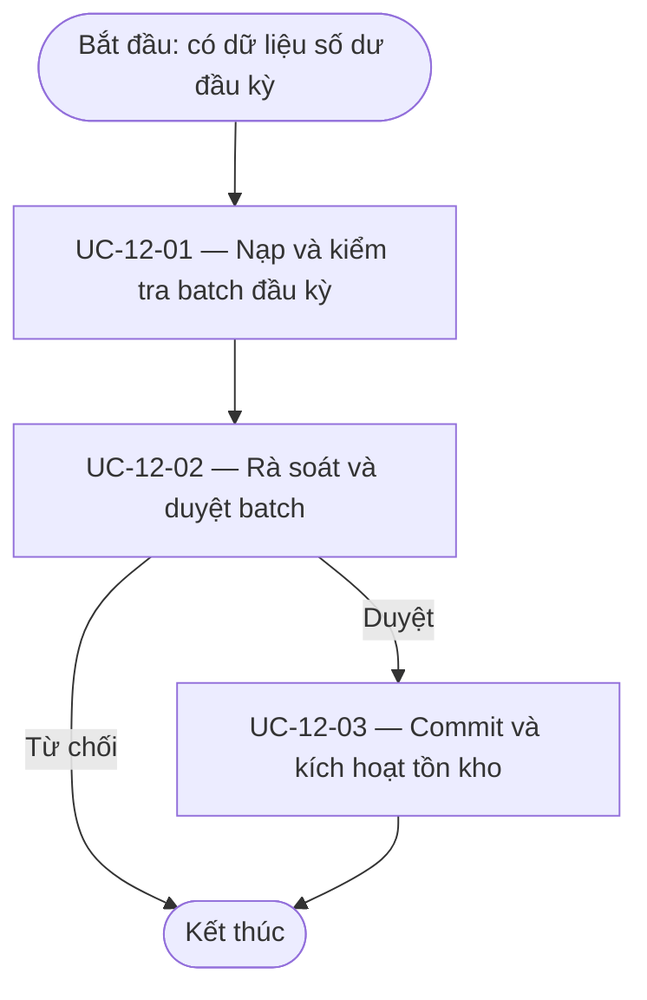

# BJ-12 — Khởi tạo số dư tồn kho đầu kỳ

## 1. Tổng quan nghiệp vụ & Bối cảnh

Khởi tạo **số lượng, trạng thái, lô/hạn dùng và giá trị tồn kho đầu kỳ** từ nguồn đã được kiểm soát; chỉ mở giao dịch kho thông thường sau khi toàn bộ batch được kiểm tra, duyệt, commit và đối soát thành công.

**Bắt đầu khi:** Đơn vị chuẩn bị vận hành tồn kho và có file số dư cùng số kiểm soát tại cut-off.

**Kết thúc khi:** Tồn kho được kích hoạt bằng một batch đã commit và có báo cáo đối soát; hoặc batch dừng ở kết quả lỗi/từ chối mà chưa mở giao dịch.

**Không bao gồm:** Tạo Product, Store, Warehouse, đơn vị tính hoặc sửa dữ liệu nguồn bên ngoài.

## 2. Tác nhân và trách nhiệm

| Tác nhân | Trách nhiệm | Phạm vi thẩm quyền |
|---|---|---|
| Quản trị triển khai, kế toán kho và người duyệt | Nạp, kiểm tra, duyệt và commit số dư đầu kỳ trước khi inventory được kích hoạt. | Không cho giao dịch vận hành chen vào trước activation; maker/approver theo policy. |

## 3. Sơ đồ hành trình nghiệp vụ

## 4. Bản đồ Use Case

| UC — Tên | Mục tiêu | Tác nhân | Đầu vào / Bắt đầu khi | Kết quả | Tiếp tục |
|---|---|---|---|---|---|
| [UC-12-01](../use-cases/UC-12-01-nap-va-kiem-tra-batch-dau-ky.md) — Nạp và kiểm tra batch đầu kỳ | Batch hợp lệ hoặc có danh sách lỗi đầy đủ; Prepared batch có version/hash, chưa ghi ledger. | Quản trị triển khai, kế toán kho và người duyệt | Có file nguồn, cut-off và control totals | Batch hợp lệ hoặc có danh sách lỗi đầy đủ; Prepared batch có version/hash, chưa ghi ledger. | UC-12-02 |
| [UC-12-02](../use-cases/UC-12-02-ra-soat-va-duyet-batch.md) — Rà soát và duyệt batch | Batch được duyệt hoặc từ chối; Approval decision độc lập với người lập. | Quản trị triển khai, kế toán kho và người duyệt | Có prepared batch hợp lệ | Batch được duyệt hoặc từ chối; Approval decision độc lập với người lập. | UC-12-03 |
| [UC-12-03](../use-cases/UC-12-03-commit-va-kich-hoat-ton-kho.md) — Commit và kích hoạt tồn kho | Toàn bộ batch hoàn tất và inventory được mở; hoặc không có gì commit; Opening evidence và activation result. | Quản trị triển khai, kế toán kho và người duyệt | Có đúng version/hash đã duyệt | Toàn bộ batch hoàn tất và inventory được mở; hoặc không có gì commit; Opening evidence và activation result. | Kết thúc / theo nhánh trên sơ đồ |

## 5. Bàn giao và ranh giới liên quan

| Nơi nhận / Nơi cung cấp | Dữ kiện hoặc trách nhiệm bàn giao | Điều kiện bàn giao / tiếp tục |
|---|---|---|
| Nguồn migration | File số dư + control totals | Trước activation |
| BJ01/BJ14 | Opening quantity/value facts | Sau commit và reconciliation |

## 6. Liên kết thiết kế

- **UI Flow canonical:** [UIF-12 — Khởi tạo số dư tồn kho đầu kỳ](../../../03.design/flows/UIF-12-BJ-12.md)
- BJ này chỉ sở hữu **business boundary, mục tiêu, UC/handoff và acceptance ở cấp hành trình**.
- Screen-to-screen routing, entry/terminal, actor handoff, state/recovery và transition nằm tại `UIF-12`; anatomy/action chi tiết nằm tại `03.design/screens/`.
- Không copy Screen Flow vào BJ để tránh trùng với UC/UIF và để redesign UI không làm thay đổi semantic của Journey.

## 7. Nghiệm thu hành trình (Journey Acceptance)

| ID | Điều kiện ở cấp hành trình | Kết quả cần bảo đảm | UC / BC liên quan |
|---|---|---|---|
| JA-01 | Journey bắt đầu từ đúng trigger và actor có quyền | Kết quả chỉ được ghi trong phạm vi authority của Theme 7; source ngoài Theme không bị sửa ngầm | UC-12-01 / BC liên quan |
| JA-02 | Một nhánh bị từ chối, blocked hoặc chưa xác định | Không được báo thành công hoặc tạo tác động bán phần; hướng xử lý/owner tiếp theo phải rõ | UC-12-01…UC-12-03 |
| JA-03 | Journey hoàn tất thành công | Kết quả cuối có provenance, thời điểm/phạm vi và đủ dữ kiện cho consumer tiếp theo | UC-12-03 / Domain ledger |

## 8. Truy vết

| Nguồn | Vai trò đối với hành trình |
|---|---|
| [KB-KGV-003 — Cửa hàng, kho và khóa định danh số dư tồn kho](../../../01.knowledge/know-how/KB-KGV-003-kho-cua-hang-va-khoa-dinh-danh-so-du-ton-kho.md); [KB-KGV-004 — Đơn vị tính và cách quy đổi số lượng tồn kho](../../../01.knowledge/know-how/KB-KGV-004-don-vi-tinh-va-cach-quy-doi-so-luong-ton-kho.md); [KB-KGV-015 — Đơn giá tồn kho chính thức và tổng giá trị ghi sổ](../../../01.knowledge/know-how/KB-KGV-015-don-gia-ton-kho-chinh-thuc-va-tong-gia-tri-ghi-so.md); [KB-KGV-022 — Chuẩn bị dữ liệu số dư tồn kho đầu kỳ](../../../01.knowledge/know-how/KB-KGV-022-chuan-bi-du-lieu-so-du-ton-kho-dau-ky.md); [KB-KGV-023 — Xác nhận số dư đầu kỳ, Chuyển đổi chính thức và đối soát migration](../../../01.knowledge/know-how/KB-KGV-023-xac-nhan-so-du-dau-ky-chuyen-doi-chinh-thuc-va-doi-soat-migration.md) | **Bài tri thức cốt lõi** giúp hiểu nền nghiệp vụ của Journey; rule triển khai vẫn theo Decision/BJ/UC/BC canonical |
| [Decision Register](../../../01.knowledge/decisions/decision-register.md) — Decision Register theo UC/BC | Nguồn quyết định nghiệp vụ và trạng thái hiệu lực |
| `DOM-IC`, `DOM-IO` | Domain authority và invariants dùng cho Journey |
| [Use Case Map](../use-cases/00-use-case-map.md) | Danh mục UC canonical của Theme 7 |
