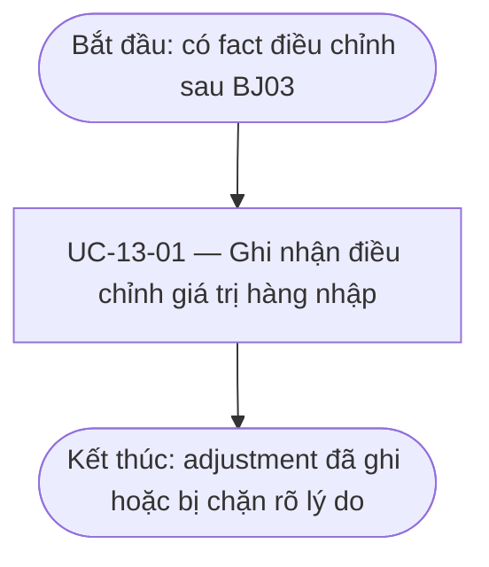

# BJ-13 — Điều chỉnh giá trị hàng nhập

## 1. Tổng quan nghiệp vụ & Bối cảnh

Ghi nhận các business fact xuất hiện hoặc trở nên hợp lệ sau initial valuation làm tăng hoặc giảm giá trị hàng nhập, với nguồn, phạm vi, phân bổ và kỳ rõ ràng; không sửa giá trị ban đầu hoặc giao dịch lịch sử.

**Bắt đầu khi:** Có thành phần giá trị mới hoặc thay đổi hợp lệ sau khi target đã hoàn tất BJ03.

**Kết thúc khi:** Adjustment được ghi đúng một lần và Product + posting period bị ảnh hưởng được đánh dấu cần cập nhật giá vốn; hoặc yêu cầu bị chặn rõ nguyên nhân.

**Không bao gồm:** Thành phần đã đủ căn cứ trước initial valuation; forecast chưa phát sinh; sửa lỗi nhập liệu; công bố giá vốn.

## 2. Tác nhân và trách nhiệm

| Tác nhân | Trách nhiệm | Phạm vi thẩm quyền |
|---|---|---|
| Kế toán mua hàng hoặc kế toán kho | Ghi signed adjustment khi business fact hợp lệ xuất hiện/thay đổi sau BJ03 và phân bổ về đúng receipt exposure. | Không dùng BJ13 để sửa lỗi nhập liệu; không ghi projected benefit vào ledger. |

## 3. Sơ đồ hành trình nghiệp vụ

## 4. Bản đồ Use Case

| UC — Tên | Mục tiêu | Tác nhân | Đầu vào / Bắt đầu khi | Kết quả | Tiếp tục |
|---|---|---|---|---|---|
| [UC-13-01](../use-cases/UC-13-01-ghi-nhan-dieu-chinh-gia-tri-hang-nhap.md) — Ghi nhận điều chỉnh giá trị hàng nhập | Ghi một khoản tăng/giảm giá trị phát sinh sau BJ03 và phân bổ về đúng hàng đã nhận | Kế toán mua hàng hoặc kế toán kho có quyền tài chính | Có thành phần giá trị mới hoặc thay đổi hợp lệ sau BJ03: chi phí vận chuyển, bảo hiểm, thuế/phí không thu hồi, chênh lệch giá hóa đơn, giảm giá, chiết khấu, credit note… | Điều chỉnh có nguồn, dấu tăng/giảm, phạm vi phân bổ và kỳ ghi nhận rõ; sản phẩm + kỳ bị ảnh hưởng được đánh dấu cần cập nhật giá vốn | Kết thúc BJ13; chuyển phạm vi cần tính lại sang BJ14 |

## 5. Bàn giao và ranh giới liên quan

| Nơi nhận / Nơi cung cấp | Dữ kiện hoặc trách nhiệm bàn giao | Điều kiện bàn giao / tiếp tục |
|---|---|---|
| Theme 10 / nguồn có thẩm quyền | Thành phần thương mại đã thực sự phát sinh hoặc thay đổi, kèm source/version | Dữ liệu dự kiến chỉ dùng mô phỏng; chưa được ghi vào giá trị tồn thực tế |
| BJ14 | Sản phẩm + kỳ cần tính lại giá vốn | Sau khi điều chỉnh giá trị commit thành công |

## 6. Luồng giao diện cấp hành trình

> **Parity v3.12.0:** semantic Journey/UC đã thay đổi; Screen Contract/HTML v3.11.0 được giữ làm downstream input và sẽ được align ở v3.13.0.

| Chặng / UC | Chuyển màn hình | Hành động nghiệp vụ |
|---|---|---|
| UC-13-01 — Ghi nhận điều chỉnh giá trị hàng nhập | `SCR-018`, `SCR-017`, `SCR-019` | Xem nguồn điều chỉnh, xác định hàng/lần nhận bị ảnh hưởng, kiểm tra cách phân bổ và xác nhận phần tăng hoặc giảm giá trị cần ghi. |

## 7. Nghiệm thu hành trình (Journey Acceptance)

| ID | Điều kiện ở cấp hành trình | Kết quả cần bảo đảm | UC / BC liên quan |
|---|---|---|---|
| JA-01 | Business fact xuất hiện sau BJ03 và có stable source identity | Adjustment giữ source/version, dấu `+/-`, target và phương pháp phân bổ; không sửa ReceiptValuation/value movement gốc | UC-13-01 / BC-IV-04 |
| JA-02 | Quyền lợi mới chỉ dự kiến hoặc lỗi do người dùng nhập sai fact cũ | Không ghi BJ13: forecast chỉ mô phỏng; lỗi nhập liệu đi BJ11/correction | UC-13-01 / BC-IV-04 |
| JA-03 | Kỳ gốc đã khóa | Adjustment được ghi ở kỳ mở theo policy nhưng vẫn giữ liên kết kỳ gốc để đối soát | UC-13-01 / BC-IV-04 |
| JA-04 | Adjustment commit thành công | Product + posting period bị ảnh hưởng được đánh dấu cần BJ14 tính lại; không tự công bố giá vốn | UC-13-01 / BC-IV-04 |

## 8. Truy vết

| Nguồn | Vai trò đối với hành trình |
|---|---|
| [Decision Register](../../../01.knowledge/decisions/decision-register.md) — G07 | Nguồn quyết định nghiệp vụ và trạng thái hiệu lực |
| `DOM-IV`, `DOM-IO` | Domain authority và invariants dùng cho Journey |
| [Use Case Map](../use-cases/00-use-case-map.md) | Danh mục UC canonical của Theme 7 |
