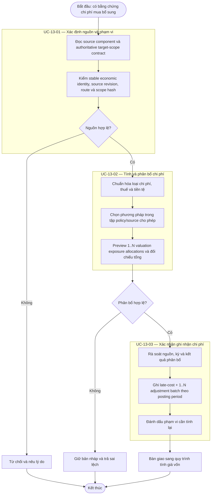

# BJ-13 — Ghi nhận chi phí mua đến muộn

## 1. Mục tiêu trải nghiệm

Ghi nhận **chi phí mua bổ sung có nguồn và phương pháp phân bổ rõ ràng** mà không sửa receipt hoặc value movement gốc; xác định đúng sản phẩm/kỳ cần tính lại giá vốn.

## 2. Phạm vi và ranh giới

### 2.1 Bắt đầu khi

| Thuộc tính | Nội dung |
|---|---|
| Bắt đầu | Có chứng từ hoặc bằng chứng chi phí mua phát sinh sau khi receipt đã được định giá |
| Kết thúc | Chi phí được ghi đúng một lần và phạm vi bị ảnh hưởng được bàn giao để tính lại; hoặc yêu cầu bị từ chối với lý do rõ ràng |
| Tác động chính | Value-only adjustment có provenance và dirty scope sản phẩm + kỳ |
| Không làm thay đổi | Quantity, receipt gốc, PO, công nợ hoặc giá bán |

### 2.2 Kết thúc khi

| Thuộc tính | Nội dung |
|---|---|
| Bắt đầu | Có chứng từ hoặc bằng chứng chi phí mua phát sinh sau khi receipt đã được định giá |
| Kết thúc | Chi phí được ghi đúng một lần và phạm vi bị ảnh hưởng được bàn giao để tính lại; hoặc yêu cầu bị từ chối với lý do rõ ràng |
| Tác động chính | Value-only adjustment có provenance và dirty scope sản phẩm + kỳ |
| Không làm thay đổi | Quantity, receipt gốc, PO, công nợ hoặc giá bán |

### 2.3 Không bao gồm

| Trong ranh giới | Ngoài ranh giới |
|---|---|
| Xác định nguồn; chọn **1..N receipt/dòng hàng liên quan**; chuẩn hóa thành phần chi phí; quy đổi VND; preview/phân bổ; chống trùng; xác định kỳ ghi nhận | Phê duyệt invoice, thanh toán, chênh lệch tỷ giá thanh toán, sửa chứng từ gốc |
| Bàn giao phạm vi cần tính lại cho BJ-14 | Tự công bố giá vốn mới hoặc tự đổi giá bán |

## 3. Actor

- Kế toán mua hàng hoặc kế toán kho

## 4. Luồng chính

## 5. Use Case map

## 6. Luồng thay thế và ngoại lệ

### 4. Logic nghiệp vụ cần giữ

| Điểm kiểm soát | Quy tắc |
|---|---|
| Nguồn bắt buộc | Mỗi chi phí phải có source document/line/version và bằng chứng; không nhập một khoản tổng không truy nguyên |
| Chống trùng | Cùng `source_component_key` chỉ là một economic cost; revision không tạo cost mới. Allocation dedup theo stable component key + valuation exposure key |
| Thành phần giá trị | Chi phí mua, discount, hàng tặng và thuế được chuẩn hóa theo chính sách; VAT được khấu trừ không vào giá vốn |
| Ngoại tệ | Sổ tồn dùng VND; dùng tỷ giá do nguồn Kế toán cung cấp; chênh lệch thanh toán không làm đổi giá trị tồn đã ghi |
| Phân bổ | Một source component phân bổ tới **1..N valuation exposures** thuộc authoritative target scope. Metric dùng initial/direct value hoặc normalized quantity snapshot theo policy; late-cost đã ghi trước đó không làm đổi metric của late-cost sau. Tổng allocation phải khớp normalized amount và rounding residual dùng stable exposure order, không phụ thuộc row order UI. |
| Phương pháp phân bổ | Theme 7 không hard-code enum khi source hiện chưa khóa danh sách Phase 1. Query preview trả `allowed_allocation_methods` + policy version; user chỉ chọn trong tập đó, server tính allocation và rounding authoritative. |
| Preview/commit | Chọn nguồn/phạm vi và tính phân bổ là read/preview, không ghi adjustment. Chỉ UC-13-03 tạo late-cost record + adjustment/value + dirty scope atomically. |
| Kỳ mở/khóa | Kỳ còn mở ghi vào phạm vi cần tính lại; kỳ đã khóa ghi adjustment ở kỳ mở hiện tại và giữ liên kết kỳ gốc |
| Bất biến lịch sử | Không sửa receipt, valuation hoặc cost run cũ; lần tính tiếp theo dùng run kế nhiệm |
| Không tác động lượng | Chỉ tạo ảnh hưởng giá trị, không tạo quantity movement |

### 5. Quan hệ và bàn giao

- Nhận receipt/value facts từ BJ-02 và BJ-03.
- Nguồn invoice, loại thuế, tỷ giá và approval chứng từ thuộc capability Mua hàng/Kế toán.
- Khi ghi nhận thành công, bàn giao product-period scope cho BJ-14; **không tự công bố official cost**.
- Nếu một source component liên quan nhiều exposure/posting period, toàn bộ late-cost record + mọi allocation + 1..N adjustment batch + value movement + dirty scope commit hoặc rollback cùng nhau.
- Nếu source sai sau khi đã ghi, sửa bằng BJ-11; không sửa adjustment cũ trực tiếp.

## 7. UI Flow và chuyển màn hình

> **Product correction:** `v1.5.0` · Preview `BC-IV-06/API-Q-12`; mutation duy nhất `ACT-03-RECORD-LATE-COST → BC-IV-04 → API-C-23`.

### Active flow

`SCR-085 → SCR-086 → SCR-087 → SCR-088 → SCR-089`

- SCR-085: source-component work queue, actionable/waiting.
- SCR-086: source + exact 1..N receipt-line scope.
- SCR-087: allowed allocation method + authoritative preview/reconciliation.
- SCR-088: final review, **một** secondary action `Chỉnh sửa` quay về SCR-087; nếu cần đổi scope, user Back tiếp về SCR-086.
- SCR-089: result/finality. Product UI chỉ nói business effect (`Giá vốn cần tính lại`), không expose `BJ14`.

### Transition contract

| ID | Từ | Trigger | Đến | Loại |
|---|---|---|---|---|
| UIF-13-T01 | Begin | Có task | SCR-085 | NAVIGATION |
| UIF-13-T02 | SCR-085 | Chọn actionable | SCR-086 | NAVIGATION |
| UIF-13-T03 | SCR-086 | Scope hợp lệ | SCR-087 | QUERY |
| UIF-13-T04 | SCR-087 | Preview hợp lệ/cân bằng | SCR-088 | NAVIGATION |
| UIF-13-T05 | SCR-088 | Chỉnh sửa | SCR-087 | NAVIGATION |
| UIF-13-T06 | SCR-088 | Ghi chi phí | SCR-089 | MUTATION |
| UIF-13-T07 | SCR-089 | COMPLETED | End | TERMINAL |
| UIF-13-T08 | SCR-089 | REJECTED_EXECUTION | SCR-087 | SYSTEM |
| UIF-13-T09 | SCR-089 | UNKNOWN | BJ17 | HANDOFF |

No normal-state architecture explanation is rendered in Product UI.

### Wave 3 / v3.9.8 semantic lock

- `SCR-085 → SCR-086 → SCR-087 → SCR-088 → SCR-089` remains the only active Product flow.
- Active UC ownership: UC13-01 → SCR-085/086; UC13-02 → SCR-087; UC13-03 → SCR-088/089. Historical SCR-014/015/017/018/019 are not BJ13 Product surfaces.
- Scope is source-authoritative; fixed membership cannot be unticked.
- UI presents valuation exposures, not receipt lines as accounting identity.
- Review freshness uses complete late-cost basis/allocation hashes; commit is all-or-nothing across all posting-period batches.
- Dirty scope handoff is Product + posting period.

## 8. Handoff / phụ thuộc ngoài Journey

## 9. Outcome cuối

| Thuộc tính | Nội dung |
|---|---|
| Bắt đầu | Có chứng từ hoặc bằng chứng chi phí mua phát sinh sau khi receipt đã được định giá |
| Kết thúc | Chi phí được ghi đúng một lần và phạm vi bị ảnh hưởng được bàn giao để tính lại; hoặc yêu cầu bị từ chối với lý do rõ ràng |
| Tác động chính | Value-only adjustment có provenance và dirty scope sản phẩm + kỳ |
| Không làm thay đổi | Quantity, receipt gốc, PO, công nợ hoặc giá bán |

## 10. Truy vết

### Nguồn v3.10.1 — BJ-13 — Ghi nhận chi phí mua đến muộn

> **Trạng thái:** Release đã đóng băng `4.1.0` — đã remap ID và boundary  
> **Chuyển đổi chính thức:** Theme 7 `4.0.0/BJ-14` → `4.1.0/BJ-13`  
> **Finality contract:** `COMPLETED`, `REJECTED/CANCELLED`, `SUSPENDED/BLOCKED`, `UNKNOWN/ESCALATED`
> **Phạm vi:** Phase 1 — chi phí mua đến sau lần xác nhận giá trị ban đầu  
> **Chủ sở hữu nghiệp vụ:** Inventory Valuation; nguồn chứng từ thuộc Mua hàng/Kế toán
> **Quyết định nghiệp vụ:** `T7-BASELINE-FREEZE-v4.0.0` + `T7-DR-058` + `T7-DR-157…163` + Wave 3 deep review
### Nguồn v3.10.1 — 3. Trường hợp sử dụng

| UC | Tên | Bắt đầu | Kết thúc | Kết quả |
|---|---|---|---|---|
| [UC-13-01](../use-cases/UC-13-01-xac-dinh-nguon-va-pham-vi.md) | Xác định nguồn và phạm vi | Có bằng chứng chi phí bổ sung | Nguồn/scope hợp lệ hoặc bị từ chối | Cost source identity và affected receipts |
| [UC-13-02](../use-cases/UC-13-02-tinh-va-phan-bo-chi-phi.md) | Tính và phân bổ chi phí | Có source/scope hợp lệ | Phân bổ cân bằng hoặc có sai lệch cần sửa | Allocation draft có provenance |
| [UC-13-03](../use-cases/UC-13-03-xac-nhan-ghi-nhan-chi-phi.md) | Xác nhận ghi nhận chi phí | Phân bổ hợp lệ được rà soát | Adjustment được ghi và scope cần tính lại được xác định | Late-cost result dùng cho successor cost run |
### Nguồn v3.10.1 — 6. Nguồn tri thức liên quan

- [Các thành phần hình thành giá nhập thực tế](../../../01.knowledge/know-how/KB-KGV-019-cac-thanh-phan-hinh-thanh-gia-nhap-thuc-te.md)
- [Đối soát giá vốn cuối kỳ và cập nhật đột xuất giữa kỳ](../../../01.knowledge/know-how/KB-KGV-018-doi-soat-gia-von-cuoi-ky-va-cap-nhat-dot-xuat-giua-ky.md)
- [Đơn giá tồn kho chính thức và tổng giá trị ghi sổ](../../../01.knowledge/know-how/KB-KGV-015-don-gia-ton-kho-chinh-thuc-va-tong-gia-tri-ghi-so.md)
- [Sửa sai tồn kho mà không sửa lịch sử](../../../01.knowledge/know-how/KB-KGV-021-sua-sai-ton-kho-khong-sua-lich-su.md)
### Nguồn v3.10.1 — 7. Addendum Wave 3 — BJ13 deep review

- **Stable economic identity:** `source_component_key` độc lập source revision; revision mới chỉ làm preview stale.
- **Authoritative scope:** source/policy trả `target_scope_key/version/hash`; fixed scope không cho user bỏ dòng tùy ý.
- **Valuation Exposure (`ENT-IV-08 ValuationExposure`):** allocation target là immutable exposure của initial valuation, không chỉ receipt line; mọi allocation bind stable `valuation_exposure_key`.
- **Immutable allocation metric:** metric snapshot/version/hash không bị late cost trước đó làm thay đổi; residual dùng stable exposure order.
- **Freshness:** commit recheck `late_cost_basis_hash + allocation_hash`; thay source/tax/FX/policy/scope/exposure/metric/period đều stale toàn command.
- **DIRECT/LATE routing:** một source component có đúng một accounting route; route LATE chờ đủ initial valuation exposure trước khi allocate.
- **Period:** original/posting period nằm trên từng allocation; dirty scope = Product + posting period; multi-period source tạo nhiều adjustment batches trong một atomic command.
