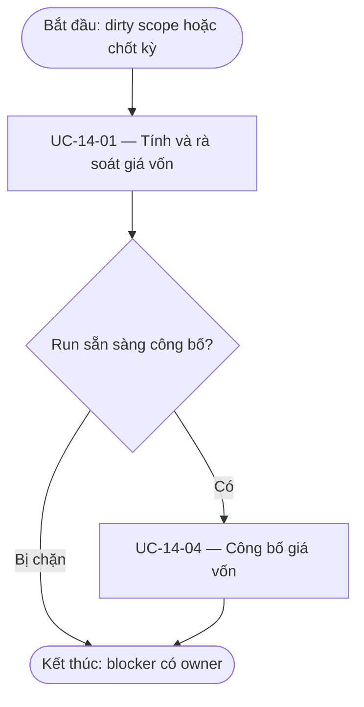

# BJ-14 — Tính và công bố giá vốn

## 1. Tổng quan nghiệp vụ & Bối cảnh

Tính hai phương pháp bình quân trên cùng valuation timeline, áp dụng phương pháp đã cấu hình ở cấp tenant để rà soát và công bố giá vốn chính thức cùng các adjustment cần thiết. Người dùng không chọn lại phương pháp theo từng run.

**Bắt đầu khi:** Có dirty scope cần cập nhật trong kỳ hoặc đến thời điểm chốt kỳ.

**Kết thúc khi:** Run được công bố thành công; hoặc bị chặn/stale với owner xử lý rõ ràng mà không ghi partial publication.

**Không bao gồm:** Đổi costing method cấp tenant, sửa valuation source, thay đổi giá bán hoặc chứng từ giao dịch gốc.

## 2. Tác nhân và trách nhiệm

| Tác nhân | Trách nhiệm | Phạm vi thẩm quyền |
|---|---|---|
| Kế toán kho và người công bố giá vốn | Tạo/rà soát cost run và công bố giá vốn theo tenant policy khi đủ điều kiện. | Không chọn costing method theo run; publication là commit riêng và chỉ BJ14 tạo Official Cost. |

## 3. Sơ đồ hành trình nghiệp vụ

## 4. Bản đồ Use Case

| UC — Tên | Mục tiêu | Tác nhân | Đầu vào / Bắt đầu khi | Kết quả | Tiếp tục |
|---|---|---|---|---|---|
| [UC-14-01](../use-cases/UC-14-01-tinh-va-ra-soat-gia-von.md) — Tính và rà soát giá vốn | Tính giá vốn cho phạm vi cần cập nhật hoặc chốt kỳ, phát hiện blocker và đưa kết quả ra rà soát | Kế toán kho/người có quyền tính giá vốn | Có sản phẩm + kỳ cần cập nhật do BJ03/BJ13/correction, hoặc đến thời điểm chốt kỳ | Lần tính ở `READY_FOR_REVIEW` với kết quả bất biến, hoặc `BLOCKED` với nguyên nhân và owner rõ | UC-14-04 khi sẵn sàng; xử lý blocker rồi tạo lần tính kế nhiệm khi cần |
| [UC-14-04](../use-cases/UC-14-04-cong-bo-gia-von.md) — Công bố giá vốn | Công bố kết quả theo phương pháp giá vốn đã cấu hình ở tenant và ghi đúng phần chênh lệch cần thiết | Kế toán/người có quyền công bố giá vốn | Lần tính ở `READY_FOR_REVIEW`, kết quả/nguồn/chính sách còn hiện hành và không còn blocker | Batch công bố commit nguyên tử; giá vốn chính thức mới có hiệu lực hoặc yêu cầu bị từ chối/chuyển phục hồi nếu chưa rõ kết quả | Kết thúc BJ14 hoặc BJ17 khi kết quả chưa xác định |

## 5. Bàn giao và ranh giới liên quan

| Nơi nhận / Nơi cung cấp | Dữ kiện hoặc trách nhiệm bàn giao | Điều kiện bàn giao / tiếp tục |
|---|---|---|
| BJ03/BJ13/BJ11 | Giá trị ban đầu, điều chỉnh giá trị và correction làm thay đổi phạm vi cần tính | Chỉ dùng dữ liệu đã commit và còn hiện hành tại cut-off |
| Theme 5 / miền định giá bán | Giá vốn chính thức mới như một nguồn tham chiếu | Chỉ sau công bố; Theme 7 không tự thay đổi giá bán |

## 6. Liên kết thiết kế

- **UI Flow canonical:** [UIF-14 — Tính và công bố giá vốn](../../../03.design/flows/UIF-14-BJ-14.md)
- BJ này chỉ sở hữu **business boundary, mục tiêu, UC/handoff và acceptance ở cấp hành trình**.
- Screen-to-screen routing, entry/terminal, actor handoff, state/recovery và transition nằm tại `UIF-14`; anatomy/action chi tiết nằm tại `03.design/screens/`.
- Không copy Screen Flow vào BJ để tránh trùng với UC/UIF và để redesign UI không làm thay đổi semantic của Journey.

## 7. Nghiệm thu hành trình (Journey Acceptance)

| ID | Điều kiện ở cấp hành trình | Kết quả cần bảo đảm | UC / BC liên quan |
|---|---|---|---|
| JA-01 | Tạo lần tính | Costing method được lấy từ tenant policy, người dùng không được chọn lại theo run; cả hai phương pháp dùng cùng valuation snapshot/cut-off | UC-14-01 / BC-IV-02 |
| JA-02 | Có blocker hoặc input/policy thay đổi | Run không được công bố; blocker có owner hoặc run stale và phải tạo successor sau khi xử lý | UC-14-01 / BC-IV-02 |
| JA-03 | Run sẵn sàng và còn current | Công bố chỉ dùng phương pháp tenant đã chọn; phương pháp còn lại chỉ đối chiếu và không tự ghi ledger | UC-14-04 / BC-IV-03 |
| JA-04 | Publication commit | COGS/value adjustment cần thiết và `OfficialCostVersion` commit cùng batch; không sửa receipt/issue/sale/value movement lịch sử | UC-14-04 / BC-IV-03 |
| JA-05 | Tạo period-close run | Chỉ scope option tenant policy cho phép mới xuất hiện; nếu có nhiều option user phải chọn rõ, nếu chỉ có một option thì hiển thị read-only; khóa snapshot ngay khi tạo run | UC-14-01 / BC-IV-02 |

## 8. Truy vết

| Nguồn | Vai trò đối với hành trình |
|---|---|
| [KB-KGV-015 — Đơn giá tồn kho chính thức và tổng giá trị ghi sổ](../../../01.knowledge/know-how/KB-KGV-015-don-gia-ton-kho-chinh-thuc-va-tong-gia-tri-ghi-so.md); [KB-KGV-016 — Vì sao sử dụng song song hai phương pháp tính giá vốn?](../../../01.knowledge/know-how/KB-KGV-016-vi-sao-tinh-song-song-hai-phuong-phap-gia-von.md); [KB-KGV-017 — Công bố giá vốn chính thức và ghi nhận giá vốn hàng bán](../../../01.knowledge/know-how/KB-KGV-017-cong-bo-don-gia-ton-kho-va-ghi-nhan-gia-von-xuat-ban.md); [KB-KGV-018 — Đối soát giá vốn cuối kỳ và cập nhật đột xuất giữa kỳ](../../../01.knowledge/know-how/KB-KGV-018-doi-soat-gia-von-cuoi-ky-va-cap-nhat-dot-xuat-giua-ky.md); [KB-KGV-045 — Rà soát giá vốn tham chiếu định giá sau chốt kỳ](../../../01.knowledge/know-how/KB-KGV-045-ra-soat-gia-von-tham-chieu-sau-chot-ky.md) | **Bài tri thức cốt lõi** giúp hiểu nền nghiệp vụ của Journey; rule triển khai vẫn theo Decision/BJ/UC/BC canonical |
| [Decision Register](../../../01.knowledge/decisions/decision-register.md) — G07 | Nguồn quyết định nghiệp vụ và trạng thái hiệu lực |
| `DOM-IV`, `DOM-IO` | Domain authority và invariants dùng cho Journey |
| [Use Case Map](../use-cases/00-use-case-map.md) | Danh mục UC canonical của Theme 7 |
