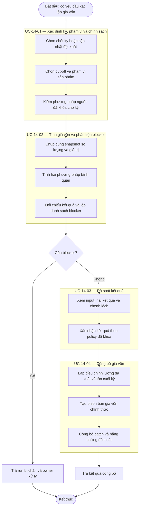
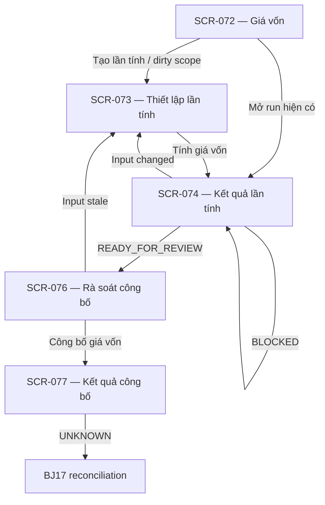

# BJ-14 — Tính và công bố giá vốn

## 1. Mục tiêu trải nghiệm

Tính song song hai phương pháp bình quân trên cùng dữ liệu, giúp kế toán rà soát blocker và công bố **giá vốn chính thức cùng các điều chỉnh liên kết**, không sửa giao dịch lịch sử.

## 2. Phạm vi và ranh giới

### 2.1 Bắt đầu khi

| Thuộc tính | Nội dung |
|---|---|
| Bắt đầu | Đến cut-off chốt kỳ hoặc có yêu cầu cập nhật giá vốn đột xuất được phép |
| Kết thúc | Run được công bố với giá vốn/adjustment mới; hoặc kết thúc bị chặn kèm danh sách blocker và owner xử lý |
| Tác động chính | COGS true-up, ending inventory adjustment và official cost version |
| Không quyết định | Giá bán, giá sàn, giá niêm yết, công nợ hoặc thay đổi đơn hàng/xuất kho gốc |

### 2.2 Kết thúc khi

| Thuộc tính | Nội dung |
|---|---|
| Bắt đầu | Đến cut-off chốt kỳ hoặc có yêu cầu cập nhật giá vốn đột xuất được phép |
| Kết thúc | Run được công bố với giá vốn/adjustment mới; hoặc kết thúc bị chặn kèm danh sách blocker và owner xử lý |
| Tác động chính | COGS true-up, ending inventory adjustment và official cost version |
| Không quyết định | Giá bán, giá sàn, giá niêm yết, công nợ hoặc thay đổi đơn hàng/xuất kho gốc |

### 2.3 Không bao gồm

| Trong ranh giới | Ngoài ranh giới |
|---|---|
| Chọn kỳ/cut-off/scope; kiểm policy; snapshot; tính hai phương pháp; phát hiện blocker; review; công bố; successor run | Sửa receipt/issue/value movement gốc; giải quyết thay cho owner của blocker; tự công bố giá bán |
| Cập nhật đột xuất theo scope và effective time rõ | Thay đổi phương pháp ngầm trong một run đã bắt đầu |

## 3. Actor

- Kế toán kho và người công bố giá vốn

## 4. Luồng chính

## 5. Use Case map

## 6. Luồng thay thế và ngoại lệ

### 4. Logic nghiệp vụ cần giữ

| Điểm kiểm soát | Quy tắc |
|---|---|
| Cùng dữ liệu | Hai phương pháp tính trên cùng ordered immutable valuation timeline tới `cutoff_valuation_sequence`; quantity/value cursor riêng chỉ còn là audit/technical cursor |
| Policy theo kỳ | Phương pháp nguồn phải được version/khóa cho kỳ trước khi tính; không được override kín trong lúc review |
| Blocker | UNKNOWN, hàng chờ giá, kiểm kê/correction/reconciliation có thể đổi số liệu phải chặn đúng product-period scope |
| Run finality | Run đã bắt đầu không bị hủy, sửa hoặc tái sử dụng; sau khi dữ liệu thay đổi phải tạo successor run |
| Công bố nguyên tử | Chỉ post incremental reconciliation delta theo từng Product; COGS true-up, ending inventory delta, Official Cost version và dirty-scope clear cùng transaction publication |
| Không hồi tố | Không sửa order, issue, receipt hoặc value movement gốc; mọi ảnh hưởng là adjustment liên kết |
| Cập nhật đột xuất | Bind authoritative Product + posting-period dirty scope/version; một run chỉ có một posting period và Official Cost không backdate trước publication commit |
| Giá bán | Official cost mới chỉ là nguồn cho miền định giá; không tự đổi pricing cost basis hoặc giá bán |

### 4.1 Product/runtime clarification — v1.5.0

- `CostCalculationRun` là immutable sau khi bắt đầu. `CALCULATING`, `BLOCKED`, `READY_FOR_REVIEW` là lifecycle states, không bắt buộc là ba màn hình khác nhau.
- `selected_method_snapshot` là snapshot của **policy method đã khóa cho kỳ**, không phải lựa chọn tự do của reviewer trong run.
- Direct valuation đầu tiên ở BJ03 có thể bootstrap official cost theo `T7-DR-026` để vận hành downstream; BJ14 vẫn thực hiện reconciliation/publish theo cost-run snapshot và tạo successor official-cost version theo effective time khi cần.
- Supporting entry/orchestration explanation thuộc architecture artifacts; Product UI chỉ hiển thị decision-relevant business facts.

### 5. Quan hệ và bàn giao

- Nhận quantity/value facts từ mọi BJ có inventory effect, đặc biệt BJ-03 và BJ-13.
- Blocker được bàn giao về BJ nguồn hoặc BJ-16; BJ này không sửa dữ liệu thay cho owner.
- Cung cấp official cost cho checkout/fulfillment tương lai và báo cáo giá vốn.
- Event công bố có thể khởi phát hành trình rà soát giá vốn tham chiếu định giá, nhưng không tự cập nhật giá bán.

## 7. UI Flow và chuyển màn hình

> **Product correction:** `v3.9.9` · **Prototype:** `HTML_HARNESS_RENDERED` · Calculate `ACT-14-CALCULATE/BC-IV-02/API-C-21`; read-only review `API-Q-10`; publish `ACT-14-PUBLISH/BC-IV-03/API-C-22`.

### Product mental model

Một **CostCalculationRun** là immutable object. Hệ thống khóa một valuation timeline cutoff, calculation/posting period và authoritative Product scope; sau đó materialize ProductCostResult và tính song song hai phương pháp trên cùng fact set. `CALCULATING`, `BLOCKED`, `READY_FOR_REVIEW` là states của cùng result surface; không tạo screen riêng cho pipeline. Policy đã khóa quyết định method dùng để publish; reviewer không override method trong run. Input đổi sau khi run bắt đầu → successor run mới.

### Active flow

`SCR-075` giữ historical ID nhưng **retired khỏi active UIF14**; blocker/adjustment thuộc state/section của SCR-074.

### Transition contract

| ID | Từ | Trigger | Đến | Loại |
|---|---|---|---|---|
| UIF-14-T01 | Begin | Vào module | SCR-072 | NAVIGATION |
| UIF-14-T02 | SCR-072 | Tạo lần tính/dirty scope | SCR-073 | NAVIGATION |
| UIF-14-T03 | SCR-073 | Tính giá vốn | SCR-074 | MUTATION: ACT-14-CALCULATE |
| UIF-14-T04 | SCR-072 | Mở run đã có | SCR-074 | NAVIGATION |
| UIF-14-T05 | SCR-074 | Ready, không blocker | SCR-076 | NAVIGATION |
| UIF-14-T06 | SCR-074/076 | Input changed/stale | SCR-073 successor setup | NAVIGATION/SYSTEM |
| UIF-14-T07 | SCR-076 | Công bố giá vốn | SCR-077 | MUTATION: ACT-14-PUBLISH |
| UIF-14-T08 | SCR-077 | COMPLETED | End | TERMINAL |
| UIF-14-T09 | SCR-077 | REJECTED_EXECUTION | SCR-074 | SYSTEM |
| UIF-14-T10 | SCR-077 | UNKNOWN | BJ17 | HANDOFF |

### Guardrails

- Hai phương pháp dùng cùng ordered valuation timeline tới `cutoff_valuation_sequence`; global totals chỉ aggregate ProductCostResult.
- Method policy read-only và versioned; không có method selector ở review.
- BLOCKED run không có publish CTA và không được sửa để “clear” blocker.
- Started run không cancel/edit/reuse; dữ liệu đổi tạo successor.
- Publish chỉ ghi incremental reconciliation delta theo Product, forward-effective Official Cost và clear đúng dirty causes trong một transaction.
- Không rewrite lịch sử và không tự thay đổi pricing/giá bán.
- First direct valuation từ BJ03 có thể bootstrap initial official cost; BJ14 chỉ tạo successor Official Cost khi có valid new basis, không backdate trước publication commit.
- Dirty/ad-hoc scope từ BJ13/correction là exact Product + posting-period set, source-owned và version/hash protected; user không tùy ý bỏ Product.
- Một run chỉ có một posting period. Original period giữ ở adjustment lineage. Negative/zero-denominator edge cases là Product result states/blockers, không bị che bởi global total.

## 8. Handoff / phụ thuộc ngoài Journey

## 9. Outcome cuối

| Thuộc tính | Nội dung |
|---|---|
| Bắt đầu | Đến cut-off chốt kỳ hoặc có yêu cầu cập nhật giá vốn đột xuất được phép |
| Kết thúc | Run được công bố với giá vốn/adjustment mới; hoặc kết thúc bị chặn kèm danh sách blocker và owner xử lý |
| Tác động chính | COGS true-up, ending inventory adjustment và official cost version |
| Không quyết định | Giá bán, giá sàn, giá niêm yết, công nợ hoặc thay đổi đơn hàng/xuất kho gốc |

## 10. Truy vết

### Nguồn v3.10.1 — BJ-14 — Tính và công bố giá vốn

> **Trạng thái:** Release đã đóng băng `4.1.0` — đã remap ID và boundary  
> **Chuyển đổi chính thức:** Theme 7 `4.0.0/BJ-15` → `4.1.0/BJ-14`  
> **Finality contract:** `COMPLETED`, `REJECTED/CANCELLED`, `SUSPENDED/BLOCKED`, `UNKNOWN/ESCALATED`
> **Phạm vi:** Phase 1 — chốt kỳ chuẩn hoặc cập nhật đột xuất có phạm vi  
> **Chủ sở hữu nghiệp vụ:** Inventory Valuation
> **Quyết định nghiệp vụ:** `T7-BASELINE-FREEZE-v4.0.0` + `T7-DR-049`, `T7-DR-050`, `T7-DR-052`, `T7-DR-053`, `T7-DR-056`, `T7-DR-058`, `T7-DR-059`, `T7-DR-060`, `T7-DR-164…170`
### Nguồn v3.10.1 — 3. Trường hợp sử dụng

| UC | Tên | Bắt đầu | Kết thúc | Kết quả |
|---|---|---|---|---|
| [UC-14-01](../use-cases/UC-14-01-xac-dinh-ky-pham-vi-va-chinh-sach.md) | Xác định kỳ, phạm vi và chính sách | Có yêu cầu chốt kỳ/cập nhật đột xuất | Kỳ, cut-off, scope và policy được xác định | Cost-run context bất biến |
| [UC-14-02](../use-cases/UC-14-02-tinh-gia-von-va-phat-hien-blocker.md) | Tính giá vốn và phát hiện blocker | Có context hợp lệ | Có hai kết quả và blocker snapshot | Draft run blocked hoặc ready for review |
| [UC-14-03](../use-cases/UC-14-03-ra-soat-ket-qua.md) | Rà soát kết quả | Run không còn blocker | Kết quả run được đọc/đối chiếu; không mutation | Read-only review evidence |
| [UC-14-04](../use-cases/UC-14-04-cong-bo-gia-von.md) | Công bố giá vốn | Draft đã được rà soát | Adjustment và official cost version cùng được công bố | Published valuation batch |
### Nguồn v3.10.1 — 6. Nguồn tri thức liên quan

- [Vì sao sử dụng song song hai phương pháp tính giá vốn](../../../01.knowledge/know-how/KB-KGV-016-vi-sao-tinh-song-song-hai-phuong-phap-gia-von.md)
- [Công bố đơn giá tồn kho và ghi nhận giá vốn xuất bán](../../../01.knowledge/know-how/KB-KGV-017-cong-bo-don-gia-ton-kho-va-ghi-nhan-gia-von-xuat-ban.md)
- [Đối soát giá vốn cuối kỳ và cập nhật đột xuất giữa kỳ](../../../01.knowledge/know-how/KB-KGV-018-doi-soat-gia-von-cuoi-ky-va-cap-nhat-dot-xuat-giua-ky.md)
- [Định giá hàng trả, tiêu hủy và chênh lệch thừa thiếu](../../../01.knowledge/know-how/KB-KGV-020-dinh-gia-hang-tra-tieu-huy-va-chenh-lech-thua-thieu.md)
- [Sửa sai tồn kho mà không sửa lịch sử](../../../01.knowledge/know-how/KB-KGV-021-sua-sai-ton-kho-khong-sua-lich-su.md)
### Nguồn v3.10.1 — 7. Wave 3 deep-review lock — v3.9.9

### 7.1 Valuation timeline và authoritative Product result

- `CostCalculationRun` không merge quantity/value ledger bằng suy luận. Mọi fact ảnh hưởng costing dùng `valuation_sequence + within_transaction_ordinal`; run khóa `cutoff_valuation_sequence` và input hash trên ordered immutable fact set (`T7-DR-164`).
- Mỗi Product trong scope materialize một immutable `ProductCostResult`; run totals chỉ là aggregate. Product result giữ opening/ending quantity-value, fact range/hash, kết quả Moving/Periodic, method policy, predecessor/proposed Official Cost, target cumulative COGS/carrying value, current authoritative baseline và delta cần post (`T7-DR-165`).
- Weighted-average edge cases được quyết định ở Product result: quantity âm trả blocker `NEGATIVE_QUANTITY`; target value âm trả `NEGATIVE_VALUATION_RESULT`; denominator 0 trả `NO_NEW_COST_BASIS`; ending quantity 0 vẫn có thể true-up COGS; zero cost chỉ hợp lệ khi provenance thực sự cho ra 0 (`T7-DR-170`).

### 7.2 Successor, posting period và Official Cost finality

- Successor/ad-hoc run chỉ post **incremental reconciliation delta**: target cumulative COGS/carrying value trừ authoritative value đã ghi tới cùng cutoff. Rerun cùng facts phải ra delta 0 (`T7-DR-166`).
- `run_type`, `calculation_period_id`, `posting_period_id` là ba fact riêng. Period-close post trong kỳ đang đóng; ad-hoc post trong đúng một posting period; original period nằm ở adjustment line (`T7-DR-168`).
- Official Cost cho giao dịch mới không được backdate trước publication commit. Future-effective chỉ hợp lệ khi publication xảy ra trước mốc; publish trễ dùng commit time hoặc future time theo policy (`T7-DR-167`).

### 7.3 Dirty scope và freshness

- Dirty/ad-hoc run nhận exact `Product + posting period` set từ BJ13/correction qua `scope_origin + dirty_scope_snapshot/version/hash + cause IDs`; user không được bỏ tùy ý Product khỏi authoritative set (`T7-DR-169`).
- Dirty cause mới trong CALCULATING/READY_FOR_REVIEW làm run stale và bắt tạo successor. Dirty mark chỉ clear sau successful publication đã reconcile đúng cause/version.
- Publish recheck run input hash, ProductCostResult hashes, dirty-scope version/hash, blocker, posting-period state và effective-time rule trong cùng transaction.

### 7.4 Chuỗi Wave 3 authoritative

`BJ03 Direct Valuation` → immutable value facts → `BJ13 late-cost adjustment + Product/posting-period DIRTY` → `BJ14 valuation timeline + ProductCostResult` → incremental reconciliation → atomic publication → forward-effective Official Cost → clear exact dirty causes.

Không được đồng nhất: `calculation result` ≠ `posted adjustment`; `target valuation` ≠ `current carrying value`; `calculation period` ≠ `posting period`; `costing cutoff` ≠ `Official Cost effective time`; `rerun` ≠ `re-post lịch sử`.
