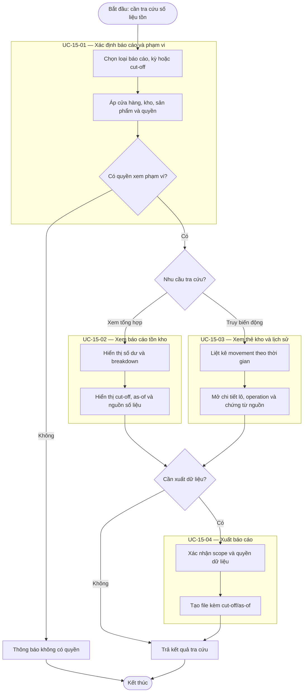
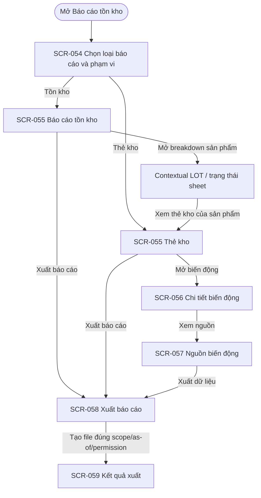

# BJ-15 — Tra cứu báo cáo tồn và thẻ kho

## 1. Mục tiêu trải nghiệm

Cho phép người vận hành và kế toán **tra cứu, giải thích và xuất số liệu tồn kho** theo phạm vi, cut-off và quyền; truy được từ số dư đến movement và chứng từ nguồn mà không sửa ledger.

## 2. Phạm vi và ranh giới

### 2.1 Bắt đầu khi

| Thuộc tính | Nội dung |
|---|---|
| Bắt đầu | Người dùng cần xem báo cáo tồn, lịch sử biến động hoặc thẻ kho |
| Kết thúc | Báo cáo/thẻ kho có as-of và đường truy nguyên được hiển thị/xuất; hoặc truy cập bị từ chối |
| Tác động chính | Không có mutation; tạo report result/export evidence |
| Không quyết định | Điều chỉnh số dư, xử lý UNKNOWN, mở Reconciliation Case hoặc rebuild projection |

### 2.2 Kết thúc khi

| Thuộc tính | Nội dung |
|---|---|
| Bắt đầu | Người dùng cần xem báo cáo tồn, lịch sử biến động hoặc thẻ kho |
| Kết thúc | Báo cáo/thẻ kho có as-of và đường truy nguyên được hiển thị/xuất; hoặc truy cập bị từ chối |
| Tác động chính | Không có mutation; tạo report result/export evidence |
| Không quyết định | Điều chỉnh số dư, xử lý UNKNOWN, mở Reconciliation Case hoặc rebuild projection |

### 2.3 Không bao gồm

| Trong ranh giới | Ngoài ranh giới |
|---|---|
| Chọn phạm vi/cut-off; báo cáo tổng hợp; breakdown trạng thái/lô; movement history; source link; export; quyền tài chính | Correction, stock count adjustment, reconciliation workflow, projection rebuild |
| Cảnh báo khi read model trễ và giữ as-of | Sửa balance để làm báo cáo khớp |

## 3. Actor

- Chủ cửa hàng, kế toán hoặc thủ kho

## 4. Luồng chính

## 5. Use Case map

## 6. Luồng thay thế và ngoại lệ

### 4. Logic nghiệp vụ cần giữ

| Điểm kiểm soát | Quy tắc |
|---|---|
| Ledger authority | Thẻ kho và lịch sử dựa trên movement ledger bất biến; không sửa số dư từ báo cáo |
| Cut-off/as-of | Báo cáo phải thể hiện cut-off, thời điểm tạo và độ mới của projection |
| Hai loại ngày | Cho phép đọc theo ngày ghi nhận hoặc ngày nghiệp vụ nhưng phải gắn nhãn rõ, không trộn ngầm |
| Quantity/value | Quyền xem quantity độc lập với quyền xem official cost, total value và valuation adjustment |
| LOT/NONE | Breakdown theo lô chỉ áp dụng cho sản phẩm LOT; không tạo lô giả cho NONE |
| Giá trị chi tiết | Giá trị có thẩm quyền ở tenant + sản phẩm; phân bổ theo kho/state/lot nếu có phải gắn nhãn dẫn xuất |
| Projection trễ | Có thể cảnh báo và hiển thị last processed sequence; không dùng report trễ làm căn cứ mutation |
| Export | File export giữ đúng filter, quyền, cut-off/as-of như màn hình; không làm lộ dữ liệu tài chính |
| Phát hiện lệch | Báo cáo chỉ chỉ ra dấu hiệu và liên kết nguồn; xử lý sai lệch thuộc BJ-16 hoặc BJ-11 |

### 5. Quan hệ và bàn giao

- Dùng cùng balance/movement facts với BJ-01 nhưng hỗ trợ kỳ, lịch sử và export rộng hơn.
- Nhận quantity/value/official-cost facts từ các BJ có inventory effect và BJ-14.
- Nếu người dùng phát hiện nguồn, projection hoặc finality không khớp, bàn giao sang BJ-16; không sửa từ báo cáo.
- Khi xác định operation hoàn tất sai, bàn giao sang BJ-11.

## 7. UI Flow và chuyển màn hình

> **v1.8.0 Product correction** · Parent: `v1.7.0` · Source SRS frozen.  
> Report/read flow không sửa ledger. Technical projection/event/operation structure chỉ ở contract/Inspect; Product UI dùng business-readable facts.

### 1. Phạm vi

| Thuộc tính | Giá trị |
|---|---|
| Nguồn nghiệp vụ | [BJ-15](BJ-15-tra-cuu-bao-cao-ton-va-the-kho.md) |
| Chủ sở hữu | Inventory Reporting / Read layer |
| Entry | `SCR-054` |
| Shared screens | `SCR-054..057` dùng context mode để không clone UIF01 |
| Export | `SCR-058 → SCR-059` |
| Prototype | `PRODUCT_CORRECTED_v1.8.0` |

### 2. Product flow

### 3. Transition contract

| ID | Từ | Trigger | Đến | Loại | Trace |
|---|---|---|---|---|---|
| `UIF-15-T01` | Start | Mở báo cáo | `SCR-054` | `NAVIGATION` | `UC-15-01` |
| `UIF-15-T02` | `SCR-054` | Query hợp lệ | `SCR-055` | `QUERY` | `UC-15-02`, `UC-15-03` |
| `UIF-15-T03` | `SCR-055:INVENTORY_REPORT` | Mở Product breakdown | Contextual sheet | `CONTEXTUAL_OVERLAY` | `UC-15-02` |
| `UIF-15-T04` | `SCR-055:STOCK_CARD` | Mở biến động | `SCR-056` | `NAVIGATION` | `UC-15-03` |
| `UIF-15-T05` | `SCR-056` | Xem nguồn | `SCR-057` | `NAVIGATION` | `UC-15-03` |
| `UIF-15-T06` | `SCR-055` / `SCR-057` | Xuất đúng result context | `SCR-058` | `NAVIGATION` | `UC-15-04` |
| `UIF-15-T07` | `SCR-058` | Xuất báo cáo | `SCR-059` | `QUERY` | `UC-15-04` · `ACT-11-EXPORT` |
| `UIF-15-T08` | `SCR-059` | File ready | End/file handoff | `TERMINAL` | `UC-15-04` |
| `UIF-15-T09` | Any result | Projection/source stale | Current result with stale banner | `QUERY_STATE` | `UC-15-*` |

### 4. Product UX invariants

1. `Tồn kho` và `Thẻ kho` là hai query intents trong cùng entry; không clone screen family.
2. `Ngày nghiệp vụ` và `Ngày ghi nhận` phải được gắn nhãn rõ, không trộn ngầm.
3. `As-of` nằm gần result; stale hiển thị persistent warning, không biến thành loading vô hạn.
4. Không tổng hợp quantity khác UOM thành một “Tổng tồn” vô nghĩa. Quantity luôn theo Product/UOM; total value chỉ được tổng hợp khi cùng currency và có finance permission.
5. LOT breakdown chỉ cho Product LOT; Product NONE không có lô giả.
6. Finance permission độc lập quantity permission. Không có quyền → official cost/value **không vào DOM**.
7. Movement detail ưu tiên business source + before/delta/after; operation/movement/event IDs chỉ ở Inspect/audit.
8. Source timeline dùng ngôn ngữ nghiệp vụ; không biến internal pipeline thành user journey.
9. Export giữ chính xác filter/date semantics/as-of/permission của result. Không có approval cho read-only export theo SRS.
10. Product viewport chuẩn `402×874`.

### 5. Screen coverage

| UC | Screen |
|---|---|
| `UC-15-01` | `SCR-054` |
| `UC-15-02` | `SCR-055:INVENTORY_REPORT_RESULT` |
| `UC-15-03` | `SCR-055:STOCK_CARD_RESULTS`, `SCR-056`, `SCR-057` |
| `UC-15-04` | `SCR-058`, `SCR-059` |

## 8. Handoff / phụ thuộc ngoài Journey

## 9. Outcome cuối

| Thuộc tính | Nội dung |
|---|---|
| Bắt đầu | Người dùng cần xem báo cáo tồn, lịch sử biến động hoặc thẻ kho |
| Kết thúc | Báo cáo/thẻ kho có as-of và đường truy nguyên được hiển thị/xuất; hoặc truy cập bị từ chối |
| Tác động chính | Không có mutation; tạo report result/export evidence |
| Không quyết định | Điều chỉnh số dư, xử lý UNKNOWN, mở Reconciliation Case hoặc rebuild projection |

## 10. Truy vết

### Nguồn v3.10.1 — BJ-15 — Tra cứu báo cáo tồn và thẻ kho

> **Trạng thái:** Release đã đóng băng `4.1.0` — đã remap ID và boundary  
> **Chuyển đổi chính thức:** Theme 7 `4.0.0/BJ-18` → `4.1.0/BJ-15`  
> **Finality contract:** `COMPLETED`, `REJECTED/CANCELLED`, `SUSPENDED/BLOCKED`, `UNKNOWN/ESCALATED`
> **Phạm vi:** Phase 1 — báo cáo đọc, thẻ kho và xuất dữ liệu theo quyền  
> **Chủ sở hữu nghiệp vụ:** Inventory Reporting / Read layer
> **Quyết định nghiệp vụ:** `T7-BASELINE-FREEZE-v4.0.0` + `T7-DR-084`, `T7-DR-085`, `T7-DR-087`, `T7-DR-091`
### Nguồn v3.10.1 — 3. Trường hợp sử dụng

| UC | Tên | Bắt đầu | Kết thúc | Kết quả |
|---|---|---|---|---|
| [UC-15-01](../use-cases/UC-15-01-xac-dinh-bao-cao-va-pham-vi.md) | Xác định báo cáo và phạm vi | Người dùng mở chức năng báo cáo | Report context hợp lệ hoặc bị từ chối | Scope/cut-off/permission context |
| [UC-15-02](../use-cases/UC-15-02-xem-bao-cao-ton-kho.md) | Xem báo cáo tồn kho | Có context hợp lệ | Số dư và breakdown được hiển thị | Inventory report có as-of |
| [UC-15-03](../use-cases/UC-15-03-xem-the-kho-va-lich-su.md) | Xem thẻ kho và lịch sử | Người dùng cần giải thích biến động | Movement và nguồn liên kết được hiển thị | Traceable stock card |
| [UC-15-04](../use-cases/UC-15-04-xuat-bao-cao.md) | Xuất báo cáo | Có kết quả và quyền export | File được tạo đúng scope/quyền | Report export có cut-off/as-of |
### Nguồn v3.10.1 — 6. Nguồn tri thức liên quan

- [Thẻ kho, báo cáo lịch sử và đối soát nguồn](../../../01.knowledge/know-how/KB-KGV-033-the-kho-bao-cao-lich-su-va-doi-soat-nguon.md)
- [Movement ledger, số dư dẫn xuất và phục hồi sau sự cố](../../../01.knowledge/know-how/KB-KGV-032-movement-ledger-so-du-dan-xuat-va-phuc-hoi-sau-su-co.md)
- [Tính chính thức của tồn kho và nguyên tắc chống xuất âm](../../../01.knowledge/know-how/KB-KGV-006-tinh-chinh-thuc-cua-ton-kho-va-nguyen-tac-chong-xuat-am.md)
- [Quyền chức năng, phạm vi kho và bảo vệ dữ liệu tài chính](../../../01.knowledge/know-how/KB-KGV-030-quyen-chuc-nang-pham-vi-kho-va-bao-ve-du-lieu-tai-chinh.md)
- [Tính nguyên tử khi ghi tồn kho và phát sự kiện](../../../01.knowledge/know-how/KB-KGV-029-tinh-nguyen-tu-khi-ghi-ton-kho-va-phat-su-kien.md)
