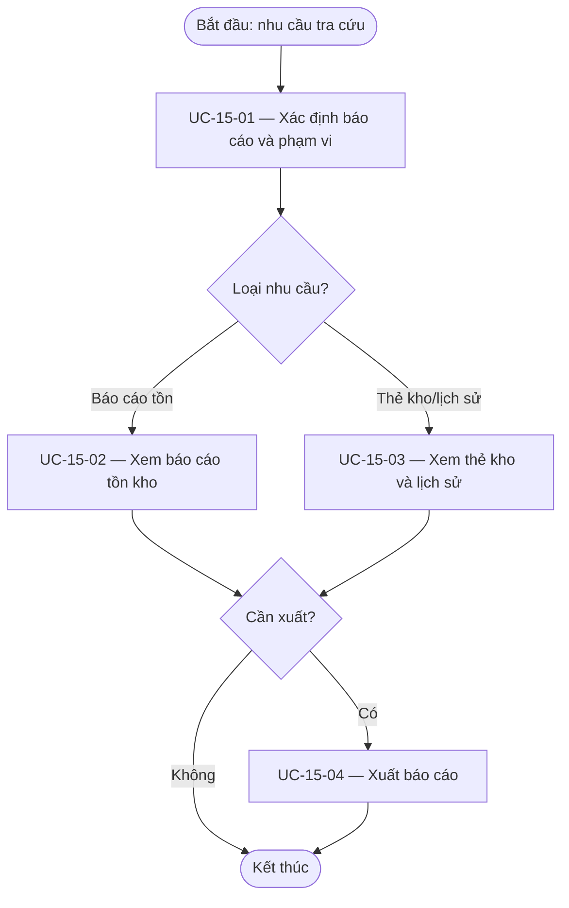

# BJ-15 — Tra cứu báo cáo tồn và thẻ kho

## 1. Tổng quan nghiệp vụ & Bối cảnh

Cho phép người vận hành và kế toán **tra cứu, giải thích và xuất số liệu tồn kho** theo phạm vi, cut-off và quyền; truy được từ số dư đến movement và chứng từ nguồn mà không sửa ledger.

**Bắt đầu khi:** Người dùng cần xem báo cáo tồn, lịch sử biến động hoặc thẻ kho.

**Kết thúc khi:** Báo cáo/thẻ kho có as-of và đường truy nguyên được hiển thị/xuất; hoặc truy cập bị từ chối.

**Không bao gồm:** Điều chỉnh số dư, xử lý UNKNOWN, mở Reconciliation Case hoặc rebuild projection.

## 2. Tác nhân và trách nhiệm

| Tác nhân | Trách nhiệm | Phạm vi thẩm quyền |
|---|---|---|
| Chủ cửa hàng, kế toán hoặc thủ kho | Chọn phạm vi, xem báo cáo/thẻ kho và xuất dữ liệu đúng quyền/as-of. | Báo cáo chỉ phản ánh source đã khóa; không tạo định nghĩa hay mutation mới. |

## 3. Sơ đồ hành trình nghiệp vụ

## 4. Bản đồ Use Case

| UC — Tên | Mục tiêu | Tác nhân | Đầu vào / Bắt đầu khi | Kết quả | Tiếp tục |
|---|---|---|---|---|---|
| [UC-15-01](../use-cases/UC-15-01-xac-dinh-bao-cao-va-pham-vi.md) — Xác định báo cáo và phạm vi | Report context hợp lệ hoặc bị từ chối; Scope/cut-off/permission context. | Chủ cửa hàng, kế toán hoặc thủ kho | Người dùng mở chức năng báo cáo | Report context hợp lệ hoặc bị từ chối; Scope/cut-off/permission context. | UC-15-02 |
| [UC-15-02](../use-cases/UC-15-02-xem-bao-cao-ton-kho.md) — Xem báo cáo tồn kho | Số dư và breakdown được hiển thị; Inventory report có as-of. | Chủ cửa hàng, kế toán hoặc thủ kho | Có context hợp lệ | Số dư và breakdown được hiển thị; Inventory report có as-of. | UC-15-03 |
| [UC-15-03](../use-cases/UC-15-03-xem-the-kho-va-lich-su.md) — Xem thẻ kho và lịch sử | Movement và nguồn liên kết được hiển thị; Traceable stock card. | Chủ cửa hàng, kế toán hoặc thủ kho | Người dùng cần giải thích biến động | Movement và nguồn liên kết được hiển thị; Traceable stock card. | UC-15-04 |
| [UC-15-04](../use-cases/UC-15-04-xuat-bao-cao.md) — Xuất báo cáo | File được tạo đúng scope/quyền; Report export có cut-off/as-of. | Chủ cửa hàng, kế toán hoặc thủ kho | Có kết quả và quyền export | File được tạo đúng scope/quyền; Report export có cut-off/as-of. | Kết thúc / theo nhánh trên sơ đồ |

## 5. Bàn giao và ranh giới liên quan

| Nơi nhận / Nơi cung cấp | Dữ kiện hoặc trách nhiệm bàn giao | Điều kiện bàn giao / tiếp tục |
|---|---|---|
| DOM-IO/IV | Ledger/read model và provenance | Read-only tại as-of/cutoff |
| BJ16 | Tín hiệu sai lệch cần điều tra | Chỉ khi evidence cho thấy cần reconciliation |

## 6. Liên kết thiết kế

- **UI Flow canonical:** [UIF-15 — Tra cứu báo cáo tồn và thẻ kho](../../../03.design/flows/UIF-15-BJ-15.md)
- BJ này chỉ sở hữu **business boundary, mục tiêu, UC/handoff và acceptance ở cấp hành trình**.
- Screen-to-screen routing, entry/terminal, actor handoff, state/recovery và transition nằm tại `UIF-15`; anatomy/action chi tiết nằm tại `03.design/screens/`.
- Không copy Screen Flow vào BJ để tránh trùng với UC/UIF và để redesign UI không làm thay đổi semantic của Journey.

## 7. Nghiệm thu hành trình (Journey Acceptance)

| ID | Điều kiện ở cấp hành trình | Kết quả cần bảo đảm | UC / BC liên quan |
|---|---|---|---|
| JA-01 | Journey bắt đầu từ đúng trigger và actor có quyền | Kết quả chỉ được ghi trong phạm vi authority của Theme 7; source ngoài Theme không bị sửa ngầm | UC-15-01 / BC liên quan |
| JA-02 | Một nhánh bị từ chối, blocked hoặc chưa xác định | Không được báo thành công hoặc tạo tác động bán phần; hướng xử lý/owner tiếp theo phải rõ | UC-15-01…UC-15-04 |
| JA-03 | Journey hoàn tất thành công | Kết quả cuối có provenance, thời điểm/phạm vi và đủ dữ kiện cho consumer tiếp theo | UC-15-04 / Domain ledger |

## 8. Truy vết

| Nguồn | Vai trò đối với hành trình |
|---|---|
| [Decision Register](../../../01.knowledge/decisions/decision-register.md) — Decision Register theo UC/BC | Nguồn quyết định nghiệp vụ và trạng thái hiệu lực |
| `DOM-COM`, `DOM-IO`, `DOM-IV` | Domain authority và invariants dùng cho Journey |
| [Use Case Map](../use-cases/00-use-case-map.md) | Danh mục UC canonical của Theme 7 |
