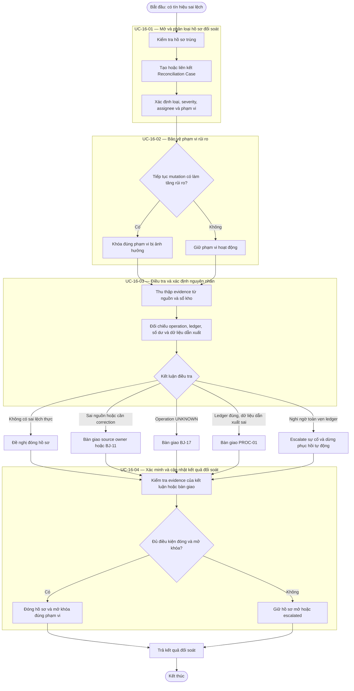
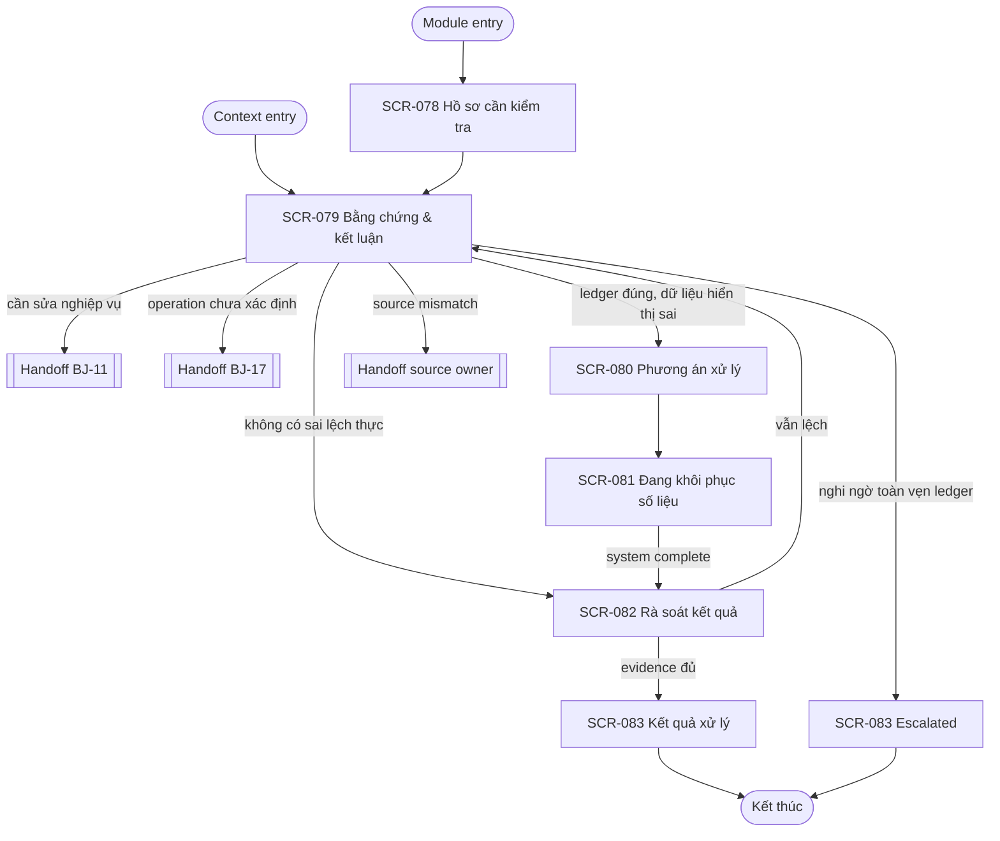

# BJ-16 — Điều tra và đối soát sai lệch

## 1. Mục tiêu trải nghiệm

Giúp người vận hành **xác định sai lệch có thực hay không, nguyên nhân nằm ở đâu và hành trình nào phải xử lý tiếp**, đồng thời giữ đầy đủ bằng chứng để chỉ đóng hồ sơ khi kết quả đã được chứng minh.

BJ này là hành trình điều tra và điều phối xử lý. Nó không mặc định coi mọi sai lệch là lỗi dữ liệu dẫn xuất và không tự dựng lại projection cho mọi Reconciliation Case.

## 2. Phạm vi và ranh giới

### 2.1 Bắt đầu khi

| Thuộc tính | Nội dung |
|---|---|
| Bắt đầu | Có tín hiệu sai lệch từ người dùng, kiểm soát tự động, báo cáo hoặc một operation có kết quả chưa xác định |
| Kết thúc | Reconciliation Case được đóng bằng bằng chứng; hoặc đã được bàn giao/escalate có kiểm soát và giữ trạng thái mở phù hợp |
| Tác động chính | Reconciliation Case, evidence, phân loại nguyên nhân, hướng xử lý và quyết định bảo vệ/mở khóa phạm vi |
| Không làm thay đổi | Ledger, movement hoặc số dư chỉ để làm cho báo cáo “khớp” |

### 2.2 Kết thúc khi

| Thuộc tính | Nội dung |
|---|---|
| Bắt đầu | Có tín hiệu sai lệch từ người dùng, kiểm soát tự động, báo cáo hoặc một operation có kết quả chưa xác định |
| Kết thúc | Reconciliation Case được đóng bằng bằng chứng; hoặc đã được bàn giao/escalate có kiểm soát và giữ trạng thái mở phù hợp |
| Tác động chính | Reconciliation Case, evidence, phân loại nguyên nhân, hướng xử lý và quyết định bảo vệ/mở khóa phạm vi |
| Không làm thay đổi | Ledger, movement hoặc số dư chỉ để làm cho báo cáo “khớp” |

### 2.3 Không bao gồm

| Trong ranh giới | Ngoài ranh giới |
|---|---|
| Chống tạo case trùng; xác định severity, assignee và phạm vi; thu thập evidence; phân loại nguyên nhân; route xử lý; verify và close/reopen | Sửa chứng từ nguồn; correction operation; giải quyết UNKNOWN; dựng lại dữ liệu dẫn xuất; khôi phục ledger bị hỏng |
| Khóa phạm vi khi tiếp tục mutation có rủi ro làm sai lệch nặng hơn | Khóa toàn tenant mặc định khi chỉ một phạm vi nhỏ bị ảnh hưởng |

## 3. Actor

- Nhân viên đối soát hoặc quản lý vận hành

## 4. Luồng chính

## 5. Use Case map

## 6. Luồng thay thế và ngoại lệ

### 4. Logic nghiệp vụ cần giữ

| Điểm kiểm soát | Quy tắc |
|---|---|
| Chống hồ sơ trùng | Cùng loại sai lệch và cùng phạm vi đang có case hoạt động thì liên kết evidence mới, không tạo case song song vô nghĩa |
| Phân loại nguyên nhân | Phải phân biệt source mismatch, UNKNOWN, projection mismatch, correction cần thiết và nghi ngờ ledger integrity |
| Rebuild | Chỉ route sang PROC-01 khi đã chứng minh ledger đúng và dữ liệu dẫn xuất sai; không phải case nào cũng rebuild |
| Bảo vệ phạm vi | Chỉ khóa phạm vi cần thiết; lock có owner, lý do và điều kiện mở rõ ràng |
| Đóng hồ sơ | Chỉ đóng khi evidence chứng minh kết quả và các tác động cần thiết đã hoàn tất; case có thể reopen nếu evidence mới phủ định kết luận cũ |
| Ledger integrity | Khi nghi ngờ ledger, dừng rebuild/correction tự động và escalated; không dựng ledger từ báo cáo hoặc chứng từ nguồn để che lỗi |
| Chỉ báo dẫn xuất | Tồn thấp/cận hạn tự biến mất theo điều kiện nguồn và không tạo Reconciliation Case |

### 5. Quan hệ và bàn giao

- Nhận tín hiệu từ BJ-15, các worklist kiểm soát, audit hoặc operation `UNKNOWN`.
- Route sai chứng từ sang owner nguồn; route nghiệp vụ cần sửa sai sang BJ-11.
- Route `UNKNOWN` sang BJ-17 và projection mismatch sang PROC-01.
- Evidence từ hành trình được bàn giao quay lại UC-16-04 để quyết định close/reopen/unlock.
- BJ này không sở hữu UI báo cáo thông thường và không sửa ledger.

## 7. UI Flow và chuyển màn hình

> **v1.7.0 Product correction.** Nguồn nghiệp vụ: BJ-16/UC-16-01..04. Journey này điều tra + điều phối; không mặc định mọi sai lệch là projection mismatch.

### 1. Design Readiness

| Câu hỏi | Quyết định |
|---|---|
| Primary task | Xác định sai lệch có thật không, nguyên nhân ở đâu và route nào xử lý tiếp |
| Primary object | Reconciliation Case + evidence + scope-protection decision |
| User decision | Review evidence; thực hiện route hợp lệ; đóng hồ sơ khi evidence đủ |
| System decision | Chống case trùng; phân loại cause; scope cần lock; route source/BJ-11/BJ-17/PROC-01/escalation |
| Commit point | Resolution/closure qua `ACT-15-RECONCILE`; projection recovery chỉ khi ledger đã được chứng minh đúng |
| Forbidden | Sửa ledger/balance chỉ để báo cáo khớp; auto rebuild khi nghi ngờ ledger integrity |

### 2. Entry architecture

> Entry/handoff/recovery explanation thuộc artifact này, **không render** thành card, banner hoặc helper trong Product UI.

| Entry | Screen | Meaning |
|---|---|---|
| Inventory → Kiểm soát → Đối soát | `SCR-078` | Worklist case cần kiểm tra |
| Cảnh báo/báo cáo/deep link có case context | `SCR-079` | Mở evidence của đúng case |

### 3. UI flow

### 4. Transition contract

| ID | From | Trigger | To | Type | Trace |
|---|---|---|---|---|---|
| `UIF-16-T01` | Module entry | Mở Đối soát | `SCR-078` | NAVIGATION | UC-16-01 |
| `UIF-16-T02` | Context entry / `SCR-078` | Mở case | `SCR-079` | NAVIGATION | UC-16-01/02/03 |
| `UIF-16-T03` | `SCR-079` | Không có sai lệch thực | `SCR-082` | NAVIGATION | UC-16-03/04 |
| `UIF-16-T04` | `SCR-079` | Sai nguồn | source owner | HANDOFF | UC-16-03 |
| `UIF-16-T05` | `SCR-079` | Cần correction | BJ-11 | HANDOFF | UC-16-03 |
| `UIF-16-T06` | `SCR-079` | Operation UNKNOWN | BJ-17 | HANDOFF | UC-16-03 |
| `UIF-16-T07` | `SCR-079` | Ledger đúng, derived data sai | `SCR-080` | NAVIGATION | UC-16-03 · PROC-01 |
| `UIF-16-T08` | `SCR-079` | Nghi ngờ ledger integrity | `SCR-083:ESCALATED` | SYSTEM/HANDOFF | UC-16-03 |
| `UIF-16-T09` | `SCR-080` | Bắt đầu projection recovery đã được contract cho phép | `SCR-081` | MUTATION | `ACT-15-RECONCILE` · BC-IC-05 · API-C-18 · PROC-01 |
| `UIF-16-T10` | `SCR-081` | System hoàn tất recovery | `SCR-082` | SYSTEM | PROC-01 |
| `UIF-16-T11` | `SCR-082` | Evidence đủ để close/unlock | `SCR-083:RESOLVED` | MUTATION | `ACT-15-RECONCILE` · UC-16-04 |
| `UIF-16-T12` | `SCR-082` | Evidence chưa đủ / mismatch còn | `SCR-079` | NAVIGATION | UC-16-04 |
| `UIF-16-T13` | `SCR-083` | Resolved / escalated | End | TERMINAL | UC-16-04 |

### 5. Product invariants

1. Cùng loại sai lệch + cùng scope đang có active case thì liên kết evidence, không tạo case song song vô nghĩa.
2. UI phân biệt source mismatch, UNKNOWN, projection mismatch, correction required và ledger integrity suspicion.
3. “Khôi phục số liệu hiển thị” chỉ xuất hiện sau khi chứng minh sổ kho đúng; Product UI không cho chọn raw replay/rebuild/source.
4. Scope protection chỉ đúng phạm vi cần thiết, có owner/lý do/điều kiện mở.
5. Ledger integrity suspicion → dừng auto recovery/correction và escalated.
6. Case chỉ đóng khi evidence chứng minh kết quả + handoff cần thiết đã hoàn tất; có thể reopen khi evidence mới phủ định kết luận.

## 8. Handoff / phụ thuộc ngoài Journey

## 9. Outcome cuối

| Thuộc tính | Nội dung |
|---|---|
| Bắt đầu | Có tín hiệu sai lệch từ người dùng, kiểm soát tự động, báo cáo hoặc một operation có kết quả chưa xác định |
| Kết thúc | Reconciliation Case được đóng bằng bằng chứng; hoặc đã được bàn giao/escalate có kiểm soát và giữ trạng thái mở phù hợp |
| Tác động chính | Reconciliation Case, evidence, phân loại nguyên nhân, hướng xử lý và quyết định bảo vệ/mở khóa phạm vi |
| Không làm thay đổi | Ledger, movement hoặc số dư chỉ để làm cho báo cáo “khớp” |

## 10. Truy vết

### Nguồn v3.10.1 — BJ-16 — Điều tra và đối soát sai lệch

> **Trạng thái:** Release đã đóng băng `4.1.0` — đã remap ID và boundary  
> **Chuyển đổi chính thức:** Theme 7 `4.0.0/BJ-19` → `4.1.0/BJ-16`  
> **Finality contract:** `COMPLETED`, `REJECTED/CANCELLED`, `SUSPENDED/BLOCKED`, `UNKNOWN/ESCALATED`
> **Phạm vi:** Phase 1 — điều tra sai lệch giữa nguồn, operation, ledger, số dư và dữ liệu dẫn xuất  
> **Chủ sở hữu nghiệp vụ:** Inventory Control
> **Quyết định nghiệp vụ:** `T7-BASELINE-FREEZE-v4.0.0` + `T7-DR-084`, `T7-DR-086`, `T7-DR-088`, `T7-DR-090`
### Nguồn v3.10.1 — 3. Trường hợp sử dụng

| UC | Tên | Bắt đầu | Kết thúc | Kết quả |
|---|---|---|---|---|
| [UC-16-01](../use-cases/UC-16-01-mo-va-phan-loai-ho-so-doi-soat.md) | Mở và phân loại hồ sơ đối soát | Có tín hiệu sai lệch | Case được tạo/liên kết và có loại, mức độ, người xử lý, phạm vi | Reconciliation Case không trùng |
| [UC-16-02](../use-cases/UC-16-02-bao-ve-pham-vi-rui-ro.md) | Bảo vệ phạm vi rủi ro | Đã xác định phạm vi sai lệch | Phạm vi cần thiết được khóa hoặc có bằng chứng không cần khóa | Scope protection decision dùng chung |
| [UC-16-03](../use-cases/UC-16-03-dieu-tra-va-xac-dinh-nguyen-nhan.md) | Điều tra và xác định nguyên nhân | Case đã được phân loại | Có kết luận sơ bộ và hướng xử lý | Investigation evidence và resolution route |
| [UC-16-04](../use-cases/UC-16-04-xac-minh-va-cap-nhat-ket-qua-doi-soat.md) | Xác minh và cập nhật kết quả đối soát | Có kết luận hoặc evidence từ hành trình được bàn giao | Case đóng/mở lại/giữ mở và lock được xử lý đúng | Authoritative case result |
### Nguồn v3.10.1 — 6. Nguồn tri thức liên quan

- [Sửa sai tồn kho không sửa lịch sử](../../../01.knowledge/know-how/KB-KGV-021-sua-sai-ton-kho-khong-sua-lich-su.md)
- [Idempotency, phiên bản nguồn và xử lý kết quả chưa xác định](../../../01.knowledge/know-how/KB-KGV-028-idempotency-phien-ban-nguon-va-xu-ly-ket-qua-chua-xac-dinh.md)
- [Movement ledger, số dư dẫn xuất và phục hồi sau sự cố](../../../01.knowledge/know-how/KB-KGV-032-movement-ledger-so-du-dan-xuat-va-phuc-hoi-sau-su-co.md)
- [Thẻ kho, báo cáo lịch sử và đối soát nguồn](../../../01.knowledge/know-how/KB-KGV-033-the-kho-bao-cao-lich-su-va-doi-soat-nguon.md)
