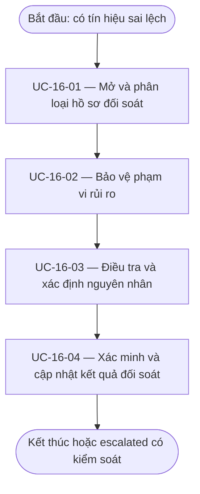

# BJ-16 — Điều tra và đối soát sai lệch

## 1. Tổng quan nghiệp vụ & Bối cảnh

Giúp người vận hành **xác định sai lệch có thực hay không, nguyên nhân nằm ở đâu và hành trình nào phải xử lý tiếp**, đồng thời giữ đầy đủ bằng chứng để chỉ đóng hồ sơ khi kết quả đã được chứng minh. BJ này là hành trình điều tra và điều phối xử lý. Nó không mặc định coi mọi sai lệch là lỗi dữ liệu dẫn xuất và không tự dựng lại projection cho mọi Reconciliation Case.

**Bắt đầu khi:** Có tín hiệu sai lệch từ người dùng, kiểm soát tự động, báo cáo hoặc một operation có kết quả chưa xác định.

**Kết thúc khi:** Reconciliation Case được đóng bằng bằng chứng; hoặc đã được bàn giao/escalate có kiểm soát và giữ trạng thái mở phù hợp.

**Không bao gồm:** Không sở hữu quyết định thuộc Theme/Domain khác.

## 2. Tác nhân và trách nhiệm

| Tác nhân | Trách nhiệm | Phạm vi thẩm quyền |
|---|---|---|
| Nhân viên đối soát hoặc quản lý vận hành | Mở case, bảo vệ phạm vi rủi ro, điều tra nguyên nhân và xác minh kết quả khắc phục. | Không tự sửa ledger để làm hết sai lệch; resolution phải đi đúng owner/correction/rebuild contract. |

## 3. Sơ đồ hành trình nghiệp vụ

## 4. Bản đồ Use Case

| UC — Tên | Mục tiêu | Tác nhân | Đầu vào / Bắt đầu khi | Kết quả | Tiếp tục |
|---|---|---|---|---|---|
| [UC-16-01](../use-cases/UC-16-01-mo-va-phan-loai-ho-so-doi-soat.md) — Mở và phân loại hồ sơ đối soát | Case được tạo/liên kết và có loại, mức độ, người xử lý, phạm vi; Reconciliation Case không trùng. | Nhân viên đối soát hoặc quản lý vận hành | Có tín hiệu sai lệch | Case được tạo/liên kết và có loại, mức độ, người xử lý, phạm vi; Reconciliation Case không trùng. | UC-16-02 |
| [UC-16-02](../use-cases/UC-16-02-bao-ve-pham-vi-rui-ro.md) — Bảo vệ phạm vi rủi ro | Phạm vi cần thiết được khóa hoặc có bằng chứng không cần khóa; Scope protection decision dùng chung. | Nhân viên đối soát hoặc quản lý vận hành | Đã xác định phạm vi sai lệch | Phạm vi cần thiết được khóa hoặc có bằng chứng không cần khóa; Scope protection decision dùng chung. | UC-16-03 |
| [UC-16-03](../use-cases/UC-16-03-dieu-tra-va-xac-dinh-nguyen-nhan.md) — Điều tra và xác định nguyên nhân | Có kết luận sơ bộ và hướng xử lý; Investigation evidence và resolution route. | Nhân viên đối soát hoặc quản lý vận hành | Case đã được phân loại | Có kết luận sơ bộ và hướng xử lý; Investigation evidence và resolution route. | UC-16-04 |
| [UC-16-04](../use-cases/UC-16-04-xac-minh-va-cap-nhat-ket-qua-doi-soat.md) — Xác minh và cập nhật kết quả đối soát | Case đóng/mở lại/giữ mở và lock được xử lý đúng; Authoritative case result. | Nhân viên đối soát hoặc quản lý vận hành | Có kết luận hoặc evidence từ hành trình được bàn giao | Case đóng/mở lại/giữ mở và lock được xử lý đúng; Authoritative case result. | Kết thúc / theo nhánh trên sơ đồ |

## 5. Bàn giao và ranh giới liên quan

| Nơi nhận / Nơi cung cấp | Dữ kiện hoặc trách nhiệm bàn giao | Điều kiện bàn giao / tiếp tục |
|---|---|---|
| Mọi Journey nguồn | Tín hiệu, operation, evidence, ledger facts | Có sai lệch cần điều tra |
| BJ11/BJ17 hoặc owner khác | Hướng sửa/khôi phục đã xác định | BJ16 không tự làm thay owner |

## 6. Liên kết thiết kế

- **UI Flow canonical:** [UIF-16 — Điều tra và đối soát sai lệch](../../../03.design/flows/UIF-16-BJ-16.md)
- BJ này chỉ sở hữu **business boundary, mục tiêu, UC/handoff và acceptance ở cấp hành trình**.
- Screen-to-screen routing, entry/terminal, actor handoff, state/recovery và transition nằm tại `UIF-16`; anatomy/action chi tiết nằm tại `03.design/screens/`.
- Không copy Screen Flow vào BJ để tránh trùng với UC/UIF và để redesign UI không làm thay đổi semantic của Journey.

## 7. Nghiệm thu hành trình (Journey Acceptance)

| ID | Điều kiện ở cấp hành trình | Kết quả cần bảo đảm | UC / BC liên quan |
|---|---|---|---|
| JA-01 | Journey bắt đầu từ đúng trigger và actor có quyền | Kết quả chỉ được ghi trong phạm vi authority của Theme 7; source ngoài Theme không bị sửa ngầm | UC-16-01 / BC liên quan |
| JA-02 | Một nhánh bị từ chối, blocked hoặc chưa xác định | Không được báo thành công hoặc tạo tác động bán phần; hướng xử lý/owner tiếp theo phải rõ | UC-16-01…UC-16-04 |
| JA-03 | Journey hoàn tất thành công | Kết quả cuối có provenance, thời điểm/phạm vi và đủ dữ kiện cho consumer tiếp theo | UC-16-04 / Domain ledger |

## 8. Truy vết

| Nguồn | Vai trò đối với hành trình |
|---|---|
| [KB-KGV-021 — Sửa sai tồn kho mà không sửa lịch sử](../../../01.knowledge/know-how/KB-KGV-021-sua-sai-ton-kho-khong-sua-lich-su.md); [KB-KGV-028 — Idempotency, phiên bản nguồn và xử lý kết quả chưa xác định](../../../01.knowledge/know-how/KB-KGV-028-idempotency-phien-ban-nguon-va-xu-ly-ket-qua-chua-xac-dinh.md); [KB-KGV-032 — Movement ledger, số dư dẫn xuất và phục hồi sau sự cố](../../../01.knowledge/know-how/KB-KGV-032-movement-ledger-so-du-dan-xuat-va-phuc-hoi-sau-su-co.md); [KB-KGV-033 — Thẻ kho, báo cáo lịch sử và đối soát nguồn](../../../01.knowledge/know-how/KB-KGV-033-the-kho-bao-cao-lich-su-va-doi-soat-nguon.md) | **Bài tri thức cốt lõi** giúp hiểu nền nghiệp vụ của Journey; rule triển khai vẫn theo Decision/BJ/UC/BC canonical |
| [Decision Register](../../../01.knowledge/decisions/decision-register.md) — Decision Register theo UC/BC | Nguồn quyết định nghiệp vụ và trạng thái hiệu lực |
| `DOM-IC`, `DOM-IO` | Domain authority và invariants dùng cho Journey |
| [Use Case Map](../use-cases/00-use-case-map.md) | Danh mục UC canonical của Theme 7 |
