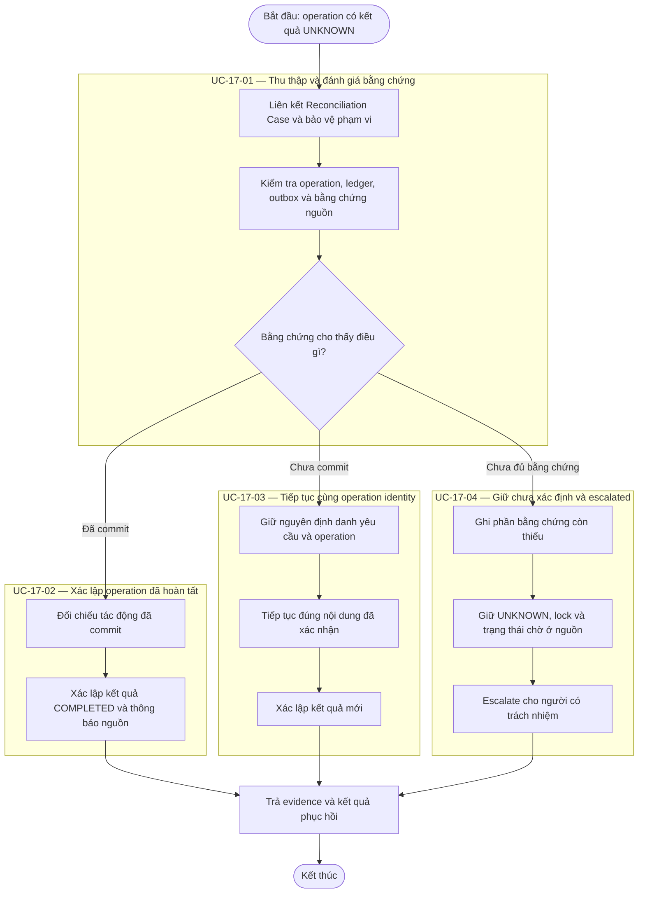
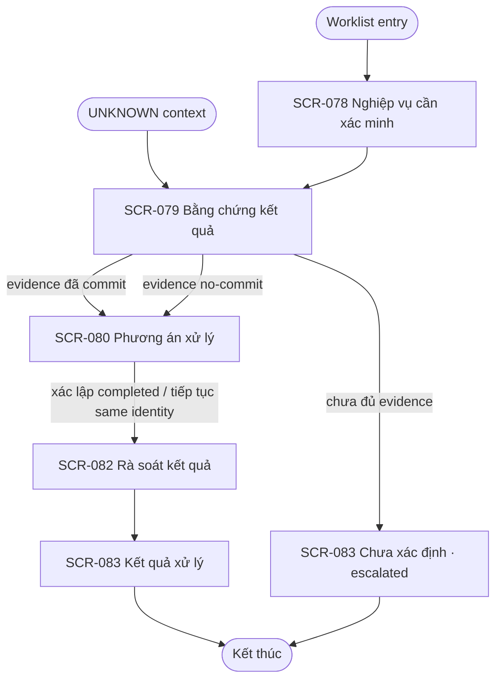

# BJ-17 — Phục hồi nghiệp vụ có kết quả chưa xác định

## 1. Mục tiêu trải nghiệm

Xác lập kết quả authoritative cho một nghiệp vụ có kết quả **chưa xác định (`UNKNOWN`)** mà không tạo mutation trùng, không tự reversal và không coi timeout là thất bại.

## 2. Phạm vi và ranh giới

### 2.1 Bắt đầu khi

| Thuộc tính | Nội dung |
|---|---|
| Bắt đầu | Một inventory operation ở trạng thái `UNKNOWN` được đưa vào xử lý |
| Kết thúc | Operation được xác lập đã commit/chưa commit và tiếp tục an toàn; hoặc vẫn `UNKNOWN` nhưng đã escalated với phạm vi được bảo vệ |
| Tác động chính | Operation result, recovery evidence, trạng thái nguồn liên miền và Reconciliation Case liên quan |
| Không được làm | Tạo operation ID mới, tự ghi movement bù, tự refund hoặc tự hoàn tất nghiệp vụ nguồn |

### 2.2 Kết thúc khi

| Thuộc tính | Nội dung |
|---|---|
| Bắt đầu | Một inventory operation ở trạng thái `UNKNOWN` được đưa vào xử lý |
| Kết thúc | Operation được xác lập đã commit/chưa commit và tiếp tục an toàn; hoặc vẫn `UNKNOWN` nhưng đã escalated với phạm vi được bảo vệ |
| Tác động chính | Operation result, recovery evidence, trạng thái nguồn liên miền và Reconciliation Case liên quan |
| Không được làm | Tạo operation ID mới, tự ghi movement bù, tự refund hoặc tự hoàn tất nghiệp vụ nguồn |

### 2.3 Không bao gồm

| Trong ranh giới | Ngoài ranh giới |
|---|---|
| Thu thập bằng chứng commit/no-commit; tiếp tục cùng operation ID; xác lập finality; giữ pending khi chưa đủ chứng cứ | Sửa ledger; dựng lại projection; correction/reversal; quyết định commercial state của Sales/Purchase |
| Bảo vệ đúng phạm vi rủi ro trong lúc chưa rõ kết quả | Coi mọi timeout là `REJECTED` hoặc tự phát lại với payload/ID khác |

## 3. Actor

- Nhân viên đối soát hoặc chủ sở hữu operation

## 4. Luồng chính

## 5. Use Case map

## 6. Luồng thay thế và ngoại lệ

### 4. Logic nghiệp vụ cần giữ

| Điểm kiểm soát | Quy tắc |
|---|---|
| UNKNOWN không phải FAILED | Timeout hoặc mất kết nối không chứng minh rằng transaction đã rollback |
| Cùng định danh | Chỉ tra cứu/tiếp tục bằng đúng định danh operation và yêu cầu; nội dung khác phải bị từ chối |
| Có bằng chứng commit | Chỉ xác lập kết quả từ tác động đã có; không ghi movement/balance/outbox lần hai |
| Có bằng chứng no-commit | Có thể tiếp tục cùng ID sau khi xác minh không tồn tại tác động bán phần |
| Chưa đủ bằng chứng | Giữ UNKNOWN và trạng thái nguồn tương ứng; không đoán kết quả để “mở đường” cho người dùng |
| Boundary liên miền | Sales/Purchase giữ trạng thái chờ theo contract của mình; Theme 7 không tự hoàn tất đơn, refund payment hoặc tạo lại receipt |
| Mở khóa | Chỉ mở phạm vi sau khi kết quả và tác động đã được chứng minh nhất quán |

### 5. Quan hệ và bàn giao

- Nhận operation từ BJ-16 hoặc từ bước phục hồi ngắn hạn của BJ phát sinh operation.
- Khi đủ bằng chứng, trả kết quả về BJ-16 để verify và đóng/mở khóa case.
- Nếu phát hiện ledger đúng nhưng read model sai, route riêng sang PROC-01; không rebuild trong BJ này.
- Nếu cần sửa một operation đã hoàn tất, dùng BJ-11 sau khi finality đã rõ.

## 7. UI Flow và chuyển màn hình

> **v1.7.0 Product correction.** Nguồn nghiệp vụ: BJ-17/UC-17-01..04. `UNKNOWN` không phải failed và không tạo operation identity mới.

### 1. Design Readiness

| Câu hỏi | Quyết định |
|---|---|
| Primary task | Xác lập authoritative finality cho một inventory operation chưa xác định kết quả |
| Primary object | Same inventory operation identity + recovery evidence + linked reconciliation case |
| User decision | Review evidence; xác nhận route system cho phép; hoàn tất review hoặc xem escalation |
| System decision | Commit / no-commit / insufficient evidence; scope protection; source waiting state |
| Commit point | Xác lập `COMPLETED`, tiếp tục same identity sau proof no-commit, hoặc giữ unresolved/escalated |
| Forbidden | New operation ID; blind retry; auto reversal; tự refund/finalize Sales/Purchase; ghi movement lần hai khi đã commit |

### 2. Entry architecture

> Entry/handoff/recovery explanation thuộc artifact này, **không render** thành card, banner hoặc helper trong Product UI.

| Entry | Screen | Meaning |
|---|---|---|
| Việc cần xác minh | `SCR-078` | Worklist operation chưa có finality |
| Handoff từ BJ khác / source waiting deep link | `SCR-079` | Mở evidence của đúng operation |

### 3. UI flow

### 4. Transition contract

| ID | From | Trigger | To | Type | Trace |
|---|---|---|---|---|---|
| `UIF-17-T01` | Worklist entry | Mở Việc cần xác minh | `SCR-078` | NAVIGATION | UC-17-01 |
| `UIF-17-T02` | Context entry / `SCR-078` | Mở operation UNKNOWN | `SCR-079` | NAVIGATION | UC-17-01 |
| `UIF-17-T03` | `SCR-079` | Evidence chứng minh đã commit | `SCR-080` | NAVIGATION | UC-17-02 |
| `UIF-17-T04` | `SCR-079` | Evidence chứng minh no-commit | `SCR-080` | NAVIGATION | UC-17-03 |
| `UIF-17-T05` | `SCR-079` | Chưa đủ evidence | `SCR-083:ESCALATED` | SYSTEM/HANDOFF | UC-17-04 |
| `UIF-17-T06` | `SCR-080` | Xác lập từ tác động đã commit | `SCR-082` | MUTATION | `ACT-15-RECONCILE` · không ghi movement/balance/outbox lần hai |
| `UIF-17-T07` | `SCR-080` | Tiếp tục đúng content + same identity sau proof no-commit | `SCR-082` | MUTATION | `ACT-15-RECONCILE` · same operation/request identity |
| `UIF-17-T08` | `SCR-082` | Review finality nhất quán | `SCR-083:COMPLETED` | MUTATION | `ACT-15-RECONCILE` |
| `UIF-17-T09` | `SCR-083` | Completed | End | TERMINAL | UC-17-02/03 |
| `UIF-17-T10` | `SCR-083` | Unknown escalated | End | TERMINAL | UC-17-04 |

### 5. Product invariants

1. Timeout/mất kết nối không chứng minh rollback.
2. Có evidence commit: chỉ xác lập finality từ tác động đã có; không ghi movement/balance/outbox lần hai.
3. Có evidence no-commit: chỉ được tiếp tục **cùng operation/request identity và cùng content đã xác nhận** sau khi chứng minh không có partial effect.
4. Chưa đủ evidence: giữ trạng thái “Chưa xác định”, giữ source waiting + scope protection, có owner escalation; không đoán kết quả.
5. Product copy dùng “Chưa xác định / Tiếp tục lần xử lý này / Xác lập đã hoàn tất”; không dùng “retry/replay” như user task.

## 8. Handoff / phụ thuộc ngoài Journey

## 9. Outcome cuối

| Thuộc tính | Nội dung |
|---|---|
| Bắt đầu | Một inventory operation ở trạng thái `UNKNOWN` được đưa vào xử lý |
| Kết thúc | Operation được xác lập đã commit/chưa commit và tiếp tục an toàn; hoặc vẫn `UNKNOWN` nhưng đã escalated với phạm vi được bảo vệ |
| Tác động chính | Operation result, recovery evidence, trạng thái nguồn liên miền và Reconciliation Case liên quan |
| Không được làm | Tạo operation ID mới, tự ghi movement bù, tự refund hoặc tự hoàn tất nghiệp vụ nguồn |

## 10. Truy vết

### Nguồn v3.10.1 — BJ-17 — Phục hồi nghiệp vụ có kết quả chưa xác định

> **Trạng thái:** Release đã đóng băng `4.1.0` — đã remap ID và boundary  
> **Chuyển đổi chính thức:** Theme 7 `4.0.0/BJ-20` → `4.1.0/BJ-17`  
> **Finality contract:** `COMPLETED`, `REJECTED/CANCELLED`, `SUSPENDED/BLOCKED`, `UNKNOWN/ESCALATED`
> **Phạm vi:** Phase 1 — phục hồi operation `UNKNOWN` bằng cùng định danh nghiệp vụ  
> **Chủ sở hữu nghiệp vụ:** Inventory Control phối hợp owner của operation
> **Quyết định nghiệp vụ:** `T7-BASELINE-FREEZE-v4.0.0` + `T7-DR-071`, `T7-DR-072`, `T7-DR-074`, `T7-DR-090`
### Nguồn v3.10.1 — 3. Trường hợp sử dụng

| UC | Tên | Bắt đầu | Kết thúc | Kết quả |
|---|---|---|---|---|
| [UC-17-01](../use-cases/UC-17-01-thu-thap-va-danh-gia-bang-chung.md) | Thu thập và đánh giá bằng chứng | Operation ở trạng thái UNKNOWN | Có kết luận commit, no-commit hoặc chưa đủ bằng chứng | Evidence assessment |
| [UC-17-02](../use-cases/UC-17-02-xac-lap-operation-da-hoan-tat.md) | Xác lập operation đã hoàn tất | Có bằng chứng commit đầy đủ | Operation và nguồn nhận kết quả COMPLETED authoritative | Completed result, không ghi lại movement |
| [UC-17-03](../use-cases/UC-17-03-tiep-tuc-cung-operation-identity.md) | Tiếp tục cùng operation identity | Có bằng chứng operation chưa commit | Cùng operation ID trả kết quả mới hoặc vẫn UNKNOWN | Idempotent continuation dùng chung |
| [UC-17-04](../use-cases/UC-17-04-giu-chua-xac-dinh-va-escalated.md) | Giữ chưa xác định và escalated | Evidence chưa đủ hoặc có nghi ngờ nghiêm trọng | UNKNOWN được giữ, phạm vi được bảo vệ và escalation có owner | Controlled unresolved result |
### Nguồn v3.10.1 — 6. Nguồn tri thức liên quan

- [Vòng đời của một inventory operation](../../../01.knowledge/know-how/KB-KGV-027-vong-doi-cua-mot-inventory-operation.md)
- [Idempotency, phiên bản nguồn và xử lý kết quả chưa xác định](../../../01.knowledge/know-how/KB-KGV-028-idempotency-phien-ban-nguon-va-xu-ly-ket-qua-chua-xac-dinh.md)
- [Tính nguyên tử khi ghi tồn kho và phát sự kiện](../../../01.knowledge/know-how/KB-KGV-029-tinh-nguyen-tu-khi-ghi-ton-kho-va-phat-su-kien.md)
- [Movement ledger, số dư dẫn xuất và phục hồi sau sự cố](../../../01.knowledge/know-how/KB-KGV-032-movement-ledger-so-du-dan-xuat-va-phuc-hoi-sau-su-co.md)
