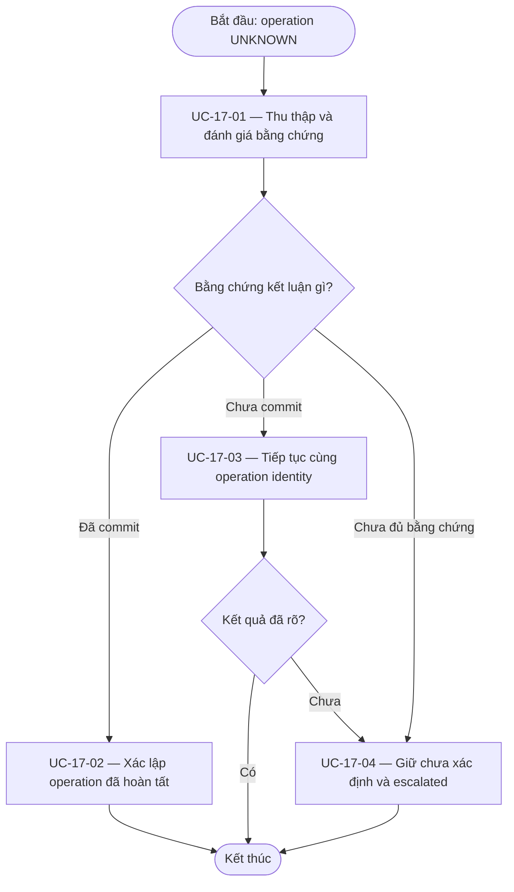

# BJ-17 — Phục hồi nghiệp vụ có kết quả chưa xác định

## 1. Tổng quan nghiệp vụ & Bối cảnh

Xác lập kết quả authoritative cho một nghiệp vụ có kết quả **chưa xác định (`UNKNOWN`)** mà không tạo mutation trùng, không tự reversal và không coi timeout là thất bại.

**Bắt đầu khi:** Một inventory operation ở trạng thái `UNKNOWN` được đưa vào xử lý.

**Kết thúc khi:** Operation được xác lập đã commit/chưa commit và tiếp tục an toàn; hoặc vẫn `UNKNOWN` nhưng đã escalated với phạm vi được bảo vệ.

**Không bao gồm:** Không sở hữu quyết định thuộc Theme/Domain khác.

## 2. Tác nhân và trách nhiệm

| Tác nhân | Trách nhiệm | Phạm vi thẩm quyền |
|---|---|---|
| Nhân viên đối soát hoặc chủ sở hữu operation | Thu thập bằng chứng finality và tiếp tục/khép operation `UNKNOWN` bằng cùng identity. | Không blind retry bằng identity mới và không suy `UNKNOWN` thành FAILED. |

## 3. Sơ đồ hành trình nghiệp vụ

## 4. Bản đồ Use Case

| UC — Tên | Mục tiêu | Tác nhân | Đầu vào / Bắt đầu khi | Kết quả | Tiếp tục |
|---|---|---|---|---|---|
| [UC-17-01](../use-cases/UC-17-01-thu-thap-va-danh-gia-bang-chung.md) — Thu thập và đánh giá bằng chứng | Có kết luận commit, no-commit hoặc chưa đủ bằng chứng; Evidence assessment. | Nhân viên đối soát hoặc chủ sở hữu operation | Operation ở trạng thái UNKNOWN | Có kết luận commit, no-commit hoặc chưa đủ bằng chứng; Evidence assessment. | UC-17-02 |
| [UC-17-02](../use-cases/UC-17-02-xac-lap-operation-da-hoan-tat.md) — Xác lập operation đã hoàn tất | Operation và nguồn nhận kết quả COMPLETED authoritative; Completed result, không ghi lại movement. | Nhân viên đối soát hoặc chủ sở hữu operation | Có bằng chứng commit đầy đủ | Operation và nguồn nhận kết quả COMPLETED authoritative; Completed result, không ghi lại movement. | UC-17-03 |
| [UC-17-03](../use-cases/UC-17-03-tiep-tuc-cung-operation-identity.md) — Tiếp tục cùng operation identity | Cùng operation ID trả kết quả mới hoặc vẫn UNKNOWN; Idempotent continuation dùng chung. | Nhân viên đối soát hoặc chủ sở hữu operation | Có bằng chứng operation chưa commit | Cùng operation ID trả kết quả mới hoặc vẫn UNKNOWN; Idempotent continuation dùng chung. | UC-17-04 |
| [UC-17-04](../use-cases/UC-17-04-giu-chua-xac-dinh-va-escalated.md) — Giữ chưa xác định và escalated | UNKNOWN được giữ, phạm vi được bảo vệ và escalation có owner; Controlled unresolved result. | Nhân viên đối soát hoặc chủ sở hữu operation | Evidence chưa đủ hoặc có nghi ngờ nghiêm trọng | UNKNOWN được giữ, phạm vi được bảo vệ và escalation có owner; Controlled unresolved result. | Kết thúc / theo nhánh trên sơ đồ |

## 5. Bàn giao và ranh giới liên quan

| Nơi nhận / Nơi cung cấp | Dữ kiện hoặc trách nhiệm bàn giao | Điều kiện bàn giao / tiếp tục |
|---|---|---|
| Operation/Journey nguồn | Operation identity và evidence UNKNOWN | Không tạo identity mới |
| BJ16 / source domain | Kết quả recovery hoặc escalated evidence | Khi cần đối soát rộng hơn |

## 6. Liên kết thiết kế

- **UI Flow canonical:** [UIF-17 — Phục hồi nghiệp vụ có kết quả chưa xác định](../../../03.design/flows/UIF-17-BJ-17.md)
- BJ này chỉ sở hữu **business boundary, mục tiêu, UC/handoff và acceptance ở cấp hành trình**.
- Screen-to-screen routing, entry/terminal, actor handoff, state/recovery và transition nằm tại `UIF-17`; anatomy/action chi tiết nằm tại `03.design/screens/`.
- Không copy Screen Flow vào BJ để tránh trùng với UC/UIF và để redesign UI không làm thay đổi semantic của Journey.

## 7. Nghiệm thu hành trình (Journey Acceptance)

| ID | Điều kiện ở cấp hành trình | Kết quả cần bảo đảm | UC / BC liên quan |
|---|---|---|---|
| JA-01 | Journey bắt đầu từ đúng trigger và actor có quyền | Kết quả chỉ được ghi trong phạm vi authority của Theme 7; source ngoài Theme không bị sửa ngầm | UC-17-01 / BC liên quan |
| JA-02 | Một nhánh bị từ chối, blocked hoặc chưa xác định | Không được báo thành công hoặc tạo tác động bán phần; hướng xử lý/owner tiếp theo phải rõ | UC-17-01…UC-17-04 |
| JA-03 | Journey hoàn tất thành công | Kết quả cuối có provenance, thời điểm/phạm vi và đủ dữ kiện cho consumer tiếp theo | UC-17-04 / Domain ledger |

## 8. Truy vết

| Nguồn | Vai trò đối với hành trình |
|---|---|
| [Decision Register](../../../01.knowledge/decisions/decision-register.md) — Decision Register theo UC/BC | Nguồn quyết định nghiệp vụ và trạng thái hiệu lực |
| `DOM-IC`, `DOM-IO` | Domain authority và invariants dùng cho Journey |
| [Use Case Map](../use-cases/00-use-case-map.md) | Danh mục UC canonical của Theme 7 |
