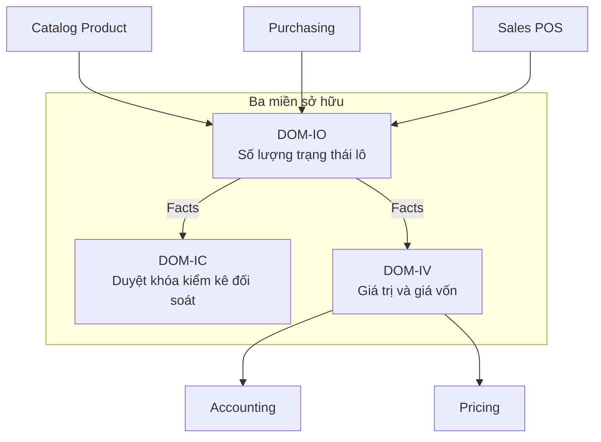
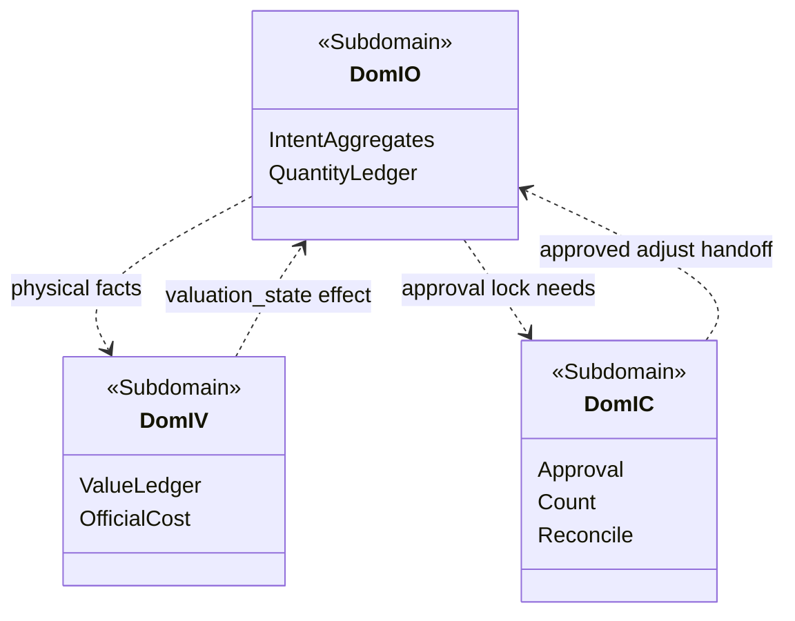
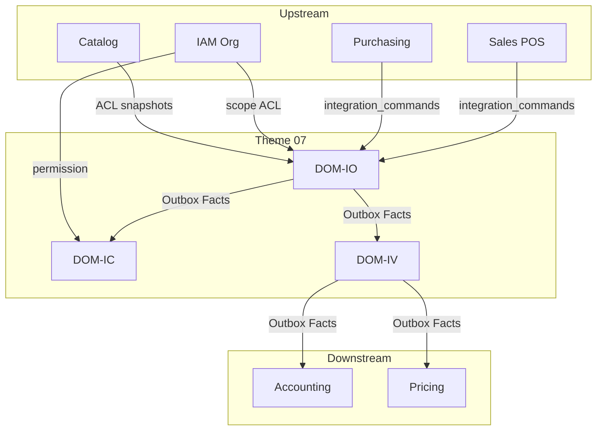

# DOM-COM — Nền tảng Domain dùng chung

## 1. Trách nhiệm

**Shared foundation** của Theme 07 — định vị ranh giới thẩm quyền giữa ba miền sở hữu, ngôn ngữ dùng chung, và bất biến tổ chức. Không phải Core Subdomain vận hành; không sở hữu ledger số lượng hay giá trị.

| Sứ mệnh cốt lõi | Trách nhiệm chính | Phạm vi thẩm quyền |
|---|---|---|
| Theme ownership map | Tách rõ IO / IC / IV | Sở hữu: bản đồ thẩm quyền. Không: lifecycle chi tiết từng miền |
| Shared ubiquitous language | Thuật ngữ xuyên miền | Sở hữu: glossary pointers. Không: field schema |
| Organizational invariants | Tenant / store / warehouse Phase 1 | Sở hữu: `INV-ORG-*`. Không: rule nghiệp vụ IO/IC/IV |

Chi tiết vận hành: [DOM-IO](DOM-IO.md) · [DOM-IC](DOM-IC.md) · [DOM-IV](DOM-IV.md).

## 2. Quyền sở hữu và ranh giới

### 2.1 Domain sở hữu (trong Theme 07)

Ba miền có thể cùng bounded context triển khai ban đầu, nhưng **consistency boundary và data ownership vẫn tách**.

### 2.2 Domain không sở hữu (ngoài Theme)

| Bối cảnh | Dữ liệu sở hữu ngoài | Theme 07 chỉ dùng |
|---|---|---|
| Tenant / IAM | Tenant, User, Role, permission | `tenant_id`, actor, warehouse scope |
| Cửa hàng / Kho | Store, Warehouse, assignment | Cặp mặc định đang hoạt động |
| Sản phẩm | Product, UOM, tracking, combo | ACL snapshot / policy refs |
| Mua hàng | PO, receipt intent, RTV, price evidence | Source id/version/request |
| Bán hàng / POS | Order, fulfillment, return request | Reserve / issue / return request |
| Kế toán | Period, GL/AP policy | Kỳ mở/khóa; nhận value facts |
| Định giá | Pricing cost basis, floor/list | Nhận official cost; **không** ghi ledger Theme |
| Kịch bản mua | Purchase discount scenario | Projected cost — ngoài ledger |

### 2.3 Ranh giới tính nhất quán (Theme-level)

- Mỗi mutation **CHỈ ĐƯỢC** đổi đúng 1 Aggregate Root trong 1 transaction (thuộc đúng một trong IO/IC/IV).
- Two-axis receipt: vật lý (IO) rồi giá (IV) — xem flowchart tại [DOM-IO §2.3](DOM-IO.md) và [DOM-IV §2.3](DOM-IV.md).

| Boundary | Commit set tối thiểu |
|---|---|
| Quantity mutation | Intent result + quantity movement + balance + lot/state + outbox |
| Direct price confirmation | Receipt valuation + value movement + valuation-state + availability + outbox |
| Reservation | Reservation + ReservationBucket + result/outbox |
| Pick | Allocation set/version — **không** movement vật lý |
| Customer return receipt | Qty movement + `RETURN_PENDING` + value (nếu có) + cap + outbox |
| Count adjustment | Count approval + StockAdjustment movement/balance + unlock |
| Opening balance | Batch duyệt + opening movements/values + cost seed + `ACTIVE` |
| Late landed cost | Late cost + allocation + value movement + dirty scope + outbox |
| Period close | Cost run publish + adjustment + official cost + outbox |

Event delivery / accounting posting **sau** commit — không mở rộng distributed transaction.

## 3. Khái niệm chính

### 3.1 Ngôn ngữ chung (Ubiquitous Language)

Chỉ thuật ngữ xuyên miền. Chi tiết IO/IC/IV nằm ở DOM tương ứng. Định nghĩa đầy đủ: [`glossary.md`](../../../01.knowledge/glossary/glossary.md).

| Thuật ngữ | Vai trò | Định nghĩa ngắn |
|---|---|---|
| [Tồn vật lý](../../../01.knowledge/glossary/glossary.md#term-ton-vat-ly) | Concept | Tổng lượng thuộc tenant đang hiện diện |
| [Lượng đủ điều kiện bán](../../../01.knowledge/glossary/glossary.md#term-luong-du-dieu-kien-ban) | Concept | Vật lý thỏa trạng thái / lô / hạn / valuation |
| [Lượng đã giữ](../../../01.knowledge/glossary/glossary.md#term-luong-da-giu) | Concept | Cam kết đơn, chưa rời kho |
| [Tồn khả dụng / ATP](../../../01.knowledge/glossary/glossary.md#term-ton-kha-dung) | Concept | Eligible − Reserved |
| [Movement](../../../01.knowledge/glossary/glossary.md#term-but-ghi-bien-dong) | Ledger (IO/IV) | Bản ghi bất biến qty hoặc value |
| [Balance](../../../01.knowledge/glossary/glossary.md#term-so-du-hien-hanh) | Projection | Bản chiếu từ movement |
| [Lô sản xuất](../../../01.knowledge/glossary/glossary.md#term-lo-san-xuat) | Aggregate (IO) | Tenant + product + manufacturer lot code |
| [Giá vốn chính thức](../../../01.knowledge/glossary/glossary.md#term-gia-von-chinh-thuc) | Aggregate (IV) | OfficialCostVersion có hiệu lực |
| [Giá trị ghi sổ](../../../01.knowledge/glossary/glossary.md#term-gia-tri-ghi-so) | Concept | Tổng value movement thẩm quyền |
| [Correction](../../../01.knowledge/glossary/glossary.md#term-nghiep-vu-sua-sai) | Aggregate (IO) | Operation mới liên kết gốc |
| [Reconciliation](../../../01.knowledge/glossary/glossary.md#term-doi-soat) | Aggregate (IC) | Bằng chứng lệch / UNKNOWN — không sửa tay |
| Inventory Operation | Concept | Bao quát lệnh kho — **không** God Aggregate Root |

### 3.2 Domain Model Overview (Theme)

## 4. Lifecycle và trạng thái

Lifecycle chi tiết **không** nhân bản tại COM:

| Miền | Xem |
|---|---|
| Intent Aggregates, Return, UNKNOWN kỹ thuật | [DOM-IO §4](DOM-IO.md) |
| Stock count, Opening, Reconciliation | [DOM-IC §4](DOM-IC.md) |
| Valuation axis, Cost run | [DOM-IV §4](DOM-IV.md) |

**Ghi chú Theme:** `UNKNOWN` là trạng thái kỹ thuật bảo vệ finality — **KHÔNG ĐƯỢC** coi là failure nghiệp vụ hay tự hủy (chi tiết DOM-IO).

## 5. Quy tắc và Điều kiện bắt buộc

Chỉ bất biến **tổ chức / phạm vi**. Rule IO/IC/IV/LOT thuộc DOM sở hữu.

| Mã | Quy tắc |
|---|---|
| INV-ORG-01 | Mỗi mutation **PHẢI** thuộc đúng một tenant, store và warehouse. |
| INV-ORG-02 | Phase 1 **CHỈ ĐƯỢC** chấp nhận cặp store/warehouse mặc định đang hoạt động. |
| INV-ORG-03 | Vị trí user/device **KHÔNG ĐƯỢC** tạo store hoặc warehouse mới. |
| INV-ORG-04 | Capability ngoài phạm vi **PHẢI** bị từ chối trước mutation; hệ thống **KHÔNG ĐƯỢC** tạo entity/nhánh giả. |

Nguồn: [`T7-DR-004`](../../../01.knowledge/decisions/decision-register.md), [`T7-DR-008`](../../../01.knowledge/decisions/decision-register.md).

## 6. Quan hệ với Domain khác

### 6.1 Context Map

### 6.2 Messaging

- **Outbox = Facts** (past tense + version). **Cấm** `*.requested` / imperative làm “event”.
- **Cross-module work** = `integration_commands` (+ intent tables khi có).
- Chi tiết catalog event: DOM-IO / DOM-IC / DOM-IV §6.2 và technical contracts.

## 7. Entity liên quan

Catalog chung: [`../entities/`](../entities/) · Read models: [`../read-models/`](../read-models/)

| Nhóm | Phạm vi | Xem catalog |
|---|---|---|
| `ENT-IO-*` | Intent, movement, reservation, lot, … | [DOM-IO §7](DOM-IO.md#7-entity--projection-liên-quan) |
| `ENT-IC-*` | Approval, lock, count, opening, reconcile | [DOM-IC §7](DOM-IC.md#7-entity-liên-quan) |
| `ENT-IV-*` | Valuation, value ledger, cost run, late cost | [DOM-IV §7](DOM-IV.md#7-entity-liên-quan) |
| `PRJ-IO-*` | Projection / read model (vd. TransactionalBalance) | [DOM-IO §7.2](DOM-IO.md#72-read-models-read-models) · [PRJ-IO-01](../read-models/PRJ-IO-01-TransactionalBalance.md) |

**Không** liệt kê `CommandReceipt` / IdempotencyRecord như Domain Entity — thuộc Application / Infrastructure.

## 8. Quyết định nghiệp vụ chi phối

Nguồn đầy đủ: [`decision-register.md`](../../../01.knowledge/decisions/decision-register.md)

| Nhóm | Chủ đề | Domain chịu trách nhiệm chính |
|---|---|---|
| G01 | Phạm vi store/kho | COM (`INV-ORG`) + IAM |
| G02 | Lot / UOM / tracking | DOM-IO |
| G03 | Nhận hàng & xác nhận giá | DOM-IO + DOM-IV |
| G04 | Khả dụng / giữ / xuất | DOM-IO |
| G05 | Kiểm kê | DOM-IC |
| G06 | Trả / trạng thái / tiêu hủy | DOM-IO |
| G07 | Giá vốn / chốt kỳ | DOM-IV |
| G08 | Sửa sai | DOM-IO |
| G09 | Opening / activation | DOM-IC |
| G10 | Operation / UNKNOWN | DOM-IO (+ IC reconcile) |
| G11 | Quyền / duyệt | DOM-IC |
| G12 | Báo cáo / đối soát | DOM-IC + IO/IV read |
| G13 | Master / combo / policy | Catalog + CAP (ngoài COM) |
| G14 | Chiết khấu / pricing | Pricing (ranh giới IV) |

## 9. Điểm chưa chốt / Phase 1 constraints

**Đã chừa ranh giới, chưa triển khai hành vi:**

- Store–Warehouse nhiều–nhiều; warehouse selector/routing; transfer / in-transit.
- Offline device, serial, custody, tracking conversion batch, forecast / replenishment proposal entity.

**Phase 1 hiện hành:**

- Một Store hoạt động, một Warehouse hoạt động, một assignment mặc định.
- Mọi mutation ghi `store_id` + `warehouse_id` mặc định; nhiều user online đồng thời được phép.

Đổi aggregate / Dữ liệu gốc / financial finality → Decision ID mới + cập nhật glossary/DOM/ENT liên quan (quy trình harness — không nhân bản checklist dài tại đây).
