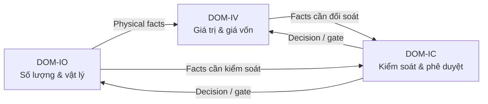
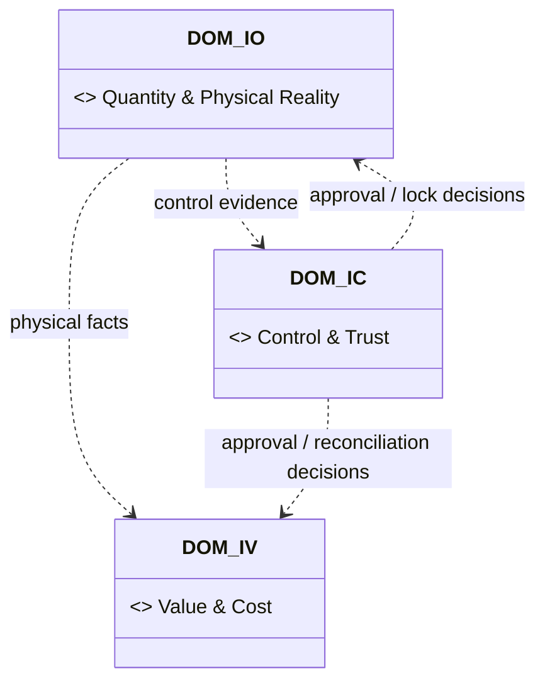
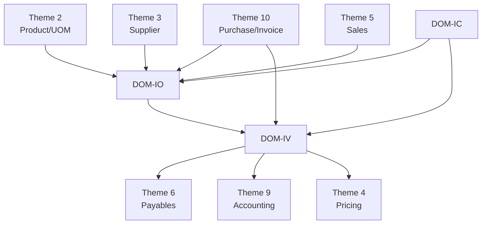

# DOM-COM — Nền tảng Domain dùng chung

## 1. Trách nhiệm

`DOM-COM` là nền dùng chung của Theme 7. Domain này không vận hành một nghiệp vụ kho độc lập; nó khóa **ranh giới thẩm quyền**, thuật ngữ xuyên miền và các bất biến tổ chức để `DOM-IO`, `DOM-IC` và `DOM-IV` không cùng sở hữu một sự thật.

| Sứ mệnh cốt lõi | Trách nhiệm chính | Phạm vi thẩm quyền |
|---|---|---|
| Tách quyền sở hữu | Xác định sự thật nào thuộc IO, IC, IV và sự thật nào chỉ tham chiếu từ Theme khác | Không thay lifecycle của Domain con |
| Ngôn ngữ xuyên miền | Chuẩn hóa quantity, value, valuation, cost, source/evidence và finality | Không sở hữu field/schema chi tiết |
| Bất biến tổ chức | Tenant, cửa hàng, kho và capability Phase 1 | Không sở hữu Product, Supplier, PO, Invoice hay GL |

## 2. Quyền sở hữu và ranh giới

### 2.1 Domain sở hữu

- Bản đồ quyền sở hữu giữa `DOM-IO`, `DOM-IC`, `DOM-IV`.
- Bất biến tenant/store/warehouse áp dụng xuyên Theme.
- Quy tắc phân biệt **sự thật vật lý**, **sự thật giá trị**, **kiểm soát/phê duyệt** và **dữ liệu nguồn ngoài Theme**.

### 2.2 Domain không sở hữu

| Khái niệm ngoài ranh giới | Owner |
|---|---|
| Product, UOM, tracking policy | Theme 2 / Catalog |
| Supplier và dữ liệu đối tác | Theme 3 |
| Sales Order / fulfillment intent | Theme 5 |
| Purchase Order, điều kiện thương mại, hóa đơn NCC | Theme 10 |
| Phải trả | Theme 6 |
| Accounting ledger, kỳ kế toán, chính sách kế toán/thuế có thẩm quyền | Theme 9 / Accounting policy owner |
| Chính sách giá bán | Theme 4 / Pricing |

### 2.3 Ranh giới tính nhất quán

- Một mutation chỉ thay đổi đúng Aggregate Root thuộc Domain sở hữu trong một transaction.
- Handoff giữa Domain/Theme không kéo owner của dữ liệu nguồn sang Theme 7.
- Event delivery và accounting posting xảy ra sau commit; không mở rộng distributed transaction.

## 3. Khái niệm chính

### 3.1 Ngôn ngữ chung (Ubiquitous Language)

| Thuật ngữ | Vai trò | Định nghĩa |
|---|---|---|
| Tồn vật lý | Concept | Lượng hàng thực tế thuộc tenant đang hiện diện trong kho |
| Tồn khả dụng | Concept | Lượng đủ điều kiện cam kết sau khi trừ lượng đã giữ |
| Inventory Movement | Ledger | Sự thật số lượng append-only do `DOM-IO` sở hữu |
| Inventory Value Movement | Ledger | Sự thật giá trị append-only do `DOM-IV` sở hữu |
| Giá trị nhập ban đầu | Concept | Giá trị lần đầu được xác lập cho lượng hàng thực nhận trong BJ03 |
| Điều chỉnh giá trị hàng nhập | Concept | Giá trị tăng/giảm phát sinh sau initial valuation và được ghi trong BJ13 |
| Giá vốn chính thức | Versioned fact | Đơn giá do BJ14 công bố theo phương pháp tenant đã cấu hình |
| Source | Concept | Nguồn có thẩm quyền xác lập một fact nghiệp vụ |
| Evidence | Concept | Tài liệu/tham chiếu chứng minh hoặc hỗ trợ source; không tự trở thành authority |
| UNKNOWN | Technical finality | Kết quả mutation chưa chứng minh commit hay rollback; không được coi là thất bại nghiệp vụ |

### 3.2 Domain Model Overview

## 4. Lifecycle và trạng thái

`DOM-COM` không tạo lifecycle nghiệp vụ riêng. Lifecycle authoritative nằm tại:

- `DOM-IO`: intent kho, reservation, lot, correction.
- `DOM-IC`: approval, stock count, opening balance, reconciliation.
- `DOM-IV`: valuation, adjustment, cost run, official cost.

`UNKNOWN` chỉ là finality kỹ thuật và phải được làm rõ bằng cùng operation identity; không tạo business state giả.

## 5. Quy tắc và Điều kiện bắt buộc

| Mã | Quy tắc |
|---|---|
| `INV-ORG-01` | Mọi mutation **PHẢI** thuộc đúng tenant và phạm vi kho mà actor được phép tác động. |
| `INV-ORG-02` | Phase 1 **CHỈ ĐƯỢC** dùng cặp cửa hàng/kho mặc định đang hoạt động; không tự tạo kho từ vị trí user/device. |
| `INV-ORG-03` | Dữ liệu do Theme khác sở hữu **CHỈ ĐƯỢC** tham chiếu/snapshot theo contract; Theme 7 **KHÔNG ĐƯỢC** sửa thay owner. |
| `INV-ORG-04` | Capability ngoài Phase 1 **PHẢI** bị từ chối trước mutation; không mô phỏng bằng một operation gần giống. |
| `INV-ORG-05` | Một fact nghiệp vụ authoritative **PHẢI** có đúng một owner; read model/prototype không được tạo một authority cạnh tranh. |

## 6. Quan hệ với Domain khác

### 6.1 Context Map

### 6.2 Messaging

- Outbox chỉ phát **fact đã xảy ra** và dùng tên quá khứ/versioned.
- Công việc yêu cầu Domain/Theme khác thực hiện dùng integration command/contract riêng; không đội lốt fact.
- Cross-theme mutation phải có identity, version/freshness, idempotency và reconciliation contract.

## 7. Entity liên quan

`DOM-COM` không sở hữu business entity riêng. Entity canonical nằm ở `ENT-IO-*`, `ENT-IC-*`, `ENT-IV-*`; read model nằm tại `02.specification/domain/read-models/`.

## 8. Quyết định nghiệp vụ chi phối

| Decision ID | Quyết định | Chi phối đối với domain này |
|---|---|---|
| `T7-DR-001…008` | Phạm vi/ownership/tenant-store-warehouse | Bất biến tổ chức và negative scope |
| `T7-DR-020…027` | Nhận hàng và two-axis valuation | Ranh giới IO ↔ IV |
| `T7-DR-079…084` | Quyền, approval, reconciliation | Ranh giới IC |
| `T7-DR-185…195` | Semantic BJ03/BJ13/BJ14 | Ranh giới initial value, adjustment và Official Cost |

## 9. Điểm chưa chốt

- Multi-store/multi-warehouse routing thuộc Phase sau; model giữ tenant/warehouse scope nhưng Phase 1 không mở selector/routing.
- Owner cuối cùng của tax/accounting policy được tích hợp qua contract có thẩm quyền; Theme 7 chỉ consume treatment, không tự tạo chính sách thuế.
