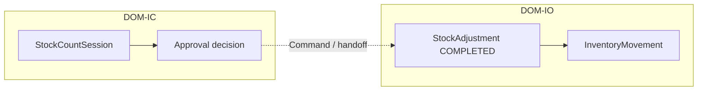
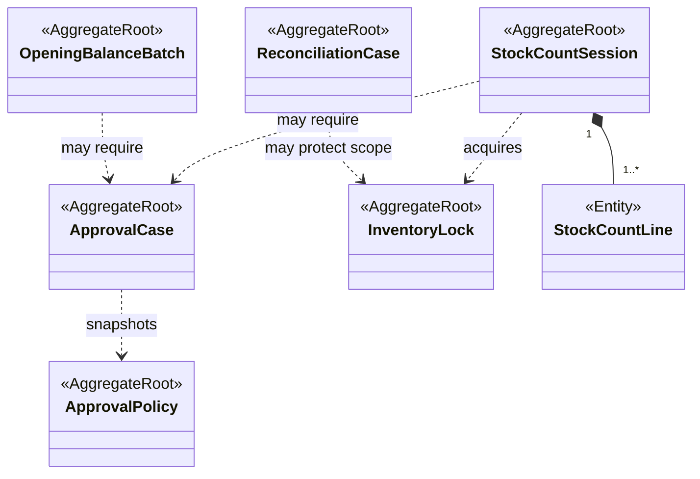
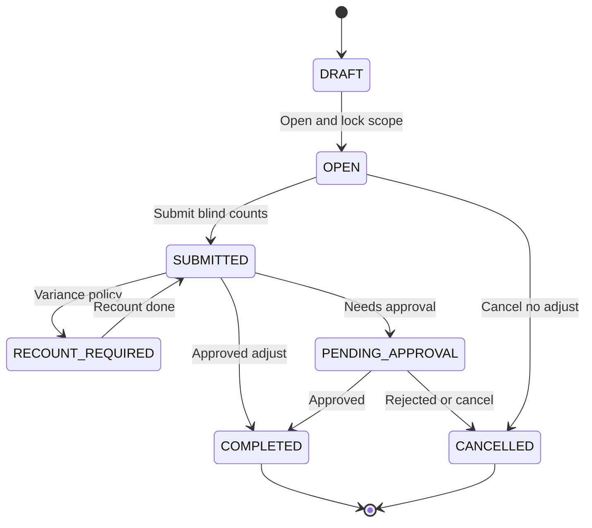
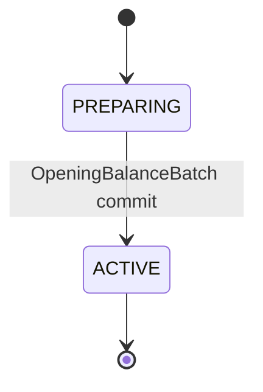
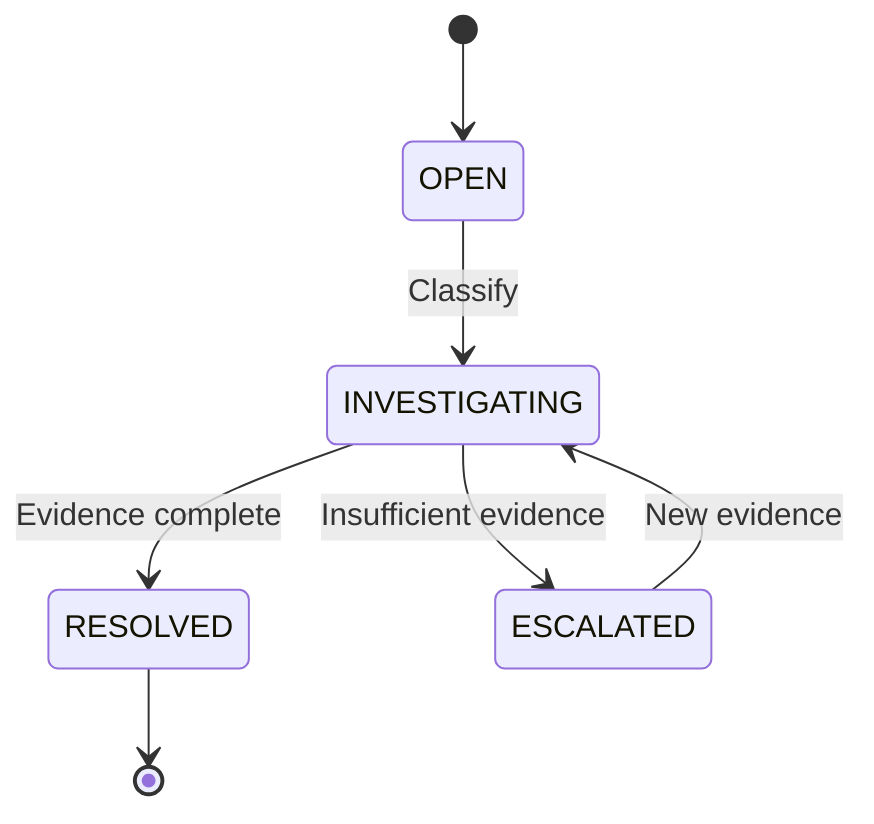
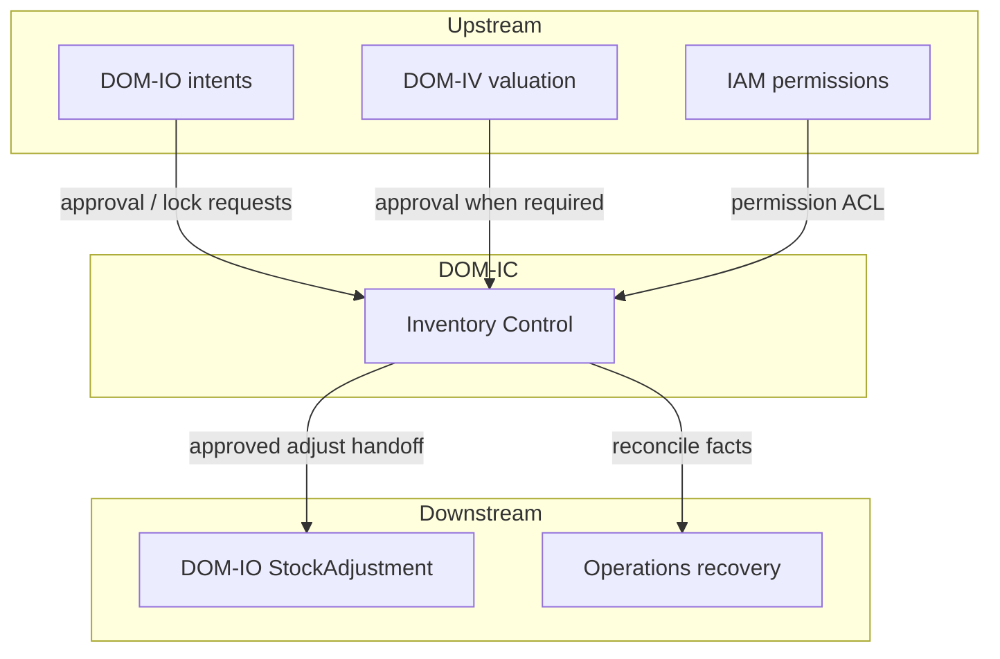

---
id: DOM-IC
type: domain-foundation
theme: theme-07
title: Inventory Control
owner: BA/SA
status: DRAFT
aligned_to: DOMAIN.template.md + DOM-IO.sample.md
source_baseline: v3.10.1
# DOM-IC — Inventory Control

## 1. Trách nhiệm

**Supporting Subdomain** của Theme 07 — thẩm quyền đối với **kiểm soát tin cậy**: phê duyệt, khóa phạm vi, kiểm kê, số dư đầu kỳ, đối soát và cổng phục hồi. Không sở hữu ledger số lượng/giá trị.

| Sứ mệnh cốt lõi     | Trách nhiệm chính                                | Phạm vi thẩm quyền                                                |
| ------------------- | ------------------------------------------------ | ----------------------------------------------------------------- |
| Approval governance | Policy snapshot + ApprovalCase nguyên tử         | Sở hữu: route/quyết định. Không: nội dung chứng từ nguồn          |
| Scope lock          | `InventoryLock` theo balance key/range           | Sở hữu: lock lease. Không: sửa balance tay                        |
| Stock count         | Session, đếm mù, duyệt variance → adjustment     | Sở hữu: count lifecycle. Không: tự bịa movement ngoài IO          |
| Opening activation  | Batch đầu kỳ + chuyển `PREPARING → ACTIVE`       | Sở hữu: batch/control totals. Không: mutation thường trước ACTIVE |
| Reconciliation      | Case bằng chứng, unlock gate, rebuild projection | Sở hữu: case. Không: UPDATE ledger                                |

## 2. Quyền sở hữu và ranh giới

### 2.1 Domain sở hữu

| Khái niệm                              | Vai trò                                                     |
| -------------------------------------- | ----------------------------------------------------------- |
| `ApprovalPolicy`                       | Aggregate Root — policy version theo operation type / risk  |
| `ApprovalCase`                         | Aggregate Root — snapshot tuyến duyệt và quyết định         |
| `InventoryLock`                        | Aggregate Root — khóa target có owner và lease              |
| `StockCountSession` + `StockCountLine` | Aggregate Root + Child — scope, cut-off, book/count/recount |
| `OpeningBalanceBatch`                  | Aggregate Root — migration all-or-nothing + control totals  |
| `ReconciliationCase`                   | Aggregate Root — sai lệch, evidence, action, unlock         |

### 2.2 Domain không sở hữu

| Khái niệm ngoài ranh giới           | Owner            |
| ----------------------------------- | ---------------- |
| Quantity / value movement đã commit | DOM-IO / DOM-IV  |
| PO, SO, return request nội dung     | Purchase / Sales |
| Giá bán, promotion                  | Pricing          |
| Product master                      | Catalog          |
| RBAC định nghĩa role                | IAM              |

### 2.3 Ranh giới tính nhất quán

- Mỗi mutation IC chỉ đổi **đúng 1 Aggregate Root** trong 1 transaction.
- Duyệt count tạo adjustment **qua** Aggregate intent IO (StockAdjustment) — IC sở hữu quyết định/session; IO sở hữu movement.

## 3. Khái niệm chính

### 3.1 Ngôn ngữ chung (Ubiquitous Language)

| Thuật ngữ           | Vai trò        | Định nghĩa                                  |
| ------------------- | -------------- | ------------------------------------------- |
| ApprovalPolicy      | Aggregate Root | Ngưỡng risk / required level theo loại lệnh |
| ApprovalCase        | Aggregate Root | Snapshot policy + quyết định maker–checker  |
| InventoryLock       | Aggregate Root | Phong tỏa phạm vi rủi ro / count            |
| StockCountSession   | Aggregate Root | Phiên kiểm kê + cut-off + lock predicate    |
| StockCountLine      | Entity         | Materialized balance key tại cut-off        |
| OpeningBalanceBatch | Aggregate Root | Batch đầu kỳ; commit → ACTIVE               |
| ReconciliationCase  | Aggregate Root | Điều tra lệch / UNKNOWN / projection drift  |
| Maker–checker       | Concept        | Người lập không tự duyệt khi policy yêu cầu |
| PREPARING / ACTIVE  | Concept        | Cổng kích hoạt tồn kho tenant               |

### 3.2 Domain Model Overview

## 4. Lifecycle và trạng thái

### 4.1 StockCountSession

### 4.2 Opening activation

Trước `ACTIVE`, mutation thường **PHẢI** bị chặn (`INVENTORY_NOT_ACTIVATED`), trừ opening/query được phép.

### 4.3 ReconciliationCase (khung)

`UNKNOWN` của Aggregate intent IO **KHÔNG ĐƯỢC** sửa tay — đối soát / tiếp tục cùng identity (xem DOM-IO).

## 5. Quy tắc và Điều kiện bắt buộc

Mức RFC 2119 — từ cấp độ **IN HOA**. Tổ chức tenant/store: [DOM-COM](DOM-COM.md).

| Mã        | Quy tắc                                                                                                                                                    |
| --------- | ---------------------------------------------------------------------------------------------------------------------------------------------------------- |
| INV-IC-01 | Mọi mutation **PHẢI** kiểm functional permission và warehouse scope tại thời điểm hành động.                                                               |
| INV-IC-02 | Người lập/kiểm **KHÔNG ĐƯỢC** duyệt operation/kết quả của mình khi policy yêu cầu maker–checker.                                                           |
| INV-IC-03 | Khi gửi duyệt, hệ thống **PHẢI** tính risk `Σ                                                                                                              |
| INV-IC-04 | Stock count **PHẢI** lưu predicate/range và materialized keys tại cut-off; **PHẢI** khóa cả key hiện hữu lẫn key mới có thể phát sinh trong predicate.     |
| INV-IC-05 | Projection lệch ledger **PHẢI** khóa scope và rebuild từ ledger; hệ thống **KHÔNG ĐƯỢC** sửa balance tay.                                                  |
| INV-IC-06 | Operation result, ledger/balance/lot/value và outbox liên quan **BẮT BUỘC** nằm trong cùng commit set (phối hợp IO/IV).                                    |
| INV-IC-07 | Event delivery retry **PHẢI** cùng event ID; lỗi giao **KHÔNG ĐƯỢC** đảo operation đã commit.                                                              |
| INV-IC-08 | Dữ liệu giá **CHỈ ĐƯỢC** lộ cho quyền tài chính dù risk engine vẫn tính nội bộ.                                                                            |
| INV-IC-09 | Trước opening commit thành công, trạng thái **PHẢI** là `PREPARING` và mutation thường **PHẢI** bị chặn; commit **PHẢI** chuyển nguyên tử sang `ACTIVE`.   |
| INV-IC-10 | `FINANCIAL_RESTRICTED` **PHẢI** được lọc ở server trên API/export/event/projection/log, không chỉ ẩn UI.                                                   |
| INV-IC-11 | `DISCONTINUED` **PHẢI** chặn mua/receipt mới trừ continuation assertion hợp lệ; `ARCHIVED` **PHẢI** chặn mọi mutation; base UOM **BẤT BIẾN** sau movement. |
| INV-IC-12 | Nhập hàng nhanh đủ dữ liệu **BẮT BUỘC** `PENDING_APPROVAL`; UI **KHÔNG ĐƯỢC** hỏi “có cần duyệt”; hệ thống **KHÔNG ĐƯỢC** đi thẳng `READY`.                |

## 6. Quan hệ với Domain khác

### 6.1 Context Map

### 6.2 Messaging

- Facts: `inventory.stock_count.completed.v1`, `inventory.stock_count.cancelled.v1`, `inventory.opening_balance.committed.v1`, `inventory.reconciliation.resolved.v1`, `inventory.approval.decided.v1`
- Handoff tạo adjustment: `integration_commands` — **không** đội lốt outbox `*.requested`

## 7. Entity liên quan

| ID                                                                 | Khái niệm                    | Vai trò DDD        | Ghi chú                                           |
| ------------------------------------------------------------------ | ---------------------------- | ------------------ | ------------------------------------------------- |
| [ENT-IC-01](../entities/ENT-IC-01-ApprovalPolicy.md)               | ApprovalPolicy               | Aggregate Root     | Versioned policy                                  |
| [ENT-IC-02](../entities/ENT-IC-02-ApprovalCase.md)                 | ApprovalCase                 | Aggregate Root     | Decision snapshot                                 |
| [ENT-IC-03](../entities/ENT-IC-03-InventoryLock.md)                | InventoryLock                | Aggregate Root     | Scope lease                                       |
| [ENT-IC-04](../entities/ENT-IC-04-StockCountSession.md)            | StockCountSession            | Aggregate Root     | Count lifecycle                                   |
| [ENT-IC-05](../entities/ENT-IC-05-StockCountLine.md)               | StockCountLine               | Child Entity       | Materialized keys                                 |
| [ENT-IC-06](../entities/ENT-IC-06-OpeningBalanceBatch.md)          | OpeningBalanceBatch          | Aggregate Root     | Activation gate                                   |
| [ENT-IC-07](../entities/ENT-IC-07-ReconciliationCase.md)           | ReconciliationCase           | Aggregate Root     | Trust / UNKNOWN                                   |
| [ENT-IC-08](../entities/ENT-IC-08-CountScopeSnapshot.md)           | CountScopeSnapshot           | Immutable snapshot | Frozen scope canonical của stock count            |
| [ENT-IC-09](../entities/ENT-IC-09-StockCountSubmission.md)         | StockCountSubmission         | Immutable evidence | FIRST/RECOUNT evidence round                      |
| [ENT-IC-10](../entities/ENT-IC-10-StateTransitionPolicyVersion.md) | StateTransitionPolicyVersion | Policy version     | Immutable state-transition policy                 |
| [ENT-IC-11](../entities/ENT-IC-11-StateChangeBasis.md)             | StateChangeBasis             | Immutable basis    | Basis cho state-change request/approval/execution |

## 8. Quyết định nghiệp vụ chi phối

Nguồn: `[decision-register.md](../../../01.knowledge/decisions/decision-register.md)`

| Decision ID           | Quyết định                 | Chi phối đối với DOM-IC  |
| --------------------- | -------------------------- | ------------------------ |
| T7-DR-027             | Quick luôn duyệt           | INV-IC-12 + DOM-IO       |
| T7-DR-035             | Count lock / materialize   | StockCountSession        |
| T7-DR-069             | Opening PREPARING→ACTIVE   | OpeningBalanceBatch      |
| T7-DR-079 / T7-DR-081 | Permission / maker–checker | ApprovalCase             |
| T7-DR-080             | Risk snapshot              | INV-IC-03                |
| T7-DR-083             | Financial masking          | INV-IC-08/10             |
| T7-DR-084 / T7-DR-090 | Ledger vs projection       | Reconciliation / rebuild |
| T7-DR-097             | DISCONTINUED / ARCHIVED    | INV-IC-11                |

## 9. Điểm chưa chốt

- Cycle-count lock phân vùng chi tiết Phase sau.
- PROC-01 rebuild projection thuộc technical procedure — IC chỉ sở hữu cổng quyết định gọi rebuild.

