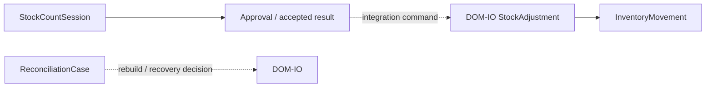
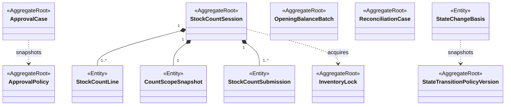
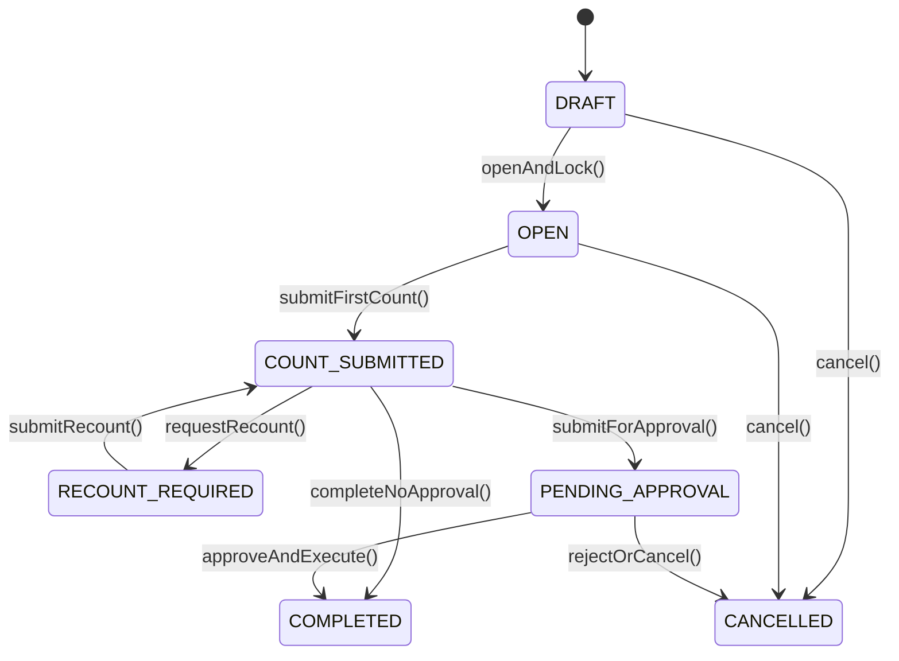
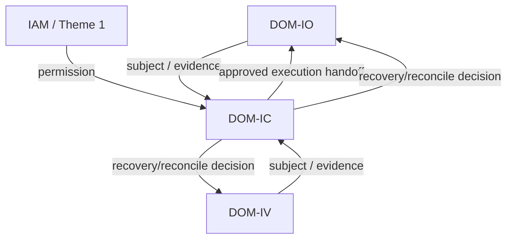

# DOM-IC — Inventory Control

## 1. Trách nhiệm

`DOM-IC` là **Supporting Subdomain** bảo đảm nghiệp vụ kho được phê duyệt, khóa phạm vi và đối soát theo đúng bằng chứng. Domain này không sở hữu movement số lượng hay value movement.

| Sứ mệnh cốt lõi | Trách nhiệm chính | Phạm vi thẩm quyền |
|---|---|---|
| Approval governance | Khóa policy version, route và quyết định maker–checker | Không sửa payload của nghiệp vụ nguồn |
| Scope protection | Khóa phạm vi kiểm kê/đối soát | Không sửa balance trực tiếp |
| Stock count | Quản lý phiên kiểm kê, round đếm, variance và quyết định xử lý | Movement điều chỉnh do `DOM-IO` ghi |
| Opening activation | Kiểm soát batch đầu kỳ và cổng `PREPARING → ACTIVE` | Không cho mutation thường trước activation |
| Reconciliation | Điều tra UNKNOWN/drift/sai lệch và quyết định recovery | Không UPDATE ledger cũ |

## 2. Quyền sở hữu và ranh giới

### 2.1 Domain sở hữu

- `ApprovalPolicy`, `ApprovalCase`.
- `InventoryLock`.
- `StockCountSession`, `StockCountLine`, `CountScopeSnapshot`, `StockCountSubmission`.
- `OpeningBalanceBatch`.
- `ReconciliationCase`.
- `StateTransitionPolicyVersion`, `StateChangeBasis`.

### 2.2 Domain không sở hữu

- Quantity movement, reservation, lot, issue/receipt: `DOM-IO`.
- Receipt valuation, value ledger, cost run, Official Cost: `DOM-IV`.
- Role definition và user lifecycle: IAM/Theme 1.
- PO/SO/invoice/master data: Theme owner tương ứng.

### 2.3 Ranh giới tính nhất quán

- Mutation IC chỉ đổi một Aggregate Root IC trong transaction của nó.
- Approval quyết định **không tự ghi movement**; executor Domain sở hữu phải recheck basis trước commit.
- Count/recount evidence bất biến; không overwrite round cũ.

## 3. Khái niệm chính

### 3.1 Ngôn ngữ chung (Ubiquitous Language)

| Thuật ngữ | Vai trò | Định nghĩa |
|---|---|---|
| ApprovalPolicy | Aggregate Root | Phiên bản policy xác định tuyến/cấp/actor đủ điều kiện |
| ApprovalCase | Aggregate Root | Hồ sơ quyết định bất biến gắn đúng subject/basis |
| InventoryLock | Aggregate Root | Khóa phạm vi nghiệp vụ có owner và lease |
| StockCountSession | Aggregate Root | Phiên kiểm kê tại cut-off và scope đã khóa |
| StockCountSubmission | Child evidence | Một round FIRST/RECOUNT bất biến |
| OpeningBalanceBatch | Aggregate Root | Batch số dư đầu kỳ trước khi inventory active |
| ReconciliationCase | Aggregate Root | Hồ sơ điều tra sai lệch/UNKNOWN/projection drift |
| StateChangeBasis | Immutable basis | Snapshot exact source/policy/quantity trước approval/execution |

### 3.2 Domain Model Overview

## 4. Lifecycle và trạng thái

### 4.1 StockCountSession

### 4.2 OpeningBalanceBatch

`DRAFT → VALIDATED → PENDING_APPROVAL → APPROVED → COMMITTED`; reject/cancel trước commit không tạo opening movement. Chỉ `COMMITTED` mới cho tenant chuyển `PREPARING → ACTIVE` trong cùng commit set.

### 4.3 ReconciliationCase

`OPEN → INVESTIGATING → RESOLVED`; khi thiếu bằng chứng có thể `ESCALATED`, sau đó quay lại `INVESTIGATING` khi có bằng chứng mới.

## 5. Quy tắc và Điều kiện bắt buộc

| Mã | Quy tắc |
|---|---|
| `INV-IC-01` | Mọi action **PHẢI** recheck functional permission và warehouse scope tại thời điểm thực hiện. |
| `INV-IC-02` | Maker/checker **KHÔNG ĐƯỢC** tự duyệt hồ sơ của chính mình khi policy yêu cầu độc lập actor. |
| `INV-IC-03` | Risk/threshold **PHẢI** được tính từ snapshot nghiệp vụ có nguồn; policy chỉ quyết định route/cấp/người duyệt, không được làm thay mutation của Domain nguồn. |
| `INV-IC-04` | Stock count **PHẢI** khóa predicate + materialized keys tại cut-off và bảo vệ cả key mới có thể phát sinh trong phạm vi đã khóa. |
| `INV-IC-05` | Mỗi count/recount **PHẢI** tạo submission bất biến; recount không overwrite first count. |
| `INV-IC-06` | Projection drift **PHẢI** được xử lý bằng đối soát/rebuild từ ledger; không sửa balance tay. |
| `INV-IC-07` | Quick receipt hợp lệ **BẮT BUỘC** tạo `ApprovalCase`; policy chỉ route approver, không có cờ bỏ duyệt. |
| `INV-IC-08` | Dữ liệu tài chính hạn chế **PHẢI** được lọc ở server/API/export/event/log, không chỉ ẩn UI. |
| `INV-IC-09` | Approval **PHẢI** bind immutable subject/basis version; executor phải recheck basis trước commit. |
| `INV-IC-10` | Trước opening commit, inventory ở `PREPARING`; mutation thường **PHẢI** bị chặn. |

## 6. Quan hệ với Domain khác

### 6.1 Context Map

### 6.2 Messaging

- Facts: approval decided, count completed/cancelled, opening committed, reconciliation resolved.
- Handoff cần Domain khác mutate dùng integration command với subject/basis identity; approval fact không tự thực thi movement.

## 7. Entity liên quan

| ID | Khái niệm | Vai trò DDD | Ghi chú |
|---|---|---|---|
| `ENT-IC-01` | ApprovalPolicy | Aggregate Root | Versioned approval policy |
| `ENT-IC-02` | ApprovalCase | Aggregate Root | Snapshot subject/basis + immutable decision |
| `ENT-IC-03` | InventoryLock | Aggregate Root | Scope protection |
| `ENT-IC-04` | StockCountSession | Aggregate Root | Count lifecycle |
| `ENT-IC-05` | StockCountLine | Child Entity | Book/count/variance per canonical key |
| `ENT-IC-06` | OpeningBalanceBatch | Aggregate Root | Activation gate |
| `ENT-IC-07` | ReconciliationCase | Aggregate Root | Investigation/recovery |
| `ENT-IC-08` | CountScopeSnapshot | Child Entity | Frozen count scope |
| `ENT-IC-09` | StockCountSubmission | Child Entity | Immutable count round |
| `ENT-IC-10` | StateTransitionPolicyVersion | Aggregate Root | State-transition policy |
| `ENT-IC-11` | StateChangeBasis | Child Entity | Immutable basis bound to request/approval |

## 8. Quyết định nghiệp vụ chi phối

| Decision ID | Quyết định | Chi phối đối với domain này |
|---|---|---|
| `T7-DR-027` | Quick receipt luôn cần duyệt | ApprovalPolicy/ApprovalCase |
| `T7-DR-035…037`, `174…175` | Count scope, rounds và approval | StockCountSession |
| `T7-DR-069` | Opening activation | OpeningBalanceBatch |
| `T7-DR-079…083`, `179…184` | Permission, maker-checker, immutable basis | Approval/state change |
| `T7-DR-084…090` | Reconciliation và rebuild | ReconciliationCase |

## 9. Điểm chưa chốt

- Chu kỳ kiểm kê tự động/cycle count nâng cao thuộc Phase sau.
- Procedure rebuild projection thuộc work slice lúc review để implement; IC chỉ sở hữu điều kiện và quyết định cho phép thực hiện.
