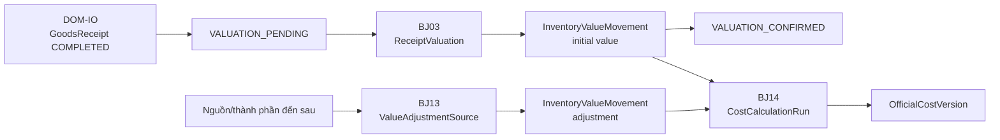
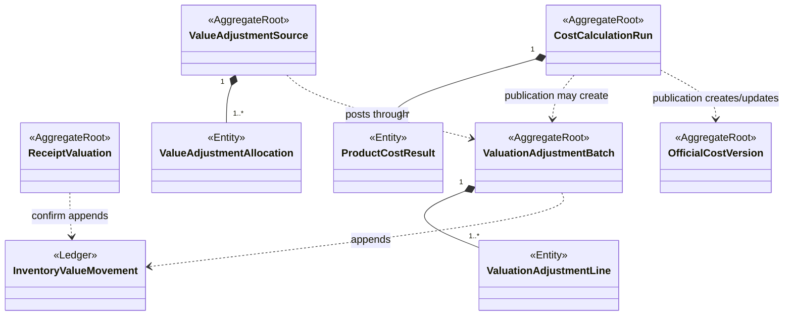
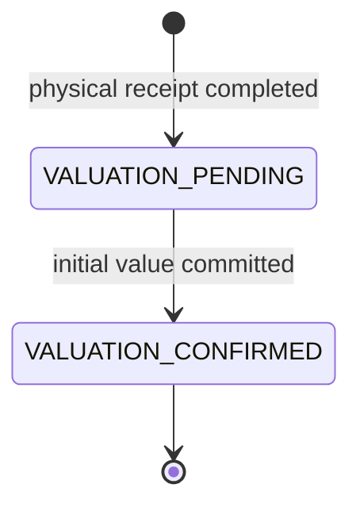
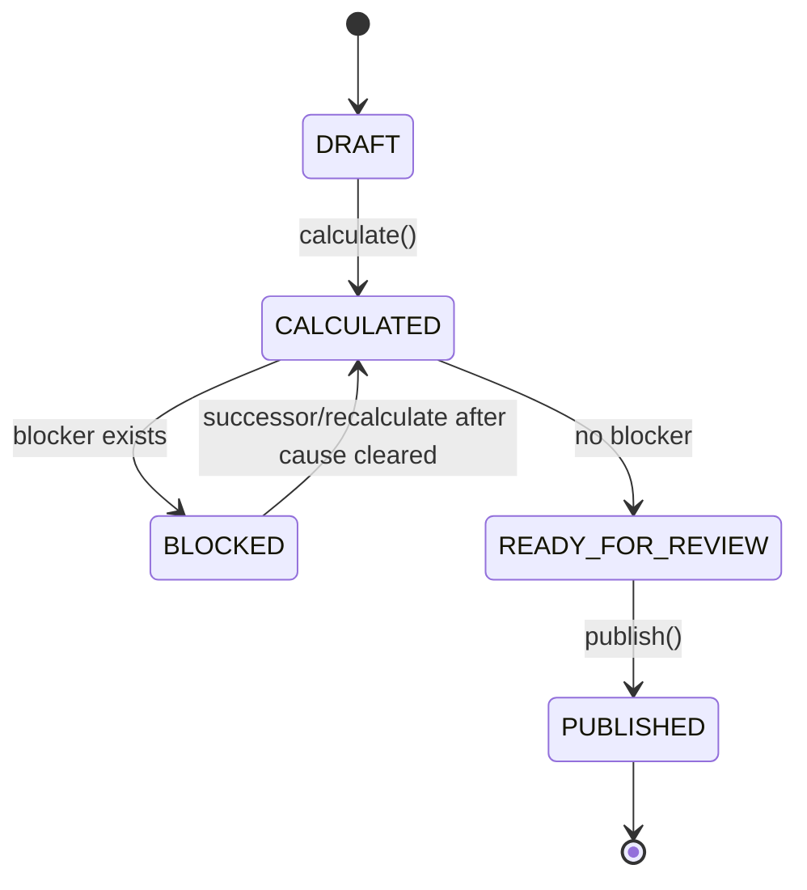
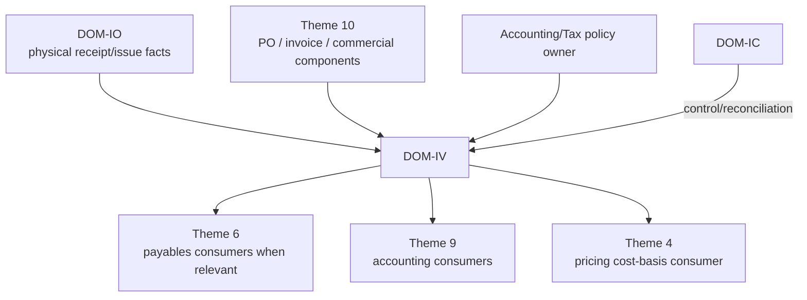

# DOM-IV — Inventory Valuation

## 1. Trách nhiệm

`DOM-IV` là **Core Subdomain** sở hữu sự thật giá trị tồn kho và giá vốn của Theme 7. Domain này xác lập giá trị ban đầu cho hàng đã nhận, ghi mọi điều chỉnh giá trị về sau, tính giá vốn theo chính sách tenant và chỉ tạo `OfficialCostVersion` khi BJ14 công bố.

| Sứ mệnh cốt lõi | Trách nhiệm chính | Phạm vi thẩm quyền |
|---|---|---|
| Initial valuation | Xác lập giá trị nhập ban đầu cho lượng thực nhận | Không sửa PO/hóa đơn/receipt vật lý |
| Value ledger | Append `InventoryValueMovement` cho mọi thay đổi giá trị | Không sửa movement cũ |
| Value adjustment | Ghi thành phần tăng/giảm phát sinh sau initial valuation | Không dùng adjustment để che lỗi nhập liệu |
| Costing | Tính song song hai phương pháp trên cùng fact set | Phương pháp công bố do tenant policy chọn trước |
| Official cost | Công bố version giá vốn chính thức và adjustment cần thiết | BJ03/BJ13 không được tạo Official Cost |

## 2. Quyền sở hữu và ranh giới

### 2.1 Domain sở hữu

- `ReceiptValuation` — giá trị nhập ban đầu + provenance cho exact quantity được căn cứ bao phủ.
- `InventoryValueMovement` — ledger giá trị append-only.
- `ValueAdjustmentSource` + `ValueAdjustmentAllocation` — thành phần tăng/giảm đến sau initial valuation và cách phân bổ.
- `CostCalculationRun` + `ProductCostResult` — run tính/rà soát giá vốn.
- `ValuationAdjustmentBatch` + `ValuationAdjustmentLine` — bút toán điều chỉnh giá trị khi BJ13/BJ14 commit.
- `OfficialCostVersion` — đơn giá chính thức theo tenant + product + hiệu lực.

### 2.2 Domain không sở hữu

| Khái niệm ngoài ranh giới | Owner |
|---|---|
| Receipt quantity, physical state, lot, reservation | `DOM-IO` |
| Approval/reconciliation/lock | `DOM-IC` |
| PO, điều kiện mua, hóa đơn NCC, dispute thương mại | Theme 10 |
| Payables | Theme 6 |
| Accounting ledger/kỳ/chính sách kế toán hoặc tax policy có thẩm quyền | Theme 9 / Accounting owner |
| Product/UOM master | Theme 2 |
| Selling-price policy | Theme 4 |

### 2.3 Ranh giới tính nhất quán

- BJ03 thay đổi valuation axis/value ledger nhưng **không** thay physical state.
- BJ13 append adjustment; không overwrite `ReceiptValuation`.
- BJ14 là owner duy nhất của `OfficialCostVersion`.

## 3. Khái niệm chính

### 3.1 Ngôn ngữ chung (Ubiquitous Language)

| Thuật ngữ | Vai trò | Định nghĩa |
|---|---|---|
| ReceiptValuation | Aggregate Root | Hồ sơ initial value đã xác nhận cho exact quantity được căn cứ bao phủ |
| Căn cứ giá trực tiếp | Concept | Source do Theme 7 cho phép lập cho Quick receipt khi không phụ thuộc Theme 10 |
| DirectCostBasis | Internal Value Model | Mô hình nội bộ gom component/source/tax/FX/allocation; không phải thuật ngữ bắt buộc trên UI |
| InventoryValueMovement | Ledger | Sự thật giá trị append-only |
| ValueAdjustmentSource | Aggregate Root | Một economic component có dấu làm thay đổi giá trị hàng nhập sau BJ03 |
| ValueAdjustmentAllocation | Child Entity | Phần source adjustment được phân bổ tới exact valuation exposure |
| CostCalculationRun | Aggregate Root | Một lần tính/rà soát giá vốn với scope/cut-off/fact set bất biến |
| ProductCostResult | Child Entity | Kết quả hai phương pháp và reconciliation delta cho một Product trong run |
| OfficialCostVersion | Aggregate Root | Đơn giá chính thức được BJ14 công bố theo tenant policy |
| Tax treatment | Concept | Kết quả policy xác định phần thuế/phí được thu hồi và phần tính vào inventory value |
| Dirty cost scope | Concept | Product + posting period cần BJ14 tính lại do valuation facts thay đổi |

### 3.2 Domain Model Overview

## 4. Lifecycle và trạng thái

### 4.1 Valuation axis

Partial chỉ phát sinh khi căn cứ thực sự bao phủ một phần quantity; user không tự chia lượng để định giá.

### 4.2 CostCalculationRun

Run đã tạo không bị sửa để “tính lại”; rerun tạo successor có liên kết.

### 4.3 Append-only value facts

`InventoryValueMovement`, `ReceiptValuation` đã confirm, `ValueAdjustmentAllocation` đã commit và `ProductCostResult` của run là bất biến. Sửa sai tạo correction/adjustment mới, không update lịch sử.

## 5. Quy tắc và Điều kiện bắt buộc

| Mã | Quy tắc |
|---|---|
| `INV-IV-01` | `InventoryValueMovement` **PHẢI** là nguồn sự thật append-only của carrying value; không sửa tay số dư giá trị. |
| `INV-IV-02` | BJ03 **CHỈ** xác lập initial inventory value và dirty scope; **KHÔNG ĐƯỢC** tạo `OfficialCostVersion`. |
| `INV-IV-03` | Quick receipt **PHẢI** hoàn tất BJ03 mà không phụ thuộc Theme 10 khi có căn cứ giá trực tiếp hợp lệ. |
| `INV-IV-04` | Theme 7 **KHÔNG ĐƯỢC** sửa PO/hóa đơn/commercial facts; conflict thương mại thuộc Theme 10 phải được owner giải quyết. |
| `INV-IV-05` | Tax treatment **PHẢI** đến từ policy có thẩm quyền; chỉ phần thuế/phí không thu hồi vào inventory value. User không chọn recoverability trong BJ03. |
| `INV-IV-06` | Initial valuation scope **PHẢI** theo coverage của căn cứ; user không tự chia quantity để thay đổi giá trị/phân bổ. |
| `INV-IV-07` | Thành phần đã đủ căn cứ trước initial confirmation có thể đi BJ03; thành phần đến sau/phát sinh sau **PHẢI** đi BJ13. |
| `INV-IV-08` | BJ13 **PHẢI** hỗ trợ signed adjustment: dương hoặc âm. Forecast/projected benefit **KHÔNG ĐƯỢC** ghi value ledger. |
| `INV-IV-09` | Lỗi nhập liệu sau commit **KHÔNG ĐƯỢC** giả làm BJ13; phải đi correction/BJ11. |
| `INV-IV-10` | Costing method dùng để công bố **PHẢI** lấy từ tenant policy snapshot; người dùng BJ14 không chọn lại method cho từng run. |
| `INV-IV-11` | Hai phương pháp có thể tính song song trên cùng fact set; method không được chọn chỉ dùng đối chiếu và không tự ghi sổ. |
| `INV-IV-12` | BJ14 là owner duy nhất của `OfficialCostVersion`; publish mới tạo version và clear dirty causes đã reconcile. |
| `INV-IV-13` | Official cost scope Phase 1 là tenant + product + base UOM; không tách theo warehouse/lot. |
| `INV-IV-14` | Publish/adjustment chỉ ghi delta cần thiết; không sửa issue/receipt/value movement lịch sử. |

## 6. Quan hệ với Domain khác

### 6.1 Context Map

### 6.2 Messaging

- Inbound commercial components phải có source identity, source version/effective time, scope và trạng thái đủ điều kiện sử dụng.
- Hóa đơn NCC không phải điều kiện bắt buộc của Quick receipt; hóa đơn đến sau có thể tạo adjustment nếu initial value đã commit.
- Outbox fact canonical: initial value confirmed, value adjustment recorded, official cost published; wire name/version thuộc Technical Contract.

## 7. Entity liên quan

| ID | Khái niệm | Vai trò DDD | Ghi chú |
|---|---|---|---|
| `ENT-IV-01` | ReceiptValuation | Aggregate Root | Initial inventory value |
| `ENT-IV-02` | InventoryValueMovement | Ledger | Append-only value fact |
| `ENT-IV-03` | CostCalculationRun | Aggregate Root | Calculate/review/publish lifecycle |
| `ENT-IV-04` | OfficialCostVersion | Aggregate Root | Chỉ BJ14 publication tạo/cập nhật |
| `ENT-IV-05` | ValuationAdjustmentBatch | Aggregate Root | Batch posting delta |
| `ENT-IV-06` | ValuationAdjustmentLine | Child Entity | Signed line-level delta |
| `ENT-IV-07` | ValueAdjustmentSource | Aggregate Root | Generalized từ semantic `LateLandedCost` cũ |
| `ENT-IV-08` | ValueAdjustmentAllocation | Child Entity | Allocation tới valuation exposure |
| `ENT-IV-09` | ProductCostResult | Child Entity | Immutable result per Product/run |

## 8. Quyết định nghiệp vụ chi phối

| Decision ID | Quyết định | Chi phối đối với domain này |
|---|---|---|
| `T7-DR-051`, `185…190` | Initial value, tax treatment, Quick/direct basis, conflict ownership | BJ03 / ReceiptValuation |
| `T7-DR-150…156`, `188` | Basis, UOM, allocation, scope/freshness | Initial valuation consistency |
| `T7-DR-157…163`, `191…193` | Signed value adjustment và allocation | BJ13 |
| `T7-DR-164…173`, `194…195` | Cost run, tenant method, publication, Official Cost ownership | BJ14 |

## 9. Điểm chưa chốt

- Multi-warehouse cost dimension thuộc Phase sau; Phase 1 authority vẫn tenant + product.
- Tax/accounting policy owner có thể phát triển theo Theme 9; `DOM-IV` chỉ consume treatment/result theo contract và không tự trở thành tax engine.
