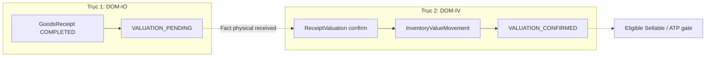
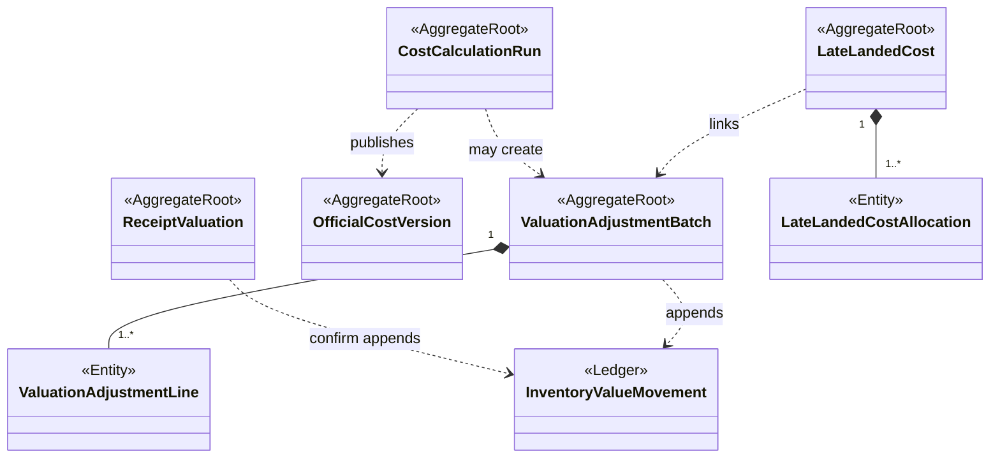
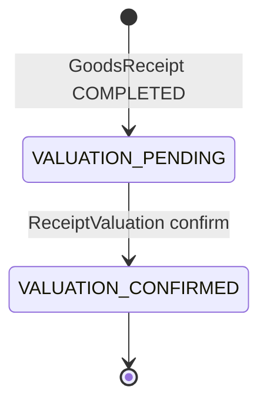
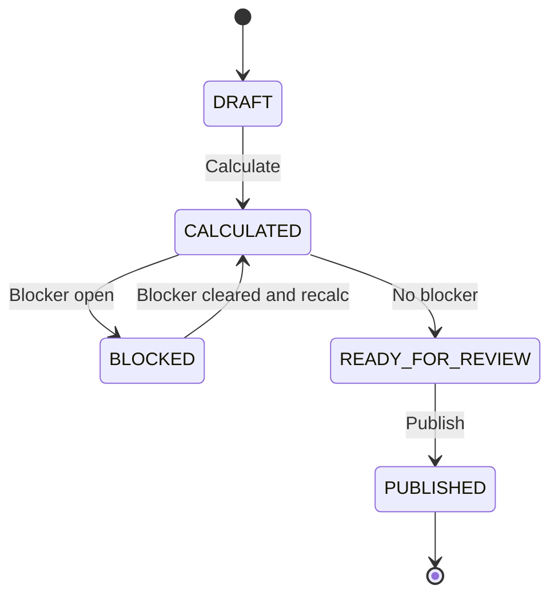
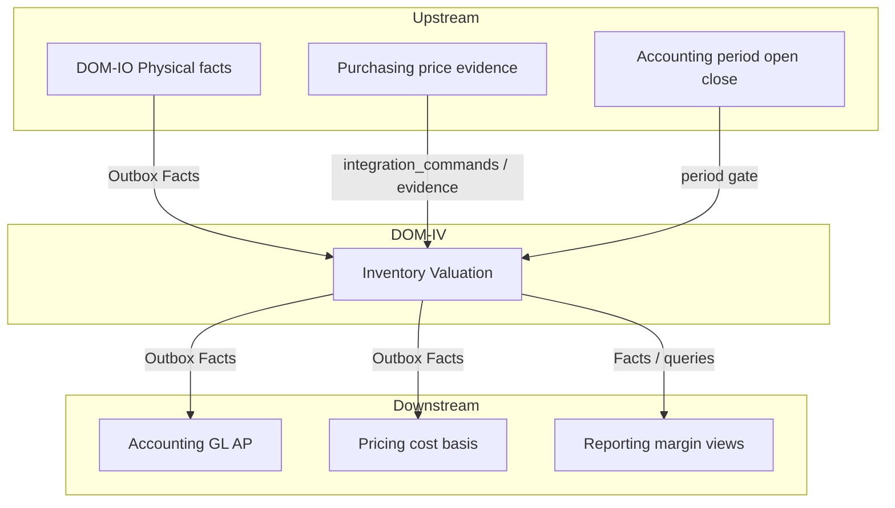

# DOM-IV — Inventory Valuation

## 1. Trách nhiệm

**Core Subdomain** (trục giá trị) của Theme 07 — thẩm quyền duy nhất đối với **giá trị ghi sổ, giá vốn chính thức và điều chỉnh định giá**. Không sở hữu số lượng vật lý, phê duyệt, hay giá bán.

| Sứ mệnh cốt lõi | Trách nhiệm chính | Phạm vi thẩm quyền |
|---|---|---|
| Value Ledger Authority | Sổ cái `InventoryValueMovement` append-only | Sở hữu: value movement. Không: quantity movement / GL posting |
| Direct receipt valuation | Chốt giá nhập thực tế theo scope receipt | Sở hữu: `ReceiptValuation`. Không: sửa PO gốc |
| Official cost | Công bố `OfficialCostVersion` theo tenant + product | Sở hữu: cost version. Không: pricing cost basis / list price |
| Cost calculation | Chạy hai phương pháp bình quân, blocker, publish | Sở hữu: `CostCalculationRun` + adjustment. Không: hủy run đã bắt đầu (Phase 1) |
| Late landed cost | Ghi nhận chi phí mua đến muộn, phân bổ 1..N receipt lines | Sở hữu: late cost + allocation. Không: sửa receipt vật lý |

## 2. Quyền sở hữu và ranh giới

### 2.1 Domain sở hữu

| Khái niệm | Vai trò |
|---|---|
| `ReceiptValuation` | Aggregate Root — bằng chứng và giá trực tiếp theo scope receipt |
| `InventoryValueMovement` | Append-only Ledger — sự thật giá trị |
| `CostCalculationRun` | Aggregate Root — cut-off, hai phương pháp, blocker, publish state |
| `OfficialCostVersion` | Aggregate Root / Versioned fact — đơn giá có hiệu lực |
| `ValuationAdjustmentBatch` + `ValuationAdjustmentLine` | Aggregate Root + Child — COGS true-up / ending / late-cost value-only |
| `LateLandedCost` + `LateLandedCostAllocation` | Aggregate Root + Child — phân bổ chi phí đến muộn |

### 2.2 Domain không sở hữu

| Khái niệm ngoài ranh giới | Owner |
|---|---|
| Quantity movement, reservation, lot physical | DOM-IO |
| Approval / lock / count / reconciliation case | DOM-IC |
| Pricing cost basis, floor/list, promotion | Pricing |
| Purchase discount scenario / projected cost | Purchase scenario |
| AP / GL posting | Accounting |
| Product master / UOM | Catalog |

### 2.3 Ranh giới tính nhất quán & Two-Axis Receipt

- Mỗi mutation valuation chỉ đổi **đúng 1 Aggregate Root** trong 1 transaction.
- Xác nhận giá **không đổi** physical axis; chỉ chuyển `valuation_state` và ghi value movement.

## 3. Khái niệm chính

### 3.1 Ngôn ngữ chung (Ubiquitous Language)

| Thuật ngữ | Vai trò | Định nghĩa |
|---|---|---|
| ReceiptValuation | Aggregate Root | Chốt giá trực tiếp cho lượng receipt đã nhận vật lý |
| InventoryValueMovement | Ledger | Bút toán giá trị append-only |
| CostCalculationRun | Aggregate Root | Kỳ tính giá vốn; hai phương pháp; blocker; publish |
| OfficialCostVersion | Aggregate Root | Đơn giá chính thức theo tenant + product + hiệu lực |
| ValuationAdjustmentBatch | Aggregate Root | Batch điều chỉnh sau chốt / giữa kỳ / late cost |
| ValuationAdjustmentLine | Entity | Dòng true-up / ending / late-cost value-only |
| LateLandedCost | Aggregate Root | Header chi phí mua đến muộn |
| LateLandedCostAllocation | Entity | Phân bổ tới 1..N receipt lines |
| Carrying value | Concept | Tổng value movement có thẩm quyền |
| Initial COGS | Concept | Snapshot official cost tại bàn giao / issue |
| COGS true-up | Concept | Phần chênh sau chốt kỳ — adjustment, không sửa issue gốc |
| Projected cost | Concept | Kịch bản mua — **không** ghi ledger IV |

### 3.2 Domain Model Overview

## 4. Lifecycle và trạng thái

### 4.1 Valuation axis (trên balance IO)

Xác nhận giá **KHÔNG ĐƯỢC** đổi `stock_state` vật lý. ATP chỉ khi `VALUATION_CONFIRMED` và đủ điều kiện bán.

### 4.2 CostCalculationRun

- Phase 1: **KHÔNG ĐƯỢC** cancel run sau khi bắt đầu. Tính lại → run mới có `supersedes_run_id`; **KHÔNG ĐƯỢC** sửa run cũ.
- Publish tạo adjustment batch + official cost versions.

### 4.3 Append-only value ledger

`InventoryValueMovement` không có lifecycle: sinh ra là bất biến. True-up / late cost = bút toán mới, không UPDATE movement gốc.

## 5. Quy tắc và Điều kiện bắt buộc

Mức RFC 2119 — từ cấp độ **IN HOA**. Cross-cutting tổ chức: xem [DOM-COM](DOM-COM.md).

| Mã | Quy tắc |
|---|---|
| INV-IV-01 | `InventoryValueMovement` **PHẢI** là nguồn bất biến của tổng giá trị ghi sổ. Hệ thống **KHÔNG ĐƯỢC** sửa tay carrying value. |
| INV-IV-02 | Official cost **PHẢI** xác định ở tenant + product; **KHÔNG ĐƯỢC** tách theo kho/lô trong Phase 1. |
| INV-IV-03 | Hàng `VALUATION_PENDING` **KHÔNG ĐƯỢC** khả dụng và **KHÔNG ĐƯỢC** có official value movement cho direct cost. |
| INV-IV-04 | Xác nhận giá trực tiếp, value movement và release khả dụng (valuation axis) **BẮT BUỘC** commit cùng nhau. |
| INV-IV-05 | Dòng xuất **PHẢI** chụp official cost version tại bàn giao / issue. |
| INV-IV-06 | Chốt kỳ **CHỈ ĐƯỢC** ghi phần chênh bằng adjustment; hệ thống **KHÔNG ĐƯỢC** update order/issue/value movement gốc. |
| INV-IV-07 | Cost run **KHÔNG ĐƯỢC** publish khi còn blocker có thể đổi lượng/giá trị của kỳ. |
| INV-IV-08 | Projected purchase-discount cost **KHÔNG ĐƯỢC** ghi ledger hoặc dùng làm accounting COGS. |
| INV-IV-09 | Official cost publication **KHÔNG ĐƯỢC** tự thay pricing cost basis hoặc selling price. |
| INV-IV-10 | Pricing cost basis (ngoài IV) **CẦN** có source type/version, actor và effective time khi IV handoff. |
| INV-IV-11 | Receipt vật lý **LUÔN** kết thúc lượng đạt ở `VALUATION_PENDING`; xác nhận direct cost **PHẢI** là command/transaction riêng. |
| INV-IV-12 | Cost run Phase 1 **KHÔNG ĐƯỢC** cancellation; rerun **PHẢI** tạo successor có liên kết và **KHÔNG ĐƯỢC** sửa run cũ. |
| INV-IV-13 | Late-cost component **PHẢI** chống trùng theo khóa nguồn; dữ liệu đến muộn **CHỈ ĐƯỢC** đánh dấu đúng product-period scope `DIRTY`. |

## 6. Quan hệ với Domain khác

### 6.1 Context Map

### 6.2 Messaging

- Facts (outbox): `inventory.receipt_valuation.confirmed.v1`, `inventory.official_cost.published.v1`, `inventory.late_landed_cost.recorded.v1`, …
- **KHÔNG ĐƯỢC** đặt imperative / `*.requested` trên outbox.
- Pricing events (`pricing.cost_basis.published.v1`) **KHÔNG ĐƯỢC** mutate inventory ledger.

## 7. Entity liên quan

Catalog: [`../entities/`](../entities/)

| ID | Khái niệm | Vai trò DDD | Ghi chú |
|---|---|---|---|
| [ENT-IV-01](../entities/ENT-IV-01-ReceiptValuation.md) | ReceiptValuation | Aggregate Root | Direct cost scope |
| [ENT-IV-02](../entities/ENT-IV-02-InventoryValueMovement.md) | InventoryValueMovement | Ledger | Append-only |
| [ENT-IV-03](../entities/ENT-IV-03-CostCalculationRun.md) | CostCalculationRun | Aggregate Root | Cut-off / blocker / publish |
| [ENT-IV-04](../entities/ENT-IV-04-OfficialCostVersion.md) | OfficialCostVersion | Aggregate Root | Effective interval |
| [ENT-IV-05](../entities/ENT-IV-05-ValuationAdjustmentBatch.md) | ValuationAdjustmentBatch | Aggregate Root | Header batch |
| [ENT-IV-06](../entities/ENT-IV-06-ValuationAdjustmentLine.md) | ValuationAdjustmentLine | Child Entity | Line-level trace |
| [ENT-IV-07](../entities/ENT-IV-07-LateLandedCost.md) | LateLandedCost | Aggregate Root | Late cost header |
| [ENT-IV-08](../entities/ENT-IV-08-LateLandedCostAllocation.md) | LateLandedCostAllocation | Child Entity | Allocation lines |
| [ENT-IV-09](../entities/ENT-IV-09-ProductCostResult.md) | ProductCostResult | Immutable result | Kết quả costing theo product trong một CostCalculationRun |

## 8. Quyết định nghiệp vụ chi phối

Nguồn: [`decision-register.md`](../../../01.knowledge/decisions/decision-register.md)

| Decision ID | Quyết định | Chi phối đối với DOM-IV |
|---|---|---|
| T7-DR-020 / T7-DR-021 | Two-axis / direct valuation | Confirm riêng; atomic với value + availability |
| T7-DR-050 | Official cost tenant+product | OfficialCostVersion |
| T7-DR-053 | Snapshot cost tại issue | Initial COGS |
| T7-DR-056 | Period close via adjustment | Không sửa movement gốc |
| T7-DR-058 | Late landed cost | Dirty scope + natural key |
| T7-DR-059 / T7-DR-060 | Cost run blocker / no cancel | CostCalculationRun |
| T7-DR-098 / T7-DR-100 | Pricing vs ledger | Ranh giới Pricing |

## 9. Điểm chưa chốt

- Multi-warehouse cost dimension: Phase sau.
- Chi tiết algorithm bình quân / blocker catalog thuộc architecture / BC — không nhân bản tại đây.
