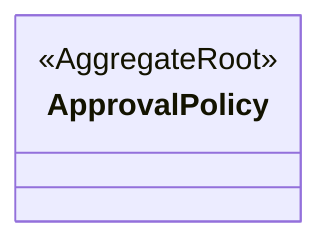
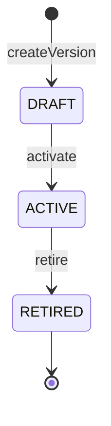

# ENT-IC-01 — ApprovalPolicy

## 1. Định vị nghiệp vụ & ranh giới Aggregate

Phiên bản chính sách xác định **khi nào hồ sơ cần duyệt, cấp duyệt nào và ai đủ điều kiện duyệt**. Policy không thực hiện mutation của nghiệp vụ nguồn và không có cờ bỏ qua duyệt Quick Receipt.

| Thuộc tính | Giá trị |
|---|---|
| Vai trò DDD | `AGGREGATE_ROOT` |
| Aggregate Root | `ApprovalPolicy` |
| Domain sở hữu | `DOM-IC` |
| Domain không sở hữu | Payload receipt/count/state change → Domain nguồn; role/user lifecycle → IAM |

### 1.1 Ranh giới Aggregate (Visual)

## 2. Identity

| Loại | Định danh | Ghi chú |
|---|---|---|
| Surrogate | `approvalPolicyVersionId` | Ổn định suốt vòng đời hồ sơ |
| Business key | `(tenantId, policyId, versionNo)` | Dùng để nhận diện cùng một sự thật nghiệp vụ, không dùng version kỹ thuật để tạo bản ghi trùng |

## 3. Thuộc tính nghiệp vụ thuần túy

| Thuộc tính | Ý nghĩa | Bắt buộc | Ghi chú |
|---|---|---:|---|
| `policyId` | Định danh ổn định của chính sách | Có | Giữ nguyên qua các version |
| `operationType` | Loại nghiệp vụ mà policy áp dụng | Có | Ví dụ Quick Receipt, State Change, Count |
| `reasonSelectors` | Điều kiện nghiệp vụ dùng để route | Có | Không được vô hiệu invariant bắt buộc duyệt |
| `riskSelectors` | Cách xác định mức rủi ro/ngưỡng | Có | Dùng snapshot nguồn |
| `requiredApprovalLevel` | Cấp duyệt tối thiểu | Có | Do policy xác định |
| `eligibleRoleConditions` | Điều kiện actor được phép duyệt | Có | Kết hợp permission/scope |
| `effectiveInterval` | Khoảng hiệu lực | Có | Các version cùng scope không overlap |
| `status` | DRAFT/ACTIVE/RETIRED | Có | Chỉ ACTIVE được resolve |

## 4. Hành vi nghiệp vụ cốt lõi

| Hành vi | Điều kiện / Invariant | Hệ quả / Domain Event |
|---|---|---|
| `createVersion()` | Policy mới kế nhiệm version trước; không sửa version ACTIVE | Tạo policy version DRAFT |
| `activate()` | Không overlap scope; nội dung đầy đủ | PolicyActivated |
| `retire()` | Có version thay thế hoặc policy hết hiệu lực | PolicyRetired |
| `resolveRoute(subjectSnapshot)` | Subject thuộc scope và version đang hiệu lực | Trả required level + eligible actor conditions |

## 5. Vòng đời & chuyển dịch trạng thái

## 6. Domain Events phát sinh

| Event | Khi nào | Ý nghĩa |
|---|---|---|
| `ApprovalPolicyActivated` | activate() | Version bắt đầu có hiệu lực |
| `ApprovalPolicyRetired` | retire() | Version không còn được dùng cho hồ sơ mới |

## 7. Liên kết truy vết

| Loại | ID |
|---|---|
| Domain Foundation | `DOM-IC` |
| Behavioral Contract | `BC-IC-06`, `BC-IC-07`, `BC-IC-09` |
| Use Case | `UC-02-03`, `UC-08-04`, `UC-09-02`, `UC-10-02`, `UC-11-04`, `UC-12-02` |
| Quyết định | `T7-DR-027`, `T7-DR-079`, `T7-DR-080` |
