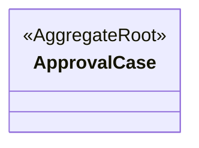
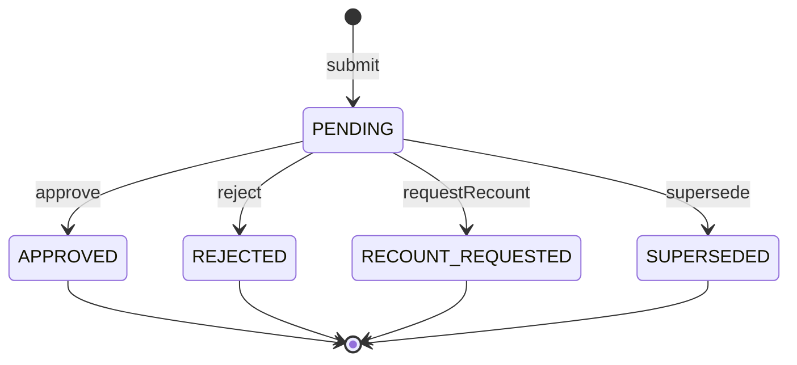

# ENT-IC-02 — ApprovalCase

## 1. Định vị nghiệp vụ & ranh giới Aggregate

Hồ sơ quyết định maker–checker gắn **đúng subject và đúng basis snapshot** tại thời điểm submit. ApprovalCase chỉ ghi quyết định; executor của Domain nguồn phải recheck basis trước mutation.

| Thuộc tính | Giá trị |
|---|---|
| Vai trò DDD | `AGGREGATE_ROOT` |
| Aggregate Root | `ApprovalCase` |
| Domain sở hữu | `DOM-IC` |
| Domain không sở hữu | Subject payload/movement → Domain nguồn; user/role master → IAM |

### 1.1 Ranh giới Aggregate (Visual)

## 2. Identity

| Loại | Định danh | Ghi chú |
|---|---|---|
| Surrogate | `approvalCaseId` | Ổn định suốt vòng đời hồ sơ |
| Business key | `(tenantId, subjectType, subjectId, subjectSnapshotHash, approvalPolicyVersionId)` | Dùng để nhận diện cùng một sự thật nghiệp vụ, không dùng version kỹ thuật để tạo bản ghi trùng |

## 3. Thuộc tính nghiệp vụ thuần túy

| Thuộc tính | Ý nghĩa | Bắt buộc | Ghi chú |
|---|---|---:|---|
| `subjectRef` | Loại và ID đối tượng cần duyệt | Có | Inventory operation hoặc StockCountSession |
| `subjectSnapshot` | Snapshot dữ kiện mà approver thực sự duyệt | Có | Bất biến sau submit |
| `policyVersionRef` | ApprovalPolicy version áp dụng | Có | Không tự đổi giữa case |
| `requesterId` | Maker/người gửi | Có | Được loại khỏi eligible approver khi policy yêu cầu |
| `excludedActorIds` | Actor không được phép quyết định | Có | Maker/count participants… |
| `riskSnapshot` | Giá trị/risk dùng để route | Theo policy | Bất biến trong case |
| `eligibleApproversSnapshot` | Tập actor/condition đủ điều kiện tại submit | Có | Server recheck quyền khi decide |
| `decision` | APPROVE/REJECT/REQUEST_RECOUNT… | Khi đóng case | Không sửa sau quyết định |
| `decisionReason` | Lý do quyết định | Theo loại decision | Reject/recount thường bắt buộc |
| `status` | PENDING/DECIDED/SUPERSEDED | Có | Một case cũ có thể bị supersede khi basis đổi |

## 4. Hành vi nghiệp vụ cốt lõi

| Hành vi | Điều kiện / Invariant | Hệ quả / Domain Event |
|---|---|---|
| `submit()` | Subject/basis/policy current; actor được phép gửi | ApprovalCaseSubmitted |
| `approve()` | Actor eligible và khác maker khi bắt buộc | ApprovalCaseApproved |
| `reject(reason)` | Actor eligible; reason hợp lệ | ApprovalCaseRejected |
| `requestRecount(reason)` | Chỉ subject stock count và policy cho phép | ApprovalRecountRequested |
| `supersede()` | Basis thay đổi hoặc case mới kế nhiệm | ApprovalCaseSuperseded |

## 5. Vòng đời & chuyển dịch trạng thái

## 6. Domain Events phát sinh

| Event | Khi nào | Ý nghĩa |
|---|---|---|
| `ApprovalCaseSubmitted` | submit() | Hồ sơ đã khóa basis và chờ quyết định |
| `ApprovalCaseApproved` | approve() | Decision APPROVE đã ghi |
| `ApprovalCaseRejected` | reject() | Decision REJECT đã ghi |
| `ApprovalRecountRequested` | requestRecount() | Yêu cầu round đếm lại |
| `ApprovalCaseSuperseded` | supersede() | Case cũ không còn dùng để execute |

## 7. Liên kết truy vết

| Loại | ID |
|---|---|
| Domain Foundation | `DOM-IC` |
| Behavioral Contract | `BC-IC-06`, `BC-IC-07`, `BC-IC-09` |
| Use Case | `UC-02-03`, `UC-08-04`, `UC-09-02`, `UC-10-02`, `UC-11-04`, `UC-12-02` |
| Quyết định | `T7-DR-079`, `T7-DR-080`, `T7-DR-175`, `T7-DR-184` |
