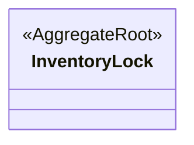
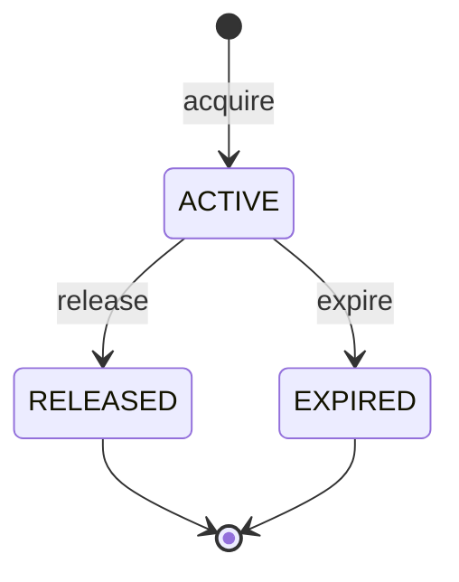

# ENT-IC-03 — InventoryLock

## 1. Định vị nghiệp vụ & ranh giới Aggregate

Khóa nghiệp vụ bảo vệ một warehouse scope trong kiểm kê/đối soát. Lock giữ owner, phạm vi đã chuẩn hóa và cut-off; không phải cách sửa hoặc “đóng băng” balance bằng UPDATE.

| Thuộc tính | Giá trị |
|---|---|
| Vai trò DDD | `AGGREGATE_ROOT` |
| Aggregate Root | `InventoryLock` |
| Domain sở hữu | `DOM-IC` |
| Domain không sở hữu | Balance/movement → DOM-IO; count lifecycle → StockCountSession |

### 1.1 Ranh giới Aggregate (Visual)

## 2. Identity

| Loại | Định danh | Ghi chú |
|---|---|---|
| Surrogate | `lockId` | Ổn định suốt vòng đời hồ sơ |
| Business key | `(tenantId, warehouseId, lockType, ownerType, ownerId)` | Dùng để nhận diện cùng một sự thật nghiệp vụ, không dùng version kỹ thuật để tạo bản ghi trùng |

## 3. Thuộc tính nghiệp vụ thuần túy

| Thuộc tính | Ý nghĩa | Bắt buộc | Ghi chú |
|---|---|---:|---|
| `warehouseScope` | Kho được bảo vệ | Có | Phase 1 theo kho mặc định |
| `lockType` | Mục đích khóa | Có | COUNT/RECONCILIATION… |
| `ownerRef` | Aggregate/case sở hữu lock | Có | Không có lock vô chủ |
| `scopeSnapshot` | Predicate + materialized keys | Có | Bất biến sau acquire |
| `cutoffLedgerSequence` | Mốc ledger tại thời điểm khóa | Có | Dùng để rebuild/count |
| `lease` | Thời điểm acquire/expire | Có | Hết lease không tự hợp thức mutation |
| `status` | ACTIVE/RELEASED/EXPIRED | Có | Chỉ ACTIVE chặn mutation |

## 4. Hành vi nghiệp vụ cốt lõi

| Hành vi | Điều kiện / Invariant | Hệ quả / Domain Event |
|---|---|---|
| `acquire()` | Không conflict với lock active khác cùng scope | InventoryLockAcquired |
| `release(reason)` | Owner hoặc actor có quyền; lý do hợp lệ | InventoryLockReleased |
| `expire()` | Lease hết theo policy | InventoryLockExpired |

## 5. Vòng đời & chuyển dịch trạng thái

## 6. Domain Events phát sinh

| Event | Khi nào | Ý nghĩa |
|---|---|---|
| `InventoryLockAcquired` | acquire() | Scope bắt đầu được bảo vệ |
| `InventoryLockReleased` | release() | Scope được mở lại có kiểm soát |
| `InventoryLockExpired` | expire() | Lease kết thúc theo policy |

## 7. Liên kết truy vết

| Loại | ID |
|---|---|
| Domain Foundation | `DOM-IC` |
| Behavioral Contract | `BC-IC-01`, `BC-IC-02` |
| Use Case | `UC-08-01`, `UC-08-05`, `UC-16-02`, `UC-16-04` |
| Quyết định | `T7-DR-035`, `T7-DR-084` |
