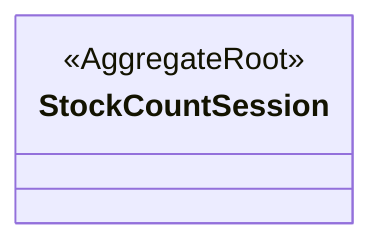
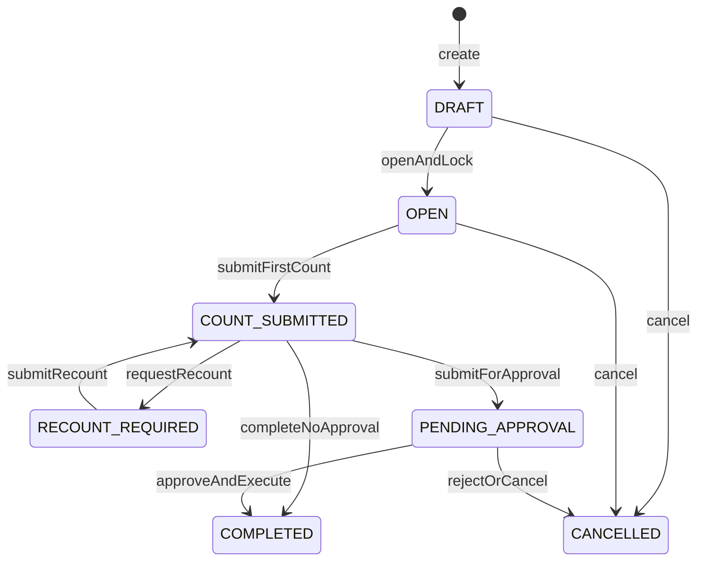

# ENT-IC-04 — StockCountSession

## 1. Định vị nghiệp vụ & ranh giới Aggregate

Phiên kiểm kê quản lý cut-off, phạm vi đã khóa, người đếm, các round đếm bất biến và kết quả variance đến khi hoàn tất/cancel.

| Thuộc tính | Giá trị |
|---|---|
| Vai trò DDD | `AGGREGATE_ROOT` |
| Aggregate Root | `StockCountSession` |
| Domain sở hữu | `DOM-IC` |
| Domain không sở hữu | InventoryMovement điều chỉnh → DOM-IO; ApprovalCase → DOM-IC nhưng aggregate riêng |

### 1.1 Ranh giới Aggregate (Visual)

## 2. Identity

| Loại | Định danh | Ghi chú |
|---|---|---|
| Surrogate | `sessionId` | Ổn định suốt vòng đời hồ sơ |
| Business key | `(tenantId, warehouseId, countScopeSnapshotId, cutoffLedgerSequence)` | Dùng để nhận diện cùng một sự thật nghiệp vụ, không dùng version kỹ thuật để tạo bản ghi trùng |

## 3. Thuộc tính nghiệp vụ thuần túy

| Thuộc tính | Ý nghĩa | Bắt buộc | Ghi chú |
|---|---|---:|---|
| `countScopeSnapshotRef` | Phạm vi kiểm kê canonical | Có | Không đổi sau open |
| `cutoffLedgerSequence` | Mốc sổ dùng làm book quantity | Có | Khóa khi open |
| `assignedCounter` | Người được giao đếm | Có | Có assignment snapshot |
| `lockRef` | InventoryLock bảo vệ scope | Có khi OPEN | Phải active đến khi kết thúc |
| `latestSubmissionRef` | Round đếm mới nhất | Sau submit | Không overwrite submission cũ |
| `approvalCaseRef` | Case duyệt variance hiện hành | Khi cần duyệt | Case cũ supersede nếu recount |
| `status` | Lifecycle của phiên | Có | DRAFT/OPEN/… |

## 4. Hành vi nghiệp vụ cốt lõi

| Hành vi | Điều kiện / Invariant | Hệ quả / Domain Event |
|---|---|---|
| `openAndLock()` | Scope hợp lệ; acquire lock thành công | StockCountOpened |
| `submitFirstCount()` | OPEN; actor đúng assignment | StockCountSubmitted |
| `requestRecount()` | Variance/policy yêu cầu | StockCountRecountRequired |
| `submitRecount()` | RECOUNT_REQUIRED; round mới bất biến | StockCountRecountSubmitted |
| `submitForApproval()` | Variance cần maker-checker | StockCountApprovalRequested |
| `complete()` | Decision hợp lệ; adjustment execution thành công nếu cần | StockCountCompleted |
| `cancel(reason)` | Chưa COMPLETED; actor có quyền | StockCountCancelled |

## 5. Vòng đời & chuyển dịch trạng thái

## 6. Domain Events phát sinh

| Event | Khi nào | Ý nghĩa |
|---|---|---|
| `StockCountOpened` | openAndLock() | Scope/cut-off đã khóa |
| `StockCountSubmitted` | submitFirstCount() | First round đã ghi |
| `StockCountRecountSubmitted` | submitRecount() | Recount round đã ghi |
| `StockCountCompleted` | complete() | Kết quả kiểm kê đã final |
| `StockCountCancelled` | cancel() | Phiên dừng không ghi adjustment mới |

## 7. Liên kết truy vết

| Loại | ID |
|---|---|
| Domain Foundation | `DOM-IC` |
| Behavioral Contract | `BC-IC-01`, `BC-IC-02`, `BC-IC-03` |
| Use Case | `UC-08-01`, `UC-08-02`, `UC-08-03`, `UC-08-04`, `UC-08-05` |
| Quyết định | `T7-DR-035`, `T7-DR-036`, `T7-DR-037`, `T7-DR-174`, `T7-DR-175` |
