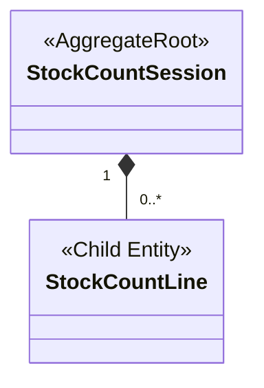

# ENT-IC-05 — StockCountLine

## 1. Định vị nghiệp vụ & ranh giới Aggregate

Dòng kiểm kê đại diện một canonical physical-count key trong `StockCountSession`; giữ book quantity tại cut-off, kết quả đếm cuối và variance được chấp nhận.

| Thuộc tính | Giá trị |
|---|---|
| Vai trò DDD | `CHILD_ENTITY` |
| Aggregate Root | `StockCountSession` |
| Domain sở hữu | `DOM-IC` |
| Domain không sở hữu | Movement/balance current → DOM-IO; giá trị adjustment → DOM-IV khi cần |

### 1.1 Ranh giới Aggregate (Visual)

## 2. Identity

| Loại | Định danh | Ghi chú |
|---|---|---|
| Surrogate | `stockCountLineId` | Ổn định suốt vòng đời hồ sơ |
| Business key | `(sessionId, physicalCountKey)` | Dùng để nhận diện cùng một sự thật nghiệp vụ, không dùng version kỹ thuật để tạo bản ghi trùng |

## 3. Thuộc tính nghiệp vụ thuần túy

| Thuộc tính | Ý nghĩa | Bắt buộc | Ghi chú |
|---|---|---:|---|
| `physicalCountKey` | Product + stock state + lot identity trong scope | Có | Ổn định trong session |
| `bookQuantityBase` | Số lượng sổ tại cut-off | Có | Không thay đổi theo movement sau cut-off |
| `firstSubmissionRef` | Round đếm đầu tiên | Sau first count | Immutable ref |
| `latestRecountRef` | Round recount mới nhất | Nếu có | Không mất round trước |
| `finalCountQuantityBase` | Số lượng cuối được chấp nhận | Khi finalize | Theo base UOM |
| `varianceQuantityBase` | Final count − book quantity | Khi finalize | Dẫn xuất |
| `valueBasisRef` | Căn cứ giá trị cho surplus/shortage khi cần | Theo variance | Không tự quyết Official Cost |
| `adjustmentOperationRef` | Operation điều chỉnh đã commit | Khi có variance | DOM-IO owner |

## 4. Hành vi nghiệp vụ cốt lõi

| Hành vi | Điều kiện / Invariant | Hệ quả / Domain Event |
|---|---|---|
| `applySubmission()` | Submission thuộc đúng session/round và chứa key | Cập nhật projection first/latest ref |
| `finalizeCount()` | Đủ evidence và decision | Khóa final count/variance |
| `bindAdjustment()` | Adjustment operation đã commit | Liên kết kết quả kiểm kê với movement |

## 5. Vòng đời & chuyển dịch trạng thái

Thực thể không có lifecycle mutable riêng sau khi được ghi nhận. Bản ghi đã commit là bất biến; thay đổi nghiệp vụ tạo fact/version/adjustment mới.

## 6. Domain Events phát sinh

| Event | Khi nào | Ý nghĩa |
|---|---|---|
| — | Không phát event riêng | Event được phát bởi Aggregate Root sở hữu. Mapping wire từ commit set thuộc work slice lúc review để implement |

## 7. Liên kết truy vết

| Loại | ID |
|---|---|
| Domain Foundation | `DOM-IC` |
| Behavioral Contract | `BC-IC-03` |
| Use Case | `UC-08-02`, `UC-08-03`, `UC-08-04` |
| Quyết định | `T7-DR-036`, `T7-DR-174` |
