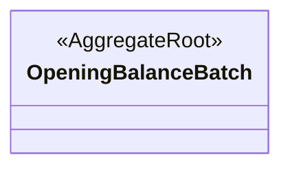
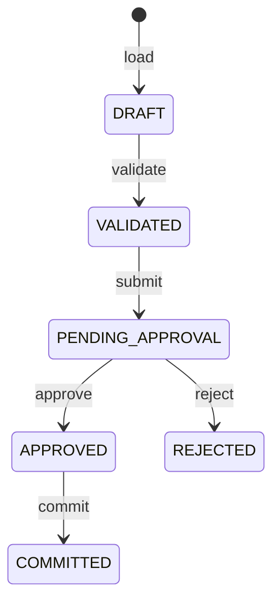

# ENT-IC-06 — OpeningBalanceBatch

## 1. Định vị nghiệp vụ & ranh giới Aggregate

Batch khởi tạo số dư đầu kỳ dùng để kiểm tra, duyệt và commit toàn bộ opening quantity/value trước khi inventory chuyển từ `PREPARING` sang `ACTIVE`.

| Thuộc tính | Giá trị |
|---|---|
| Vai trò DDD | `AGGREGATE_ROOT` |
| Aggregate Root | `OpeningBalanceBatch` |
| Domain sở hữu | `DOM-IC` |
| Domain không sở hữu | Movement/value movement sau commit → DOM-IO/DOM-IV; source master → owner tương ứng |

### 1.1 Ranh giới Aggregate (Visual)

## 2. Identity

| Loại | Định danh | Ghi chú |
|---|---|---|
| Surrogate | `batchId` | Ổn định suốt vòng đời hồ sơ |
| Business key | `(tenantId, baselineId)` | Dùng để nhận diện cùng một sự thật nghiệp vụ, không dùng version kỹ thuật để tạo bản ghi trùng |

## 3. Thuộc tính nghiệp vụ thuần túy

| Thuộc tính | Ý nghĩa | Bắt buộc | Ghi chú |
|---|---|---:|---|
| `baselineId` | Định danh baseline đầu kỳ | Có | Không tái sử dụng cho batch khác |
| `cutoffAt` | Mốc nghiệp vụ của opening | Có | Cùng baseline |
| `scopeSnapshot` | Phạm vi Product/kho được nạp | Có | Bất biến sau validate |
| `sourceReference` | Nguồn file/dataset + hash | Có | Dùng audit, không phải domain owner |
| `controlTotals` | Tổng quantity/value để đối chiếu | Có | Phải cân trước submit |
| `approvalCaseRef` | Case duyệt batch | Khi policy yêu cầu | Maker-checker |
| `committedOperationRefs` | Opening operations đã commit | Khi COMMITTED | Trace IO/IV |
| `immutableReportRef` | Báo cáo migration cuối | Khi COMMITTED | Không sửa sau commit |
| `status` | DRAFT/VALIDATED/PENDING_APPROVAL/APPROVED/COMMITTED/REJECTED | Có | Lifecycle batch |

## 4. Hành vi nghiệp vụ cốt lõi

| Hành vi | Điều kiện / Invariant | Hệ quả / Domain Event |
|---|---|---|
| `loadDraft()` | Tenant đang PREPARING | OpeningBalanceBatchCreated |
| `validate()` | Schema, master, totals và negative scope hợp lệ | OpeningBalanceValidated |
| `submitForApproval()` | VALIDATED; đủ evidence | OpeningBalanceApprovalRequested |
| `approve()` | ApprovalCase hợp lệ | OpeningBalanceApproved |
| `commit()` | APPROVED; all-or-nothing IO+IV+activation contract | OpeningBalanceCommitted |
| `reject(reason)` | Chưa COMMITTED | OpeningBalanceRejected |

## 5. Vòng đời & chuyển dịch trạng thái

## 6. Domain Events phát sinh

| Event | Khi nào | Ý nghĩa |
|---|---|---|
| `OpeningBalanceValidated` | validate() | Batch đạt kiểm tra |
| `OpeningBalanceCommitted` | commit() | Opening facts đã ghi và inventory active |
| `OpeningBalanceRejected` | reject() | Batch không được commit |

## 7. Liên kết truy vết

| Loại | ID |
|---|---|
| Domain Foundation | `DOM-IC` |
| Behavioral Contract | `BC-IC-04`, `BC-IC-05` |
| Use Case | `UC-12-01`, `UC-12-02`, `UC-12-03` |
| Quyết định | `T7-DR-069`, `T7-DR-073` |
