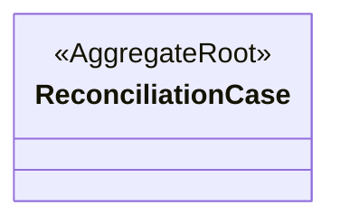
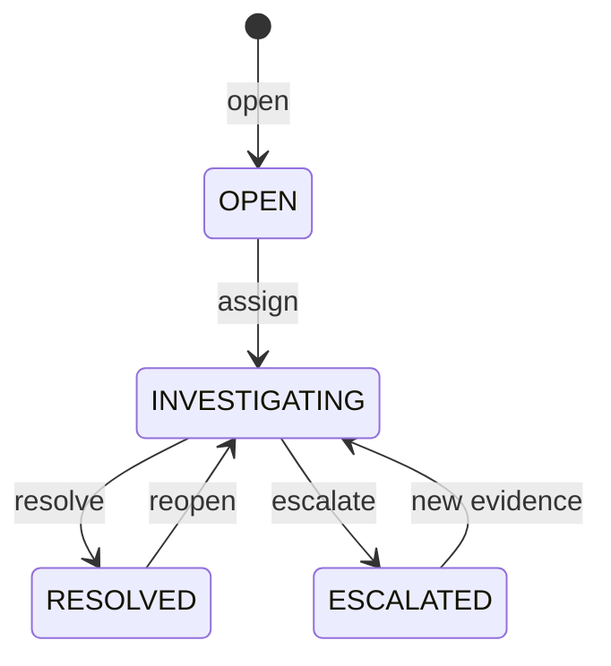

# ENT-IC-07 — ReconciliationCase

## 1. Định vị nghiệp vụ & ranh giới Aggregate

Hồ sơ điều tra một sai lệch có thể ảnh hưởng độ tin cậy của tồn kho/giá trị hoặc finality của operation. Case giữ evidence và quyết định recovery; không tự sửa ledger.

| Thuộc tính | Giá trị |
|---|---|
| Vai trò DDD | `AGGREGATE_ROOT` |
| Aggregate Root | `ReconciliationCase` |
| Domain sở hữu | `DOM-IC` |
| Domain không sở hữu | Movement/value movement/correction execution → DOM-IO/DOM-IV |

### 1.1 Ranh giới Aggregate (Visual)

## 2. Identity

| Loại | Định danh | Ghi chú |
|---|---|---|
| Surrogate | `caseId` | Ổn định suốt vòng đời hồ sơ |
| Business key | `(tenantId, caseType, protectedScope, detectedFactIdentity)` | Dùng để nhận diện cùng một sự thật nghiệp vụ, không dùng version kỹ thuật để tạo bản ghi trùng |

## 3. Thuộc tính nghiệp vụ thuần túy

| Thuộc tính | Ý nghĩa | Bắt buộc | Ghi chú |
|---|---|---:|---|
| `caseType` | Loại sai lệch/UNKNOWN/drift | Có | Quyết định checklist/evidence |
| `severity` | Mức độ ảnh hưởng | Có | Dùng ưu tiên/escalation |
| `protectedScope` | Kho/Product/operation/period liên quan | Có | Có thể bind InventoryLock |
| `expectedEvidence` | Evidence hệ thống kỳ vọng | Có | Không phải fact giả |
| `actualEvidence` | Evidence đã thu thập | Có thể rỗng lúc mở | Append có audit |
| `assignee` | Người/nhóm chịu trách nhiệm | Có | Có thể chuyển assignment theo policy |
| `resolution` | Kết luận + evidence | Khi RESOLVED | Phải giải thích được |
| `status` | OPEN/INVESTIGATING/ESCALATED/RESOLVED | Có | Không close khi thiếu evidence |

## 4. Hành vi nghiệp vụ cốt lõi

| Hành vi | Điều kiện / Invariant | Hệ quả / Domain Event |
|---|---|---|
| `open()` | Phát hiện discrepancy chưa có case active trùng | ReconciliationCaseOpened |
| `startInvestigation()` | Có owner/assignee | ReconciliationInvestigationStarted |
| `addEvidence()` | Evidence có nguồn và thuộc scope | EvidenceAttached |
| `resolve()` | Đủ evidence và recovery result rõ | ReconciliationResolved |
| `escalate()` | Thiếu evidence/quyền hoặc rủi ro vượt thẩm quyền | ReconciliationEscalated |
| `reopen()` | Có evidence mới làm thay đổi kết luận | ReconciliationReopened |

## 5. Vòng đời & chuyển dịch trạng thái

## 6. Domain Events phát sinh

| Event | Khi nào | Ý nghĩa |
|---|---|---|
| `ReconciliationCaseOpened` | open() | Case cần điều tra |
| `ReconciliationResolved` | resolve() | Kết luận và recovery đã rõ |
| `ReconciliationEscalated` | escalate() | Cần owner/cấp xử lý khác |

## 7. Liên kết truy vết

| Loại | ID |
|---|---|
| Domain Foundation | `DOM-IC` |
| Behavioral Contract | `BC-IC-08` |
| Use Case | `UC-16-01`, `UC-16-02`, `UC-16-03`, `UC-16-04`, `UC-17-01` |
| Quyết định | `T7-DR-084`, `T7-DR-090` |
