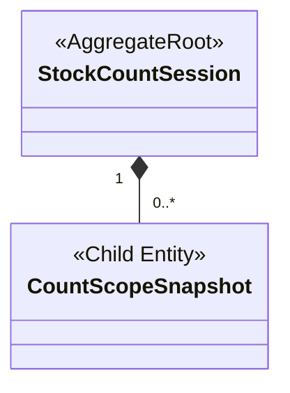

# ENT-IC-08 — CountScopeSnapshot

## 1. Định vị nghiệp vụ & ranh giới Aggregate

Snapshot bất biến của phạm vi kiểm kê tại thời điểm mở session. Nó trả lời chính xác “đang kiểm kê những key nào và theo predicate nào” để count/lock/recount cùng một scope.

| Thuộc tính | Giá trị |
|---|---|
| Vai trò DDD | `CHILD_ENTITY` |
| Aggregate Root | `StockCountSession` |
| Domain sở hữu | `DOM-IC` |
| Domain không sở hữu | Product/lot master current → owner master; balance current → DOM-IO |

### 1.1 Ranh giới Aggregate (Visual)

## 2. Identity

| Loại | Định danh | Ghi chú |
|---|---|---|
| Surrogate | `countScopeSnapshotId` | Ổn định suốt vòng đời hồ sơ |
| Business key | `(sessionId, scopeHash)` | Dùng để nhận diện cùng một sự thật nghiệp vụ, không dùng version kỹ thuật để tạo bản ghi trùng |

## 3. Thuộc tính nghiệp vụ thuần túy

| Thuộc tính | Ý nghĩa | Bắt buộc | Ghi chú |
|---|---|---:|---|
| `warehouseId` | Kho được kiểm kê | Có | Cùng session |
| `scopeType` | Toàn kho / subset theo policy | Có | Không đổi sau open |
| `normalizedPredicate` | Predicate canonical | Có | Dùng để bảo vệ future keys |
| `resolvedProductIds` | Product membership tại snapshot | Có | Snapshot |
| `resolvedLotKeys` | Lot membership nếu phạm vi cần | Theo tracking | Snapshot |
| `sourceMasterVersions` | Version master dùng để resolve scope | Có | Dùng freshness/audit |
| `scopeHash` | Hash semantic của scope | Có | Bind lock/session |

## 4. Hành vi nghiệp vụ cốt lõi

| Hành vi | Điều kiện / Invariant | Hệ quả / Domain Event |
|---|---|---|
| `freeze()` | Scope/predicate hợp lệ và resolve được | CountScopeFrozen |

## 5. Vòng đời & chuyển dịch trạng thái

Thực thể không có lifecycle mutable riêng sau khi được ghi nhận. Bản ghi đã commit là bất biến; thay đổi nghiệp vụ tạo fact/version/adjustment mới.

## 6. Domain Events phát sinh

| Event | Khi nào | Ý nghĩa |
|---|---|---|
| `CountScopeFrozen` | freeze() | Scope canonical được khóa cho session |

## 7. Liên kết truy vết

| Loại | ID |
|---|---|
| Domain Foundation | `DOM-IC` |
| Behavioral Contract | `BC-IC-01` |
| Use Case | `UC-08-01` |
| Quyết định | `T7-DR-035`, `T7-DR-174` |
