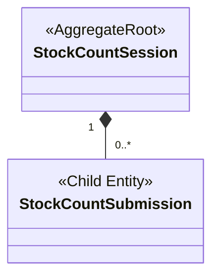

# ENT-IC-09 — StockCountSubmission

## 1. Định vị nghiệp vụ & ranh giới Aggregate

Bằng chứng bất biến của một round đếm `FIRST` hoặc `RECOUNT`. Submission giữ actor/assignment và observations; recount luôn tạo record mới.

| Thuộc tính | Giá trị |
|---|---|
| Vai trò DDD | `CHILD_ENTITY` |
| Aggregate Root | `StockCountSession` |
| Domain sở hữu | `DOM-IC` |
| Domain không sở hữu | Final variance/adjustment → StockCountSession/DOM-IO |

### 1.1 Ranh giới Aggregate (Visual)

## 2. Identity

| Loại | Định danh | Ghi chú |
|---|---|---|
| Surrogate | `submissionId` | Ổn định suốt vòng đời hồ sơ |
| Business key | `(sessionId, roundNo)` | Dùng để nhận diện cùng một sự thật nghiệp vụ, không dùng version kỹ thuật để tạo bản ghi trùng |

## 3. Thuộc tính nghiệp vụ thuần túy

| Thuộc tính | Ý nghĩa | Bắt buộc | Ghi chú |
|---|---|---:|---|
| `roundNo` | Số thứ tự round | Có | Tăng đơn điệu trong session |
| `roundType` | FIRST hoặc RECOUNT | Có | Không thay sau submit |
| `predecessorSubmissionRef` | Round trước nếu recount | Khi RECOUNT | Trace chain |
| `actorId` | Người thực hiện round | Có | Phải đúng assignment |
| `assignmentSnapshot` | Assignment áp dụng | Có | Không suy từ current assignment về sau |
| `submittedAt` | Thời điểm nộp bằng chứng | Có | Audit |
| `lineObservations` | Các quantity quan sát theo count key | Có | Immutable sau submit |

## 4. Hành vi nghiệp vụ cốt lõi

| Hành vi | Điều kiện / Invariant | Hệ quả / Domain Event |
|---|---|---|
| `submit()` | Actor/assignment đúng; observations hợp lệ | StockCountSubmissionRecorded |

## 5. Vòng đời & chuyển dịch trạng thái

Thực thể không có lifecycle mutable riêng sau khi được ghi nhận. Bản ghi đã commit là bất biến; thay đổi nghiệp vụ tạo fact/version/adjustment mới.

## 6. Domain Events phát sinh

| Event | Khi nào | Ý nghĩa |
|---|---|---|
| `StockCountSubmissionRecorded` | submit() | Một round count/recount đã được ghi bất biến |

## 7. Liên kết truy vết

| Loại | ID |
|---|---|
| Domain Foundation | `DOM-IC` |
| Behavioral Contract | `BC-IC-03` |
| Use Case | `UC-08-02`, `UC-08-03` |
| Quyết định | `T7-DR-174` |
