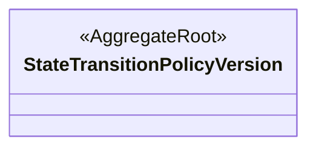
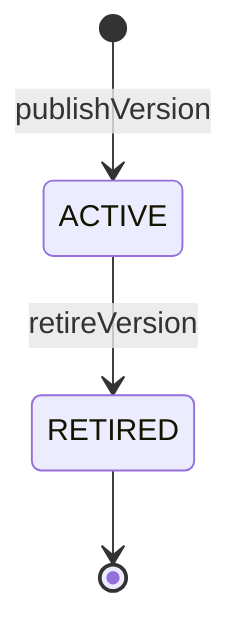

# ENT-IC-10 — StateTransitionPolicyVersion

## 1. Định vị nghiệp vụ & ranh giới Aggregate

Phiên bản bất biến của chính sách cho phép chuyển trạng thái hàng giữa các stock state, gồm điều kiện, approval/evidence requirement và hiệu lực.

| Thuộc tính | Giá trị |
|---|---|
| Vai trò DDD | `AGGREGATE_ROOT` |
| Aggregate Root | `StateTransitionPolicyVersion` |
| Domain sở hữu | `DOM-IC` |
| Domain không sở hữu | Stock state movement → DOM-IO; Product policy master → Theme 2 nếu là nguồn phân loại |

### 1.1 Ranh giới Aggregate (Visual)

## 2. Identity

| Loại | Định danh | Ghi chú |
|---|---|---|
| Surrogate | `stateTransitionPolicyVersionId` | Ổn định suốt vòng đời hồ sơ |
| Business key | `(tenantId, policyCode, versionNo)` | Dùng để nhận diện cùng một sự thật nghiệp vụ, không dùng version kỹ thuật để tạo bản ghi trùng |

## 3. Thuộc tính nghiệp vụ thuần túy

| Thuộc tính | Ý nghĩa | Bắt buộc | Ghi chú |
|---|---|---:|---|
| `policyCode` | Định danh ổn định của policy | Có | Giữ qua version |
| `effectiveInterval` | Khoảng hiệu lực | Có | Không overlap cùng code |
| `transitionRules` | Tập from→to + điều kiện | Có | Canonical rule set |
| `policyHash` | Dấu vết semantic của version | Có | Bind StateChangeBasis |

## 4. Hành vi nghiệp vụ cốt lõi

| Hành vi | Điều kiện / Invariant | Hệ quả / Domain Event |
|---|---|---|
| `publishVersion()` | Rule set hợp lệ, không overlap hiệu lực | StateTransitionPolicyPublished |
| `retireVersion()` | Có policy kế nhiệm/hết hiệu lực | StateTransitionPolicyRetired |

## 5. Vòng đời & chuyển dịch trạng thái

## 6. Domain Events phát sinh

| Event | Khi nào | Ý nghĩa |
|---|---|---|
| `StateTransitionPolicyPublished` | publishVersion() | Version bắt đầu dùng cho request mới |
| `StateTransitionPolicyRetired` | retireVersion() | Version không dùng cho request mới |

## 7. Liên kết truy vết

| Loại | ID |
|---|---|
| Domain Foundation | `DOM-IC` |
| Behavioral Contract | `BC-IC-09` |
| Use Case | `UC-09-01`, `UC-09-02`, `UC-09-04` |
| Quyết định | `T7-DR-184` |
