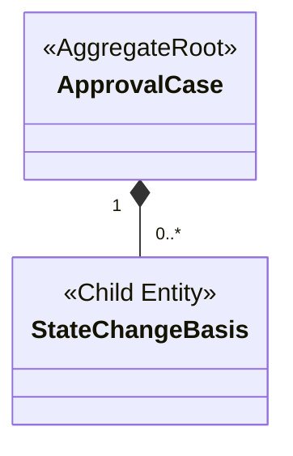

# ENT-IC-11 — StateChangeBasis

## 1. Định vị nghiệp vụ & ranh giới Aggregate

Snapshot bất biến mô tả **exact stock slices, quantity, from/to state, policy, reason/evidence và ảnh hưởng reservation** mà maker yêu cầu và approver duyệt.

| Thuộc tính | Giá trị |
|---|---|
| Vai trò DDD | `CHILD_ENTITY` |
| Aggregate Root | `ApprovalCase` |
| Domain sở hữu | `DOM-IC` |
| Domain không sở hữu | Stock balance/movement → DOM-IO; policy definition → StateTransitionPolicyVersion |

### 1.1 Ranh giới Aggregate (Visual)

## 2. Identity

| Loại | Định danh | Ghi chú |
|---|---|---|
| Surrogate | `stateChangeBasisId` | Ổn định suốt vòng đời hồ sơ |
| Business key | `(operationId, operationLineId, basisHash)` | Dùng để nhận diện cùng một sự thật nghiệp vụ, không dùng version kỹ thuật để tạo bản ghi trùng |

## 3. Thuộc tính nghiệp vụ thuần túy

| Thuộc tính | Ý nghĩa | Bắt buộc | Ghi chú |
|---|---|---:|---|
| `sourceScope` | Exact balance slices/lot/product/warehouse | Có | Không resolve lại tùy ý khi approve |
| `fromState` | Trạng thái nguồn | Có | Phải khớp source |
| `toState` | Trạng thái đích | Có | Policy cho phép |
| `quantityBase` | Số lượng base UOM | Có | >0 |
| `policyVersionRef` | Policy version dùng để xét | Có | Bind policy hash |
| `reasonSnapshot` | Lý do nghiệp vụ | Theo policy | Bất biến |
| `evidenceSnapshot` | Bằng chứng đã nộp | Theo policy | Bất biến |
| `businessDate` | Ngày nghiệp vụ | Có | Dùng expiry/rule |
| `expiryFacts` | Fact HSD nếu liên quan | Theo sản phẩm | Snapshot |
| `reservationImpact` | Ảnh hưởng lượng giữ/ATP | Có khi relevant | Preview trước quyết định |
| `basisHash` | Hash toàn basis | Có | Approval/executor phải bind |

## 4. Hành vi nghiệp vụ cốt lõi

| Hành vi | Điều kiện / Invariant | Hệ quả / Domain Event |
|---|---|---|
| `freeze()` | Source/policy/evidence current và hợp lệ | StateChangeBasisFrozen |

## 5. Vòng đời & chuyển dịch trạng thái

Thực thể không có lifecycle mutable riêng sau khi được ghi nhận. Bản ghi đã commit là bất biến; thay đổi nghiệp vụ tạo fact/version/adjustment mới.

## 6. Domain Events phát sinh

| Event | Khi nào | Ý nghĩa |
|---|---|---|
| `StateChangeBasisFrozen` | freeze() | Basis sẵn sàng bind vào request/approval |

## 7. Liên kết truy vết

| Loại | ID |
|---|---|
| Domain Foundation | `DOM-IC` |
| Behavioral Contract | `BC-IC-09`, `BC-IO-14` |
| Use Case | `UC-09-01`, `UC-09-02`, `UC-09-04` |
| Quyết định | `T7-DR-184` |
