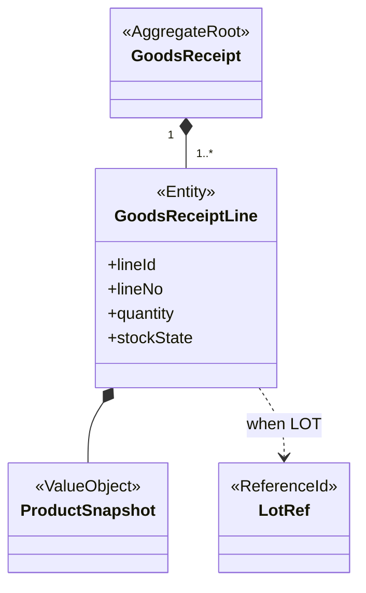

# ENT-IO-02 — GoodsReceiptLine

## 1. Định vị nghiệp vụ & ranh giới Aggregate

Dòng hàng thuộc lệnh nhận `GoodsReceipt`: sản phẩm, số lượng, UOM, trạng thái vật lý đích và tham chiếu lô khi tracking = LOT.

| Thuộc tính | Giá trị |
|---|---|
| Vai trò DDD | `CHILD_ENTITY` |
| Aggregate Root | `GoodsReceipt` (`ENT-IO-01`) |
| Domain sở hữu | `DOM-IO` |
| Domain không sở hữu | Product/UOM master → Catalog; giá vốn → `DOM-IV` |

### 1.1 Ranh giới Aggregate (Visual)

## 2. Identity

| Loại | Định danh | Ghi chú |
|---|---|---|
| Surrogate | `lineId` | Ổn định trong aggregate |
| Business key | `(receiptId, lineNo)` | `lineNo > 0` |

## 3. Thuộc tính nghiệp vụ thuần túy

| Thuộc tính | Ý nghĩa | Bắt buộc | Ghi chú |
|---|---|---:|---|
| `lineId` | Định danh dòng | Có | Surrogate |
| `lineNo` | Thứ tự dòng | Có | > 0 |
| `receiptItemRef` | Nhóm mục hàng UI/nghiệp vụ | Theo loại nhận | Nhiều technical line cùng item (đa lô) |
| `productId` | Sản phẩm nhận | Có | Qua ProductSnapshot |
| `transactionQuantity` | Số lượng giao dịch | Có | > 0 |
| `transactionUom` | Đơn vị giao dịch | Có | Cùng UOM trong một `receiptItemRef` |
| `baseQuantity` | Số lượng quy đổi base | Có | Tái hiện từ ratio snapshot |
| `stockState` | Trạng thái vật lý đích | Có | SELLABLE / QUARANTINE / … |
| `lotId` | Lô sản xuất | Khi LOT | NONE → null; LOT bắt buộc khi ghi vật lý |
| `sourceLineId` | Dòng chứng từ nguồn | Khi có source | Version nguồn kèm theo |

## 4. Hành vi nghiệp vụ cốt lõi

Hành vi mutate dòng **đi qua Root** `GoodsReceipt.addOrUpdateLine` / complete — Child không tự commit movement.

| Hành vi (qua Root) | Điều kiện / Invariant | Hệ quả |
|---|---|---|
| Thêm/sửa dòng | Aggregate `DRAFT`; qty > 0; lot/policy hợp lệ | Cập nhật line |
| Khóa cùng submit | Sau submit Root | Line bất biến cùng payload |
| Materialize movement | Root `completePhysicalReceipt` | Mỗi line → movement `VALUATION_PENDING` |

## 5. Vòng đời & chuyển dịch trạng thái

Không có state machine riêng — theo lifecycle của `GoodsReceipt`.

## 6. Domain Events phát sinh

Không phát event riêng; gói trong event của Root (`GoodsReceiptCompleted`, …).

## 7. Liên kết truy vết

| Loại | ID |
|---|---|
| Domain Foundation | `DOM-IO` |
| Aggregate Root | `ENT-IO-01` |
| Behavioral Contract | `BC-IO-02`, `BC-IO-16` |
| Quyết định | G02 (lot/UOM), G03 (nhận hàng) |
