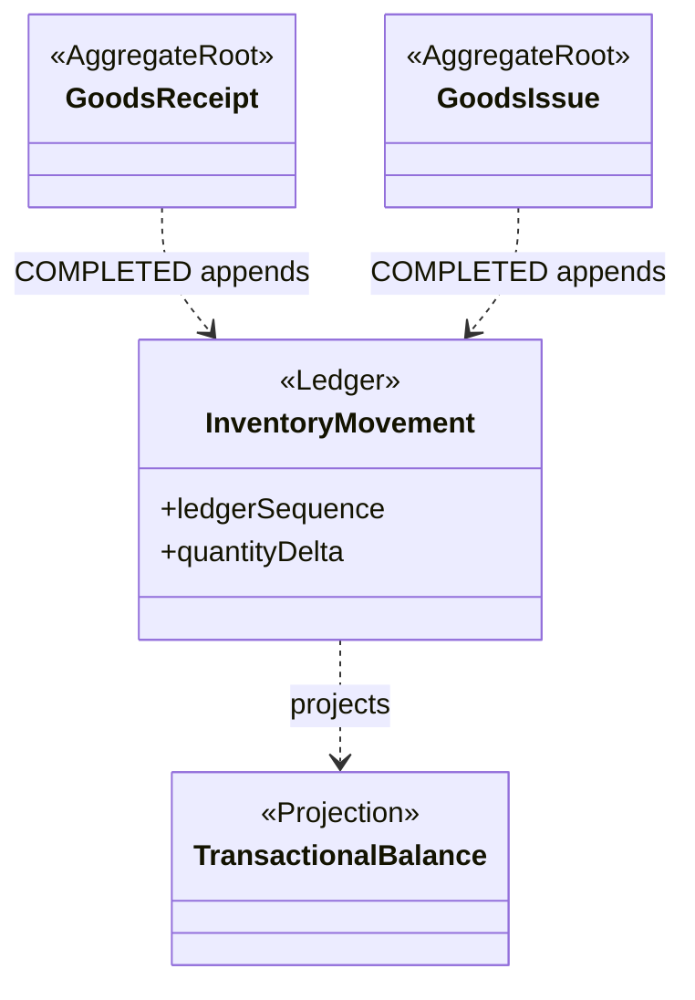

# ENT-IO-03 — InventoryMovement

## 1. Định vị nghiệp vụ & ranh giới Aggregate

Bút toán **sổ cái số lượng/trạng thái** append-only. Nguồn sự thật để rebuild `TransactionalBalance`. Không phải Aggregate Root và không có lifecycle mutable.

| Thuộc tính | Giá trị |
|---|---|
| Vai trò DDD | `LEDGER` |
| Aggregate Root | Không — sinh ra khi Intent Aggregate `COMPLETED` |
| Domain sở hữu | `DOM-IO` |
| Domain không sở hữu | Value movement → `DOM-IV` |

### 1.1 Ranh giới Aggregate (Visual)

## 2. Identity

| Loại | Định danh | Ghi chú |
|---|---|---|
| Surrogate | `movementId` | Bất biến |
| Ordering key | `ledgerSequence` | Monotonic trong phạm vi tenant |

## 3. Thuộc tính nghiệp vụ thuần túy

| Thuộc tính | Ý nghĩa | Bắt buộc | Ghi chú |
|---|---|---:|---|
| `movementId` | Định danh bút toán | Có | |
| `ledgerSequence` | Thứ tự sổ | Có | Rebuild balance |
| `intentRef` | Aggregate intent nguồn | Có | GoodsReceipt / GoodsIssue / StockDisposal / … |
| `intentLineRef` | Dòng intent | Có | |
| `productId` | Sản phẩm | Có | |
| `warehouseScope` | Kho | Có | |
| `lotId` | Lô | Khi LOT | |
| `movementKind` | Phiếu nhận hàng / issue / state / adjust… | Có | |
| `fromState` / `toState` | Chuyển trạng thái vật lý | Khi state transfer | |
| `quantityDelta` | Biến động số lượng | Có | ≠ 0 |
| `valuationStateSnapshot` | Trục định giá tại thời điểm | Khi cần chứng minh | STATE_TRANSFER không đổi valuation axis |
| `businessDate` | Ngày nghiệp vụ | Có | |

## 4. Hành vi nghiệp vụ cốt lõi

| Hành vi | Điều kiện / Invariant | Hệ quả / Domain Event |
|---|---|---|
| Append (qua Intent COMPLETED) | Intent all-or-nothing; qty ≠ 0 | Bản ghi bất biến; `InventoryMovementAppended` |
| — | Hệ thống **KHÔNG ĐƯỢC** UPDATE/DELETE | Sửa sai → `CorrectionChain` + bút toán mới |

## 5. Vòng đời & chuyển dịch trạng thái

Không có state machine — sinh ra là bất biến.

## 6. Domain Events phát sinh

| Event | Khi nào | Ý nghĩa |
|---|---|---|
| `InventoryMovementAppended` | Intent commit | Ledger đã có fact số lượng |

## 7. Liên kết truy vết

| Loại | ID |
|---|---|
| Domain Foundation | `DOM-IO` |
| Projection | `PRJ-IO-01` |
| Quyết định | `T7-DR-084`, INV-IO-02/04 |
